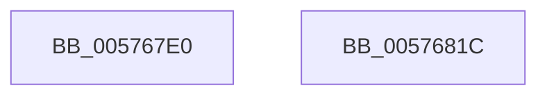

# XmMoveImmediate

- RVA: `0x005767E0`–`0x0057681D` (길이 `61` bytes)
- VA: `0x00000001405767E0`
- 실행 섹션: `.text`
- PDB 이름 있음: `예`; PDB Function 태그: `아니요`
- unwind 정보 RVA: `0x0005CF00`
- 디코드: `18`개 명령, `61/61` bytes 표시
- 미해석 바이트: `0` (있으면 어셈블리에 `.byte`로 보존)

> 이 문서는 커널 이미지의 기계어와 PDB 기호를 분석해 생성했습니다. 4번과 5번은 함수 원형과 자료형을 바이너리 사용 방식에서 추정한 C 해석이며 원본 소스 복구 결과는 아닙니다.

## 1. Dependencies

- 직접 호출 지점: **3**; 고유 호출 대상: **3**
- 직접 호출자로 확인된 함수: **0**
- RIP 상대 이미지 참조: **0**

### Outgoing calls
- `0x005767EE` → [XmSetDataType](../47/XmSetDataType_function_004734C0.md) (function, `0x004734C0`)
- `0x005767FB` → [XmEvaluateAddressSpecifier](../47/XmEvaluateAddressSpecifier_function_00473224.md) (function, `0x00473224`)
- `0x00576809` → [XmGetImmediateSourceValue](../47/XmGetImmediateSourceValue_function_0047340C.md) (function, `0x0047340C`)

### Direct callers
- 이 함수 시작 RVA로 연결되는 직접 call은 확인되지 않았습니다. 간접 호출은 완전히 역산할 수 없습니다.

### Static image references
- 디코드된 RIP-relative 메모리 참조가 없습니다.

## 2. Other-region calls and transfers

- 다른 실행 섹션으로 향하는 call: **0**
- 별도 외부 분기/꼬리 이동을 확인하지 못했습니다.

## 3. Assembly (complete function range)

```asm
005767E0  40 53                           push rbx
005767E2  48 83 EC 20                     sub rsp, 0x20
005767E6  83 64 24 30 00                  and dword ptr [rsp + 0x30], 0
005767EB  48 8B D9                        mov rbx, rcx
005767EE  E8 CD CC EF FF                  call 0x1404734c0
005767F3  48 8D 54 24 30                  lea rdx, [rsp + 0x30]
005767F8  48 8B CB                        mov rcx, rbx
005767FB  E8 24 CA EF FF                  call 0x140473224
00576800  33 D2                           xor edx, edx
00576802  48 89 43 58                     mov qword ptr [rbx + 0x58], rax
00576806  48 8B CB                        mov rcx, rbx
00576809  E8 FE CB EF FF                  call 0x14047340c
0057680E  89 43 6C                        mov dword ptr [rbx + 0x6c], eax
00576811  B8 01 00 00 00                  mov eax, 1
00576816  48 83 C4 20                     add rsp, 0x20
0057681A  5B                              pop rbx
0057681B  C3                              ret
0057681C  CC                              int3
```

## 4. C-style interpretation (structured pseudocode)

```c
__int64 __fastcall XmMoveImmediate(__int64 a1)
{
    __int64 result;
    __int64 v_rsp;
    unsigned int v_stack_p8;

    v_rsp = (v_rsp) - (32);
    result = XmSetDataType(a1, a2, a3, a4);
    result = XmEvaluateAddressSpecifier(a1, v_stack_p8, a3, a4);
    a2 = 0;
    *(unsigned __int64 *)(a1 + 88) = result;
    result = XmGetImmediateSourceValue(a1, a2, a3, a4);
    *(unsigned int *)(a1 + 108) = (unsigned int)(result);
    v_rsp = (v_rsp) + (32);
    return 1;
}
```

## 5. (Beta) C Style

```c
int64_t XmMoveImmediate(void *Arg1)
{
    uint8_t *arg1 = (uint8_t *)Arg1;

    int64_t result;
    int64_t local_rsp;
    uint32_t v_stack_p8;

    local_rsp = (local_rsp) - (32);
    result = XmSetDataType(Arg1, a2, a3, a4);
    result = XmEvaluateAddressSpecifier(Arg1, v_stack_p8, a3, a4);
    a2 = 0;
    *(uint64_t *)(arg1 + 0x58) = result;
    result = XmGetImmediateSourceValue(Arg1, a2, a3, a4);
    *(uint32_t *)(arg1 + 0x6C) = (uint32_t)(result);
    local_rsp = (local_rsp) + (32);
    return 1;
}
```

### 관측된 메모리 오프셋

구조체 형식이 확인되지 않은 접근은 인자 기준의 오프셋으로만 기록했습니다.

| 기준 인자 | 오프셋 표현 | 폭 (bit) | 접근 |
|---|---:|---:|---|
| `Arg1` | `+ 0x58` | `64` | `W` |
| `Arg1` | `+ 0x6C` | `32` | `W` |

## 6. Execution-region graph

[열기: 2D/3D 그래프와 함수 탐색 컨트롤 패널](../../../control-panel.html?section=text&rva=0x005767E0&view=graph)

- 2D 그래프는 위에서 아래로 흐르고, 3D 그래프는 빈 공간을 드래그해 회전합니다. Shift+드래그는 이동, 휠은 확대·축소, 함수 노드 선택은 대상 보고서 이동입니다.

### Static fallback


