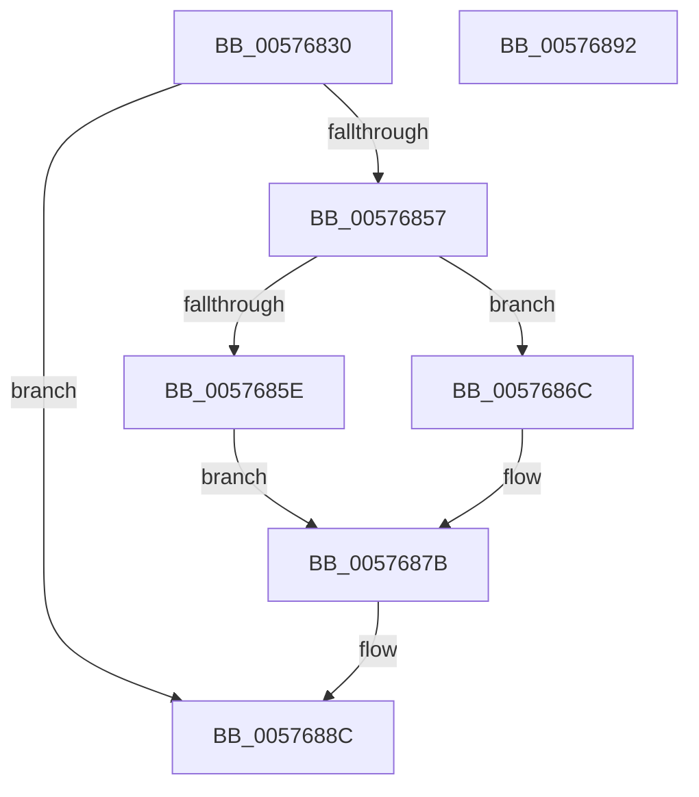

# XmMoveSegment

- RVA: `0x00576830`–`0x00576893` (길이 `99` bytes)
- VA: `0x0000000140576830`
- 실행 섹션: `.text`
- PDB 이름 있음: `예`; PDB Function 태그: `아니요`
- unwind 정보 RVA: `0x0005CF00`
- 디코드: `29`개 명령, `99/99` bytes 표시
- 미해석 바이트: `0` (있으면 어셈블리에 `.byte`로 보존)

> 이 문서는 커널 이미지의 기계어와 PDB 기호를 분석해 생성했습니다. 4번과 5번은 함수 원형과 자료형을 바이너리 사용 방식에서 추정한 C 해석이며 원본 소스 복구 결과는 아닙니다.

## 1. Dependencies

- 직접 호출 지점: **2**; 고유 호출 대상: **2**
- 직접 호출자로 확인된 함수: **0**
- RIP 상대 이미지 참조: **0**

### Outgoing calls
- `0x0057684A` → [XmEvaluateAddressSpecifier](../47/XmEvaluateAddressSpecifier_function_00473224.md) (function, `0x00473224`)
- `0x00576882` → [XmSetSourceValue](../47/XmSetSourceValue_function_004737A8.md) (function, `0x004737A8`)

### Direct callers
- 이 함수 시작 RVA로 연결되는 직접 call은 확인되지 않았습니다. 간접 호출은 완전히 역산할 수 없습니다.

### Static image references
- 디코드된 RIP-relative 메모리 참조가 없습니다.

## 2. Other-region calls and transfers

- 다른 실행 섹션으로 향하는 call: **0**
- 별도 외부 분기/꼬리 이동을 확인하지 못했습니다.

## 3. Assembly (complete function range)

```asm
00576830  40 53                           push rbx
00576832  48 83 EC 20                     sub rsp, 0x20
00576836  83 64 24 30 00                  and dword ptr [rsp + 0x30], 0
0057683B  48 8D 54 24 30                  lea rdx, [rsp + 0x30]
00576840  48 8B D9                        mov rbx, rcx
00576843  C7 41 78 01 00 00 00            mov dword ptr [rcx + 0x78], 1
0057684A  E8 D5 C9 EF FF                  call 0x140473224
0057684F  48 8B C8                        mov rcx, rax
00576852  48 85 C0                        test rax, rax
00576855  74 35                           je 0x14057688c
00576857  8B 43 70                        mov eax, dword ptr [rbx + 0x70]
0057685A  A8 02                           test al, 2
0057685C  75 0E                           jne 0x14057686c
0057685E  8B 54 24 30                     mov edx, dword ptr [rsp + 0x30]
00576862  48 83 C2 1C                     add rdx, 0x1c
00576866  48 8D 14 53                     lea rdx, [rbx + rdx*2]
0057686A  EB 0F                           jmp 0x14057687b
0057686C  48 8B D1                        mov rdx, rcx
0057686F  8B 4C 24 30                     mov ecx, dword ptr [rsp + 0x30]
00576873  48 83 C1 1C                     add rcx, 0x1c
00576877  48 8D 0C 4B                     lea rcx, [rbx + rcx*2]
0057687B  48 89 4B 58                     mov qword ptr [rbx + 0x58], rcx
0057687F  48 8B CB                        mov rcx, rbx
00576882  E8 21 CF EF FF                  call 0x1404737a8
00576887  B8 01 00 00 00                  mov eax, 1
0057688C  48 83 C4 20                     add rsp, 0x20
00576890  5B                              pop rbx
00576891  C3                              ret
00576892  CC                              int3
```

## 4. C-style interpretation (structured pseudocode)

```c
__int64 __fastcall XmMoveSegment(__int64 a1)
{
    __int64 result;
    __int64 v_rsp;
    unsigned int v_stack_p8;

    v_rsp = (v_rsp) - (32);
    *(unsigned int *)(a1 + 120) = 1;
    result = XmEvaluateAddressSpecifier(a1, v_stack_p8, a3, a4);
    if (result == 0) goto loc_0057688C;
    if ((((unsigned __int8)((unsigned int)(*(unsigned int *)(a1 + 112)))) & (2)) != 0) goto loc_0057686C;
    a2 = ((unsigned int)(v_stack_p8)) + (28);
    goto loc_0057687B;
loc_0057686C:
    a1 = ((unsigned int)(v_stack_p8)) + (28);
loc_0057687B:
    *(unsigned __int64 *)(a1 + 88) = a1 + a1 * 2;
    result = XmSetSourceValue(a1, result, a3, a4);
loc_0057688C:
    v_rsp = (v_rsp) + (32);
    return 1;
}
```

## 5. (Beta) C Style

```c
int64_t XmMoveSegment(void *Arg1)
{
    uint8_t *arg1 = (uint8_t *)Arg1;

    int64_t result;
    int64_t local_rsp;
    uint32_t v_stack_p8;

    local_rsp = (local_rsp) - (32);
    *(uint32_t *)(arg1 + 0x78) = 1;
    result = XmEvaluateAddressSpecifier(Arg1, v_stack_p8, a3, a4);
    if (result == 0) goto loc_0057688C;
    if ((((uint8_t)((uint32_t)(*(uint32_t *)(arg1 + 0x70)))) & (2)) != 0) goto loc_0057686C;
    a2 = ((uint32_t)(v_stack_p8)) + (28);
    goto loc_0057687B;
loc_0057686C:
    Arg1 = ((uint32_t)(v_stack_p8)) + (28);
loc_0057687B:
    *(void **)(arg1 + 0x58) = Arg1 + Arg1 * 2;
    result = XmSetSourceValue(Arg1, result, a3, a4);
loc_0057688C:
    local_rsp = (local_rsp) + (32);
    return 1;
}
```

### 관측된 메모리 오프셋

구조체 형식이 확인되지 않은 접근은 인자 기준의 오프셋으로만 기록했습니다.

| 기준 인자 | 오프셋 표현 | 폭 (bit) | 접근 |
|---|---:|---:|---|
| `Arg1` | `+ 0x0 + rcx*2` | `64` | `R` |
| `Arg1` | `+ 0x0 + rdx*2` | `64` | `R` |
| `Arg1` | `+ 0x58` | `64` | `W` |
| `Arg1` | `+ 0x70` | `32` | `R` |
| `Arg1` | `+ 0x78` | `32` | `W` |

## 6. Execution-region graph

[열기: 2D/3D 그래프와 함수 탐색 컨트롤 패널](../../../control-panel.html?section=text&rva=0x00576830&view=graph)

- 2D 그래프는 위에서 아래로 흐르고, 3D 그래프는 빈 공간을 드래그해 회전합니다. Shift+드래그는 이동, 휠은 확대·축소, 함수 노드 선택은 대상 보고서 이동입니다.

### Static fallback


