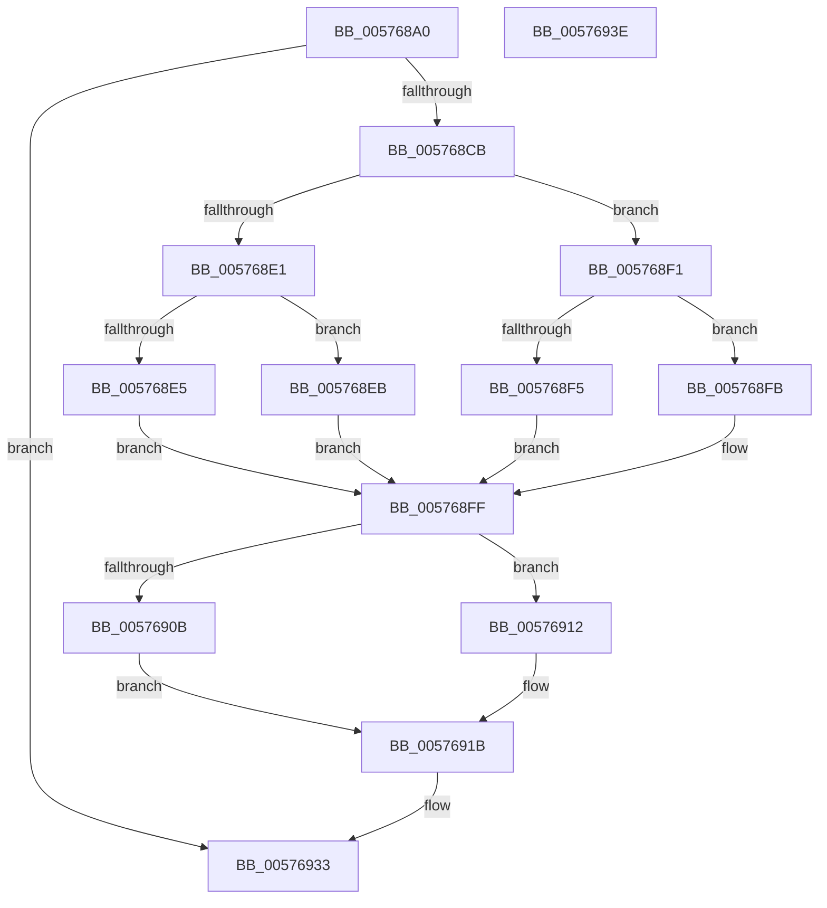

# XmMoveXxGeneral

- RVA: `0x005768A0`–`0x0057693F` (길이 `159` bytes)
- VA: `0x00000001405768A0`
- 실행 섹션: `.text`
- PDB 이름 있음: `예`; PDB Function 태그: `아니요`
- unwind 정보 RVA: `0x00068D5C`
- 디코드: `49`개 명령, `159/159` bytes 표시
- 미해석 바이트: `0` (있으면 어셈블리에 `.byte`로 보존)

> 이 문서는 커널 이미지의 기계어와 PDB 기호를 분석해 생성했습니다. 4번과 5번은 함수 원형과 자료형을 바이너리 사용 방식에서 추정한 C 해석이며 원본 소스 복구 결과는 아닙니다.

## 1. Dependencies

- 직접 호출 지점: **2**; 고유 호출 대상: **2**
- 직접 호출자로 확인된 함수: **0**
- RIP 상대 이미지 참조: **0**

### Outgoing calls
- `0x005768C1` → [XmEvaluateAddressSpecifier](../47/XmEvaluateAddressSpecifier_function_00473224.md) (function, `0x00473224`)
- `0x005768D1` → [XmSetSourceValue](../47/XmSetSourceValue_function_004737A8.md) (function, `0x004737A8`)

### Direct callers
- 이 함수 시작 RVA로 연결되는 직접 call은 확인되지 않았습니다. 간접 호출은 완전히 역산할 수 없습니다.

### Static image references
- 디코드된 RIP-relative 메모리 참조가 없습니다.

## 2. Other-region calls and transfers

- 다른 실행 섹션으로 향하는 call: **0**
- 별도 외부 분기/꼬리 이동을 확인하지 못했습니다.

## 3. Assembly (complete function range)

```asm
005768A0  48 89 5C 24 10                  mov qword ptr [rsp + 0x10], rbx
005768A5  57                              push rdi
005768A6  48 83 EC 20                     sub rsp, 0x20
005768AA  8B 41 70                        mov eax, dword ptr [rcx + 0x70]
005768AD  48 8D 54 24 30                  lea rdx, [rsp + 0x30]
005768B2  83 E0 01                        and eax, 1
005768B5  33 FF                           xor edi, edi
005768B7  89 7C 24 30                     mov dword ptr [rsp + 0x30], edi
005768BB  48 8B D9                        mov rbx, rcx
005768BE  89 41 78                        mov dword ptr [rcx + 0x78], eax
005768C1  E8 5E C9 EF FF                  call 0x140473224
005768C6  48 85 C0                        test rax, rax
005768C9  74 68                           je 0x140576933
005768CB  48 8B D0                        mov rdx, rax
005768CE  48 8B CB                        mov rcx, rbx
005768D1  E8 D2 CE EF FF                  call 0x1404737a8
005768D6  8B 43 70                        mov eax, dword ptr [rbx + 0x70]
005768D9  83 E0 08                        and eax, 8
005768DC  39 7B 78                        cmp dword ptr [rbx + 0x78], edi
005768DF  75 10                           jne 0x1405768f1
005768E1  85 C0                           test eax, eax
005768E3  75 06                           jne 0x1405768eb
005768E5  0F B6 43 6C                     movzx eax, byte ptr [rbx + 0x6c]
005768E9  EB 14                           jmp 0x1405768ff
005768EB  0F BE 43 6C                     movsx eax, byte ptr [rbx + 0x6c]
005768EF  EB 0E                           jmp 0x1405768ff
005768F1  85 C0                           test eax, eax
005768F3  75 06                           jne 0x1405768fb
005768F5  0F B7 43 6C                     movzx eax, word ptr [rbx + 0x6c]
005768F9  EB 04                           jmp 0x1405768ff
005768FB  0F BF 43 6C                     movsx eax, word ptr [rbx + 0x6c]
005768FF  89 43 6C                        mov dword ptr [rbx + 0x6c], eax
00576902  40 38 BB 8A 00 00 00            cmp byte ptr [rbx + 0x8a], dil
00576909  74 07                           je 0x140576912
0057690B  B8 03 00 00 00                  mov eax, 3
00576910  EB 09                           jmp 0x14057691b
00576912  66 89 7B 6E                     mov word ptr [rbx + 0x6e], di
00576916  B8 01 00 00 00                  mov eax, 1
0057691B  89 43 78                        mov dword ptr [rbx + 0x78], eax
0057691E  B8 01 00 00 00                  mov eax, 1
00576923  8B 54 24 30                     mov edx, dword ptr [rsp + 0x30]
00576927  48 83 C2 06                     add rdx, 6
0057692B  48 8D 14 93                     lea rdx, [rbx + rdx*4]
0057692F  48 89 53 58                     mov qword ptr [rbx + 0x58], rdx
00576933  48 8B 5C 24 38                  mov rbx, qword ptr [rsp + 0x38]
00576938  48 83 C4 20                     add rsp, 0x20
0057693C  5F                              pop rdi
0057693D  C3                              ret
0057693E  CC                              int3
```

## 4. C-style interpretation (structured pseudocode)

```c
__int64 __fastcall XmMoveXxGeneral(__int64 a1)
{
    __int64 result;
    __int64 v_rdi;
    __int64 v_rsp;
    unsigned __int64 v_stack_p10;
    unsigned __int64 v_stack_p8;

    v_stack_p10 = v_rbx;
    v_rsp = (v_rsp) - (32);
    result = (unsigned int)(((unsigned int)(*(unsigned int *)(a1 + 112))) & (1));
    v_rdi = 0;
    v_stack_p8 = 0;
    *(unsigned int *)(a1 + 120) = (unsigned int)(result);
    result = XmEvaluateAddressSpecifier(a1, v_stack_p8, a3, a4);
    if (result == 0) goto loc_00576933;
    result = XmSetSourceValue(a1, result, a3, a4);
    result = (unsigned int)(((unsigned int)(*(unsigned int *)(a1 + 112))) & (8));
    if ((*(unsigned int *)(a1 + 120)) != 0) goto loc_005768F1;
    if ((unsigned int)(result) != 0) goto loc_005768EB;
    goto loc_005768FF;
loc_005768EB:
    goto loc_005768FF;
loc_005768F1:
    if ((unsigned int)((__int8)(*(unsigned __int8 *)(a1 + 108))) != 0) goto loc_005768FB;
    goto loc_005768FF;
loc_005768FB:
loc_005768FF:
    *(unsigned int *)(a1 + 108) = (unsigned int)((__int16)(*(unsigned __int16 *)(a1 + 108)));
    if ((*(unsigned __int8 *)(a1 + 138)) == 0) goto loc_00576912;
    goto loc_0057691B;
loc_00576912:
    *(unsigned __int16 *)(a1 + 110) = 0;
loc_0057691B:
    *(unsigned int *)(a1 + 120) = 1;
    a2 = ((unsigned int)(v_stack_p8)) + (6);
    *(unsigned __int64 *)(a1 + 88) = a1 + a2 * 4;
loc_00576933:
    v_rsp = (v_rsp) + (32);
    return 1;
}
```

## 5. (Beta) C Style

```c
int64_t XmMoveXxGeneral(void *Arg1)
{
    uint8_t *arg1 = (uint8_t *)Arg1;

    int64_t result;
    int64_t local_rdi;
    int64_t local_rsp;
    uint64_t v_stack_p10;
    uint64_t v_stack_p8;

    v_stack_p10 = local_rbx;
    local_rsp = (local_rsp) - (32);
    result = (uint32_t)(((uint32_t)(*(uint32_t *)(arg1 + 0x70))) & (1));
    local_rdi = 0;
    v_stack_p8 = 0;
    *(uint32_t *)(arg1 + 0x78) = (uint32_t)(result);
    result = XmEvaluateAddressSpecifier(Arg1, v_stack_p8, a3, a4);
    if (result == 0) goto loc_00576933;
    result = XmSetSourceValue(Arg1, result, a3, a4);
    result = (uint32_t)(((uint32_t)(*(uint32_t *)(arg1 + 0x70))) & (8));
    if ((*(uint32_t *)(arg1 + 0x78)) != 0) goto loc_005768F1;
    if ((uint32_t)(result) != 0) goto loc_005768EB;
    goto loc_005768FF;
loc_005768EB:
    goto loc_005768FF;
loc_005768F1:
    if ((uint32_t)((int8_t)(*(uint8_t *)(arg1 + 0x6C))) != 0) goto loc_005768FB;
    goto loc_005768FF;
loc_005768FB:
loc_005768FF:
    *(uint32_t *)(arg1 + 0x6C) = (uint32_t)((int16_t)(*(uint16_t *)(arg1 + 0x6C)));
    if ((*(uint8_t *)(arg1 + 0x8A)) == 0) goto loc_00576912;
    goto loc_0057691B;
loc_00576912:
    *(uint16_t *)(arg1 + 0x6E) = 0;
loc_0057691B:
    *(uint32_t *)(arg1 + 0x78) = 1;
    a2 = ((uint32_t)(v_stack_p8)) + (6);
    *(void **)(arg1 + 0x58) = Arg1 + a2 * 4;
loc_00576933:
    local_rsp = (local_rsp) + (32);
    return 1;
}
```

### 관측된 메모리 오프셋

구조체 형식이 확인되지 않은 접근은 인자 기준의 오프셋으로만 기록했습니다.

| 기준 인자 | 오프셋 표현 | 폭 (bit) | 접근 |
|---|---:|---:|---|
| `Arg1` | `+ 0x0 + rdx*4` | `64` | `R` |
| `Arg1` | `+ 0x58` | `64` | `W` |
| `Arg1` | `+ 0x6C` | `8` | `R` |
| `Arg1` | `+ 0x6C` | `16` | `R` |
| `Arg1` | `+ 0x6C` | `32` | `W` |
| `Arg1` | `+ 0x6E` | `16` | `W` |
| `Arg1` | `+ 0x70` | `32` | `R` |
| `Arg1` | `+ 0x78` | `32` | `R` |
| `Arg1` | `+ 0x78` | `32` | `W` |
| `Arg1` | `+ 0x8A` | `8` | `R` |

## 6. Execution-region graph

[열기: 2D/3D 그래프와 함수 탐색 컨트롤 패널](../../../control-panel.html?section=text&rva=0x005768A0&view=graph)

- 2D 그래프는 위에서 아래로 흐르고, 3D 그래프는 빈 공간을 드래그해 회전합니다. Shift+드래그는 이동, 휠은 확대·축소, 함수 노드 선택은 대상 보고서 이동입니다.

### Static fallback


