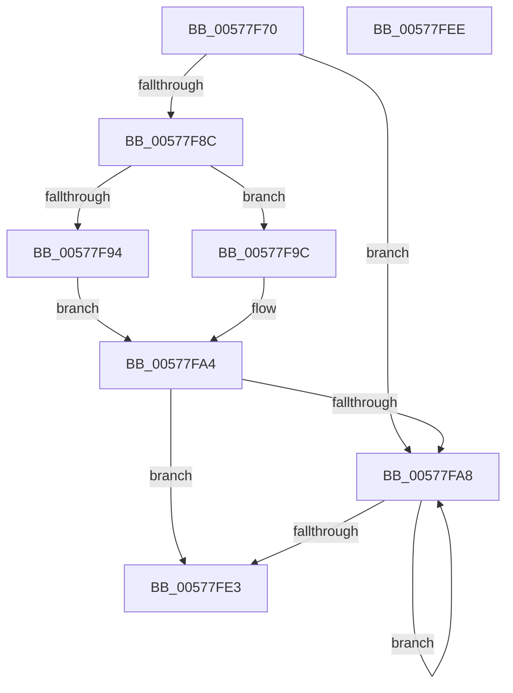

# XmMovsOp

- RVA: `0x00577F70`–`0x00577FEF` (길이 `127` bytes)
- VA: `0x0000000140577F70`
- 실행 섹션: `.text`
- PDB 이름 있음: `예`; PDB Function 태그: `아니요`
- unwind 정보 RVA: `0x0005CAAC`
- 디코드: `38`개 명령, `127/127` bytes 표시
- 미해석 바이트: `0` (있으면 어셈블리에 `.byte`로 보존)

> 이 문서는 커널 이미지의 기계어와 PDB 기호를 분석해 생성했습니다. 4번과 5번은 함수 원형과 자료형을 바이너리 사용 방식에서 추정한 C 해석이며 원본 소스 복구 결과는 아닙니다.

## 1. Dependencies

- 직접 호출 지점: **4**; 고유 호출 대상: **3**
- 직접 호출자로 확인된 함수: **0**
- RIP 상대 이미지 참조: **0**

### Outgoing calls
- `0x00577FB4` → [XmGetStringAddress](XmGetStringAddress_function_00578BCC.md) (function, `0x00578BCC`)
- `0x00577FBF` → [XmSetSourceValue](../47/XmSetSourceValue_function_004737A8.md) (function, `0x004737A8`)
- `0x00577FCA` → [XmGetStringAddress](XmGetStringAddress_function_00578BCC.md) (function, `0x00578BCC`)
- `0x00577FD9` → [XmStoreResult](../47/XmStoreResult_function_004739FC.md) (function, `0x004739FC`)

### Direct callers
- 이 함수 시작 RVA로 연결되는 직접 call은 확인되지 않았습니다. 간접 호출은 완전히 역산할 수 없습니다.

### Static image references
- 디코드된 RIP-relative 메모리 참조가 없습니다.

## 2. Other-region calls and transfers

- 다른 실행 섹션으로 향하는 call: **0**
- 별도 외부 분기/꼬리 이동을 확인하지 못했습니다.

## 3. Assembly (complete function range)

```asm
00577F70  48 89 5C 24 08                  mov qword ptr [rsp + 8], rbx
00577F75  57                              push rdi
00577F76  48 83 EC 20                     sub rsp, 0x20
00577F7A  33 C0                           xor eax, eax
00577F7C  48 8B D9                        mov rbx, rcx
00577F7F  BF 01 00 00 00                  mov edi, 1
00577F84  38 81 8B 00 00 00               cmp byte ptr [rcx + 0x8b], al
00577F8A  74 1C                           je 0x140577fa8
00577F8C  38 81 89 00 00 00               cmp byte ptr [rcx + 0x89], al
00577F92  74 08                           je 0x140577f9c
00577F94  8B 79 1C                        mov edi, dword ptr [rcx + 0x1c]
00577F97  89 41 1C                        mov dword ptr [rcx + 0x1c], eax
00577F9A  EB 08                           jmp 0x140577fa4
00577F9C  0F B7 79 1C                     movzx edi, word ptr [rcx + 0x1c]
00577FA0  66 89 41 1C                     mov word ptr [rcx + 0x1c], ax
00577FA4  85 FF                           test edi, edi
00577FA6  74 3B                           je 0x140577fe3
00577FA8  8B 53 74                        mov edx, dword ptr [rbx + 0x74]
00577FAB  41 B8 06 00 00 00               mov r8d, 6
00577FB1  48 8B CB                        mov rcx, rbx
00577FB4  E8 13 0C 00 00                  call 0x140578bcc
00577FB9  48 8B D0                        mov rdx, rax
00577FBC  48 8B CB                        mov rcx, rbx
00577FBF  E8 E4 B7 EF FF                  call 0x1404737a8
00577FC4  33 D2                           xor edx, edx
00577FC6  44 8D 42 07                     lea r8d, [rdx + 7]
00577FCA  E8 FD 0B 00 00                  call 0x140578bcc
00577FCF  8B 53 6C                        mov edx, dword ptr [rbx + 0x6c]
00577FD2  48 8B CB                        mov rcx, rbx
00577FD5  48 89 43 58                     mov qword ptr [rbx + 0x58], rax
00577FD9  E8 1E BA EF FF                  call 0x1404739fc
00577FDE  83 C7 FF                        add edi, -1
00577FE1  75 C5                           jne 0x140577fa8
00577FE3  48 8B 5C 24 30                  mov rbx, qword ptr [rsp + 0x30]
00577FE8  48 83 C4 20                     add rsp, 0x20
00577FEC  5F                              pop rdi
00577FED  C3                              ret
00577FEE  CC                              int3
```

## 4. C-style interpretation (structured pseudocode)

```c
__int64 __fastcall XmMovsOp(__int64 a1)
{
    __int64 result;
    __int64 v_rdi;
    __int64 v_rsp;
    unsigned __int64 v_stack_p8;

    v_stack_p8 = v_rbx;
    v_rsp = (v_rsp) - (32);
    result = 0;
    if ((*(unsigned __int8 *)(a1 + 139)) == 0) goto loc_00577FA8;
    if ((*(unsigned __int8 *)(a1 + 137)) == 0) goto loc_00577F9C;
    *(unsigned int *)(a1 + 28) = 0;
    goto loc_00577FA4;
loc_00577F9C:
    *(unsigned __int16 *)(a1 + 28) = 0;
loc_00577FA4:
    if ((unsigned int)(*(unsigned __int16 *)(a1 + 28)) == 0) goto loc_00577FE3;
loc_00577FA8:
    result = XmGetStringAddress(a1, (unsigned int)(*(unsigned int *)(a1 + 116)), 6, a4);
    result = XmSetSourceValue(a1, result, 6, a4);
    a2 = 0;
    result = XmGetStringAddress(a1, a2, a2 + 7, a4);
    *(unsigned __int64 *)(a1 + 88) = result;
    result = XmStoreResult(a1, (unsigned int)(*(unsigned int *)(a1 + 108)), a2 + 7, a4);
    v_rdi = (unsigned int)((*(unsigned __int16 *)(a1 + 28)) + (-1));
    if (condition_is_not_equal) goto loc_00577FA8;
loc_00577FE3:
    v_rsp = (v_rsp) + (32);
    return result;
}
```

## 5. (Beta) C Style

```c
int64_t XmMovsOp(void *Arg1)
{
    uint8_t *arg1 = (uint8_t *)Arg1;

    int64_t result;
    int64_t local_rdi;
    int64_t local_rsp;
    uint64_t v_stack_p8;

    v_stack_p8 = local_rbx;
    local_rsp = (local_rsp) - (32);
    result = 0;
    if ((*(uint8_t *)(arg1 + 0x8B)) == 0) goto loc_00577FA8;
    if ((*(uint8_t *)(arg1 + 0x89)) == 0) goto loc_00577F9C;
    *(uint32_t *)(arg1 + 0x1C) = 0;
    goto loc_00577FA4;
loc_00577F9C:
    *(uint16_t *)(arg1 + 0x1C) = 0;
loc_00577FA4:
    if ((uint32_t)(*(uint16_t *)(arg1 + 0x1C)) == 0) goto loc_00577FE3;
loc_00577FA8:
    result = XmGetStringAddress(Arg1, (uint32_t)(*(uint32_t *)(arg1 + 0x74)), 6, a4);
    result = XmSetSourceValue(Arg1, result, 6, a4);
    a2 = 0;
    result = XmGetStringAddress(Arg1, a2, a2 + 7, a4);
    *(uint64_t *)(arg1 + 0x58) = result;
    result = XmStoreResult(Arg1, (uint32_t)(*(uint32_t *)(arg1 + 0x6C)), a2 + 7, a4);
    local_rdi = (uint32_t)((*(uint16_t *)(arg1 + 0x1C)) + (-1));
    if (condition_is_not_equal) goto loc_00577FA8;
loc_00577FE3:
    local_rsp = (local_rsp) + (32);
    return result;
}
```

### 관측된 메모리 오프셋

구조체 형식이 확인되지 않은 접근은 인자 기준의 오프셋으로만 기록했습니다.

| 기준 인자 | 오프셋 표현 | 폭 (bit) | 접근 |
|---|---:|---:|---|
| `Arg1` | `+ 0x1C` | `16` | `R` |
| `Arg1` | `+ 0x1C` | `16` | `W` |
| `Arg1` | `+ 0x1C` | `32` | `R` |
| `Arg1` | `+ 0x1C` | `32` | `W` |
| `Arg1` | `+ 0x58` | `64` | `W` |
| `Arg1` | `+ 0x6C` | `32` | `R` |
| `Arg1` | `+ 0x74` | `32` | `R` |
| `Arg1` | `+ 0x89` | `8` | `R` |
| `Arg1` | `+ 0x8B` | `8` | `R` |

## 6. Execution-region graph

[열기: 2D/3D 그래프와 함수 탐색 컨트롤 패널](../../../control-panel.html?section=text&rva=0x00577F70&view=graph)

- 2D 그래프는 위에서 아래로 흐르고, 3D 그래프는 빈 공간을 드래그해 회전합니다. Shift+드래그는 이동, 휠은 확대·축소, 함수 노드 선택은 대상 보고서 이동입니다.

### Static fallback


