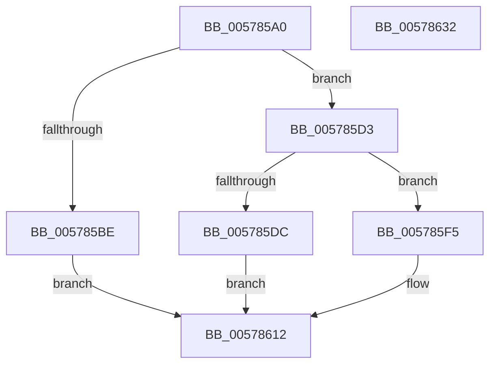

# XmMulOp

- RVA: `0x005785A0`–`0x00578633` (길이 `147` bytes)
- VA: `0x00000001405785A0`
- 실행 섹션: `.text`
- PDB 이름 있음: `예`; PDB Function 태그: `아니요`
- unwind 정보 RVA: `0x0005C788`
- 디코드: `42`개 명령, `147/147` bytes 표시
- 미해석 바이트: `0` (있으면 어셈블리에 `.byte`로 보존)

> 이 문서는 커널 이미지의 기계어와 PDB 기호를 분석해 생성했습니다. 4번과 5번은 함수 원형과 자료형을 바이너리 사용 방식에서 추정한 C 해석이며 원본 소스 복구 결과는 아닙니다.

## 1. Dependencies

- 직접 호출 지점: **5**; 고유 호출 대상: **1**
- 직접 호출자로 확인된 함수: **0**
- RIP 상대 이미지 참조: **0**

### Outgoing calls
- `0x005785C8` → [XmStoreResult](../47/XmStoreResult_function_004739FC.md) (function, `0x004739FC`)
- `0x005785DF` → [XmStoreResult](../47/XmStoreResult_function_004739FC.md) (function, `0x004739FC`)
- `0x005785EC` → [XmStoreResult](../47/XmStoreResult_function_004739FC.md) (function, `0x004739FC`)
- `0x005785F9` → [XmStoreResult](../47/XmStoreResult_function_004739FC.md) (function, `0x004739FC`)
- `0x00578609` → [XmStoreResult](../47/XmStoreResult_function_004739FC.md) (function, `0x004739FC`)

### Direct callers
- 이 함수 시작 RVA로 연결되는 직접 call은 확인되지 않았습니다. 간접 호출은 완전히 역산할 수 없습니다.

### Static image references
- 디코드된 RIP-relative 메모리 참조가 없습니다.

## 2. Other-region calls and transfers

- 다른 실행 섹션으로 향하는 call: **0**
- 별도 외부 분기/꼬리 이동을 확인하지 못했습니다.

## 3. Assembly (complete function range)

```asm
005785A0  48 83 EC 28                     sub rsp, 0x28
005785A4  8B 41 68                        mov eax, dword ptr [rcx + 0x68]
005785A7  45 33 D2                        xor r10d, r10d
005785AA  44 8B 49 6C                     mov r9d, dword ptr [rcx + 0x6c]
005785AE  4C 0F AF C8                     imul r9, rax
005785B2  8B 41 78                        mov eax, dword ptr [rcx + 0x78]
005785B5  4C 89 4C 24 30                  mov qword ptr [rsp + 0x30], r9
005785BA  85 C0                           test eax, eax
005785BC  75 15                           jne 0x1405785d3
005785BE  41 8B D1                        mov edx, r9d
005785C1  C7 41 78 01 00 00 00            mov dword ptr [rcx + 0x78], 1
005785C8  E8 2F B4 EF FF                  call 0x1404739fc
005785CD  44 38 51 19                     cmp byte ptr [rcx + 0x19], r10b
005785D1  EB 3F                           jmp 0x140578612
005785D3  4C 8D 59 20                     lea r11, [rcx + 0x20]
005785D7  83 F8 03                        cmp eax, 3
005785DA  75 19                           jne 0x1405785f5
005785DC  41 8B D1                        mov edx, r9d
005785DF  E8 18 B4 EF FF                  call 0x1404739fc
005785E4  8B 54 24 34                     mov edx, dword ptr [rsp + 0x34]
005785E8  4C 89 59 58                     mov qword ptr [rcx + 0x58], r11
005785EC  E8 0B B4 EF FF                  call 0x1404739fc
005785F1  85 D2                           test edx, edx
005785F3  EB 1D                           jmp 0x140578612
005785F5  41 0F B7 D1                     movzx edx, r9w
005785F9  E8 FE B3 EF FF                  call 0x1404739fc
005785FE  41 C1 E9 10                     shr r9d, 0x10
00578602  41 8B D1                        mov edx, r9d
00578605  4C 89 59 58                     mov qword ptr [rcx + 0x58], r11
00578609  E8 EE B3 EF FF                  call 0x1404739fc
0057860E  66 45 39 13                     cmp word ptr [r11], r10w
00578612  8B 41 10                        mov eax, dword ptr [rcx + 0x10]
00578615  41 0F 95 C2                     setne r10b
00578619  83 E0 FE                        and eax, 0xfffffffe
0057861C  41 0B C2                        or eax, r10d
0057861F  41 C1 E2 0B                     shl r10d, 0xb
00578623  0F BA F0 0B                     btr eax, 0xb
00578627  41 0B C2                        or eax, r10d
0057862A  89 41 10                        mov dword ptr [rcx + 0x10], eax
0057862D  48 83 C4 28                     add rsp, 0x28
00578631  C3                              ret
00578632  CC                              int3
```

## 4. C-style interpretation (structured pseudocode)

```c
__int64 __fastcall XmMulOp(__int64 a1)
{
    __int64 result;
    __int64 v_r10;
    __int64 v_rsp;
    unsigned __int64 v_stack_p8;
    unsigned int v_stack_pC;

    v_rsp = (v_rsp) - (40);
    v_r10 = 0;
    a4 = ((unsigned int)(*(unsigned int *)(a1 + 108))) * ((unsigned int)(*(unsigned int *)(a1 + 104)));
    v_stack_p8 = a4;
    if ((unsigned int)((unsigned int)(*(unsigned int *)(a1 + 120))) != 0) goto loc_005785D3;
    *(unsigned int *)(a1 + 120) = 1;
    result = XmStoreResult(a1, (unsigned int)((unsigned int)(a4)), a3, a4);
    goto loc_00578612;
loc_005785D3:
    if (((unsigned int)(result)) != 3) goto loc_005785F5;
    result = XmStoreResult(a1, (unsigned int)((unsigned int)(a4)), a3, a4);
    *(unsigned __int64 *)(a1 + 88) = a1 + 32;
    result = XmStoreResult(a1, (unsigned int)(v_stack_pC), a3, a4);
    goto loc_00578612;
loc_005785F5:
    result = XmStoreResult(a1, (unsigned __int16)(a4), a3, a4);
    a4 = (unsigned int)((a4) >> (16));
    *(unsigned __int64 *)(a1 + 88) = a1 + 32;
    result = XmStoreResult(a1, (unsigned int)((unsigned int)(a4)), a3, a4);
loc_00578612:
    v_r10 = ((*(unsigned __int16 *)(a1 + 32)) != 0) ? 1 : 0;
    result = (unsigned int)(((unsigned int)(*(unsigned int *)(a1 + 16))) & (0xFFFFFFFEULL));
    result = (unsigned int)((result) | ((unsigned int)(v_r10)));
    v_r10 = (unsigned int)((v_r10) << (11));
    result = (unsigned int)((result) | ((unsigned int)(v_r10)));
    *(unsigned int *)(a1 + 16) = (unsigned int)(result);
    v_rsp = (v_rsp) + (40);
    return result;
}
```

## 5. (Beta) C Style

```c
int64_t XmMulOp(void *Arg1)
{
    uint8_t *arg1 = (uint8_t *)Arg1;

    int64_t result;
    int64_t local_r10;
    int64_t local_rsp;
    uint64_t v_stack_p8;
    uint32_t v_stack_pC;

    local_rsp = (local_rsp) - (40);
    local_r10 = 0;
    a4 = ((uint32_t)(*(uint32_t *)(arg1 + 0x6C))) * ((uint32_t)(*(uint32_t *)(arg1 + 0x68)));
    v_stack_p8 = a4;
    if ((uint32_t)((uint32_t)(*(uint32_t *)(arg1 + 0x78))) != 0) goto loc_005785D3;
    *(uint32_t *)(arg1 + 0x78) = 1;
    result = XmStoreResult(Arg1, (uint32_t)((uint32_t)(a4)), a3, a4);
    goto loc_00578612;
loc_005785D3:
    if (((uint32_t)(result)) != 3) goto loc_005785F5;
    result = XmStoreResult(Arg1, (uint32_t)((uint32_t)(a4)), a3, a4);
    *(void **)(arg1 + 0x58) = Arg1 + 32;
    result = XmStoreResult(Arg1, (uint32_t)(v_stack_pC), a3, a4);
    goto loc_00578612;
loc_005785F5:
    result = XmStoreResult(Arg1, (uint16_t)(a4), a3, a4);
    a4 = (uint32_t)((a4) >> (16));
    *(void **)(arg1 + 0x58) = Arg1 + 32;
    result = XmStoreResult(Arg1, (uint32_t)((uint32_t)(a4)), a3, a4);
loc_00578612:
    local_r10 = ((*(uint16_t *)(arg1 + 0x20)) != 0) ? 1 : 0;
    result = (uint32_t)(((uint32_t)(*(uint32_t *)(arg1 + 0x10))) & (0xFFFFFFFEULL));
    result = (uint32_t)((result) | ((uint32_t)(local_r10)));
    local_r10 = (uint32_t)((local_r10) << (11));
    result = (uint32_t)((result) | ((uint32_t)(local_r10)));
    *(uint32_t *)(arg1 + 0x10) = (uint32_t)(result);
    local_rsp = (local_rsp) + (40);
    return result;
}
```

### 관측된 메모리 오프셋

구조체 형식이 확인되지 않은 접근은 인자 기준의 오프셋으로만 기록했습니다.

| 기준 인자 | 오프셋 표현 | 폭 (bit) | 접근 |
|---|---:|---:|---|
| `Arg1` | `+ 0x20` | `64` | `R` |
| `Arg1` | `+ 0x68` | `32` | `R` |
| `Arg1` | `+ 0x6C` | `32` | `R` |
| `Arg1` | `+ 0x78` | `32` | `R` |
| `Arg1` | `+ 0x78` | `32` | `W` |

## 6. Execution-region graph

[열기: 2D/3D 그래프와 함수 탐색 컨트롤 패널](../../../control-panel.html?section=text&rva=0x005785A0&view=graph)

- 2D 그래프는 위에서 아래로 흐르고, 3D 그래프는 빈 공간을 드래그해 회전합니다. Shift+드래그는 이동, 휠은 확대·축소, 함수 노드 선택은 대상 보고서 이동입니다.

### Static fallback


