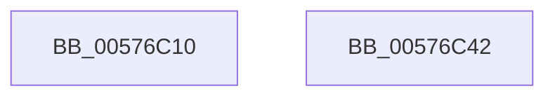

# XmNotOp

- RVA: `0x00576C10`–`0x00576C43` (길이 `51` bytes)
- VA: `0x0000000140576C10`
- 실행 섹션: `.text`
- PDB 이름 있음: `예`; PDB Function 태그: `아니요`
- unwind 정보 RVA: `0x0005C788`
- 디코드: `16`개 명령, `51/51` bytes 표시
- 미해석 바이트: `0` (있으면 어셈블리에 `.byte`로 보존)

> 이 문서는 커널 이미지의 기계어와 PDB 기호를 분석해 생성했습니다. 4번과 5번은 함수 원형과 자료형을 바이너리 사용 방식에서 추정한 C 해석이며 원본 소스 복구 결과는 아닙니다.

## 1. Dependencies

- 직접 호출 지점: **1**; 고유 호출 대상: **1**
- 직접 호출자로 확인된 함수: **0**
- RIP 상대 이미지 참조: **0**

### Outgoing calls
- `0x00576C38` → [XmStoreResult](../47/XmStoreResult_function_004739FC.md) (function, `0x004739FC`)

### Direct callers
- 이 함수 시작 RVA로 연결되는 직접 call은 확인되지 않았습니다. 간접 호출은 완전히 역산할 수 없습니다.

### Static image references
- 디코드된 RIP-relative 메모리 참조가 없습니다.

## 2. Other-region calls and transfers

- 다른 실행 섹션으로 향하는 call: **0**
- 별도 외부 분기/꼬리 이동을 확인하지 못했습니다.

## 3. Assembly (complete function range)

```asm
00576C10  48 83 EC 28                     sub rsp, 0x28
00576C14  8B 41 78                        mov eax, dword ptr [rcx + 0x78]
00576C17  4C 8B C1                        mov r8, rcx
00576C1A  BA 01 00 00 00                  mov edx, 1
00576C1F  8D 0C C5 07 00 00 00            lea ecx, [rax*8 + 7]
00576C26  41 8B 40 68                     mov eax, dword ptr [r8 + 0x68]
00576C2A  D3 E2                           shl edx, cl
00576C2C  F7 D0                           not eax
00576C2E  FF CA                           dec edx
00576C30  0F AB CA                        bts edx, ecx
00576C33  49 8B C8                        mov rcx, r8
00576C36  23 D0                           and edx, eax
00576C38  E8 BF CD EF FF                  call 0x1404739fc
00576C3D  48 83 C4 28                     add rsp, 0x28
00576C41  C3                              ret
00576C42  CC                              int3
```

## 4. C-style interpretation (structured pseudocode)

```c
__int64 __fastcall XmNotOp(__int64 a1)
{
    __int64 result;
    __int64 v_rsp;

    v_rsp = (v_rsp) - (40);
    a2 = (unsigned int)((1) << ((unsigned __int8)((unsigned int)(*(unsigned int *)(a1 + 120)) * 8 + 7)));
    result = (unsigned int)(~((unsigned int)(*(unsigned int *)(a1 + 104))));
    a2 = (unsigned int)((a2) - 1);
    a2 = (unsigned int)((a2) & ((unsigned int)(result)));
    result = XmStoreResult(a1, a2, a1, a4);
    v_rsp = (v_rsp) + (40);
    return result;
}
```

## 5. (Beta) C Style

```c
int64_t XmNotOp(void *Arg1)
{
    uint8_t *arg1 = (uint8_t *)Arg1;

    int64_t result;
    int64_t local_rsp;

    local_rsp = (local_rsp) - (40);
    a2 = (uint32_t)((1) << ((uint8_t)((uint32_t)(*(uint32_t *)(arg1 + 0x78)) * 8 + 7)));
    result = (uint32_t)(~((uint32_t)(*(uint32_t *)(arg1 + 0x68))));
    a2 = (uint32_t)((a2) - 1);
    a2 = (uint32_t)((a2) & ((uint32_t)(result)));
    result = XmStoreResult(Arg1, a2, Arg1, a4);
    local_rsp = (local_rsp) + (40);
    return result;
}
```

### 관측된 메모리 오프셋

구조체 형식이 확인되지 않은 접근은 인자 기준의 오프셋으로만 기록했습니다.

| 기준 인자 | 오프셋 표현 | 폭 (bit) | 접근 |
|---|---:|---:|---|
| `Arg1` | `+ 0x68` | `32` | `R` |
| `Arg1` | `+ 0x78` | `32` | `R` |

## 6. Execution-region graph

[열기: 2D/3D 그래프와 함수 탐색 컨트롤 패널](../../../control-panel.html?section=text&rva=0x00576C10&view=graph)

- 2D 그래프는 위에서 아래로 흐르고, 3D 그래프는 빈 공간을 드래그해 회전합니다. Shift+드래그는 이동, 휠은 확대·축소, 함수 노드 선택은 대상 보고서 이동입니다.

### Static fallback


