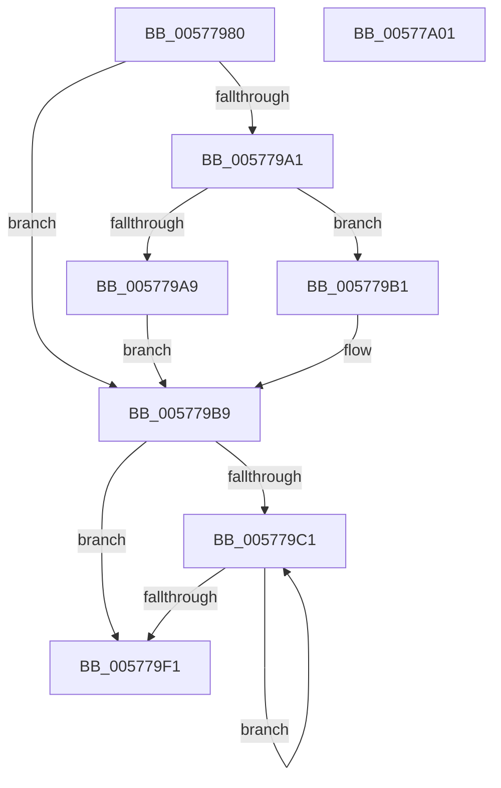

# XmOutsOp

- RVA: `0x00577980`–`0x00577A02` (길이 `130` bytes)
- VA: `0x0000000140577980`
- 실행 섹션: `.text`
- PDB 이름 있음: `예`; PDB Function 태그: `아니요`
- unwind 정보 RVA: `0x00060BC4`
- 디코드: `38`개 명령, `130/130` bytes 표시
- 미해석 바이트: `0` (있으면 어셈블리에 `.byte`로 보존)

> 이 문서는 커널 이미지의 기계어와 PDB 기호를 분석해 생성했습니다. 4번과 5번은 함수 원형과 자료형을 바이너리 사용 방식에서 추정한 C 해석이며 원본 소스 복구 결과는 아닙니다.

## 1. Dependencies

- 직접 호출 지점: **3**; 고유 호출 대상: **3**
- 직접 호출자로 확인된 함수: **0**
- RIP 상대 이미지 참조: **0**

### Outgoing calls
- `0x005779CD` → [XmGetStringAddress](XmGetStringAddress_function_00578BCC.md) (function, `0x00578BCC`)
- `0x005779D8` → [XmSetSourceValue](../47/XmSetSourceValue_function_004737A8.md) (function, `0x004737A8`)
- `0x005779E7` → [x86BiosWriteIoSpace](../47/x86BiosWriteIoSpace_function_00472E00.md) (function, `0x00472E00`)

### Direct callers
- 이 함수 시작 RVA로 연결되는 직접 call은 확인되지 않았습니다. 간접 호출은 완전히 역산할 수 없습니다.

### Static image references
- 디코드된 RIP-relative 메모리 참조가 없습니다.

## 2. Other-region calls and transfers

- 다른 실행 섹션으로 향하는 call: **0**
- 별도 외부 분기/꼬리 이동을 확인하지 못했습니다.

## 3. Assembly (complete function range)

```asm
00577980  48 89 5C 24 08                  mov qword ptr [rsp + 8], rbx
00577985  48 89 74 24 10                  mov qword ptr [rsp + 0x10], rsi
0057798A  57                              push rdi
0057798B  48 83 EC 20                     sub rsp, 0x20
0057798F  33 C0                           xor eax, eax
00577991  48 8B D9                        mov rbx, rcx
00577994  BF 01 00 00 00                  mov edi, 1
00577999  38 81 8B 00 00 00               cmp byte ptr [rcx + 0x8b], al
0057799F  74 18                           je 0x1405779b9
005779A1  38 81 89 00 00 00               cmp byte ptr [rcx + 0x89], al
005779A7  74 08                           je 0x1405779b1
005779A9  8B 79 1C                        mov edi, dword ptr [rcx + 0x1c]
005779AC  89 41 1C                        mov dword ptr [rcx + 0x1c], eax
005779AF  EB 08                           jmp 0x1405779b9
005779B1  0F B7 79 1C                     movzx edi, word ptr [rcx + 0x1c]
005779B5  66 89 41 1C                     mov word ptr [rcx + 0x1c], ax
005779B9  0F B7 71 6C                     movzx esi, word ptr [rcx + 0x6c]
005779BD  85 FF                           test edi, edi
005779BF  74 30                           je 0x1405779f1
005779C1  8B 53 74                        mov edx, dword ptr [rbx + 0x74]
005779C4  41 B8 06 00 00 00               mov r8d, 6
005779CA  48 8B CB                        mov rcx, rbx
005779CD  E8 FA 11 00 00                  call 0x140578bcc
005779D2  48 8B D0                        mov rdx, rax
005779D5  48 8B CB                        mov rcx, rbx
005779D8  E8 CB BD EF FF                  call 0x1404737a8
005779DD  44 8B 43 6C                     mov r8d, dword ptr [rbx + 0x6c]
005779E1  0F B7 D6                        movzx edx, si
005779E4  8B 4B 78                        mov ecx, dword ptr [rbx + 0x78]
005779E7  E8 14 B4 EF FF                  call 0x140472e00
005779EC  83 C7 FF                        add edi, -1
005779EF  75 D0                           jne 0x1405779c1
005779F1  48 8B 5C 24 30                  mov rbx, qword ptr [rsp + 0x30]
005779F6  48 8B 74 24 38                  mov rsi, qword ptr [rsp + 0x38]
005779FB  48 83 C4 20                     add rsp, 0x20
005779FF  5F                              pop rdi
00577A00  C3                              ret
00577A01  CC                              int3
```

## 4. C-style interpretation (structured pseudocode)

```c
__int64 __fastcall XmOutsOp(__int64 a1)
{
    __int64 result;
    __int64 v_rdi;
    __int64 v_rsp;
    unsigned __int64 v_stack_p10;
    unsigned __int64 v_stack_p8;

    v_stack_p8 = v_rbx;
    v_stack_p10 = v_rsi;
    v_rsp = (v_rsp) - (32);
    result = 0;
    if ((*(unsigned __int8 *)(a1 + 139)) == 0) goto loc_005779B9;
    if ((*(unsigned __int8 *)(a1 + 137)) == 0) goto loc_005779B1;
    *(unsigned int *)(a1 + 28) = 0;
    goto loc_005779B9;
loc_005779B1:
    *(unsigned __int16 *)(a1 + 28) = 0;
loc_005779B9:
    if ((unsigned int)(*(unsigned __int16 *)(a1 + 28)) == 0) goto loc_005779F1;
loc_005779C1:
    result = XmGetStringAddress(a1, (unsigned int)(*(unsigned int *)(a1 + 116)), 6, a4);
    result = XmSetSourceValue(a1, result, 6, a4);
    result = x86BiosWriteIoSpace((unsigned int)(*(unsigned int *)(a1 + 120)), (unsigned __int16)(*(unsigned __int16 *)(a1 + 108)), (unsigned int)(*(unsigned int *)(a1 + 108)), a4);
    v_rdi = (unsigned int)((*(unsigned __int16 *)(a1 + 28)) + (-1));
    if (condition_is_not_equal) goto loc_005779C1;
loc_005779F1:
    v_rsp = (v_rsp) + (32);
    return result;
}
```

## 5. (Beta) C Style

```c
int64_t XmOutsOp(void *Arg1)
{
    uint8_t *arg1 = (uint8_t *)Arg1;

    int64_t result;
    int64_t local_rdi;
    int64_t local_rsp;
    uint64_t v_stack_p10;
    uint64_t v_stack_p8;

    v_stack_p8 = local_rbx;
    v_stack_p10 = local_rsi;
    local_rsp = (local_rsp) - (32);
    result = 0;
    if ((*(uint8_t *)(arg1 + 0x8B)) == 0) goto loc_005779B9;
    if ((*(uint8_t *)(arg1 + 0x89)) == 0) goto loc_005779B1;
    *(uint32_t *)(arg1 + 0x1C) = 0;
    goto loc_005779B9;
loc_005779B1:
    *(uint16_t *)(arg1 + 0x1C) = 0;
loc_005779B9:
    if ((uint32_t)(*(uint16_t *)(arg1 + 0x1C)) == 0) goto loc_005779F1;
loc_005779C1:
    result = XmGetStringAddress(Arg1, (uint32_t)(*(uint32_t *)(arg1 + 0x74)), 6, a4);
    result = XmSetSourceValue(Arg1, result, 6, a4);
    result = x86BiosWriteIoSpace((uint32_t)(*(uint32_t *)(arg1 + 0x78)), (uint16_t)(*(uint16_t *)(arg1 + 0x6C)), (uint32_t)(*(uint32_t *)(arg1 + 0x6C)), a4);
    local_rdi = (uint32_t)((*(uint16_t *)(arg1 + 0x1C)) + (-1));
    if (condition_is_not_equal) goto loc_005779C1;
loc_005779F1:
    local_rsp = (local_rsp) + (32);
    return result;
}
```

### 관측된 메모리 오프셋

구조체 형식이 확인되지 않은 접근은 인자 기준의 오프셋으로만 기록했습니다.

| 기준 인자 | 오프셋 표현 | 폭 (bit) | 접근 |
|---|---:|---:|---|
| `Arg1` | `+ 0x1C` | `16` | `R` |
| `Arg1` | `+ 0x1C` | `16` | `W` |
| `Arg1` | `+ 0x1C` | `32` | `R` |
| `Arg1` | `+ 0x1C` | `32` | `W` |
| `Arg1` | `+ 0x6C` | `16` | `R` |
| `Arg1` | `+ 0x6C` | `32` | `R` |
| `Arg1` | `+ 0x74` | `32` | `R` |
| `Arg1` | `+ 0x78` | `32` | `R` |
| `Arg1` | `+ 0x89` | `8` | `R` |
| `Arg1` | `+ 0x8B` | `8` | `R` |

## 6. Execution-region graph

[열기: 2D/3D 그래프와 함수 탐색 컨트롤 패널](../../../control-panel.html?section=text&rva=0x00577980&view=graph)

- 2D 그래프는 위에서 아래로 흐르고, 3D 그래프는 빈 공간을 드래그해 회전합니다. Shift+드래그는 이동, 휠은 확대·축소, 함수 노드 선택은 대상 보고서 이동입니다.

### Static fallback


