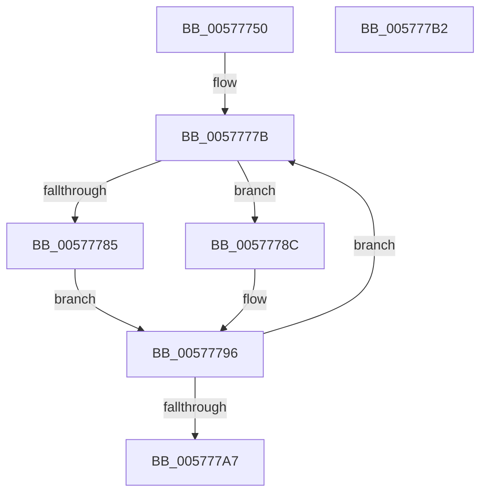

# XmPopaOp

- RVA: `0x00577750`–`0x005777B3` (길이 `99` bytes)
- VA: `0x0000000140577750`
- 실행 섹션: `.text`
- PDB 이름 있음: `예`; PDB Function 태그: `아니요`
- unwind 정보 RVA: `0x00068D5C`
- 디코드: `32`개 명령, `99/99` bytes 표시
- 미해석 바이트: `0` (있으면 어셈블리에 `.byte`로 보존)

> 이 문서는 커널 이미지의 기계어와 PDB 기호를 분석해 생성했습니다. 4번과 5번은 함수 원형과 자료형을 바이너리 사용 방식에서 추정한 C 해석이며 원본 소스 복구 결과는 아닙니다.

## 1. Dependencies

- 직접 호출 지점: **2**; 고유 호출 대상: **2**
- 직접 호출자로 확인된 함수: **0**
- RIP 상대 이미지 참조: **0**

### Outgoing calls
- `0x00577796` → [XmSetDestinationValue](../47/XmSetDestinationValue_function_004734EC.md) (function, `0x004734EC`)
- `0x0057779E` → [XmPopOp](../47/XmPopOp_function_00472560.md) (function, `0x00472560`)

### Direct callers
- 이 함수 시작 RVA로 연결되는 직접 call은 확인되지 않았습니다. 간접 호출은 완전히 역산할 수 없습니다.

### Static image references
- 디코드된 RIP-relative 메모리 참조가 없습니다.

## 2. Other-region calls and transfers

- 다른 실행 섹션으로 향하는 call: **0**
- 별도 외부 분기/꼬리 이동을 확인하지 못했습니다.

## 3. Assembly (complete function range)

```asm
00577750  48 89 5C 24 10                  mov qword ptr [rsp + 0x10], rbx
00577755  57                              push rdi
00577756  48 83 EC 20                     sub rsp, 0x20
0057775A  8A 81 8A 00 00 00               mov al, byte ptr [rcx + 0x8a]
00577760  48 8B D9                        mov rbx, rcx
00577763  F6 D8                           neg al
00577765  BF 08 00 00 00                  mov edi, 8
0057776A  1B D2                           sbb edx, edx
0057776C  83 E2 02                        and edx, 2
0057776F  FF C2                           inc edx
00577771  89 51 78                        mov dword ptr [rcx + 0x78], edx
00577774  8B 41 28                        mov eax, dword ptr [rcx + 0x28]
00577777  89 44 24 30                     mov dword ptr [rsp + 0x30], eax
0057777B  FF CF                           dec edi
0057777D  48 8B CB                        mov rcx, rbx
00577780  83 FF 04                        cmp edi, 4
00577783  75 07                           jne 0x14057778c
00577785  48 8D 54 24 30                  lea rdx, [rsp + 0x30]
0057778A  EB 0A                           jmp 0x140577796
0057778C  8B C7                           mov eax, edi
0057778E  48 83 C0 06                     add rax, 6
00577792  48 8D 14 83                     lea rdx, [rbx + rax*4]
00577796  E8 51 BD EF FF                  call 0x1404734ec
0057779B  48 8B CB                        mov rcx, rbx
0057779E  E8 BD AD EF FF                  call 0x140472560
005777A3  85 FF                           test edi, edi
005777A5  75 D4                           jne 0x14057777b
005777A7  48 8B 5C 24 38                  mov rbx, qword ptr [rsp + 0x38]
005777AC  48 83 C4 20                     add rsp, 0x20
005777B0  5F                              pop rdi
005777B1  C3                              ret
005777B2  CC                              int3
```

## 4. C-style interpretation (structured pseudocode)

```c
__int64 __fastcall XmPopaOp(__int64 a1, int a2)
{
    __int64 result;
    __int64 v_rdi;
    __int64 v_rsp;
    unsigned __int64 v_stack_p10;
    unsigned int v_stack_p8;

    v_stack_p10 = v_rbx;
    v_rsp = (v_rsp) - (32);
    result = (unsigned __int8)(-(*(unsigned __int8 *)(a1 + 138)));
    a2 = (unsigned int)((a2) & (2));
    a2 = (unsigned int)((a2) + 1);
    *(unsigned int *)(a1 + 120) = a2;
    v_stack_p8 = (unsigned int)((unsigned int)(*(unsigned int *)(a1 + 40)));
loc_0057777B:
    v_rdi = (unsigned int)((8) - 1);
    if (((unsigned int)(v_rdi)) != 4) goto loc_0057778C;
    goto loc_00577796;
loc_0057778C:
    result = ((unsigned int)((unsigned int)(v_rdi))) + (6);
loc_00577796:
    result = XmSetDestinationValue(a1, a1 + result * 4, a3, a4);
    result = XmPopOp(a1, a1 + result * 4, a3, a4);
    if ((unsigned int)(v_rdi) != 0) goto loc_0057777B;
    v_rsp = (v_rsp) + (32);
    return result;
}
```

## 5. (Beta) C Style

```c
int64_t XmPopaOp(void *Arg1, int32_t Arg2)
{
    uint8_t *arg1 = (uint8_t *)Arg1;

    int64_t result;
    int64_t local_rdi;
    int64_t local_rsp;
    uint64_t v_stack_p10;
    uint32_t v_stack_p8;

    v_stack_p10 = local_rbx;
    local_rsp = (local_rsp) - (32);
    result = (uint8_t)(-(*(uint8_t *)(arg1 + 0x8A)));
    Arg2 = (uint32_t)((Arg2) & (2));
    Arg2 = (uint32_t)((Arg2) + 1);
    *(uint32_t *)(arg1 + 0x78) = Arg2;
    v_stack_p8 = (uint32_t)((uint32_t)(*(uint32_t *)(arg1 + 0x28)));
loc_0057777B:
    local_rdi = (uint32_t)((8) - 1);
    if (((uint32_t)(local_rdi)) != 4) goto loc_0057778C;
    goto loc_00577796;
loc_0057778C:
    result = ((uint32_t)((uint32_t)(local_rdi))) + (6);
loc_00577796:
    result = XmSetDestinationValue(Arg1, Arg1 + result * 4, a3, a4);
    result = XmPopOp(Arg1, Arg1 + result * 4, a3, a4);
    if ((uint32_t)(local_rdi) != 0) goto loc_0057777B;
    local_rsp = (local_rsp) + (32);
    return result;
}
```

### 관측된 메모리 오프셋

구조체 형식이 확인되지 않은 접근은 인자 기준의 오프셋으로만 기록했습니다.

| 기준 인자 | 오프셋 표현 | 폭 (bit) | 접근 |
|---|---:|---:|---|
| `Arg1` | `+ 0x0 + rax*4` | `64` | `R` |
| `Arg1` | `+ 0x28` | `32` | `R` |
| `Arg1` | `+ 0x78` | `32` | `W` |
| `Arg1` | `+ 0x8A` | `8` | `R` |

## 6. Execution-region graph

[열기: 2D/3D 그래프와 함수 탐색 컨트롤 패널](../../../control-panel.html?section=text&rva=0x00577750&view=graph)

- 2D 그래프는 위에서 아래로 흐르고, 3D 그래프는 빈 공간을 드래그해 회전합니다. Shift+드래그는 이동, 휠은 확대·축소, 함수 노드 선택은 대상 보고서 이동입니다.

### Static fallback


