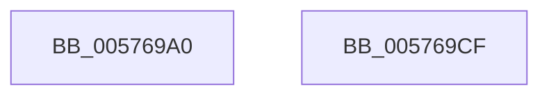

# XmPortImmediate

- RVA: `0x005769A0`–`0x005769D0` (길이 `48` bytes)
- VA: `0x00000001405769A0`
- 실행 섹션: `.text`
- PDB 이름 있음: `예`; PDB Function 태그: `아니요`
- unwind 정보 RVA: `0x0005CF00`
- 디코드: `15`개 명령, `48/48` bytes 표시
- 미해석 바이트: `0` (있으면 어셈블리에 `.byte`로 보존)

> 이 문서는 커널 이미지의 기계어와 PDB 기호를 분석해 생성했습니다. 4번과 5번은 함수 원형과 자료형을 바이너리 사용 방식에서 추정한 C 해석이며 원본 소스 복구 결과는 아닙니다.

## 1. Dependencies

- 직접 호출 지점: **2**; 고유 호출 대상: **2**
- 직접 호출자로 확인된 함수: **0**
- RIP 상대 이미지 참조: **0**

### Outgoing calls
- `0x005769A9` → [XmGetCodeByte](../47/XmGetCodeByte_function_00473678.md) (function, `0x00473678`)
- `0x005769C1` → [XmSetDataType](../47/XmSetDataType_function_004734C0.md) (function, `0x004734C0`)

### Direct callers
- 이 함수 시작 RVA로 연결되는 직접 call은 확인되지 않았습니다. 간접 호출은 완전히 역산할 수 없습니다.

### Static image references
- 디코드된 RIP-relative 메모리 참조가 없습니다.

## 2. Other-region calls and transfers

- 다른 실행 섹션으로 향하는 call: **0**
- 별도 외부 분기/꼬리 이동을 확인하지 못했습니다.

## 3. Assembly (complete function range)

```asm
005769A0  40 53                           push rbx
005769A2  48 83 EC 20                     sub rsp, 0x20
005769A6  48 8B D9                        mov rbx, rcx
005769A9  E8 CA CC EF FF                  call 0x140473678
005769AE  0F B6 D0                        movzx edx, al
005769B1  41 B8 01 00 00 00               mov r8d, 1
005769B7  48 8B CB                        mov rcx, rbx
005769BA  44 89 43 78                     mov dword ptr [rbx + 0x78], r8d
005769BE  89 53 6C                        mov dword ptr [rbx + 0x6c], edx
005769C1  E8 FA CA EF FF                  call 0x1404734c0
005769C6  41 8B C0                        mov eax, r8d
005769C9  48 83 C4 20                     add rsp, 0x20
005769CD  5B                              pop rbx
005769CE  C3                              ret
005769CF  CC                              int3
```

## 4. C-style interpretation (structured pseudocode)

```c
__int64 __fastcall XmPortImmediate(__int64 a1)
{
    __int64 result;
    __int64 v_rsp;

    v_rsp = (v_rsp) - (32);
    result = XmGetCodeByte(a1, a2, a3, a4);
    *(unsigned int *)(a1 + 120) = 1;
    *(unsigned int *)(a1 + 108) = (unsigned int)((unsigned __int8)(result));
    result = XmSetDataType(a1, (unsigned __int8)(result), 1, a4);
    v_rsp = (v_rsp) + (32);
    return 1;
}
```

## 5. (Beta) C Style

```c
int64_t XmPortImmediate(void *Arg1)
{
    uint8_t *arg1 = (uint8_t *)Arg1;

    int64_t result;
    int64_t local_rsp;

    local_rsp = (local_rsp) - (32);
    result = XmGetCodeByte(Arg1, a2, a3, a4);
    *(uint32_t *)(arg1 + 0x78) = 1;
    *(uint32_t *)(arg1 + 0x6C) = (uint32_t)((uint8_t)(result));
    result = XmSetDataType(Arg1, (uint8_t)(result), 1, a4);
    local_rsp = (local_rsp) + (32);
    return 1;
}
```

### 관측된 메모리 오프셋

구조체 형식이 확인되지 않은 접근은 인자 기준의 오프셋으로만 기록했습니다.

| 기준 인자 | 오프셋 표현 | 폭 (bit) | 접근 |
|---|---:|---:|---|
| `Arg1` | `+ 0x6C` | `32` | `W` |
| `Arg1` | `+ 0x78` | `32` | `W` |

## 6. Execution-region graph

[열기: 2D/3D 그래프와 함수 탐색 컨트롤 패널](../../../control-panel.html?section=text&rva=0x005769A0&view=graph)

- 2D 그래프는 위에서 아래로 흐르고, 3D 그래프는 빈 공간을 드래그해 회전합니다. Shift+드래그는 이동, 휠은 확대·축소, 함수 노드 선택은 대상 보고서 이동입니다.

### Static fallback


