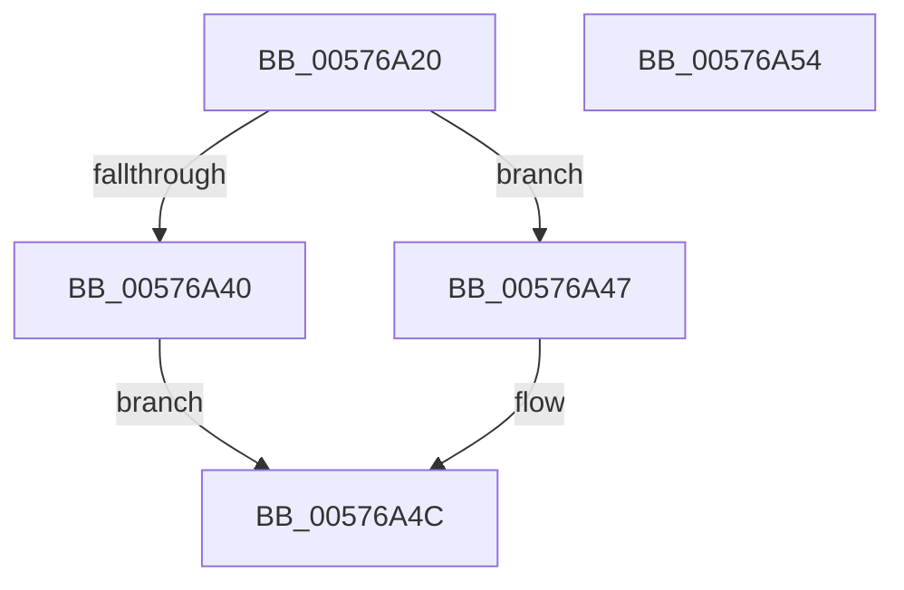

# XmPushPopSegment

- RVA: `0x00576A20`–`0x00576A55` (길이 `53` bytes)
- VA: `0x0000000140576A20`
- 실행 섹션: `.text`
- PDB 이름 있음: `예`; PDB Function 태그: `아니요`
- unwind 정보 RVA: `0x0005C788`
- 디코드: `15`개 명령, `53/53` bytes 표시
- 미해석 바이트: `0` (있으면 어셈블리에 `.byte`로 보존)

> 이 문서는 커널 이미지의 기계어와 PDB 기호를 분석해 생성했습니다. 4번과 5번은 함수 원형과 자료형을 바이너리 사용 방식에서 추정한 C 해석이며 원본 소스 복구 결과는 아닙니다.

## 1. Dependencies

- 직접 호출 지점: **2**; 고유 호출 대상: **2**
- 직접 호출자로 확인된 함수: **0**
- RIP 상대 이미지 참조: **0**

### Outgoing calls
- `0x00576A40` → [XmSetSourceValue](../47/XmSetSourceValue_function_004737A8.md) (function, `0x004737A8`)
- `0x00576A47` → [XmSetDestinationValue](../47/XmSetDestinationValue_function_004734EC.md) (function, `0x004734EC`)

### Direct callers
- 이 함수 시작 RVA로 연결되는 직접 call은 확인되지 않았습니다. 간접 호출은 완전히 역산할 수 없습니다.

### Static image references
- 디코드된 RIP-relative 메모리 참조가 없습니다.

## 2. Other-region calls and transfers

- 다른 실행 섹션으로 향하는 call: **0**
- 별도 외부 분기/꼬리 이동을 확인하지 못했습니다.

## 3. Assembly (complete function range)

```asm
00576A20  48 83 EC 28                     sub rsp, 0x28
00576A24  0F B6 51 51                     movzx edx, byte ptr [rcx + 0x51]
00576A28  41 B8 01 00 00 00               mov r8d, 1
00576A2E  48 83 C2 1C                     add rdx, 0x1c
00576A32  44 89 41 78                     mov dword ptr [rcx + 0x78], r8d
00576A36  83 79 7C 24                     cmp dword ptr [rcx + 0x7c], 0x24
00576A3A  48 8D 14 51                     lea rdx, [rcx + rdx*2]
00576A3E  75 07                           jne 0x140576a47
00576A40  E8 63 CD EF FF                  call 0x1404737a8
00576A45  EB 05                           jmp 0x140576a4c
00576A47  E8 A0 CA EF FF                  call 0x1404734ec
00576A4C  41 8B C0                        mov eax, r8d
00576A4F  48 83 C4 28                     add rsp, 0x28
00576A53  C3                              ret
00576A54  CC                              int3
```

## 4. C-style interpretation (structured pseudocode)

```c
__int64 __fastcall XmPushPopSegment(__int64 a1)
{
    __int64 result;
    __int64 v_rsp;

    v_rsp = (v_rsp) - (40);
    a2 = (*(unsigned __int8 *)(a1 + 81)) + (28);
    *(unsigned int *)(a1 + 120) = 1;
    if ((*(unsigned int *)(a1 + 124)) != 36) goto loc_00576A47;
    result = XmSetSourceValue(a1, a1 + a2 * 2, 1, a4);
    goto loc_00576A4C;
loc_00576A47:
    result = XmSetDestinationValue(a1, a1 + a2 * 2, 1, a4);
loc_00576A4C:
    v_rsp = (v_rsp) + (40);
    return 1;
}
```

## 5. (Beta) C Style

```c
int64_t XmPushPopSegment(void *Arg1)
{
    uint8_t *arg1 = (uint8_t *)Arg1;

    int64_t result;
    int64_t local_rsp;

    local_rsp = (local_rsp) - (40);
    a2 = (*(uint8_t *)(arg1 + 0x51)) + (28);
    *(uint32_t *)(arg1 + 0x78) = 1;
    if ((*(uint32_t *)(arg1 + 0x7C)) != 36) goto loc_00576A47;
    result = XmSetSourceValue(Arg1, Arg1 + a2 * 2, 1, a4);
    goto loc_00576A4C;
loc_00576A47:
    result = XmSetDestinationValue(Arg1, Arg1 + a2 * 2, 1, a4);
loc_00576A4C:
    local_rsp = (local_rsp) + (40);
    return 1;
}
```

### 관측된 메모리 오프셋

구조체 형식이 확인되지 않은 접근은 인자 기준의 오프셋으로만 기록했습니다.

| 기준 인자 | 오프셋 표현 | 폭 (bit) | 접근 |
|---|---:|---:|---|
| `Arg1` | `+ 0x0 + rdx*2` | `64` | `R` |
| `Arg1` | `+ 0x51` | `8` | `R` |
| `Arg1` | `+ 0x78` | `32` | `W` |
| `Arg1` | `+ 0x7C` | `32` | `R` |

## 6. Execution-region graph

[열기: 2D/3D 그래프와 함수 탐색 컨트롤 패널](../../../control-panel.html?section=text&rva=0x00576A20&view=graph)

- 2D 그래프는 위에서 아래로 흐르고, 3D 그래프는 빈 공간을 드래그해 회전합니다. Shift+드래그는 이동, 휠은 확대·축소, 함수 노드 선택은 대상 보고서 이동입니다.

### Static fallback


