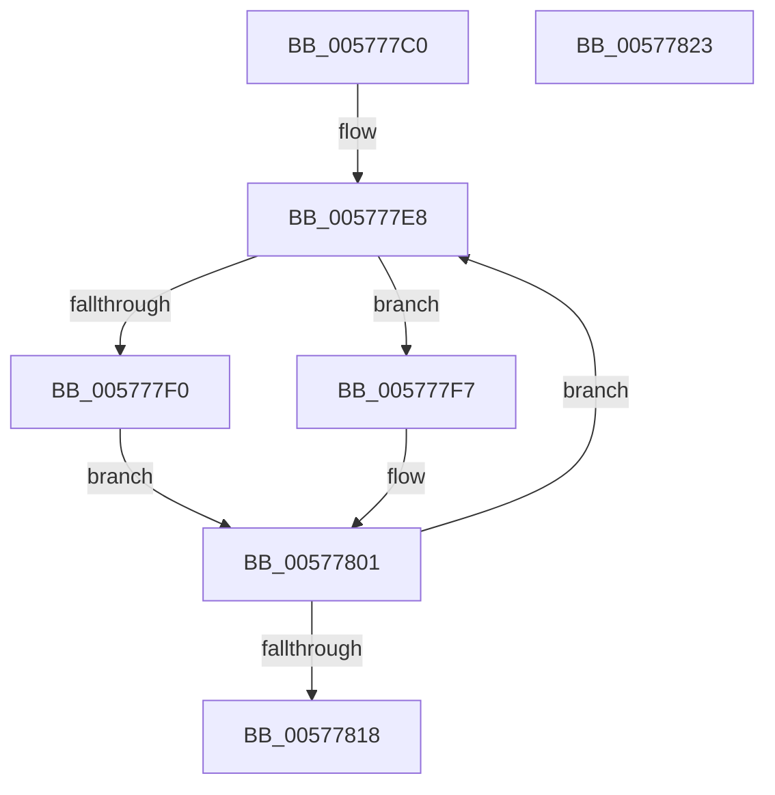

# XmPushaOp

- RVA: `0x005777C0`–`0x00577824` (길이 `100` bytes)
- VA: `0x00000001405777C0`
- 실행 섹션: `.text`
- PDB 이름 있음: `예`; PDB Function 태그: `아니요`
- unwind 정보 RVA: `0x00068D5C`
- 디코드: `33`개 명령, `100/100` bytes 표시
- 미해석 바이트: `0` (있으면 어셈블리에 `.byte`로 보존)

> 이 문서는 커널 이미지의 기계어와 PDB 기호를 분석해 생성했습니다. 4번과 5번은 함수 원형과 자료형을 바이너리 사용 방식에서 추정한 C 해석이며 원본 소스 복구 결과는 아닙니다.

## 1. Dependencies

- 직접 호출 지점: **2**; 고유 호출 대상: **2**
- 직접 호출자로 확인된 함수: **0**
- RIP 상대 이미지 참조: **0**

### Outgoing calls
- `0x00577801` → [XmSetSourceValue](../47/XmSetSourceValue_function_004737A8.md) (function, `0x004737A8`)
- `0x0057780C` → [XmPushStack](../47/XmPushStack_function_00473088.md) (function, `0x00473088`)

### Direct callers
- 이 함수 시작 RVA로 연결되는 직접 call은 확인되지 않았습니다. 간접 호출은 완전히 역산할 수 없습니다.

### Static image references
- 디코드된 RIP-relative 메모리 참조가 없습니다.

## 2. Other-region calls and transfers

- 다른 실행 섹션으로 향하는 call: **0**
- 별도 외부 분기/꼬리 이동을 확인하지 못했습니다.

## 3. Assembly (complete function range)

```asm
005777C0  48 89 5C 24 10                  mov qword ptr [rsp + 0x10], rbx
005777C5  57                              push rdi
005777C6  48 83 EC 20                     sub rsp, 0x20
005777CA  8A 81 8A 00 00 00               mov al, byte ptr [rcx + 0x8a]
005777D0  48 8B D9                        mov rbx, rcx
005777D3  F6 D8                           neg al
005777D5  1B D2                           sbb edx, edx
005777D7  83 E2 02                        and edx, 2
005777DA  FF C2                           inc edx
005777DC  89 51 78                        mov dword ptr [rcx + 0x78], edx
005777DF  33 FF                           xor edi, edi
005777E1  8B 41 28                        mov eax, dword ptr [rcx + 0x28]
005777E4  89 44 24 30                     mov dword ptr [rsp + 0x30], eax
005777E8  48 8B CB                        mov rcx, rbx
005777EB  83 FF 04                        cmp edi, 4
005777EE  75 07                           jne 0x1405777f7
005777F0  48 8D 54 24 30                  lea rdx, [rsp + 0x30]
005777F5  EB 0A                           jmp 0x140577801
005777F7  8B C7                           mov eax, edi
005777F9  48 83 C0 06                     add rax, 6
005777FD  48 8D 14 83                     lea rdx, [rbx + rax*4]
00577801  E8 A2 BF EF FF                  call 0x1404737a8
00577806  8B 53 6C                        mov edx, dword ptr [rbx + 0x6c]
00577809  48 8B CB                        mov rcx, rbx
0057780C  E8 77 B8 EF FF                  call 0x140473088
00577811  FF C7                           inc edi
00577813  83 FF 07                        cmp edi, 7
00577816  76 D0                           jbe 0x1405777e8
00577818  48 8B 5C 24 38                  mov rbx, qword ptr [rsp + 0x38]
0057781D  48 83 C4 20                     add rsp, 0x20
00577821  5F                              pop rdi
00577822  C3                              ret
00577823  CC                              int3
```

## 4. C-style interpretation (structured pseudocode)

```c
__int64 __fastcall XmPushaOp(__int64 a1, int a2)
{
    __int64 result;
    __int64 v_rdi;
    __int64 v_rsp;
    unsigned __int64 v_stack_p10;
    unsigned int v_stack_p8;

    v_stack_p10 = v_rbx;
    v_rsp = (v_rsp) - (32);
    result = (unsigned __int8)(-(*(unsigned __int8 *)(a1 + 138)));
    a2 = (unsigned int)((a2) & (2));
    a2 = (unsigned int)((a2) + 1);
    *(unsigned int *)(a1 + 120) = a2;
    v_rdi = 0;
    v_stack_p8 = (unsigned int)((unsigned int)(*(unsigned int *)(a1 + 40)));
loc_005777E8:
    if (0 != 4) goto loc_005777F7;
    goto loc_00577801;
loc_005777F7:
    result = (0) + (6);
loc_00577801:
    result = XmSetSourceValue(a1, a1 + result * 4, a3, a4);
    result = XmPushStack(a1, (unsigned int)(*(unsigned int *)(a1 + 108)), a3, a4);
    v_rdi = (unsigned int)((v_rdi) + 1);
    if (((unsigned int)(v_rdi)) <= 7) goto loc_005777E8;
    v_rsp = (v_rsp) + (32);
    return result;
}
```

## 5. (Beta) C Style

```c
int64_t XmPushaOp(void *Arg1, int32_t Arg2)
{
    uint8_t *arg1 = (uint8_t *)Arg1;

    int64_t result;
    int64_t local_rdi;
    int64_t local_rsp;
    uint64_t v_stack_p10;
    uint32_t v_stack_p8;

    v_stack_p10 = local_rbx;
    local_rsp = (local_rsp) - (32);
    result = (uint8_t)(-(*(uint8_t *)(arg1 + 0x8A)));
    Arg2 = (uint32_t)((Arg2) & (2));
    Arg2 = (uint32_t)((Arg2) + 1);
    *(uint32_t *)(arg1 + 0x78) = Arg2;
    local_rdi = 0;
    v_stack_p8 = (uint32_t)((uint32_t)(*(uint32_t *)(arg1 + 0x28)));
loc_005777E8:
    if (0 != 4) goto loc_005777F7;
    goto loc_00577801;
loc_005777F7:
    result = (0) + (6);
loc_00577801:
    result = XmSetSourceValue(Arg1, Arg1 + result * 4, a3, a4);
    result = XmPushStack(Arg1, (uint32_t)(*(uint32_t *)(arg1 + 0x6C)), a3, a4);
    local_rdi = (uint32_t)((local_rdi) + 1);
    if (((uint32_t)(local_rdi)) <= 7) goto loc_005777E8;
    local_rsp = (local_rsp) + (32);
    return result;
}
```

### 관측된 메모리 오프셋

구조체 형식이 확인되지 않은 접근은 인자 기준의 오프셋으로만 기록했습니다.

| 기준 인자 | 오프셋 표현 | 폭 (bit) | 접근 |
|---|---:|---:|---|
| `Arg1` | `+ 0x0 + rax*4` | `64` | `R` |
| `Arg1` | `+ 0x28` | `32` | `R` |
| `Arg1` | `+ 0x6C` | `32` | `R` |
| `Arg1` | `+ 0x78` | `32` | `W` |
| `Arg1` | `+ 0x8A` | `8` | `R` |

## 6. Execution-region graph

[열기: 2D/3D 그래프와 함수 탐색 컨트롤 패널](../../../control-panel.html?section=text&rva=0x005777C0&view=graph)

- 2D 그래프는 위에서 아래로 흐르고, 3D 그래프는 빈 공간을 드래그해 회전합니다. Shift+드래그는 이동, 휠은 확대·축소, 함수 노드 선택은 대상 보고서 이동입니다.

### Static fallback


