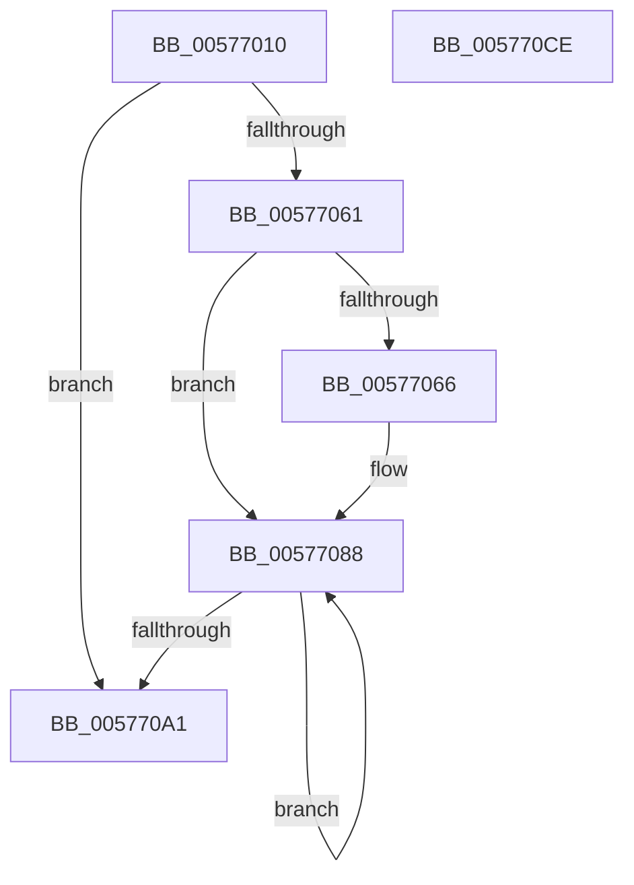

# XmRclOp

- RVA: `0x00577010`–`0x005770CF` (길이 `191` bytes)
- VA: `0x0000000140577010`
- 실행 섹션: `.text`
- PDB 이름 있음: `예`; PDB Function 태그: `아니요`
- unwind 정보 RVA: `0x00060BC4`
- 디코드: `63`개 명령, `191/191` bytes 표시
- 미해석 바이트: `0` (있으면 어셈블리에 `.byte`로 보존)

> 이 문서는 커널 이미지의 기계어와 PDB 기호를 분석해 생성했습니다. 4번과 5번은 함수 원형과 자료형을 바이너리 사용 방식에서 추정한 C 해석이며 원본 소스 복구 결과는 아닙니다.

## 1. Dependencies

- 직접 호출 지점: **1**; 고유 호출 대상: **1**
- 직접 호출자로 확인된 함수: **0**
- RIP 상대 이미지 참조: **0**

### Outgoing calls
- `0x005770A7` → [XmStoreResult](../47/XmStoreResult_function_004739FC.md) (function, `0x004739FC`)

### Direct callers
- 이 함수 시작 RVA로 연결되는 직접 call은 확인되지 않았습니다. 간접 호출은 완전히 역산할 수 없습니다.

### Static image references
- 디코드된 RIP-relative 메모리 참조가 없습니다.

## 2. Other-region calls and transfers

- 다른 실행 섹션으로 향하는 call: **0**
- 별도 외부 분기/꼬리 이동을 확인하지 못했습니다.

## 3. Assembly (complete function range)

```asm
00577010  48 89 5C 24 08                  mov qword ptr [rsp + 8], rbx
00577015  48 89 74 24 10                  mov qword ptr [rsp + 0x10], rsi
0057701A  57                              push rdi
0057701B  48 83 EC 20                     sub rsp, 0x20
0057701F  8B 41 78                        mov eax, dword ptr [rcx + 0x78]
00577022  4C 8B C9                        mov r9, rcx
00577025  BF 01 00 00 00                  mov edi, 1
0057702A  41 8B 71 10                     mov esi, dword ptr [r9 + 0x10]
0057702E  8D 14 C5 00 00 00 00            lea edx, [rax*8]
00577035  41 8B 41 6C                     mov eax, dword ptr [r9 + 0x6c]
00577039  8D 5A 07                        lea ebx, [rdx + 7]
0057703C  45 8B 41 68                     mov r8d, dword ptr [r9 + 0x68]
00577040  8B CB                           mov ecx, ebx
00577042  D3 E7                           shl edi, cl
00577044  83 E0 1F                        and eax, 0x1f
00577047  8D 4A 09                        lea ecx, [rdx + 9]
0057704A  FF CF                           dec edi
0057704C  33 D2                           xor edx, edx
0057704E  0F AB DF                        bts edi, ebx
00577051  F7 F1                           div ecx
00577053  44 8B DE                        mov r11d, esi
00577056  41 83 E3 01                     and r11d, 1
0057705A  44 8B D2                        mov r10d, edx
0057705D  85 D2                           test edx, edx
0057705F  74 40                           je 0x1405770a1
00577061  83 FA 01                        cmp edx, 1
00577064  75 22                           jne 0x140577088
00577066  8D 4B FF                        lea ecx, [rbx - 1]
00577069  41 8B D0                        mov edx, r8d
0057706C  D3 EA                           shr edx, cl
0057706E  41 8B C0                        mov eax, r8d
00577071  8B CB                           mov ecx, ebx
00577073  D3 E8                           shr eax, cl
00577075  33 D0                           xor edx, eax
00577077  C1 E2 0B                        shl edx, 0xb
0057707A  33 D6                           xor edx, esi
0057707C  81 E2 00 08 00 00               and edx, 0x800
00577082  33 D6                           xor edx, esi
00577084  41 89 51 10                     mov dword ptr [r9 + 0x10], edx
00577088  41 8B C0                        mov eax, r8d
0057708B  8B CB                           mov ecx, ebx
0057708D  45 03 C0                        add r8d, r8d
00577090  D3 E8                           shr eax, cl
00577092  44 23 C7                        and r8d, edi
00577095  45 0B C3                        or r8d, r11d
00577098  44 8B D8                        mov r11d, eax
0057709B  41 83 C2 FF                     add r10d, -1
0057709F  75 E7                           jne 0x140577088
005770A1  41 8B D0                        mov edx, r8d
005770A4  49 8B C9                        mov rcx, r9
005770A7  E8 50 C9 EF FF                  call 0x1404739fc
005770AC  41 8B 49 10                     mov ecx, dword ptr [r9 + 0x10]
005770B0  8B C1                           mov eax, ecx
005770B2  48 8B 5C 24 30                  mov rbx, qword ptr [rsp + 0x30]
005770B7  41 33 C3                        xor eax, r11d
005770BA  48 8B 74 24 38                  mov rsi, qword ptr [rsp + 0x38]
005770BF  83 E0 01                        and eax, 1
005770C2  33 C1                           xor eax, ecx
005770C4  41 89 41 10                     mov dword ptr [r9 + 0x10], eax
005770C8  48 83 C4 20                     add rsp, 0x20
005770CC  5F                              pop rdi
005770CD  C3                              ret
005770CE  CC                              int3
```

## 4. C-style interpretation (structured pseudocode)

```c
__int64 __fastcall XmRclOp(__int64 a1)
{
    __int64 result;
    __int64 v_r10;
    __int64 v_r11;
    __int64 v_rdi;
    __int64 v_rsp;
    unsigned __int64 v_stack_p10;
    unsigned __int64 v_stack_p8;

    v_stack_p8 = v_rbx;
    v_stack_p10 = v_rsi;
    v_rsp = (v_rsp) - (32);
    v_rdi = (unsigned int)((1) << ((unsigned __int8)((unsigned int)((unsigned int)((unsigned int)(*(unsigned int *)(a1 + 120)) * 8 + 7)))));
    result = (unsigned int)(((unsigned int)(*(unsigned int *)(a1 + 108))) & (31));
    v_rdi = (unsigned int)((v_rdi) - 1);
    a2 = 0;
    v_r11 = (unsigned int)(((unsigned int)((unsigned int)((unsigned int)(*(unsigned int *)(a1 + 16))))) & (1));
    if (0 == 0) goto loc_005770A1;
    if (0 == 1) {
        a1 = (unsigned int)(*(unsigned int *)(a1 + 120)) * 8 + 7 - 1;
        a2 = (unsigned int)((unsigned int)(*(unsigned int *)(a1 + 104)));
        a2 = (unsigned int)((a2) >> ((unsigned __int8)(a1)));
        result = (unsigned int)((unsigned int)(*(unsigned int *)(a1 + 104)));
        a1 = (unsigned int)((unsigned int)(*(unsigned int *)(a1 + 120)) * 8 + 7);
        result = (unsigned int)((result) >> ((unsigned __int8)(a1)));
        a2 = (unsigned int)((a2) ^ ((unsigned int)(result)));
        a2 = (unsigned int)((a2) << (11));
        a2 = (unsigned int)((a2) ^ ((unsigned int)((unsigned int)(*(unsigned int *)(a1 + 16)))));
        a2 = (unsigned int)((a2) & (0x800ULL));
        a2 = (unsigned int)((a2) ^ ((unsigned int)((unsigned int)(*(unsigned int *)(a1 + 16)))));
        *(unsigned int *)(a1 + 16) = (unsigned int)(a2);
    }
    a3 = (unsigned int)(((unsigned int)(*(unsigned int *)(a1 + 104))) + ((unsigned int)((unsigned int)(*(unsigned int *)(a1 + 104)))));
    result = (unsigned int)(((unsigned int)((unsigned int)((unsigned int)(*(unsigned int *)(a1 + 104))))) >> ((unsigned __int8)((unsigned int)((unsigned int)((unsigned int)(*(unsigned int *)(a1 + 120)) * 8 + 7)))));
    a3 = (unsigned int)((a3) & ((unsigned int)(v_rdi)));
    a3 = (unsigned int)((a3) | ((unsigned int)(v_r11)));
    v_r10 = (unsigned int)((0) + (-1));
    if (condition_is_not_equal) goto loc_00577088;
loc_005770A1:
    result = XmStoreResult(a1, (unsigned int)((unsigned int)(a3)), a3, a1);
    result = (unsigned int)(((unsigned int)((unsigned int)((unsigned int)(*(unsigned int *)(a1 + 16))))) ^ ((unsigned int)((unsigned int)((unsigned int)(result)))));
    result = (unsigned int)((result) & (1));
    result = (unsigned int)((result) ^ ((unsigned int)((unsigned int)(*(unsigned int *)(a1 + 16)))));
    *(unsigned int *)(a1 + 16) = (unsigned int)(result);
    v_rsp = (v_rsp) + (32);
    return result;
}
```

## 5. (Beta) C Style

```c
int64_t XmRclOp(void *Arg1)
{
    uint8_t *arg1 = (uint8_t *)Arg1;

    int64_t result;
    int64_t local_r10;
    int64_t local_r11;
    int64_t local_rdi;
    int64_t local_rsp;
    uint64_t v_stack_p10;
    uint64_t v_stack_p8;

    v_stack_p8 = local_rbx;
    v_stack_p10 = local_rsi;
    local_rsp = (local_rsp) - (32);
    local_rdi = (uint32_t)((1) << ((uint8_t)((uint32_t)((uint32_t)((uint32_t)(*(uint32_t *)(arg1 + 0x78)) * 8 + 7)))));
    result = (uint32_t)(((uint32_t)(*(uint32_t *)(arg1 + 0x6C))) & (31));
    local_rdi = (uint32_t)((local_rdi) - 1);
    a2 = 0;
    local_r11 = (uint32_t)(((uint32_t)((uint32_t)((uint32_t)(*(uint32_t *)(arg1 + 0x10))))) & (1));
    if (0 == 0) goto loc_005770A1;
    if (0 == 1) {
        Arg1 = (uint32_t)(*(uint32_t *)(arg1 + 0x78)) * 8 + 7 - 1;
        a2 = (uint32_t)((uint32_t)(*(uint32_t *)(arg1 + 0x68)));
        a2 = (uint32_t)((a2) >> ((uint8_t)(Arg1)));
        result = (uint32_t)((uint32_t)(*(uint32_t *)(arg1 + 0x68)));
        Arg1 = (uint32_t)((uint32_t)(*(uint32_t *)(arg1 + 0x78)) * 8 + 7);
        result = (uint32_t)((result) >> ((uint8_t)(Arg1)));
        a2 = (uint32_t)((a2) ^ ((uint32_t)(result)));
        a2 = (uint32_t)((a2) << (11));
        a2 = (uint32_t)((a2) ^ ((uint32_t)((uint32_t)(*(uint32_t *)(arg1 + 0x10)))));
        a2 = (uint32_t)((a2) & (0x800ULL));
        a2 = (uint32_t)((a2) ^ ((uint32_t)((uint32_t)(*(uint32_t *)(arg1 + 0x10)))));
        *(uint32_t *)(arg1 + 0x10) = (uint32_t)(a2);
    }
    a3 = (uint32_t)(((uint32_t)(*(uint32_t *)(arg1 + 0x68))) + ((uint32_t)((uint32_t)(*(uint32_t *)(arg1 + 0x68)))));
    result = (uint32_t)(((uint32_t)((uint32_t)((uint32_t)(*(uint32_t *)(arg1 + 0x68))))) >> ((uint8_t)((uint32_t)((uint32_t)((uint32_t)(*(uint32_t *)(arg1 + 0x78)) * 8 + 7)))));
    a3 = (uint32_t)((a3) & ((uint32_t)(local_rdi)));
    a3 = (uint32_t)((a3) | ((uint32_t)(local_r11)));
    local_r10 = (uint32_t)((0) + (-1));
    if (condition_is_not_equal) goto loc_00577088;
loc_005770A1:
    result = XmStoreResult(Arg1, (uint32_t)((uint32_t)(a3)), a3, Arg1);
    result = (uint32_t)(((uint32_t)((uint32_t)((uint32_t)(*(uint32_t *)(arg1 + 0x10))))) ^ ((uint32_t)((uint32_t)((uint32_t)(result)))));
    result = (uint32_t)((result) & (1));
    result = (uint32_t)((result) ^ ((uint32_t)((uint32_t)(*(uint32_t *)(arg1 + 0x10)))));
    *(uint32_t *)(arg1 + 0x10) = (uint32_t)(result);
    local_rsp = (local_rsp) + (32);
    return result;
}
```

### 관측된 메모리 오프셋

구조체 형식이 확인되지 않은 접근은 인자 기준의 오프셋으로만 기록했습니다.

| 기준 인자 | 오프셋 표현 | 폭 (bit) | 접근 |
|---|---:|---:|---|
| `Arg1` | `+ 0x10` | `32` | `R` |
| `Arg1` | `+ 0x10` | `32` | `W` |
| `Arg1` | `+ 0x68` | `32` | `R` |
| `Arg1` | `+ 0x6C` | `32` | `R` |
| `Arg1` | `+ 0x78` | `32` | `R` |

## 6. Execution-region graph

[열기: 2D/3D 그래프와 함수 탐색 컨트롤 패널](../../../control-panel.html?section=text&rva=0x00577010&view=graph)

- 2D 그래프는 위에서 아래로 흐르고, 3D 그래프는 빈 공간을 드래그해 회전합니다. Shift+드래그는 이동, 휠은 확대·축소, 함수 노드 선택은 대상 보고서 이동입니다.

### Static fallback


