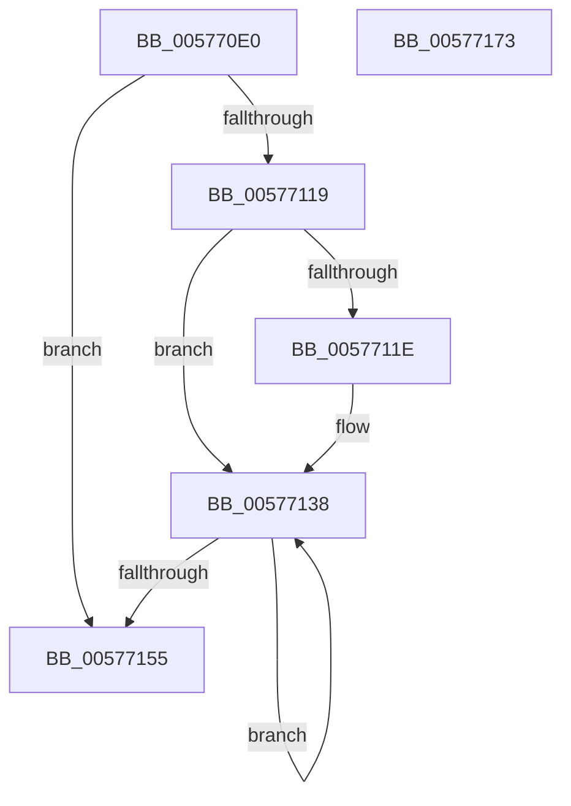

# XmRcrOp

- RVA: `0x005770E0`–`0x00577174` (길이 `148` bytes)
- VA: `0x00000001405770E0`
- 실행 섹션: `.text`
- PDB 이름 있음: `예`; PDB Function 태그: `아니요`
- unwind 정보 RVA: `0x0005C788`
- 디코드: `46`개 명령, `148/148` bytes 표시
- 미해석 바이트: `0` (있으면 어셈블리에 `.byte`로 보존)

> 이 문서는 커널 이미지의 기계어와 PDB 기호를 분석해 생성했습니다. 4번과 5번은 함수 원형과 자료형을 바이너리 사용 방식에서 추정한 C 해석이며 원본 소스 복구 결과는 아닙니다.

## 1. Dependencies

- 직접 호출 지점: **1**; 고유 호출 대상: **1**
- 직접 호출자로 확인된 함수: **0**
- RIP 상대 이미지 참조: **0**

### Outgoing calls
- `0x0057715B` → [XmStoreResult](../47/XmStoreResult_function_004739FC.md) (function, `0x004739FC`)

### Direct callers
- 이 함수 시작 RVA로 연결되는 직접 call은 확인되지 않았습니다. 간접 호출은 완전히 역산할 수 없습니다.

### Static image references
- 디코드된 RIP-relative 메모리 참조가 없습니다.

## 2. Other-region calls and transfers

- 다른 실행 섹션으로 향하는 call: **0**
- 별도 외부 분기/꼬리 이동을 확인하지 못했습니다.

## 3. Assembly (complete function range)

```asm
005770E0  48 83 EC 28                     sub rsp, 0x28
005770E4  8B 41 78                        mov eax, dword ptr [rcx + 0x78]
005770E7  4C 8B C9                        mov r9, rcx
005770EA  33 D2                           xor edx, edx
005770EC  45 8B 59 68                     mov r11d, dword ptr [r9 + 0x68]
005770F0  44 8D 04 C5 00 00 00 00         lea r8d, [rax*8]
005770F8  41 8B 41 6C                     mov eax, dword ptr [r9 + 0x6c]
005770FC  41 8D 48 07                     lea ecx, [r8 + 7]
00577100  41 83 C0 09                     add r8d, 9
00577104  83 E0 1F                        and eax, 0x1f
00577107  41 F7 F0                        div r8d
0057710A  45 8B 41 10                     mov r8d, dword ptr [r9 + 0x10]
0057710E  45 8B D0                        mov r10d, r8d
00577111  41 83 E2 01                     and r10d, 1
00577115  85 D2                           test edx, edx
00577117  74 3C                           je 0x140577155
00577119  83 FA 01                        cmp edx, 1
0057711C  75 1A                           jne 0x140577138
0057711E  41 8B C3                        mov eax, r11d
00577121  D3 E8                           shr eax, cl
00577123  41 33 C2                        xor eax, r10d
00577126  C1 E0 0B                        shl eax, 0xb
00577129  41 33 C0                        xor eax, r8d
0057712C  25 00 08 00 00                  and eax, 0x800
00577131  41 33 C0                        xor eax, r8d
00577134  41 89 41 10                     mov dword ptr [r9 + 0x10], eax
00577138  41 D3 E2                        shl r10d, cl
0057713B  41 8B C3                        mov eax, r11d
0057713E  45 8B C3                        mov r8d, r11d
00577141  D1 E8                           shr eax, 1
00577143  45 8B DA                        mov r11d, r10d
00577146  41 83 E0 01                     and r8d, 1
0057714A  44 0B D8                        or r11d, eax
0057714D  45 8B D0                        mov r10d, r8d
00577150  83 C2 FF                        add edx, -1
00577153  75 E3                           jne 0x140577138
00577155  41 8B D3                        mov edx, r11d
00577158  49 8B C9                        mov rcx, r9
0057715B  E8 9C C8 EF FF                  call 0x1404739fc
00577160  41 8B 49 10                     mov ecx, dword ptr [r9 + 0x10]
00577164  83 E1 FE                        and ecx, 0xfffffffe
00577167  41 0B CA                        or ecx, r10d
0057716A  41 89 49 10                     mov dword ptr [r9 + 0x10], ecx
0057716E  48 83 C4 28                     add rsp, 0x28
00577172  C3                              ret
00577173  CC                              int3
```

## 4. C-style interpretation (structured pseudocode)

```c
__int64 __fastcall XmRcrOp(__int64 a1, int a2)
{
    __int64 result;
    __int64 v_r10;
    __int64 v_r11;
    __int64 v_rsp;

    v_rsp = (v_rsp) - (40);
    a2 = 0;
    a3 = (unsigned int)(((unsigned int)(*(unsigned int *)(a1 + 120)) * 8) + (9));
    result = (unsigned int)(((unsigned int)(*(unsigned int *)(a1 + 108))) & (31));
    v_r10 = (unsigned int)(((unsigned int)((unsigned int)((unsigned int)(*(unsigned int *)(a1 + 16))))) & (1));
    if (0 == 0) goto loc_00577155;
    if (0 == 1) {
        result = (unsigned int)((unsigned int)(*(unsigned int *)(a1 + 104)));
        result = (unsigned int)((result) >> ((unsigned __int8)((unsigned int)(*(unsigned int *)(a1 + 120)) * 8 + 7)));
        result = (unsigned int)((result) ^ ((unsigned int)(v_r10)));
        result = (unsigned int)((result) << (11));
        result = (unsigned int)((result) ^ ((unsigned int)((unsigned int)(*(unsigned int *)(a1 + 16)))));
        result = (unsigned int)((result) & (0x800ULL));
        result = (unsigned int)((result) ^ ((unsigned int)((unsigned int)(*(unsigned int *)(a1 + 16)))));
        *(unsigned int *)(a1 + 16) = (unsigned int)(result);
    }
    v_r10 = (unsigned int)((v_r10) << ((unsigned __int8)((unsigned int)(*(unsigned int *)(a1 + 120)) * 8 + 7)));
    result = (unsigned int)(((unsigned int)((unsigned int)((unsigned int)(*(unsigned int *)(a1 + 104))))) >> (1));
    a3 = (unsigned int)(((unsigned int)((unsigned int)((unsigned int)(*(unsigned int *)(a1 + 104))))) & (1));
    v_r11 = (unsigned int)(((unsigned int)((unsigned int)(v_r10))) | ((unsigned int)(result)));
    a2 = (unsigned int)((a2) + (-1));
    if (condition_is_not_equal) goto loc_00577138;
loc_00577155:
    result = XmStoreResult(a1, (unsigned int)((unsigned int)(v_r11)), a3, a1);
    a1 = (unsigned int)(((unsigned int)(*(unsigned int *)(a1 + 16))) & (0xFFFFFFFEULL));
    a1 = (unsigned int)((a1) | ((unsigned int)((unsigned int)((unsigned int)(a3)))));
    *(unsigned int *)(a1 + 16) = (unsigned int)(a1);
    v_rsp = (v_rsp) + (40);
    return result;
}
```

## 5. (Beta) C Style

```c
int64_t XmRcrOp(void *Arg1, int32_t Arg2)
{
    uint8_t *arg1 = (uint8_t *)Arg1;

    int64_t result;
    int64_t local_r10;
    int64_t local_r11;
    int64_t local_rsp;

    local_rsp = (local_rsp) - (40);
    Arg2 = 0;
    a3 = (uint32_t)(((uint32_t)(*(uint32_t *)(arg1 + 0x78)) * 8) + (9));
    result = (uint32_t)(((uint32_t)(*(uint32_t *)(arg1 + 0x6C))) & (31));
    local_r10 = (uint32_t)(((uint32_t)((uint32_t)((uint32_t)(*(uint32_t *)(arg1 + 0x10))))) & (1));
    if (0 == 0) goto loc_00577155;
    if (0 == 1) {
        result = (uint32_t)((uint32_t)(*(uint32_t *)(arg1 + 0x68)));
        result = (uint32_t)((result) >> ((uint8_t)((uint32_t)(*(uint32_t *)(arg1 + 0x78)) * 8 + 7)));
        result = (uint32_t)((result) ^ ((uint32_t)(local_r10)));
        result = (uint32_t)((result) << (11));
        result = (uint32_t)((result) ^ ((uint32_t)((uint32_t)(*(uint32_t *)(arg1 + 0x10)))));
        result = (uint32_t)((result) & (0x800ULL));
        result = (uint32_t)((result) ^ ((uint32_t)((uint32_t)(*(uint32_t *)(arg1 + 0x10)))));
        *(uint32_t *)(arg1 + 0x10) = (uint32_t)(result);
    }
    local_r10 = (uint32_t)((local_r10) << ((uint8_t)((uint32_t)(*(uint32_t *)(arg1 + 0x78)) * 8 + 7)));
    result = (uint32_t)(((uint32_t)((uint32_t)((uint32_t)(*(uint32_t *)(arg1 + 0x68))))) >> (1));
    a3 = (uint32_t)(((uint32_t)((uint32_t)((uint32_t)(*(uint32_t *)(arg1 + 0x68))))) & (1));
    local_r11 = (uint32_t)(((uint32_t)((uint32_t)(local_r10))) | ((uint32_t)(result)));
    Arg2 = (uint32_t)((Arg2) + (-1));
    if (condition_is_not_equal) goto loc_00577138;
loc_00577155:
    result = XmStoreResult(Arg1, (uint32_t)((uint32_t)(local_r11)), a3, Arg1);
    Arg1 = (uint32_t)(((uint32_t)(*(uint32_t *)(arg1 + 0x10))) & (0xFFFFFFFEULL));
    Arg1 = (uint32_t)((Arg1) | ((uint32_t)((uint32_t)((uint32_t)(a3)))));
    *(uint32_t *)(arg1 + 0x10) = (uint32_t)(Arg1);
    local_rsp = (local_rsp) + (40);
    return result;
}
```

### 관측된 메모리 오프셋

구조체 형식이 확인되지 않은 접근은 인자 기준의 오프셋으로만 기록했습니다.

| 기준 인자 | 오프셋 표현 | 폭 (bit) | 접근 |
|---|---:|---:|---|
| `Arg1` | `+ 0x10` | `32` | `R` |
| `Arg1` | `+ 0x10` | `32` | `W` |
| `Arg1` | `+ 0x68` | `32` | `R` |
| `Arg1` | `+ 0x6C` | `32` | `R` |
| `Arg1` | `+ 0x78` | `32` | `R` |

## 6. Execution-region graph

[열기: 2D/3D 그래프와 함수 탐색 컨트롤 패널](../../../control-panel.html?section=text&rva=0x005770E0&view=graph)

- 2D 그래프는 위에서 아래로 흐르고, 3D 그래프는 빈 공간을 드래그해 회전합니다. Shift+드래그는 이동, 휠은 확대·축소, 함수 노드 선택은 대상 보고서 이동입니다.

### Static fallback


