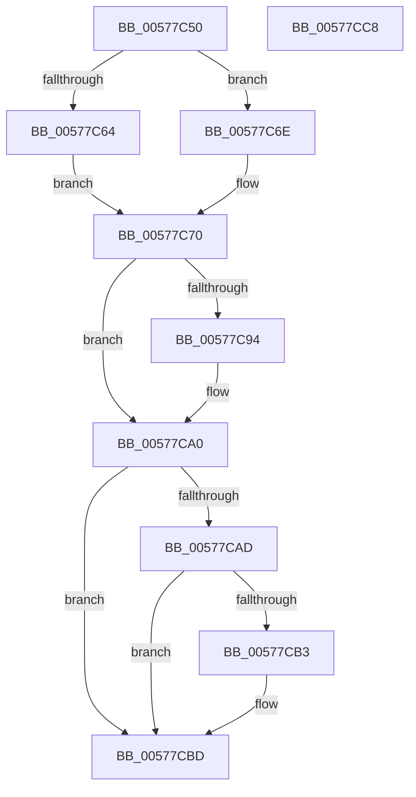

# XmRetOp

- RVA: `0x00577C50`–`0x00577CC9` (길이 `121` bytes)
- VA: `0x0000000140577C50`
- 실행 섹션: `.text`
- PDB 이름 있음: `예`; PDB Function 태그: `아니요`
- unwind 정보 RVA: `0x0005CAAC`
- 디코드: `38`개 명령, `121/121` bytes 표시
- 미해석 바이트: `0` (있으면 어셈블리에 `.byte`로 보존)

> 이 문서는 커널 이미지의 기계어와 PDB 기호를 분석해 생성했습니다. 4번과 5번은 함수 원형과 자료형을 바이너리 사용 방식에서 추정한 C 해석이며 원본 소스 복구 결과는 아닙니다.

## 1. Dependencies

- 직접 호출 지점: **3**; 고유 호출 대상: **2**
- 직접 호출자로 확인된 함수: **0**
- RIP 상대 이미지 참조: **1**

### Outgoing calls
- `0x00577C64` → [XmGetWordImmediate](../47/XmGetWordImmediate_function_004731DC.md) (function, `0x004731DC`)
- `0x00577C85` → [XmPopStack](../47/XmPopStack_function_00472588.md) (function, `0x00472588`)
- `0x00577C97` → [XmPopStack](../47/XmPopStack_function_00472588.md) (function, `0x00472588`)

### Direct callers
- 이 함수 시작 RVA로 연결되는 직접 call은 확인되지 않았습니다. 간접 호출은 완전히 역산할 수 없습니다.

### Static image references
- `0x00577CB3` → RVA `0x00E11814` (`.data`; write)

## 2. Other-region calls and transfers

- 다른 실행 섹션으로 향하는 call: **0**
- 별도 외부 분기/꼬리 이동을 확인하지 못했습니다.

## 3. Assembly (complete function range)

```asm
00577C50  48 89 5C 24 08                  mov qword ptr [rsp + 8], rbx
00577C55  57                              push rdi
00577C56  48 83 EC 20                     sub rsp, 0x20
00577C5A  8B 41 70                        mov eax, dword ptr [rcx + 0x70]
00577C5D  48 8B D9                        mov rbx, rcx
00577C60  A8 01                           test al, 1
00577C62  75 0A                           jne 0x140577c6e
00577C64  E8 73 B5 EF FF                  call 0x1404731dc
00577C69  0F B7 F8                        movzx edi, ax
00577C6C  EB 02                           jmp 0x140577c70
00577C6E  33 FF                           xor edi, edi
00577C70  8A 83 8A 00 00 00               mov al, byte ptr [rbx + 0x8a]
00577C76  F6 D8                           neg al
00577C78  1B C9                           sbb ecx, ecx
00577C7A  83 E1 02                        and ecx, 2
00577C7D  FF C1                           inc ecx
00577C7F  89 4B 78                        mov dword ptr [rbx + 0x78], ecx
00577C82  48 8B CB                        mov rcx, rbx
00577C85  E8 FE A8 EF FF                  call 0x140472588
00577C8A  89 43 14                        mov dword ptr [rbx + 0x14], eax
00577C8D  8B 43 70                        mov eax, dword ptr [rbx + 0x70]
00577C90  A8 08                           test al, 8
00577C92  74 0C                           je 0x140577ca0
00577C94  48 8B CB                        mov rcx, rbx
00577C97  E8 EC A8 EF FF                  call 0x140472588
00577C9C  66 89 43 3A                     mov word ptr [rbx + 0x3a], ax
00577CA0  01 7B 28                        add dword ptr [rbx + 0x28], edi
00577CA3  B8 FF FF 00 00                  mov eax, 0xffff
00577CA8  39 43 14                        cmp dword ptr [rbx + 0x14], eax
00577CAB  75 10                           jne 0x140577cbd
00577CAD  66 39 43 3A                     cmp word ptr [rbx + 0x3a], ax
00577CB1  75 0A                           jne 0x140577cbd
00577CB3  C7 05 57 9B 89 00 01 00 00 00   mov dword ptr [rip + 0x899b57], 1
00577CBD  48 8B 5C 24 30                  mov rbx, qword ptr [rsp + 0x30]
00577CC2  48 83 C4 20                     add rsp, 0x20
00577CC6  5F                              pop rdi
00577CC7  C3                              ret
00577CC8  CC                              int3
```

## 4. C-style interpretation (structured pseudocode)

```c
__int64 __fastcall XmRetOp(__int64 a1)
{
    __int64 result;
    __int64 v_rdi;
    __int64 v_rsp;
    unsigned __int64 v_stack_p8;

    v_stack_p8 = v_rbx;
    v_rsp = (v_rsp) - (32);
    if ((((unsigned __int8)((unsigned int)(*(unsigned int *)(a1 + 112)))) & (1)) != 0) goto loc_00577C6E;
    result = XmGetWordImmediate(a1, a2, a3, a4);
    goto loc_00577C70;
loc_00577C6E:
    v_rdi = 0;
loc_00577C70:
    result = (unsigned __int8)(-(*(unsigned __int8 *)(a1 + 138)));
    a1 = (unsigned int)((a1) & (2));
    a1 = (unsigned int)((a1) + 1);
    *(unsigned int *)(a1 + 120) = (unsigned int)(a1);
    result = XmPopStack(a1, a2, a3, a4);
    *(unsigned int *)(a1 + 20) = (unsigned int)(result);
    result = (unsigned int)(*(unsigned int *)(a1 + 112));
    if ((((unsigned __int8)((unsigned int)(*(unsigned int *)(a1 + 112)))) & (8)) != 0) {
        a1 = a1;
        result = XmPopStack(a1, a2, a3, a4);
        *(unsigned __int16 *)(a1 + 58) = (unsigned __int16)(result);
    }
    if ((*(unsigned int *)(a1 + 20)) != ((unsigned int)((unsigned int)(0xFFFFULL)))) goto loc_00577CBD;
    if ((*(unsigned __int16 *)(a1 + 58)) == ((unsigned __int16)((unsigned int)(0xFFFFULL)))) {
        *(unsigned int *)(v_rip + 9018199) = 1;
    }
    v_rsp = (v_rsp) + (32);
    return (unsigned int)(0xFFFFULL);
}
```

## 5. (Beta) C Style

```c
int64_t XmRetOp(void *Arg1)
{
    uint8_t *arg1 = (uint8_t *)Arg1;

    int64_t result;
    int64_t local_rdi;
    int64_t local_rsp;
    uint64_t v_stack_p8;

    v_stack_p8 = local_rbx;
    local_rsp = (local_rsp) - (32);
    if ((((uint8_t)((uint32_t)(*(uint32_t *)(arg1 + 0x70)))) & (1)) != 0) goto loc_00577C6E;
    result = XmGetWordImmediate(Arg1, a2, a3, a4);
    goto loc_00577C70;
loc_00577C6E:
    local_rdi = 0;
loc_00577C70:
    result = (uint8_t)(-(*(uint8_t *)(arg1 + 0x8A)));
    Arg1 = (uint32_t)((Arg1) & (2));
    Arg1 = (uint32_t)((Arg1) + 1);
    *(uint32_t *)(arg1 + 0x78) = (uint32_t)(Arg1);
    result = XmPopStack(Arg1, a2, a3, a4);
    *(uint32_t *)(arg1 + 0x14) = (uint32_t)(result);
    result = (uint32_t)(*(uint32_t *)(arg1 + 0x70));
    if ((((uint8_t)((uint32_t)(*(uint32_t *)(arg1 + 0x70)))) & (8)) != 0) {
        Arg1 = Arg1;
        result = XmPopStack(Arg1, a2, a3, a4);
        *(uint16_t *)(arg1 + 0x3A) = (uint16_t)(result);
    }
    if ((*(uint32_t *)(arg1 + 0x14)) != ((uint32_t)((uint32_t)(0xFFFFULL)))) goto loc_00577CBD;
    if ((*(uint16_t *)(arg1 + 0x3A)) == ((uint16_t)((uint32_t)(0xFFFFULL)))) {
        *(uint32_t *)(v_rip + 0x899B57) = 1;
    }
    local_rsp = (local_rsp) + (32);
    return (uint32_t)(0xFFFFULL);
}
```

### 관측된 메모리 오프셋

구조체 형식이 확인되지 않은 접근은 인자 기준의 오프셋으로만 기록했습니다.

| 기준 인자 | 오프셋 표현 | 폭 (bit) | 접근 |
|---|---:|---:|---|
| `Arg1` | `+ 0x14` | `32` | `R` |
| `Arg1` | `+ 0x14` | `32` | `W` |
| `Arg1` | `+ 0x28` | `32` | `R/W` |
| `Arg1` | `+ 0x3A` | `16` | `R` |
| `Arg1` | `+ 0x3A` | `16` | `W` |
| `Arg1` | `+ 0x70` | `32` | `R` |
| `Arg1` | `+ 0x78` | `32` | `W` |
| `Arg1` | `+ 0x8A` | `8` | `R` |

## 6. Execution-region graph

[열기: 2D/3D 그래프와 함수 탐색 컨트롤 패널](../../../control-panel.html?section=text&rva=0x00577C50&view=graph)

- 2D 그래프는 위에서 아래로 흐르고, 3D 그래프는 빈 공간을 드래그해 회전합니다. Shift+드래그는 이동, 휠은 확대·축소, 함수 노드 선택은 대상 보고서 이동입니다.

### Static fallback


