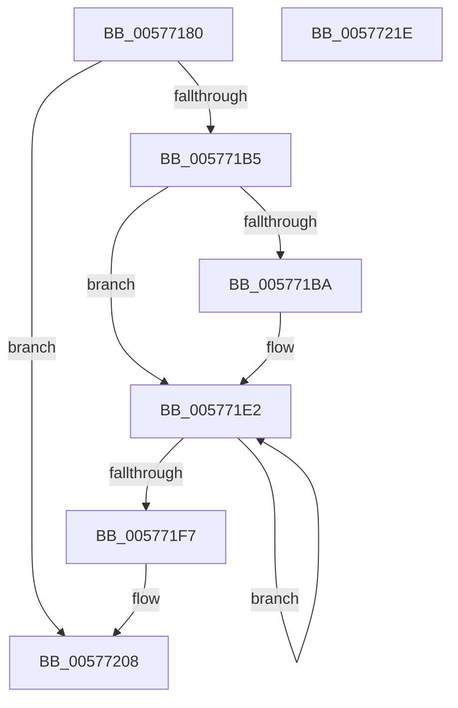

# XmRolOp

- RVA: `0x00577180`–`0x0057721F` (길이 `159` bytes)
- VA: `0x0000000140577180`
- 실행 섹션: `.text`
- PDB 이름 있음: `예`; PDB Function 태그: `아니요`
- unwind 정보 RVA: `0x0005CAAC`
- 디코드: `52`개 명령, `159/159` bytes 표시
- 미해석 바이트: `0` (있으면 어셈블리에 `.byte`로 보존)

> 이 문서는 커널 이미지의 기계어와 PDB 기호를 분석해 생성했습니다. 4번과 5번은 함수 원형과 자료형을 바이너리 사용 방식에서 추정한 C 해석이며 원본 소스 복구 결과는 아닙니다.

## 1. Dependencies

- 직접 호출 지점: **1**; 고유 호출 대상: **1**
- 직접 호출자로 확인된 함수: **0**
- RIP 상대 이미지 참조: **0**

### Outgoing calls
- `0x0057720E` → [XmStoreResult](../47/XmStoreResult_function_004739FC.md) (function, `0x004739FC`)

### Direct callers
- 이 함수 시작 RVA로 연결되는 직접 call은 확인되지 않았습니다. 간접 호출은 완전히 역산할 수 없습니다.

### Static image references
- 디코드된 RIP-relative 메모리 참조가 없습니다.

## 2. Other-region calls and transfers

- 다른 실행 섹션으로 향하는 call: **0**
- 별도 외부 분기/꼬리 이동을 확인하지 못했습니다.

## 3. Assembly (complete function range)

```asm
00577180  48 89 5C 24 08                  mov qword ptr [rsp + 8], rbx
00577185  57                              push rdi
00577186  48 83 EC 20                     sub rsp, 0x20
0057718A  8B 41 78                        mov eax, dword ptr [rcx + 0x78]
0057718D  4C 8B D1                        mov r10, rcx
00577190  41 BB 01 00 00 00               mov r11d, 1
00577196  41 8B 5A 6C                     mov ebx, dword ptr [r10 + 0x6c]
0057719A  8D 3C C5 07 00 00 00            lea edi, [rax*8 + 7]
005771A1  45 8B 4A 68                     mov r9d, dword ptr [r10 + 0x68]
005771A5  8B CF                           mov ecx, edi
005771A7  41 D3 E3                        shl r11d, cl
005771AA  41 FF CB                        dec r11d
005771AD  41 0F AB FB                     bts r11d, edi
005771B1  23 DF                           and ebx, edi
005771B3  74 53                           je 0x140577208
005771B5  83 FB 01                        cmp ebx, 1
005771B8  75 28                           jne 0x1405771e2
005771BA  45 8B 42 10                     mov r8d, dword ptr [r10 + 0x10]
005771BE  8D 4F FF                        lea ecx, [rdi - 1]
005771C1  41 8B D1                        mov edx, r9d
005771C4  41 8B C1                        mov eax, r9d
005771C7  D3 EA                           shr edx, cl
005771C9  8B CF                           mov ecx, edi
005771CB  D3 E8                           shr eax, cl
005771CD  33 D0                           xor edx, eax
005771CF  C1 E2 0B                        shl edx, 0xb
005771D2  41 33 D0                        xor edx, r8d
005771D5  81 E2 00 08 00 00               and edx, 0x800
005771DB  41 33 D0                        xor edx, r8d
005771DE  41 89 52 10                     mov dword ptr [r10 + 0x10], edx
005771E2  41 8B D1                        mov edx, r9d
005771E5  8B CF                           mov ecx, edi
005771E7  45 03 C9                        add r9d, r9d
005771EA  D3 EA                           shr edx, cl
005771EC  45 23 CB                        and r9d, r11d
005771EF  44 0B CA                        or r9d, edx
005771F2  83 C3 FF                        add ebx, -1
005771F5  75 EB                           jne 0x1405771e2
005771F7  41 8B 42 10                     mov eax, dword ptr [r10 + 0x10]
005771FB  8B C8                           mov ecx, eax
005771FD  33 CA                           xor ecx, edx
005771FF  83 E1 01                        and ecx, 1
00577202  33 C8                           xor ecx, eax
00577204  41 89 4A 10                     mov dword ptr [r10 + 0x10], ecx
00577208  41 8B D1                        mov edx, r9d
0057720B  49 8B CA                        mov rcx, r10
0057720E  E8 E9 C7 EF FF                  call 0x1404739fc
00577213  48 8B 5C 24 30                  mov rbx, qword ptr [rsp + 0x30]
00577218  48 83 C4 20                     add rsp, 0x20
0057721C  5F                              pop rdi
0057721D  C3                              ret
0057721E  CC                              int3
```

## 4. C-style interpretation (structured pseudocode)

```c
__int64 __fastcall XmRolOp(__int64 a1)
{
    __int64 result;
    __int64 v_r11;
    __int64 v_rbx;
    __int64 v_rsp;
    unsigned __int64 v_stack_p8;

    v_stack_p8 = v_rbx;
    v_rsp = (v_rsp) - (32);
    v_r11 = (unsigned int)((1) << ((unsigned __int8)((unsigned int)((unsigned int)((unsigned int)(*(unsigned int *)(a1 + 120)) * 8 + 7)))));
    v_r11 = (unsigned int)((v_r11) - 1);
    v_rbx = (unsigned int)(((unsigned int)(*(unsigned int *)(a1 + 108))) & ((unsigned int)((unsigned int)(*(unsigned int *)(a1 + 120)) * 8 + 7)));
    if (condition_is_equal) goto loc_00577208;
    result = (unsigned int)(*(unsigned int *)(a1 + 120));
    if (((unsigned int)(v_rbx)) == 1) {
        a3 = *(unsigned int *)(a1 + 16);
        a1 = (unsigned int)(*(unsigned int *)(a1 + 120)) * 8 + 7 - 1;
        a2 = (unsigned int)((unsigned int)(*(unsigned int *)(a1 + 104)));
        result = (unsigned int)((unsigned int)(*(unsigned int *)(a1 + 104)));
        a2 = (unsigned int)((a2) >> ((unsigned __int8)(a1)));
        a1 = (unsigned int)((unsigned int)(*(unsigned int *)(a1 + 120)) * 8 + 7);
        result = (unsigned int)((result) >> ((unsigned __int8)(a1)));
        a2 = (unsigned int)((a2) ^ ((unsigned int)(result)));
        a2 = (unsigned int)((a2) << (11));
        a2 = (unsigned int)((a2) ^ ((unsigned int)(a3)));
        a2 = (unsigned int)((a2) & (0x800ULL));
        a2 = (unsigned int)((a2) ^ ((unsigned int)(a3)));
        *(unsigned int *)(a1 + 16) = (unsigned int)(a2);
    }
    a4 = (unsigned int)(((unsigned int)(*(unsigned int *)(a1 + 104))) + ((unsigned int)((unsigned int)(*(unsigned int *)(a1 + 104)))));
    a2 = (unsigned int)(((unsigned int)((unsigned int)((unsigned int)(*(unsigned int *)(a1 + 104))))) >> ((unsigned __int8)((unsigned int)((unsigned int)((unsigned int)(*(unsigned int *)(a1 + 120)) * 8 + 7)))));
    a4 = (unsigned int)((a4) & ((unsigned int)(v_r11)));
    a4 = (unsigned int)((a4) | ((unsigned int)(a2)));
    v_rbx = (unsigned int)((v_rbx) + (-1));
    if (condition_is_not_equal) goto loc_005771E2;
    a1 = (unsigned int)(((unsigned int)((unsigned int)((unsigned int)(*(unsigned int *)(a1 + 16))))) ^ ((unsigned int)(a2)));
    a1 = (unsigned int)((a1) & (1));
    a1 = (unsigned int)((a1) ^ ((unsigned int)((unsigned int)(*(unsigned int *)(a1 + 16)))));
    *(unsigned int *)(a1 + 16) = (unsigned int)(a1);
loc_00577208:
    result = XmStoreResult(a1, (unsigned int)((unsigned int)(a4)), a3, a4);
    v_rsp = (v_rsp) + (32);
    return result;
}
```

## 5. (Beta) C Style

```c
int64_t XmRolOp(void *Arg1)
{
    uint8_t *arg1 = (uint8_t *)Arg1;

    int64_t result;
    int64_t local_r11;
    int64_t local_rbx;
    int64_t local_rsp;
    uint64_t v_stack_p8;

    v_stack_p8 = local_rbx;
    local_rsp = (local_rsp) - (32);
    local_r11 = (uint32_t)((1) << ((uint8_t)((uint32_t)((uint32_t)((uint32_t)(*(uint32_t *)(arg1 + 0x78)) * 8 + 7)))));
    local_r11 = (uint32_t)((local_r11) - 1);
    local_rbx = (uint32_t)(((uint32_t)(*(uint32_t *)(arg1 + 0x6C))) & ((uint32_t)((uint32_t)(*(uint32_t *)(arg1 + 0x78)) * 8 + 7)));
    if (condition_is_equal) goto loc_00577208;
    result = (uint32_t)(*(uint32_t *)(arg1 + 0x78));
    if (((uint32_t)(local_rbx)) == 1) {
        a3 = *(uint32_t *)(arg1 + 0x10);
        Arg1 = (uint32_t)(*(uint32_t *)(arg1 + 0x78)) * 8 + 7 - 1;
        a2 = (uint32_t)((uint32_t)(*(uint32_t *)(arg1 + 0x68)));
        result = (uint32_t)((uint32_t)(*(uint32_t *)(arg1 + 0x68)));
        a2 = (uint32_t)((a2) >> ((uint8_t)(Arg1)));
        Arg1 = (uint32_t)((uint32_t)(*(uint32_t *)(arg1 + 0x78)) * 8 + 7);
        result = (uint32_t)((result) >> ((uint8_t)(Arg1)));
        a2 = (uint32_t)((a2) ^ ((uint32_t)(result)));
        a2 = (uint32_t)((a2) << (11));
        a2 = (uint32_t)((a2) ^ ((uint32_t)(a3)));
        a2 = (uint32_t)((a2) & (0x800ULL));
        a2 = (uint32_t)((a2) ^ ((uint32_t)(a3)));
        *(uint32_t *)(arg1 + 0x10) = (uint32_t)(a2);
    }
    a4 = (uint32_t)(((uint32_t)(*(uint32_t *)(arg1 + 0x68))) + ((uint32_t)((uint32_t)(*(uint32_t *)(arg1 + 0x68)))));
    a2 = (uint32_t)(((uint32_t)((uint32_t)((uint32_t)(*(uint32_t *)(arg1 + 0x68))))) >> ((uint8_t)((uint32_t)((uint32_t)((uint32_t)(*(uint32_t *)(arg1 + 0x78)) * 8 + 7)))));
    a4 = (uint32_t)((a4) & ((uint32_t)(local_r11)));
    a4 = (uint32_t)((a4) | ((uint32_t)(a2)));
    local_rbx = (uint32_t)((local_rbx) + (-1));
    if (condition_is_not_equal) goto loc_005771E2;
    Arg1 = (uint32_t)(((uint32_t)((uint32_t)((uint32_t)(*(uint32_t *)(arg1 + 0x10))))) ^ ((uint32_t)(a2)));
    Arg1 = (uint32_t)((Arg1) & (1));
    Arg1 = (uint32_t)((Arg1) ^ ((uint32_t)((uint32_t)(*(uint32_t *)(arg1 + 0x10)))));
    *(uint32_t *)(arg1 + 0x10) = (uint32_t)(Arg1);
loc_00577208:
    result = XmStoreResult(Arg1, (uint32_t)((uint32_t)(a4)), a3, a4);
    local_rsp = (local_rsp) + (32);
    return result;
}
```

### 관측된 메모리 오프셋

구조체 형식이 확인되지 않은 접근은 인자 기준의 오프셋으로만 기록했습니다.

| 기준 인자 | 오프셋 표현 | 폭 (bit) | 접근 |
|---|---:|---:|---|
| `Arg1` | `+ 0x10` | `32` | `R` |
| `Arg1` | `+ 0x10` | `32` | `W` |
| `Arg1` | `+ 0x68` | `32` | `R` |
| `Arg1` | `+ 0x6C` | `32` | `R` |
| `Arg1` | `+ 0x78` | `32` | `R` |

## 6. Execution-region graph

[열기: 2D/3D 그래프와 함수 탐색 컨트롤 패널](../../../control-panel.html?section=text&rva=0x00577180&view=graph)

- 2D 그래프는 위에서 아래로 흐르고, 3D 그래프는 빈 공간을 드래그해 회전합니다. Shift+드래그는 이동, 휠은 확대·축소, 함수 노드 선택은 대상 보고서 이동입니다.

### Static fallback


