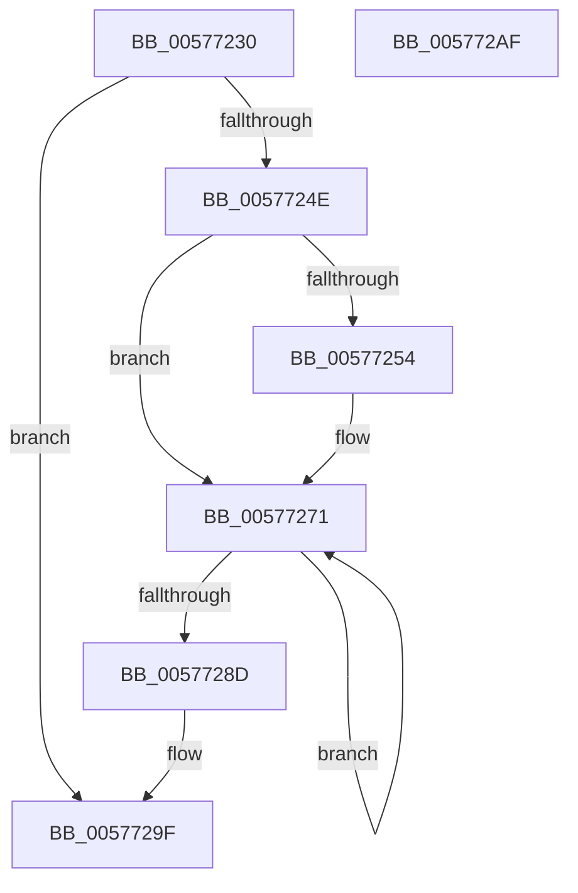

# XmRorOp

- RVA: `0x00577230`–`0x005772B0` (길이 `128` bytes)
- VA: `0x0000000140577230`
- 실행 섹션: `.text`
- PDB 이름 있음: `예`; PDB Function 태그: `아니요`
- unwind 정보 RVA: `0x0005C788`
- 디코드: `41`개 명령, `128/128` bytes 표시
- 미해석 바이트: `0` (있으면 어셈블리에 `.byte`로 보존)

> 이 문서는 커널 이미지의 기계어와 PDB 기호를 분석해 생성했습니다. 4번과 5번은 함수 원형과 자료형을 바이너리 사용 방식에서 추정한 C 해석이며 원본 소스 복구 결과는 아닙니다.

## 1. Dependencies

- 직접 호출 지점: **1**; 고유 호출 대상: **1**
- 직접 호출자로 확인된 함수: **0**
- RIP 상대 이미지 참조: **0**

### Outgoing calls
- `0x005772A5` → [XmStoreResult](../47/XmStoreResult_function_004739FC.md) (function, `0x004739FC`)

### Direct callers
- 이 함수 시작 RVA로 연결되는 직접 call은 확인되지 않았습니다. 간접 호출은 완전히 역산할 수 없습니다.

### Static image references
- 디코드된 RIP-relative 메모리 참조가 없습니다.

## 2. Other-region calls and transfers

- 다른 실행 섹션으로 향하는 call: **0**
- 별도 외부 분기/꼬리 이동을 확인하지 못했습니다.

## 3. Assembly (complete function range)

```asm
00577230  48 83 EC 28                     sub rsp, 0x28
00577234  8B 41 78                        mov eax, dword ptr [rcx + 0x78]
00577237  4C 8B C1                        mov r8, rcx
0057723A  45 8B 50 6C                     mov r10d, dword ptr [r8 + 0x6c]
0057723E  8D 0C C5 07 00 00 00            lea ecx, [rax*8 + 7]
00577245  45 8B 48 68                     mov r9d, dword ptr [r8 + 0x68]
00577249  44 23 D1                        and r10d, ecx
0057724C  74 51                           je 0x14057729f
0057724E  41 83 FA 01                     cmp r10d, 1
00577252  75 1D                           jne 0x140577271
00577254  41 8B 40 10                     mov eax, dword ptr [r8 + 0x10]
00577258  41 8B D1                        mov edx, r9d
0057725B  D3 EA                           shr edx, cl
0057725D  41 33 D1                        xor edx, r9d
00577260  C1 E2 0B                        shl edx, 0xb
00577263  33 D0                           xor edx, eax
00577265  81 E2 00 08 00 00               and edx, 0x800
0057726B  33 D0                           xor edx, eax
0057726D  41 89 50 10                     mov dword ptr [r8 + 0x10], edx
00577271  41 8B D1                        mov edx, r9d
00577274  41 8B C1                        mov eax, r9d
00577277  83 E2 01                        and edx, 1
0057727A  D1 E8                           shr eax, 1
0057727C  D3 E2                           shl edx, cl
0057727E  45 8B D9                        mov r11d, r9d
00577281  44 8B CA                        mov r9d, edx
00577284  44 0B C8                        or r9d, eax
00577287  41 83 C2 FF                     add r10d, -1
0057728B  75 E4                           jne 0x140577271
0057728D  41 8B 40 10                     mov eax, dword ptr [r8 + 0x10]
00577291  8B C8                           mov ecx, eax
00577293  41 33 CB                        xor ecx, r11d
00577296  83 E1 01                        and ecx, 1
00577299  33 C8                           xor ecx, eax
0057729B  41 89 48 10                     mov dword ptr [r8 + 0x10], ecx
0057729F  41 8B D1                        mov edx, r9d
005772A2  49 8B C8                        mov rcx, r8
005772A5  E8 52 C7 EF FF                  call 0x1404739fc
005772AA  48 83 C4 28                     add rsp, 0x28
005772AE  C3                              ret
005772AF  CC                              int3
```

## 4. C-style interpretation (structured pseudocode)

```c
__int64 __fastcall XmRorOp(__int64 a1)
{
    __int64 result;
    __int64 v_r10;
    __int64 v_rsp;

    v_rsp = (v_rsp) - (40);
    v_r10 = (unsigned int)(((unsigned int)(*(unsigned int *)(a1 + 108))) & ((unsigned int)((unsigned int)(*(unsigned int *)(a1 + 120)) * 8 + 7)));
    if (condition_is_equal) goto loc_0057729F;
    result = (unsigned int)(*(unsigned int *)(a1 + 120));
    if (((unsigned int)(v_r10)) == 1) {
        result = *(unsigned int *)(a1 + 16);
        a2 = (unsigned int)((unsigned int)(*(unsigned int *)(a1 + 104)));
        a2 = (unsigned int)((a2) >> ((unsigned __int8)((unsigned int)(*(unsigned int *)(a1 + 120)) * 8 + 7)));
        a2 = (unsigned int)((a2) ^ ((unsigned int)((unsigned int)(*(unsigned int *)(a1 + 104)))));
        a2 = (unsigned int)((a2) << (11));
        a2 = (unsigned int)((a2) ^ ((unsigned int)(result)));
        a2 = (unsigned int)((a2) & (0x800ULL));
        a2 = (unsigned int)((a2) ^ ((unsigned int)(result)));
        *(unsigned int *)(a1 + 16) = (unsigned int)(a2);
    }
    a2 = (unsigned int)(((unsigned int)((unsigned int)((unsigned int)(*(unsigned int *)(a1 + 104))))) & (1));
    result = (unsigned int)(((unsigned int)((unsigned int)((unsigned int)(*(unsigned int *)(a1 + 104))))) >> (1));
    a2 = (unsigned int)((a2) << ((unsigned __int8)((unsigned int)(*(unsigned int *)(a1 + 120)) * 8 + 7)));
    a4 = (unsigned int)(((unsigned int)((unsigned int)(a2))) | ((unsigned int)(result)));
    v_r10 = (unsigned int)((v_r10) + (-1));
    if (condition_is_not_equal) goto loc_00577271;
    a1 = (unsigned int)(((unsigned int)((unsigned int)((unsigned int)(*(unsigned int *)(a1 + 16))))) ^ ((unsigned int)((unsigned int)((unsigned int)((unsigned int)(*(unsigned int *)(a1 + 104)))))));
    a1 = (unsigned int)((a1) & (1));
    a1 = (unsigned int)((a1) ^ ((unsigned int)((unsigned int)(*(unsigned int *)(a1 + 16)))));
    *(unsigned int *)(a1 + 16) = (unsigned int)(a1);
loc_0057729F:
    result = XmStoreResult(a1, (unsigned int)((unsigned int)(a4)), a1, a4);
    v_rsp = (v_rsp) + (40);
    return result;
}
```

## 5. (Beta) C Style

```c
int64_t XmRorOp(void *Arg1)
{
    uint8_t *arg1 = (uint8_t *)Arg1;

    int64_t result;
    int64_t local_r10;
    int64_t local_rsp;

    local_rsp = (local_rsp) - (40);
    local_r10 = (uint32_t)(((uint32_t)(*(uint32_t *)(arg1 + 0x6C))) & ((uint32_t)((uint32_t)(*(uint32_t *)(arg1 + 0x78)) * 8 + 7)));
    if (condition_is_equal) goto loc_0057729F;
    result = (uint32_t)(*(uint32_t *)(arg1 + 0x78));
    if (((uint32_t)(local_r10)) == 1) {
        result = *(uint32_t *)(arg1 + 0x10);
        a2 = (uint32_t)((uint32_t)(*(uint32_t *)(arg1 + 0x68)));
        a2 = (uint32_t)((a2) >> ((uint8_t)((uint32_t)(*(uint32_t *)(arg1 + 0x78)) * 8 + 7)));
        a2 = (uint32_t)((a2) ^ ((uint32_t)((uint32_t)(*(uint32_t *)(arg1 + 0x68)))));
        a2 = (uint32_t)((a2) << (11));
        a2 = (uint32_t)((a2) ^ ((uint32_t)(result)));
        a2 = (uint32_t)((a2) & (0x800ULL));
        a2 = (uint32_t)((a2) ^ ((uint32_t)(result)));
        *(uint32_t *)(arg1 + 0x10) = (uint32_t)(a2);
    }
    a2 = (uint32_t)(((uint32_t)((uint32_t)((uint32_t)(*(uint32_t *)(arg1 + 0x68))))) & (1));
    result = (uint32_t)(((uint32_t)((uint32_t)((uint32_t)(*(uint32_t *)(arg1 + 0x68))))) >> (1));
    a2 = (uint32_t)((a2) << ((uint8_t)((uint32_t)(*(uint32_t *)(arg1 + 0x78)) * 8 + 7)));
    a4 = (uint32_t)(((uint32_t)((uint32_t)(a2))) | ((uint32_t)(result)));
    local_r10 = (uint32_t)((local_r10) + (-1));
    if (condition_is_not_equal) goto loc_00577271;
    Arg1 = (uint32_t)(((uint32_t)((uint32_t)((uint32_t)(*(uint32_t *)(arg1 + 0x10))))) ^ ((uint32_t)((uint32_t)((uint32_t)((uint32_t)(*(uint32_t *)(arg1 + 0x68)))))));
    Arg1 = (uint32_t)((Arg1) & (1));
    Arg1 = (uint32_t)((Arg1) ^ ((uint32_t)((uint32_t)(*(uint32_t *)(arg1 + 0x10)))));
    *(uint32_t *)(arg1 + 0x10) = (uint32_t)(Arg1);
loc_0057729F:
    result = XmStoreResult(Arg1, (uint32_t)((uint32_t)(a4)), Arg1, a4);
    local_rsp = (local_rsp) + (40);
    return result;
}
```

### 관측된 메모리 오프셋

구조체 형식이 확인되지 않은 접근은 인자 기준의 오프셋으로만 기록했습니다.

| 기준 인자 | 오프셋 표현 | 폭 (bit) | 접근 |
|---|---:|---:|---|
| `Arg1` | `+ 0x10` | `32` | `R` |
| `Arg1` | `+ 0x10` | `32` | `W` |
| `Arg1` | `+ 0x68` | `32` | `R` |
| `Arg1` | `+ 0x6C` | `32` | `R` |
| `Arg1` | `+ 0x78` | `32` | `R` |

## 6. Execution-region graph

[열기: 2D/3D 그래프와 함수 탐색 컨트롤 패널](../../../control-panel.html?section=text&rva=0x00577230&view=graph)

- 2D 그래프는 위에서 아래로 흐르고, 3D 그래프는 빈 공간을 드래그해 회전합니다. Shift+드래그는 이동, 휠은 확대·축소, 함수 노드 선택은 대상 보고서 이동입니다.

### Static fallback


