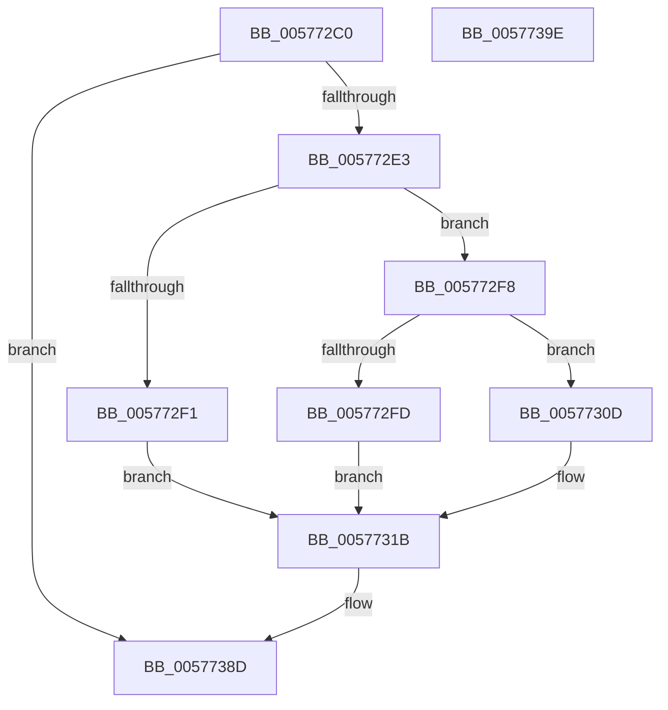

# XmSarOp

- RVA: `0x005772C0`–`0x0057739F` (길이 `223` bytes)
- VA: `0x00000001405772C0`
- 실행 섹션: `.text`
- PDB 이름 있음: `예`; PDB Function 태그: `아니요`
- unwind 정보 RVA: `0x0005CF00`
- 디코드: `68`개 명령, `223/223` bytes 표시
- 미해석 바이트: `0` (있으면 어셈블리에 `.byte`로 보존)

> 이 문서는 커널 이미지의 기계어와 PDB 기호를 분석해 생성했습니다. 4번과 5번은 함수 원형과 자료형을 바이너리 사용 방식에서 추정한 C 해석이며 원본 소스 복구 결과는 아닙니다.

## 1. Dependencies

- 직접 호출 지점: **1**; 고유 호출 대상: **1**
- 직접 호출자로 확인된 함수: **0**
- RIP 상대 이미지 참조: **1**

### Outgoing calls
- `0x00577393` → [XmStoreResult](../47/XmStoreResult_function_004739FC.md) (function, `0x004739FC`)

### Direct callers
- 이 함수 시작 RVA로 연결되는 직접 call은 확인되지 않았습니다. 간접 호출은 완전히 역산할 수 없습니다.

### Static image references
- `0x0057731F` → RVA `0x0001A190` (`.rdata`; read)

## 2. Other-region calls and transfers

- 다른 실행 섹션으로 향하는 call: **0**
- 별도 외부 분기/꼬리 이동을 확인하지 못했습니다.

## 3. Assembly (complete function range)

```asm
005772C0  40 53                           push rbx
005772C2  48 83 EC 20                     sub rsp, 0x20
005772C6  8B 51 78                        mov edx, dword ptr [rcx + 0x78]
005772C9  4C 8B D1                        mov r10, rcx
005772CC  8B 41 6C                        mov eax, dword ptr [rcx + 0x6c]
005772CF  44 8B 49 68                     mov r9d, dword ptr [rcx + 0x68]
005772D3  44 8D 1C D5 07 00 00 00         lea r11d, [rdx*8 + 7]
005772DB  85 C0                           test eax, eax
005772DD  0F 84 AA 00 00 00               je 0x14057738d
005772E3  8D 48 FF                        lea ecx, [rax - 1]
005772E6  45 8B C1                        mov r8d, r9d
005772E9  41 D3 F8                        sar r8d, cl
005772EC  83 FA 03                        cmp edx, 3
005772EF  75 07                           jne 0x1405772f8
005772F1  8B C8                           mov ecx, eax
005772F3  41 D3 F9                        sar r9d, cl
005772F6  EB 23                           jmp 0x14057731b
005772F8  83 FA 01                        cmp edx, 1
005772FB  75 10                           jne 0x14057730d
005772FD  41 C1 E1 10                     shl r9d, 0x10
00577301  8D 48 10                        lea ecx, [rax + 0x10]
00577304  41 D3 F9                        sar r9d, cl
00577307  45 0F B7 C9                     movzx r9d, r9w
0057730B  EB 0E                           jmp 0x14057731b
0057730D  41 C1 E1 18                     shl r9d, 0x18
00577311  8D 48 18                        lea ecx, [rax + 0x18]
00577314  41 D3 F9                        sar r9d, cl
00577317  45 0F B6 C9                     movzx r9d, r9b
0057731B  41 8B 52 10                     mov edx, dword ptr [r10 + 0x10]
0057731F  48 8D 1D 6A 2E AA FF            lea rbx, [rip - 0x55d196]
00577326  41 83 E0 01                     and r8d, 1
0057732A  41 8B C9                        mov ecx, r9d
0057732D  81 E2 FE F7 FF FF               and edx, 0xfffff7fe
00577333  41 8B C1                        mov eax, r9d
00577336  41 33 D0                        xor edx, r8d
00577339  48 C1 E8 04                     shr rax, 4
0057733D  83 E0 0F                        and eax, 0xf
00577340  83 E2 FB                        and edx, 0xfffffffb
00577343  83 E1 0F                        and ecx, 0xf
00577346  44 0F B6 04 18                  movzx r8d, byte ptr [rax + rbx]
0057734B  0F B6 04 19                     movzx eax, byte ptr [rcx + rbx]
0057734F  41 8B CB                        mov ecx, r11d
00577352  44 03 C0                        add r8d, eax
00577355  41 8B C1                        mov eax, r9d
00577358  41 F7 D0                        not r8d
0057735B  41 83 E0 01                     and r8d, 1
0057735F  41 C1 E0 02                     shl r8d, 2
00577363  44 33 C2                        xor r8d, edx
00577366  41 83 E0 BF                     and r8d, 0xffffffbf
0057736A  F7 D8                           neg eax
0057736C  41 8B C1                        mov eax, r9d
0057736F  1B D2                           sbb edx, edx
00577371  D3 F8                           sar eax, cl
00577373  C1 E0 07                        shl eax, 7
00577376  F7 D2                           not edx
00577378  83 E2 40                        and edx, 0x40
0057737B  44 0B C2                        or r8d, edx
0057737E  41 33 C0                        xor eax, r8d
00577381  25 80 00 00 00                  and eax, 0x80
00577386  41 33 C0                        xor eax, r8d
00577389  41 89 42 10                     mov dword ptr [r10 + 0x10], eax
0057738D  41 8B D1                        mov edx, r9d
00577390  49 8B CA                        mov rcx, r10
00577393  E8 64 C6 EF FF                  call 0x1404739fc
00577398  48 83 C4 20                     add rsp, 0x20
0057739C  5B                              pop rbx
0057739D  C3                              ret
0057739E  CC                              int3
```

## 4. C-style interpretation (structured pseudocode)

```c
__int64 __fastcall XmSarOp(__int64 a1)
{
    __int64 result;
    __int64 v_rsp;

    v_rsp = (v_rsp) - (32);
    if ((unsigned int)((unsigned int)(*(unsigned int *)(a1 + 108))) == 0) goto loc_0057738D;
    a3 = (unsigned int)(((unsigned int)((unsigned int)((unsigned int)(*(unsigned int *)(a1 + 104))))) >> ((unsigned __int8)((unsigned int)(*(unsigned int *)(a1 + 108)) - 1)));
    if (((unsigned int)((unsigned int)(*(unsigned int *)(a1 + 120)))) != 3) goto loc_005772F8;
    a4 = (unsigned int)(((unsigned int)(*(unsigned int *)(a1 + 104))) >> ((unsigned __int8)((unsigned int)((unsigned int)((unsigned int)(*(unsigned int *)(a1 + 108)))))));
    goto loc_0057731B;
loc_005772F8:
    if (((unsigned int)((unsigned int)(*(unsigned int *)(a1 + 120)))) != 1) goto loc_0057730D;
    a4 = (unsigned int)((a4) << (16));
    a4 = (unsigned int)((a4) >> ((unsigned __int8)((unsigned int)(*(unsigned int *)(a1 + 108)) + 16)));
    goto loc_0057731B;
loc_0057730D:
    a4 = (unsigned int)(((unsigned __int16)(a4)) << (24));
    a4 = (unsigned int)((a4) >> ((unsigned __int8)((unsigned int)(*(unsigned int *)(a1 + 108)) + 24)));
loc_0057731B:
    a3 = (unsigned int)((a3) & (1));
    a2 = (unsigned int)(((unsigned int)(*(unsigned int *)(a1 + 16))) & (0xFFFFF7FEULL));
    a2 = (unsigned int)((a2) ^ ((unsigned int)(a3)));
    result = ((unsigned int)((unsigned int)((unsigned __int8)(a4)))) >> (4);
    result = (unsigned int)((result) & (15));
    a2 = (unsigned int)((a2) & (0xFFFFFFFBULL));
    a1 = (unsigned int)(((unsigned int)((unsigned int)((unsigned __int8)(a4)))) & (15));
    a3 = (unsigned int)((*(unsigned __int8 *)(result + v_rip - 5624214 * 1)) + ((unsigned int)(*(unsigned __int8 *)(a1 + v_rip - 5624214 * 1))));
    a3 = (unsigned int)(~(a3));
    a3 = (unsigned int)((a3) & (1));
    a3 = (unsigned int)((a3) << (2));
    a3 = (unsigned int)((a3) ^ ((unsigned int)(a2)));
    a3 = (unsigned int)((a3) & (0xFFFFFFBFULL));
    result = (unsigned int)(-((unsigned int)((unsigned int)((unsigned __int8)(a4)))));
    result = (unsigned int)(((unsigned int)((unsigned int)((unsigned __int8)(a4)))) >> ((unsigned __int8)((unsigned int)((unsigned int)((unsigned int)(*(unsigned int *)(a1 + 120)) * 8 + 7)))));
    result = (unsigned int)((result) << (7));
    a2 = (unsigned int)(~(a2));
    a2 = (unsigned int)((a2) & (64));
    a3 = (unsigned int)((a3) | ((unsigned int)(a2)));
    result = (unsigned int)((result) ^ ((unsigned int)(a3)));
    result = (unsigned int)((result) & (128));
    result = (unsigned int)((result) ^ ((unsigned int)(a3)));
    *(unsigned int *)(a1 + 16) = (unsigned int)(result);
loc_0057738D:
    result = XmStoreResult(a1, (unsigned int)((unsigned int)((unsigned __int8)(a4))), a3, (unsigned __int8)(a4));
    v_rsp = (v_rsp) + (32);
    return result;
}
```

## 5. (Beta) C Style

```c
int64_t XmSarOp(void *Arg1)
{
    uint8_t *arg1 = (uint8_t *)Arg1;

    int64_t result;
    int64_t local_rsp;

    local_rsp = (local_rsp) - (32);
    if ((uint32_t)((uint32_t)(*(uint32_t *)(arg1 + 0x6C))) == 0) goto loc_0057738D;
    a3 = (uint32_t)(((uint32_t)((uint32_t)((uint32_t)(*(uint32_t *)(arg1 + 0x68))))) >> ((uint8_t)((uint32_t)(*(uint32_t *)(arg1 + 0x6C)) - 1)));
    if (((uint32_t)((uint32_t)(*(uint32_t *)(arg1 + 0x78)))) != 3) goto loc_005772F8;
    a4 = (uint32_t)(((uint32_t)(*(uint32_t *)(arg1 + 0x68))) >> ((uint8_t)((uint32_t)((uint32_t)((uint32_t)(*(uint32_t *)(arg1 + 0x6C)))))));
    goto loc_0057731B;
loc_005772F8:
    if (((uint32_t)((uint32_t)(*(uint32_t *)(arg1 + 0x78)))) != 1) goto loc_0057730D;
    a4 = (uint32_t)((a4) << (16));
    a4 = (uint32_t)((a4) >> ((uint8_t)((uint32_t)(*(uint32_t *)(arg1 + 0x6C)) + 16)));
    goto loc_0057731B;
loc_0057730D:
    a4 = (uint32_t)(((uint16_t)(a4)) << (24));
    a4 = (uint32_t)((a4) >> ((uint8_t)((uint32_t)(*(uint32_t *)(arg1 + 0x6C)) + 24)));
loc_0057731B:
    a3 = (uint32_t)((a3) & (1));
    a2 = (uint32_t)(((uint32_t)(*(uint32_t *)(arg1 + 0x10))) & (0xFFFFF7FEULL));
    a2 = (uint32_t)((a2) ^ ((uint32_t)(a3)));
    result = ((uint32_t)((uint32_t)((uint8_t)(a4)))) >> (4);
    result = (uint32_t)((result) & (15));
    a2 = (uint32_t)((a2) & (0xFFFFFFFBULL));
    Arg1 = (uint32_t)(((uint32_t)((uint32_t)((uint8_t)(a4)))) & (15));
    a3 = (uint32_t)((*(uint8_t *)(result + v_rip - 0x55D196 * 1)) + ((uint32_t)(*(uint8_t *)(arg1 + v_rip - 0x55D196 * 1))));
    a3 = (uint32_t)(~(a3));
    a3 = (uint32_t)((a3) & (1));
    a3 = (uint32_t)((a3) << (2));
    a3 = (uint32_t)((a3) ^ ((uint32_t)(a2)));
    a3 = (uint32_t)((a3) & (0xFFFFFFBFULL));
    result = (uint32_t)(-((uint32_t)((uint32_t)((uint8_t)(a4)))));
    result = (uint32_t)(((uint32_t)((uint32_t)((uint8_t)(a4)))) >> ((uint8_t)((uint32_t)((uint32_t)((uint32_t)(*(uint32_t *)(arg1 + 0x78)) * 8 + 7)))));
    result = (uint32_t)((result) << (7));
    a2 = (uint32_t)(~(a2));
    a2 = (uint32_t)((a2) & (64));
    a3 = (uint32_t)((a3) | ((uint32_t)(a2)));
    result = (uint32_t)((result) ^ ((uint32_t)(a3)));
    result = (uint32_t)((result) & (128));
    result = (uint32_t)((result) ^ ((uint32_t)(a3)));
    *(uint32_t *)(arg1 + 0x10) = (uint32_t)(result);
loc_0057738D:
    result = XmStoreResult(Arg1, (uint32_t)((uint32_t)((uint8_t)(a4))), a3, (uint8_t)(a4));
    local_rsp = (local_rsp) + (32);
    return result;
}
```

### 관측된 메모리 오프셋

구조체 형식이 확인되지 않은 접근은 인자 기준의 오프셋으로만 기록했습니다.

| 기준 인자 | 오프셋 표현 | 폭 (bit) | 접근 |
|---|---:|---:|---|
| `Arg1` | `+ 0x10` | `32` | `R` |
| `Arg1` | `+ 0x10` | `32` | `W` |
| `Arg1` | `+ 0x68` | `32` | `R` |
| `Arg1` | `+ 0x6C` | `32` | `R` |
| `Arg1` | `+ 0x78` | `32` | `R` |

## 6. Execution-region graph

[열기: 2D/3D 그래프와 함수 탐색 컨트롤 패널](../../../control-panel.html?section=text&rva=0x005772C0&view=graph)

- 2D 그래프는 위에서 아래로 흐르고, 3D 그래프는 빈 공간을 드래그해 회전합니다. Shift+드래그는 이동, 휠은 확대·축소, 함수 노드 선택은 대상 보고서 이동입니다.

### Static fallback


