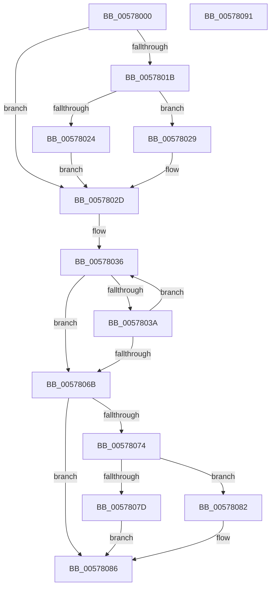

# XmScasOp

- RVA: `0x00578000`–`0x00578092` (길이 `146` bytes)
- VA: `0x0000000140578000`
- 실행 섹션: `.text`
- PDB 이름 있음: `예`; PDB Function 태그: `아니요`
- unwind 정보 RVA: `0x0005CAAC`
- 디코드: `42`개 명령, `146/146` bytes 표시
- 미해석 바이트: `0` (있으면 어셈블리에 `.byte`로 보존)

> 이 문서는 커널 이미지의 기계어와 PDB 기호를 분석해 생성했습니다. 4번과 5번은 함수 원형과 자료형을 바이너리 사용 방식에서 추정한 C 해석이며 원본 소스 복구 결과는 아닙니다.

## 1. Dependencies

- 직접 호출 지점: **4**; 고유 호출 대상: **4**
- 직접 호출자로 확인된 함수: **0**
- RIP 상대 이미지 참조: **0**

### Outgoing calls
- `0x00578031` → [XmSetSourceValue](../47/XmSetSourceValue_function_004737A8.md) (function, `0x004737A8`)
- `0x00578043` → [XmGetStringAddress](XmGetStringAddress_function_00578BCC.md) (function, `0x00578BCC`)
- `0x0057804E` → [XmSetDestinationValue](../47/XmSetDestinationValue_function_004734EC.md) (function, `0x004734EC`)
- `0x00578053` → [XmCompareOperands](XmCompareOperands_function_00577D78.md) (function, `0x00577D78`)

### Direct callers
- 이 함수 시작 RVA로 연결되는 직접 call은 확인되지 않았습니다. 간접 호출은 완전히 역산할 수 없습니다.

### Static image references
- 디코드된 RIP-relative 메모리 참조가 없습니다.

## 2. Other-region calls and transfers

- 다른 실행 섹션으로 향하는 call: **0**
- 별도 외부 분기/꼬리 이동을 확인하지 못했습니다.

## 3. Assembly (complete function range)

```asm
00578000  48 89 5C 24 08                  mov qword ptr [rsp + 8], rbx
00578005  57                              push rdi
00578006  48 83 EC 20                     sub rsp, 0x20
0057800A  80 B9 8B 00 00 00 00            cmp byte ptr [rcx + 0x8b], 0
00578011  48 8B D9                        mov rbx, rcx
00578014  BF 01 00 00 00                  mov edi, 1
00578019  74 12                           je 0x14057802d
0057801B  80 B9 89 00 00 00 00            cmp byte ptr [rcx + 0x89], 0
00578022  74 05                           je 0x140578029
00578024  8B 79 1C                        mov edi, dword ptr [rcx + 0x1c]
00578027  EB 04                           jmp 0x14057802d
00578029  0F B7 79 1C                     movzx edi, word ptr [rcx + 0x1c]
0057802D  48 8D 51 18                     lea rdx, [rcx + 0x18]
00578031  E8 72 B7 EF FF                  call 0x1404737a8
00578036  85 FF                           test edi, edi
00578038  74 31                           je 0x14057806b
0057803A  33 D2                           xor edx, edx
0057803C  48 8B CB                        mov rcx, rbx
0057803F  44 8D 42 07                     lea r8d, [rdx + 7]
00578043  E8 84 0B 00 00                  call 0x140578bcc
00578048  48 8B D0                        mov rdx, rax
0057804B  48 8B CB                        mov rcx, rbx
0057804E  E8 99 B4 EF FF                  call 0x1404734ec
00578053  E8 20 FD FF FF                  call 0x140577d78
00578058  8B 4B 10                        mov ecx, dword ptr [rbx + 0x10]
0057805B  FF CF                           dec edi
0057805D  C1 E9 06                        shr ecx, 6
00578060  83 E1 01                        and ecx, 1
00578063  3A 8B 8D 00 00 00               cmp cl, byte ptr [rbx + 0x8d]
00578069  74 CB                           je 0x140578036
0057806B  80 BB 8B 00 00 00 00            cmp byte ptr [rbx + 0x8b], 0
00578072  74 12                           je 0x140578086
00578074  80 BB 89 00 00 00 00            cmp byte ptr [rbx + 0x89], 0
0057807B  74 05                           je 0x140578082
0057807D  89 7B 1C                        mov dword ptr [rbx + 0x1c], edi
00578080  EB 04                           jmp 0x140578086
00578082  66 89 7B 1C                     mov word ptr [rbx + 0x1c], di
00578086  48 8B 5C 24 30                  mov rbx, qword ptr [rsp + 0x30]
0057808B  48 83 C4 20                     add rsp, 0x20
0057808F  5F                              pop rdi
00578090  C3                              ret
00578091  CC                              int3
```

## 4. C-style interpretation (structured pseudocode)

```c
__int64 __fastcall XmScasOp(__int64 a1)
{
    __int64 result;
    __int64 v_rdi;
    __int64 v_rsp;
    unsigned __int64 v_stack_p8;

    v_stack_p8 = v_rbx;
    v_rsp = (v_rsp) - (32);
    if ((*(unsigned __int8 *)(a1 + 139)) == 0) goto loc_0057802D;
    if ((*(unsigned __int8 *)(a1 + 137)) == 0) goto loc_00578029;
    goto loc_0057802D;
loc_00578029:
loc_0057802D:
    result = XmSetSourceValue(a1, a1 + 24, a3, a4);
loc_00578036:
    if ((unsigned int)(*(unsigned __int16 *)(a1 + 28)) == 0) goto loc_0057806B;
    a2 = 0;
    result = XmGetStringAddress(a1, a2, a2 + 7, a4);
    result = XmSetDestinationValue(a1, result, a2 + 7, a4);
    result = XmCompareOperands(a1, result, a2 + 7, a4);
    v_rdi = (unsigned int)((*(unsigned __int16 *)(a1 + 28)) - 1);
    a1 = (unsigned int)(((unsigned int)(*(unsigned int *)(a1 + 16))) >> (6));
    a1 = (unsigned int)((a1) & (1));
    if (((unsigned __int8)(a1)) == (*(unsigned __int8 *)(a1 + 141))) goto loc_00578036;
loc_0057806B:
    if ((*(unsigned __int8 *)(a1 + 139)) == 0) goto loc_00578086;
    if ((*(unsigned __int8 *)(a1 + 137)) == 0) goto loc_00578082;
    *(unsigned int *)(a1 + 28) = (unsigned int)(v_rdi);
    goto loc_00578086;
loc_00578082:
    *(unsigned __int16 *)(a1 + 28) = (unsigned __int16)(v_rdi);
loc_00578086:
    v_rsp = (v_rsp) + (32);
    return result;
}
```

## 5. (Beta) C Style

```c
int64_t XmScasOp(void *Arg1)
{
    uint8_t *arg1 = (uint8_t *)Arg1;

    int64_t result;
    int64_t local_rdi;
    int64_t local_rsp;
    uint64_t v_stack_p8;

    v_stack_p8 = local_rbx;
    local_rsp = (local_rsp) - (32);
    if ((*(uint8_t *)(arg1 + 0x8B)) == 0) goto loc_0057802D;
    if ((*(uint8_t *)(arg1 + 0x89)) == 0) goto loc_00578029;
    goto loc_0057802D;
loc_00578029:
loc_0057802D:
    result = XmSetSourceValue(Arg1, Arg1 + 24, a3, a4);
loc_00578036:
    if ((uint32_t)(*(uint16_t *)(arg1 + 0x1C)) == 0) goto loc_0057806B;
    a2 = 0;
    result = XmGetStringAddress(Arg1, a2, a2 + 7, a4);
    result = XmSetDestinationValue(Arg1, result, a2 + 7, a4);
    result = XmCompareOperands(Arg1, result, a2 + 7, a4);
    local_rdi = (uint32_t)((*(uint16_t *)(arg1 + 0x1C)) - 1);
    Arg1 = (uint32_t)(((uint32_t)(*(uint32_t *)(arg1 + 0x10))) >> (6));
    Arg1 = (uint32_t)((Arg1) & (1));
    if (((uint8_t)(Arg1)) == (*(uint8_t *)(arg1 + 0x8D))) goto loc_00578036;
loc_0057806B:
    if ((*(uint8_t *)(arg1 + 0x8B)) == 0) goto loc_00578086;
    if ((*(uint8_t *)(arg1 + 0x89)) == 0) goto loc_00578082;
    *(uint32_t *)(arg1 + 0x1C) = (uint32_t)(local_rdi);
    goto loc_00578086;
loc_00578082:
    *(uint16_t *)(arg1 + 0x1C) = (uint16_t)(local_rdi);
loc_00578086:
    local_rsp = (local_rsp) + (32);
    return result;
}
```

### 관측된 메모리 오프셋

구조체 형식이 확인되지 않은 접근은 인자 기준의 오프셋으로만 기록했습니다.

| 기준 인자 | 오프셋 표현 | 폭 (bit) | 접근 |
|---|---:|---:|---|
| `Arg1` | `+ 0x10` | `32` | `R` |
| `Arg1` | `+ 0x18` | `64` | `R` |
| `Arg1` | `+ 0x1C` | `16` | `R` |
| `Arg1` | `+ 0x1C` | `16` | `W` |
| `Arg1` | `+ 0x1C` | `32` | `R` |
| `Arg1` | `+ 0x1C` | `32` | `W` |
| `Arg1` | `+ 0x89` | `8` | `R` |
| `Arg1` | `+ 0x8B` | `8` | `R` |
| `Arg1` | `+ 0x8D` | `8` | `R` |

## 6. Execution-region graph

[열기: 2D/3D 그래프와 함수 탐색 컨트롤 패널](../../../control-panel.html?section=text&rva=0x00578000&view=graph)

- 2D 그래프는 위에서 아래로 흐르고, 3D 그래프는 빈 공간을 드래그해 회전합니다. Shift+드래그는 이동, 휠은 확대·축소, 함수 노드 선택은 대상 보고서 이동입니다.

### Static fallback


