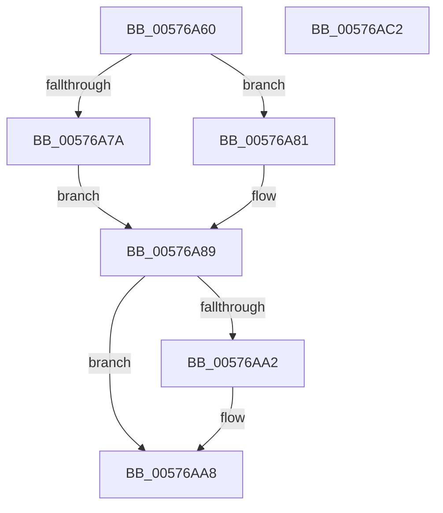

# XmSegmentOffset

- RVA: `0x00576A60`–`0x00576AC3` (길이 `99` bytes)
- VA: `0x0000000140576A60`
- 실행 섹션: `.text`
- PDB 이름 있음: `예`; PDB Function 태그: `아니요`
- unwind 정보 RVA: `0x0005CF00`
- 디코드: `30`개 명령, `99/99` bytes 표시
- 미해석 바이트: `0` (있으면 어셈블리에 `.byte`로 보존)

> 이 문서는 커널 이미지의 기계어와 PDB 기호를 분석해 생성했습니다. 4번과 5번은 함수 원형과 자료형을 바이너리 사용 방식에서 추정한 C 해석이며 원본 소스 복구 결과는 아닙니다.

## 1. Dependencies

- 직접 호출 지점: **5**; 고유 호출 대상: **5**
- 직접 호출자로 확인된 함수: **0**
- RIP 상대 이미지 참조: **0**

### Outgoing calls
- `0x00576A69` → [XmSetDataType](../47/XmSetDataType_function_004734C0.md) (function, `0x004734C0`)
- `0x00576A7A` → [XmGetLongImmediate](../56/XmGetLongImmediate_function_0056DC70.md) (function, `0x0056DC70`)
- `0x00576A81` → [XmGetWordImmediate](../47/XmGetWordImmediate_function_004731DC.md) (function, `0x004731DC`)
- `0x00576A8E` → [XmGetOffsetAddress](XmGetOffsetAddress_function_00578B84.md) (function, `0x00578B84`)
- `0x00576AB2` → [XmSetSourceValue](../47/XmSetSourceValue_function_004737A8.md) (function, `0x004737A8`)

### Direct callers
- 이 함수 시작 RVA로 연결되는 직접 call은 확인되지 않았습니다. 간접 호출은 완전히 역산할 수 없습니다.

### Static image references
- 디코드된 RIP-relative 메모리 참조가 없습니다.

## 2. Other-region calls and transfers

- 다른 실행 섹션으로 향하는 call: **0**
- 별도 외부 분기/꼬리 이동을 확인하지 못했습니다.

## 3. Assembly (complete function range)

```asm
00576A60  40 53                           push rbx
00576A62  48 83 EC 20                     sub rsp, 0x20
00576A66  48 8B D9                        mov rbx, rcx
00576A69  E8 52 CA EF FF                  call 0x1404734c0
00576A6E  80 BB 89 00 00 00 00            cmp byte ptr [rbx + 0x89], 0
00576A75  48 8B CB                        mov rcx, rbx
00576A78  74 07                           je 0x140576a81
00576A7A  E8 F1 71 FF FF                  call 0x14056dc70
00576A7F  EB 08                           jmp 0x140576a89
00576A81  E8 56 C7 EF FF                  call 0x1404731dc
00576A86  0F B7 C0                        movzx eax, ax
00576A89  8B D0                           mov edx, eax
00576A8B  48 8B CB                        mov rcx, rbx
00576A8E  E8 F1 20 00 00                  call 0x140578b84
00576A93  8B 4B 70                        mov ecx, dword ptr [rbx + 0x70]
00576A96  48 8D 53 18                     lea rdx, [rbx + 0x18]
00576A9A  4C 8B C0                        mov r8, rax
00576A9D  F6 C1 02                        test cl, 2
00576AA0  74 06                           je 0x140576aa8
00576AA2  48 8B C2                        mov rax, rdx
00576AA5  49 8B D0                        mov rdx, r8
00576AA8  48 89 53 58                     mov qword ptr [rbx + 0x58], rdx
00576AAC  48 8B CB                        mov rcx, rbx
00576AAF  48 8B D0                        mov rdx, rax
00576AB2  E8 F1 CC EF FF                  call 0x1404737a8
00576AB7  B8 01 00 00 00                  mov eax, 1
00576ABC  48 83 C4 20                     add rsp, 0x20
00576AC0  5B                              pop rbx
00576AC1  C3                              ret
00576AC2  CC                              int3
```

## 4. C-style interpretation (structured pseudocode)

```c
__int64 __fastcall XmSegmentOffset(__int64 a1)
{
    __int64 result;
    __int64 v_rsp;

    v_rsp = (v_rsp) - (32);
    result = XmSetDataType(a1, a2, a3, a4);
    if ((*(unsigned __int8 *)(a1 + 137)) == 0) goto loc_00576A81;
    result = XmGetLongImmediate(a1, a2, a3, a4);
    goto loc_00576A89;
loc_00576A81:
    result = XmGetWordImmediate(a1, a2, a3, a4);
loc_00576A89:
    result = XmGetOffsetAddress(a1, (unsigned int)((unsigned int)((unsigned __int16)(result))), a3, a4);
    if ((((unsigned __int8)((unsigned int)(*(unsigned int *)(a1 + 112)))) & (2)) != 0) {
        result = a1 + 24;
        a2 = result;
    }
    *(unsigned __int64 *)(a1 + 88) = a2;
    result = XmSetSourceValue(a1, result, result, a4);
    v_rsp = (v_rsp) + (32);
    return 1;
}
```

## 5. (Beta) C Style

```c
int64_t XmSegmentOffset(void *Arg1)
{
    uint8_t *arg1 = (uint8_t *)Arg1;

    int64_t result;
    int64_t local_rsp;

    local_rsp = (local_rsp) - (32);
    result = XmSetDataType(Arg1, a2, a3, a4);
    if ((*(uint8_t *)(arg1 + 0x89)) == 0) goto loc_00576A81;
    result = XmGetLongImmediate(Arg1, a2, a3, a4);
    goto loc_00576A89;
loc_00576A81:
    result = XmGetWordImmediate(Arg1, a2, a3, a4);
loc_00576A89:
    result = XmGetOffsetAddress(Arg1, (uint32_t)((uint32_t)((uint16_t)(result))), a3, a4);
    if ((((uint8_t)((uint32_t)(*(uint32_t *)(arg1 + 0x70)))) & (2)) != 0) {
        result = Arg1 + 24;
        a2 = result;
    }
    *(uint64_t *)(arg1 + 0x58) = a2;
    result = XmSetSourceValue(Arg1, result, result, a4);
    local_rsp = (local_rsp) + (32);
    return 1;
}
```

### 관측된 메모리 오프셋

구조체 형식이 확인되지 않은 접근은 인자 기준의 오프셋으로만 기록했습니다.

| 기준 인자 | 오프셋 표현 | 폭 (bit) | 접근 |
|---|---:|---:|---|
| `Arg1` | `+ 0x18` | `64` | `R` |
| `Arg1` | `+ 0x58` | `64` | `W` |
| `Arg1` | `+ 0x70` | `32` | `R` |
| `Arg1` | `+ 0x89` | `8` | `R` |

## 6. Execution-region graph

[열기: 2D/3D 그래프와 함수 탐색 컨트롤 패널](../../../control-panel.html?section=text&rva=0x00576A60&view=graph)

- 2D 그래프는 위에서 아래로 흐르고, 3D 그래프는 빈 공간을 드래그해 회전합니다. Shift+드래그는 이동, 휠은 확대·축소, 함수 노드 선택은 대상 보고서 이동입니다.

### Static fallback


