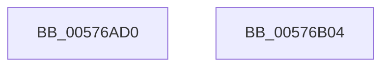

# XmSetccByte

- RVA: `0x00576AD0`–`0x00576B05` (길이 `53` bytes)
- VA: `0x0000000140576AD0`
- 실행 섹션: `.text`
- PDB 이름 있음: `예`; PDB Function 태그: `아니요`
- unwind 정보 RVA: `0x0005CF00`
- 디코드: `16`개 명령, `53/53` bytes 표시
- 미해석 바이트: `0` (있으면 어셈블리에 `.byte`로 보존)

> 이 문서는 커널 이미지의 기계어와 PDB 기호를 분석해 생성했습니다. 4번과 5번은 함수 원형과 자료형을 바이너리 사용 방식에서 추정한 C 해석이며 원본 소스 복구 결과는 아닙니다.

## 1. Dependencies

- 직접 호출 지점: **1**; 고유 호출 대상: **1**
- 직접 호출자로 확인된 함수: **0**
- RIP 상대 이미지 참조: **0**

### Outgoing calls
- `0x00576AE7` → [XmEvaluateAddressSpecifier](../47/XmEvaluateAddressSpecifier_function_00473224.md) (function, `0x00473224`)

### Direct callers
- 이 함수 시작 RVA로 연결되는 직접 call은 확인되지 않았습니다. 간접 호출은 완전히 역산할 수 없습니다.

### Static image references
- 디코드된 RIP-relative 메모리 참조가 없습니다.

## 2. Other-region calls and transfers

- 다른 실행 섹션으로 향하는 call: **0**
- 별도 외부 분기/꼬리 이동을 확인하지 못했습니다.

## 3. Assembly (complete function range)

```asm
00576AD0  40 53                           push rbx
00576AD2  48 83 EC 20                     sub rsp, 0x20
00576AD6  83 64 24 30 00                  and dword ptr [rsp + 0x30], 0
00576ADB  48 8D 54 24 30                  lea rdx, [rsp + 0x30]
00576AE0  83 61 78 00                     and dword ptr [rcx + 0x78], 0
00576AE4  48 8B D9                        mov rbx, rcx
00576AE7  E8 38 C7 EF FF                  call 0x140473224
00576AEC  48 89 43 58                     mov qword ptr [rbx + 0x58], rax
00576AF0  8B 43 70                        mov eax, dword ptr [rbx + 0x70]
00576AF3  83 E0 0F                        and eax, 0xf
00576AF6  89 43 6C                        mov dword ptr [rbx + 0x6c], eax
00576AF9  B8 01 00 00 00                  mov eax, 1
00576AFE  48 83 C4 20                     add rsp, 0x20
00576B02  5B                              pop rbx
00576B03  C3                              ret
00576B04  CC                              int3
```

## 4. C-style interpretation (structured pseudocode)

```c
__int64 __fastcall XmSetccByte(__int64 a1)
{
    __int64 result;
    __int64 v_rsp;
    unsigned int v_stack_p8;

    v_rsp = (v_rsp) - (32);
    result = XmEvaluateAddressSpecifier(a1, v_stack_p8, a3, a4);
    *(unsigned __int64 *)(a1 + 88) = result;
    result = (unsigned int)(((unsigned int)(*(unsigned int *)(a1 + 112))) & (15));
    *(unsigned int *)(a1 + 108) = (unsigned int)(result);
    v_rsp = (v_rsp) + (32);
    return 1;
}
```

## 5. (Beta) C Style

```c
int64_t XmSetccByte(void *Arg1)
{
    uint8_t *arg1 = (uint8_t *)Arg1;

    int64_t result;
    int64_t local_rsp;
    uint32_t v_stack_p8;

    local_rsp = (local_rsp) - (32);
    result = XmEvaluateAddressSpecifier(Arg1, v_stack_p8, a3, a4);
    *(uint64_t *)(arg1 + 0x58) = result;
    result = (uint32_t)(((uint32_t)(*(uint32_t *)(arg1 + 0x70))) & (15));
    *(uint32_t *)(arg1 + 0x6C) = (uint32_t)(result);
    local_rsp = (local_rsp) + (32);
    return 1;
}
```

### 관측된 메모리 오프셋

구조체 형식이 확인되지 않은 접근은 인자 기준의 오프셋으로만 기록했습니다.

| 기준 인자 | 오프셋 표현 | 폭 (bit) | 접근 |
|---|---:|---:|---|
| `Arg1` | `+ 0x58` | `64` | `W` |
| `Arg1` | `+ 0x6C` | `32` | `W` |
| `Arg1` | `+ 0x70` | `32` | `R` |
| `Arg1` | `+ 0x78` | `32` | `R/W` |

## 6. Execution-region graph

[열기: 2D/3D 그래프와 함수 탐색 컨트롤 패널](../../../control-panel.html?section=text&rva=0x00576AD0&view=graph)

- 2D 그래프는 위에서 아래로 흐르고, 3D 그래프는 빈 공간을 드래그해 회전합니다. Shift+드래그는 이동, 휠은 확대·축소, 함수 노드 선택은 대상 보고서 이동입니다.

### Static fallback


