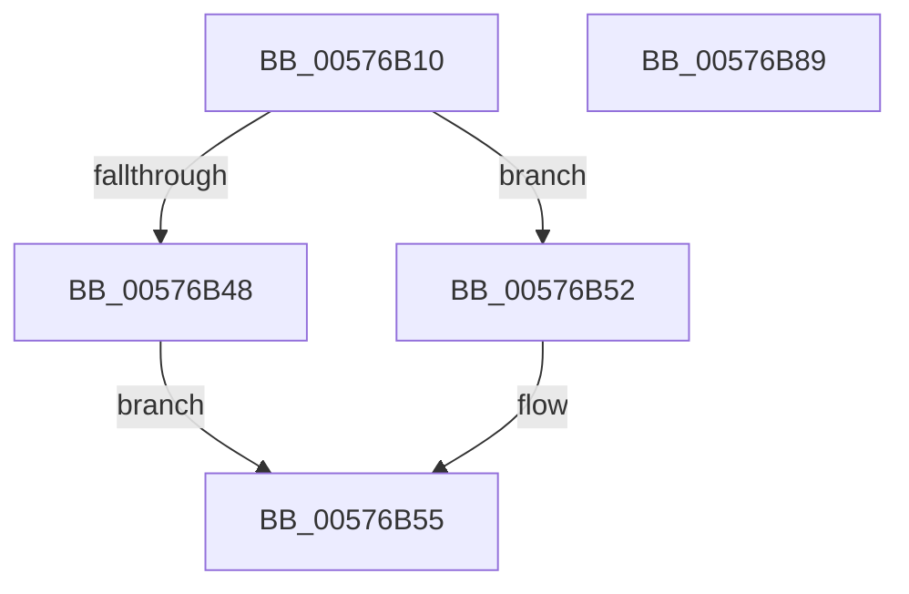

# XmShiftDouble

- RVA: `0x00576B10`–`0x00576B8A` (길이 `122` bytes)
- VA: `0x0000000140576B10`
- 실행 섹션: `.text`
- PDB 이름 있음: `예`; PDB Function 태그: `아니요`
- unwind 정보 RVA: `0x00068D5C`
- 디코드: `36`개 명령, `122/122` bytes 표시
- 미해석 바이트: `0` (있으면 어셈블리에 `.byte`로 보존)

> 이 문서는 커널 이미지의 기계어와 PDB 기호를 분석해 생성했습니다. 4번과 5번은 함수 원형과 자료형을 바이너리 사용 방식에서 추정한 C 해석이며 원본 소스 복구 결과는 아닙니다.

## 1. Dependencies

- 직접 호출 지점: **4**; 고유 호출 대상: **4**
- 직접 호출자로 확인된 함수: **0**
- RIP 상대 이미지 참조: **0**

### Outgoing calls
- `0x00576B39` → [XmEvaluateAddressSpecifier](../47/XmEvaluateAddressSpecifier_function_00473224.md) (function, `0x00473224`)
- `0x00576B4B` → [XmGetCodeByte](../47/XmGetCodeByte_function_00473678.md) (function, `0x00473678`)
- `0x00576B6C` → [XmSetSourceValue](../47/XmSetSourceValue_function_004737A8.md) (function, `0x004737A8`)
- `0x00576B74` → [XmSetDestinationValue](../47/XmSetDestinationValue_function_004734EC.md) (function, `0x004734EC`)

### Direct callers
- 이 함수 시작 RVA로 연결되는 직접 call은 확인되지 않았습니다. 간접 호출은 완전히 역산할 수 없습니다.

### Static image references
- 디코드된 RIP-relative 메모리 참조가 없습니다.

## 2. Other-region calls and transfers

- 다른 실행 섹션으로 향하는 call: **0**
- 별도 외부 분기/꼬리 이동을 확인하지 못했습니다.

## 3. Assembly (complete function range)

```asm
00576B10  48 89 5C 24 10                  mov qword ptr [rsp + 0x10], rbx
00576B15  57                              push rdi
00576B16  48 83 EC 20                     sub rsp, 0x20
00576B1A  83 64 24 30 00                  and dword ptr [rsp + 0x30], 0
00576B1F  48 8B D9                        mov rbx, rcx
00576B22  8A 81 8A 00 00 00               mov al, byte ptr [rcx + 0x8a]
00576B28  F6 D8                           neg al
00576B2A  1B D2                           sbb edx, edx
00576B2C  83 E2 02                        and edx, 2
00576B2F  FF C2                           inc edx
00576B31  89 51 78                        mov dword ptr [rcx + 0x78], edx
00576B34  48 8D 54 24 30                  lea rdx, [rsp + 0x30]
00576B39  E8 E6 C6 EF FF                  call 0x140473224
00576B3E  48 8B F8                        mov rdi, rax
00576B41  8B 43 70                        mov eax, dword ptr [rbx + 0x70]
00576B44  A8 01                           test al, 1
00576B46  75 0A                           jne 0x140576b52
00576B48  48 8B CB                        mov rcx, rbx
00576B4B  E8 28 CB EF FF                  call 0x140473678
00576B50  EB 03                           jmp 0x140576b55
00576B52  8A 43 1C                        mov al, byte ptr [rbx + 0x1c]
00576B55  8B 4C 24 30                     mov ecx, dword ptr [rsp + 0x30]
00576B59  24 1F                           and al, 0x1f
00576B5B  48 83 C1 06                     add rcx, 6
00576B5F  88 83 90 00 00 00               mov byte ptr [rbx + 0x90], al
00576B65  48 8D 14 8B                     lea rdx, [rbx + rcx*4]
00576B69  48 8B CB                        mov rcx, rbx
00576B6C  E8 37 CC EF FF                  call 0x1404737a8
00576B71  48 8B D7                        mov rdx, rdi
00576B74  E8 73 C9 EF FF                  call 0x1404734ec
00576B79  48 8B 5C 24 38                  mov rbx, qword ptr [rsp + 0x38]
00576B7E  B8 01 00 00 00                  mov eax, 1
00576B83  48 83 C4 20                     add rsp, 0x20
00576B87  5F                              pop rdi
00576B88  C3                              ret
00576B89  CC                              int3
```

## 4. C-style interpretation (structured pseudocode)

```c
__int64 __fastcall XmShiftDouble(__int64 a1, int a2)
{
    __int64 result;
    __int64 v_rsp;
    unsigned __int64 v_stack_p10;
    unsigned int v_stack_p8;

    v_stack_p10 = v_rbx;
    v_rsp = (v_rsp) - (32);
    result = (unsigned __int8)(-(*(unsigned __int8 *)(a1 + 138)));
    a2 = (unsigned int)((a2) & (2));
    a2 = (unsigned int)((a2) + 1);
    *(unsigned int *)(a1 + 120) = a2;
    result = XmEvaluateAddressSpecifier(a1, v_stack_p8, a3, a4);
    if ((((unsigned __int8)((unsigned int)(*(unsigned int *)(a1 + 112)))) & (1)) != 0) goto loc_00576B52;
    result = XmGetCodeByte(a1, v_stack_p8, a3, a4);
    goto loc_00576B55;
loc_00576B52:
loc_00576B55:
    result = (unsigned __int8)((*(unsigned __int8 *)(a1 + 28)) & (31));
    a1 = ((unsigned int)(v_stack_p8)) + (6);
    *(unsigned __int8 *)(a1 + 144) = (unsigned __int8)(result);
    result = XmSetSourceValue(a1, a1 + a1 * 4, a3, a4);
    result = XmSetDestinationValue(a1, result, a3, a4);
    v_rsp = (v_rsp) + (32);
    return 1;
}
```

## 5. (Beta) C Style

```c
int64_t XmShiftDouble(void *Arg1, int32_t Arg2)
{
    uint8_t *arg1 = (uint8_t *)Arg1;

    int64_t result;
    int64_t local_rsp;
    uint64_t v_stack_p10;
    uint32_t v_stack_p8;

    v_stack_p10 = local_rbx;
    local_rsp = (local_rsp) - (32);
    result = (uint8_t)(-(*(uint8_t *)(arg1 + 0x8A)));
    Arg2 = (uint32_t)((Arg2) & (2));
    Arg2 = (uint32_t)((Arg2) + 1);
    *(uint32_t *)(arg1 + 0x78) = Arg2;
    result = XmEvaluateAddressSpecifier(Arg1, v_stack_p8, a3, a4);
    if ((((uint8_t)((uint32_t)(*(uint32_t *)(arg1 + 0x70)))) & (1)) != 0) goto loc_00576B52;
    result = XmGetCodeByte(Arg1, v_stack_p8, a3, a4);
    goto loc_00576B55;
loc_00576B52:
loc_00576B55:
    result = (uint8_t)((*(uint8_t *)(arg1 + 0x1C)) & (31));
    Arg1 = ((uint32_t)(v_stack_p8)) + (6);
    *(uint8_t *)(arg1 + 0x90) = (uint8_t)(result);
    result = XmSetSourceValue(Arg1, Arg1 + Arg1 * 4, a3, a4);
    result = XmSetDestinationValue(Arg1, result, a3, a4);
    local_rsp = (local_rsp) + (32);
    return 1;
}
```

### 관측된 메모리 오프셋

구조체 형식이 확인되지 않은 접근은 인자 기준의 오프셋으로만 기록했습니다.

| 기준 인자 | 오프셋 표현 | 폭 (bit) | 접근 |
|---|---:|---:|---|
| `Arg1` | `+ 0x0 + rcx*4` | `64` | `R` |
| `Arg1` | `+ 0x1C` | `8` | `R` |
| `Arg1` | `+ 0x70` | `32` | `R` |
| `Arg1` | `+ 0x78` | `32` | `W` |
| `Arg1` | `+ 0x8A` | `8` | `R` |
| `Arg1` | `+ 0x90` | `8` | `W` |

## 6. Execution-region graph

[열기: 2D/3D 그래프와 함수 탐색 컨트롤 패널](../../../control-panel.html?section=text&rva=0x00576B10&view=graph)

- 2D 그래프는 위에서 아래로 흐르고, 3D 그래프는 빈 공간을 드래그해 회전합니다. Shift+드래그는 이동, 휠은 확대·축소, 함수 노드 선택은 대상 보고서 이동입니다.

### Static fallback


