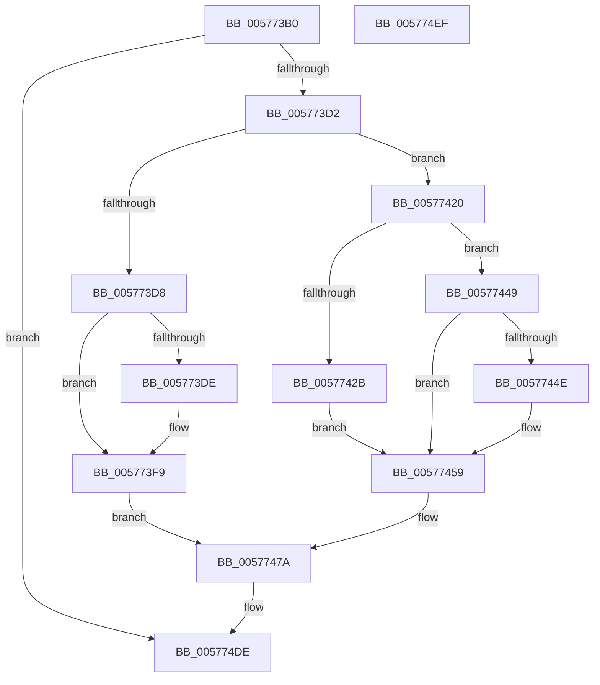

# XmShldOp

- RVA: `0x005773B0`–`0x005774F0` (길이 `320` bytes)
- VA: `0x00000001405773B0`
- 실행 섹션: `.text`
- PDB 이름 있음: `예`; PDB Function 태그: `아니요`
- unwind 정보 RVA: `0x0005CF00`
- 디코드: `100`개 명령, `320/320` bytes 표시
- 미해석 바이트: `0` (있으면 어셈블리에 `.byte`로 보존)

> 이 문서는 커널 이미지의 기계어와 PDB 기호를 분석해 생성했습니다. 4번과 5번은 함수 원형과 자료형을 바이너리 사용 방식에서 추정한 C 해석이며 원본 소스 복구 결과는 아닙니다.

## 1. Dependencies

- 직접 호출 지점: **1**; 고유 호출 대상: **1**
- 직접 호출자로 확인된 함수: **0**
- RIP 상대 이미지 참조: **1**

### Outgoing calls
- `0x005774E4` → [XmStoreResult](../47/XmStoreResult_function_004739FC.md) (function, `0x004739FC`)

### Direct callers
- 이 함수 시작 RVA로 연결되는 직접 call은 확인되지 않았습니다. 간접 호출은 완전히 역산할 수 없습니다.

### Static image references
- `0x00577488` → RVA `0x0001A190` (`.rdata`; read)

## 2. Other-region calls and transfers

- 다른 실행 섹션으로 향하는 call: **0**
- 별도 외부 분기/꼬리 이동을 확인하지 못했습니다.

## 3. Assembly (complete function range)

```asm
005773B0  40 53                           push rbx
005773B2  48 83 EC 20                     sub rsp, 0x20
005773B6  44 0F B6 81 90 00 00 00         movzx r8d, byte ptr [rcx + 0x90]
005773BE  4C 8B D1                        mov r10, rcx
005773C1  44 8B 59 6C                     mov r11d, dword ptr [rcx + 0x6c]
005773C5  44 8B 49 68                     mov r9d, dword ptr [rcx + 0x68]
005773C9  45 85 C0                        test r8d, r8d
005773CC  0F 84 0C 01 00 00               je 0x1405774de
005773D2  83 79 78 03                     cmp dword ptr [rcx + 0x78], 3
005773D6  75 48                           jne 0x140577420
005773D8  41 83 F8 01                     cmp r8d, 1
005773DC  75 1B                           jne 0x1405773f9
005773DE  8B 41 10                        mov eax, dword ptr [rcx + 0x10]
005773E1  41 8B D1                        mov edx, r9d
005773E4  D1 EA                           shr edx, 1
005773E6  41 33 D1                        xor edx, r9d
005773E9  C1 EA 13                        shr edx, 0x13
005773EC  33 D0                           xor edx, eax
005773EE  81 E2 00 08 00 00               and edx, 0x800
005773F4  33 D0                           xor edx, eax
005773F6  89 51 10                        mov dword ptr [rcx + 0x10], edx
005773F9  41 8B D9                        mov ebx, r9d
005773FC  41 8B C1                        mov eax, r9d
005773FF  B9 20 00 00 00                  mov ecx, 0x20
00577404  41 2B C8                        sub ecx, r8d
00577407  41 D3 EB                        shr r11d, cl
0057740A  45 8B CB                        mov r9d, r11d
0057740D  D3 EB                           shr ebx, cl
0057740F  41 8B C8                        mov ecx, r8d
00577412  D3 E0                           shl eax, cl
00577414  44 0B C8                        or r9d, eax
00577417  45 8B D9                        mov r11d, r9d
0057741A  41 C1 EB 1F                     shr r11d, 0x1f
0057741E  EB 5A                           jmp 0x14057747a
00577420  BA 10 00 00 00                  mov edx, 0x10
00577425  41 83 F8 01                     cmp r8d, 1
00577429  75 1E                           jne 0x140577449
0057742B  8B 41 10                        mov eax, dword ptr [rcx + 0x10]
0057742E  41 8B C9                        mov ecx, r9d
00577431  D1 E9                           shr ecx, 1
00577433  41 33 C9                        xor ecx, r9d
00577436  C1 E9 03                        shr ecx, 3
00577439  33 C8                           xor ecx, eax
0057743B  81 E1 00 08 00 00               and ecx, 0x800
00577441  33 C8                           xor ecx, eax
00577443  41 89 4A 10                     mov dword ptr [r10 + 0x10], ecx
00577447  EB 10                           jmp 0x140577459
00577449  44 3B C2                        cmp r8d, edx
0057744C  76 0B                           jbe 0x140577459
0057744E  41 83 C0 F0                     add r8d, -0x10
00577452  45 0F B7 CB                     movzx r9d, r11w
00577456  45 33 DB                        xor r11d, r11d
00577459  41 8B D9                        mov ebx, r9d
0057745C  41 2B D0                        sub edx, r8d
0057745F  8B CA                           mov ecx, edx
00577461  41 D3 EB                        shr r11d, cl
00577464  D3 EB                           shr ebx, cl
00577466  41 8B C8                        mov ecx, r8d
00577469  41 D3 E1                        shl r9d, cl
0057746C  45 0B D9                        or r11d, r9d
0057746F  45 0F B7 CB                     movzx r9d, r11w
00577473  45 8B D9                        mov r11d, r9d
00577476  41 C1 EB 0F                     shr r11d, 0xf
0057747A  41 8B 42 10                     mov eax, dword ptr [r10 + 0x10]
0057747E  8B D0                           mov edx, eax
00577480  33 D3                           xor edx, ebx
00577482  41 8B C9                        mov ecx, r9d
00577485  83 E1 0F                        and ecx, 0xf
00577488  48 8D 1D 01 2D AA FF            lea rbx, [rip - 0x55d2ff]
0057748F  83 E2 01                        and edx, 1
00577492  33 D0                           xor edx, eax
00577494  41 8B C1                        mov eax, r9d
00577497  48 C1 E8 04                     shr rax, 4
0057749B  83 E2 FB                        and edx, 0xfffffffb
0057749E  83 E0 0F                        and eax, 0xf
005774A1  44 0F B6 04 18                  movzx r8d, byte ptr [rax + rbx]
005774A6  0F B6 04 19                     movzx eax, byte ptr [rcx + rbx]
005774AA  44 03 C0                        add r8d, eax
005774AD  41 8B C1                        mov eax, r9d
005774B0  41 F7 D0                        not r8d
005774B3  41 83 E0 01                     and r8d, 1
005774B7  41 C1 E0 02                     shl r8d, 2
005774BB  44 33 C2                        xor r8d, edx
005774BE  41 83 E0 BF                     and r8d, 0xffffffbf
005774C2  F7 D8                           neg eax
005774C4  1B C9                           sbb ecx, ecx
005774C6  41 C1 E3 07                     shl r11d, 7
005774CA  F7 D1                           not ecx
005774CC  83 E1 40                        and ecx, 0x40
005774CF  44 0B C1                        or r8d, ecx
005774D2  41 0F BA F0 07                  btr r8d, 7
005774D7  45 0B C3                        or r8d, r11d
005774DA  45 89 42 10                     mov dword ptr [r10 + 0x10], r8d
005774DE  41 8B D1                        mov edx, r9d
005774E1  49 8B CA                        mov rcx, r10
005774E4  E8 13 C5 EF FF                  call 0x1404739fc
005774E9  48 83 C4 20                     add rsp, 0x20
005774ED  5B                              pop rbx
005774EE  C3                              ret
005774EF  CC                              int3
```

## 4. C-style interpretation (structured pseudocode)

```c
__int64 __fastcall XmShldOp(__int64 a1)
{
    __int64 result;
    __int64 v_r11;
    __int64 v_rbx;
    __int64 v_rsp;

    v_rsp = (v_rsp) - (32);
    if ((unsigned int)(*(unsigned __int8 *)(a1 + 144)) == 0) goto loc_005774DE;
    if ((*(unsigned int *)(a1 + 120)) != 3) goto loc_00577420;
    if (((unsigned int)(*(unsigned __int8 *)(a1 + 144))) == 1) {
        result = *(unsigned int *)(a1 + 16);
        a2 = (unsigned int)((unsigned int)(*(unsigned int *)(a1 + 104)));
        a2 = (unsigned int)((a2) >> (1));
        a2 = (unsigned int)((a2) ^ ((unsigned int)((unsigned int)(*(unsigned int *)(a1 + 104)))));
        a2 = (unsigned int)((a2) >> (19));
        a2 = (unsigned int)((a2) ^ ((unsigned int)(result)));
        a2 = (unsigned int)((a2) & (0x800ULL));
        a2 = (unsigned int)((a2) ^ ((unsigned int)(result)));
        *(unsigned int *)(a1 + 16) = (unsigned int)(a2);
    }
    a1 = (unsigned int)((32) - ((unsigned int)(*(unsigned __int8 *)(a1 + 144))));
    v_r11 = (unsigned int)(((unsigned int)(*(unsigned int *)(a1 + 108))) >> ((unsigned __int8)(a1)));
    v_rbx = (unsigned int)(((unsigned int)((unsigned int)((unsigned int)(*(unsigned int *)(a1 + 104))))) >> ((unsigned __int8)(a1)));
    result = (unsigned int)(((unsigned int)((unsigned int)((unsigned int)(*(unsigned int *)(a1 + 104))))) << ((unsigned __int8)((unsigned int)((unsigned int)(*(unsigned __int8 *)(a1 + 144))))));
    a4 = (unsigned int)(((unsigned int)((unsigned int)(v_r11))) | ((unsigned int)(result)));
    v_r11 = (unsigned int)(((unsigned int)((unsigned int)(a4))) >> (31));
    goto loc_0057747A;
loc_00577420:
    if (((unsigned int)(*(unsigned __int8 *)(a1 + 144))) != 1) goto loc_00577449;
    a1 = (unsigned int)(((unsigned int)((unsigned int)(a4))) >> (1));
    a1 = (unsigned int)((a1) ^ ((unsigned int)(a4)));
    a1 = (unsigned int)((a1) >> (3));
    a1 = (unsigned int)((a1) ^ ((unsigned int)((unsigned int)(*(unsigned int *)((unsigned int)((unsigned int)(*(unsigned __int8 *)(a1 + 144))) + 16)))));
    a1 = (unsigned int)((a1) & (0x800ULL));
    a1 = (unsigned int)((a1) ^ ((unsigned int)((unsigned int)(*(unsigned int *)((unsigned int)((unsigned int)(*(unsigned __int8 *)(a1 + 144))) + 16)))));
    *(unsigned int *)(a1 + 16) = (unsigned int)(a1);
    goto loc_00577459;
loc_00577449:
    if (((unsigned int)(*(unsigned __int8 *)(a1 + 144))) >= = 16) {
        a3 = (unsigned int)((*(unsigned __int8 *)(a1 + 144)) + (-16));
        a4 = (unsigned __int16)(v_r11);
        v_r11 = 0;
    }
    a2 = (unsigned int)((16) - ((unsigned int)(a3)));
    v_r11 = (unsigned int)((v_r11) >> ((unsigned __int8)((unsigned int)((unsigned int)(a2)))));
    v_rbx = (unsigned int)(((unsigned int)((unsigned int)(a4))) >> ((unsigned __int8)((unsigned int)((unsigned int)(a2)))));
    a4 = (unsigned int)((a4) << ((unsigned __int8)((unsigned int)((unsigned int)(a3)))));
    v_r11 = (unsigned int)((v_r11) | ((unsigned int)(a4)));
    v_r11 = (unsigned int)(((unsigned int)((unsigned int)((unsigned __int16)(v_r11)))) >> (15));
loc_0057747A:
    a2 = (unsigned int)(((unsigned int)((unsigned int)((unsigned int)(*(unsigned int *)(a1 + 16))))) ^ ((unsigned int)(v_rbx)));
    a1 = (unsigned int)(((unsigned int)((unsigned int)((unsigned __int16)(v_r11)))) & (15));
    a2 = (unsigned int)((a2) & (1));
    a2 = (unsigned int)((a2) ^ ((unsigned int)((unsigned int)(*(unsigned int *)(a1 + 16)))));
    result = ((unsigned int)((unsigned int)((unsigned __int16)(v_r11)))) >> (4);
    a2 = (unsigned int)((a2) & (0xFFFFFFFBULL));
    result = (unsigned int)((result) & (15));
    a3 = (unsigned int)((*(unsigned __int8 *)(result + v_rip - 5624575 * 1)) + ((unsigned int)(*(unsigned __int8 *)(a1 + v_rip - 5624575 * 1))));
    a3 = (unsigned int)(~(a3));
    a3 = (unsigned int)((a3) & (1));
    a3 = (unsigned int)((a3) << (2));
    a3 = (unsigned int)((a3) ^ ((unsigned int)(a2)));
    a3 = (unsigned int)((a3) & (0xFFFFFFBFULL));
    result = (unsigned int)(-((unsigned int)((unsigned int)((unsigned __int16)(v_r11)))));
    v_r11 = (unsigned int)((v_r11) << (7));
    a1 = (unsigned int)(~(a1));
    a1 = (unsigned int)((a1) & (64));
    a3 = (unsigned int)((a3) | ((unsigned int)(a1)));
    a3 = (unsigned int)((a3) | ((unsigned int)(v_r11)));
    *(unsigned int *)(a1 + 16) = (unsigned int)(a3);
loc_005774DE:
    result = XmStoreResult(a1, (unsigned int)((unsigned int)((unsigned __int16)(v_r11))), a3, (unsigned __int16)(v_r11));
    v_rsp = (v_rsp) + (32);
    return result;
}
```

## 5. (Beta) C Style

```c
int64_t XmShldOp(void *Arg1)
{
    uint8_t *arg1 = (uint8_t *)Arg1;

    int64_t result;
    int64_t local_r11;
    int64_t local_rbx;
    int64_t local_rsp;

    local_rsp = (local_rsp) - (32);
    if ((uint32_t)(*(uint8_t *)(arg1 + 0x90)) == 0) goto loc_005774DE;
    if ((*(uint32_t *)(arg1 + 0x78)) != 3) goto loc_00577420;
    if (((uint32_t)(*(uint8_t *)(arg1 + 0x90))) == 1) {
        result = *(uint32_t *)(arg1 + 0x10);
        a2 = (uint32_t)((uint32_t)(*(uint32_t *)(arg1 + 0x68)));
        a2 = (uint32_t)((a2) >> (1));
        a2 = (uint32_t)((a2) ^ ((uint32_t)((uint32_t)(*(uint32_t *)(arg1 + 0x68)))));
        a2 = (uint32_t)((a2) >> (19));
        a2 = (uint32_t)((a2) ^ ((uint32_t)(result)));
        a2 = (uint32_t)((a2) & (0x800ULL));
        a2 = (uint32_t)((a2) ^ ((uint32_t)(result)));
        *(uint32_t *)(arg1 + 0x10) = (uint32_t)(a2);
    }
    Arg1 = (uint32_t)((32) - ((uint32_t)(*(uint8_t *)(arg1 + 0x90))));
    local_r11 = (uint32_t)(((uint32_t)(*(uint32_t *)(arg1 + 0x6C))) >> ((uint8_t)(Arg1)));
    local_rbx = (uint32_t)(((uint32_t)((uint32_t)((uint32_t)(*(uint32_t *)(arg1 + 0x68))))) >> ((uint8_t)(Arg1)));
    result = (uint32_t)(((uint32_t)((uint32_t)((uint32_t)(*(uint32_t *)(arg1 + 0x68))))) << ((uint8_t)((uint32_t)((uint32_t)(*(uint8_t *)(arg1 + 0x90))))));
    a4 = (uint32_t)(((uint32_t)((uint32_t)(local_r11))) | ((uint32_t)(result)));
    local_r11 = (uint32_t)(((uint32_t)((uint32_t)(a4))) >> (31));
    goto loc_0057747A;
loc_00577420:
    if (((uint32_t)(*(uint8_t *)(arg1 + 0x90))) != 1) goto loc_00577449;
    Arg1 = (uint32_t)(((uint32_t)((uint32_t)(a4))) >> (1));
    Arg1 = (uint32_t)((Arg1) ^ ((uint32_t)(a4)));
    Arg1 = (uint32_t)((Arg1) >> (3));
    Arg1 = (uint32_t)((Arg1) ^ ((uint32_t)((uint32_t)(*(uint32_t *)((uint32_t)((uint32_t)(*(uint8_t *)(arg1 + 0x90))) + 0x10)))));
    Arg1 = (uint32_t)((Arg1) & (0x800ULL));
    Arg1 = (uint32_t)((Arg1) ^ ((uint32_t)((uint32_t)(*(uint32_t *)((uint32_t)((uint32_t)(*(uint8_t *)(arg1 + 0x90))) + 0x10)))));
    *(uint32_t *)(arg1 + 0x10) = (uint32_t)(Arg1);
    goto loc_00577459;
loc_00577449:
    if (((uint32_t)(*(uint8_t *)(arg1 + 0x90))) >= = 16) {
        a3 = (uint32_t)((*(uint8_t *)(arg1 + 0x90)) + (-16));
        a4 = (uint16_t)(local_r11);
        local_r11 = 0;
    }
    a2 = (uint32_t)((16) - ((uint32_t)(a3)));
    local_r11 = (uint32_t)((local_r11) >> ((uint8_t)((uint32_t)((uint32_t)(a2)))));
    local_rbx = (uint32_t)(((uint32_t)((uint32_t)(a4))) >> ((uint8_t)((uint32_t)((uint32_t)(a2)))));
    a4 = (uint32_t)((a4) << ((uint8_t)((uint32_t)((uint32_t)(a3)))));
    local_r11 = (uint32_t)((local_r11) | ((uint32_t)(a4)));
    local_r11 = (uint32_t)(((uint32_t)((uint32_t)((uint16_t)(local_r11)))) >> (15));
loc_0057747A:
    a2 = (uint32_t)(((uint32_t)((uint32_t)((uint32_t)(*(uint32_t *)(arg1 + 0x10))))) ^ ((uint32_t)(local_rbx)));
    Arg1 = (uint32_t)(((uint32_t)((uint32_t)((uint16_t)(local_r11)))) & (15));
    a2 = (uint32_t)((a2) & (1));
    a2 = (uint32_t)((a2) ^ ((uint32_t)((uint32_t)(*(uint32_t *)(arg1 + 0x10)))));
    result = ((uint32_t)((uint32_t)((uint16_t)(local_r11)))) >> (4);
    a2 = (uint32_t)((a2) & (0xFFFFFFFBULL));
    result = (uint32_t)((result) & (15));
    a3 = (uint32_t)((*(uint8_t *)(result + v_rip - 0x55D2FF * 1)) + ((uint32_t)(*(uint8_t *)(arg1 + v_rip - 0x55D2FF * 1))));
    a3 = (uint32_t)(~(a3));
    a3 = (uint32_t)((a3) & (1));
    a3 = (uint32_t)((a3) << (2));
    a3 = (uint32_t)((a3) ^ ((uint32_t)(a2)));
    a3 = (uint32_t)((a3) & (0xFFFFFFBFULL));
    result = (uint32_t)(-((uint32_t)((uint32_t)((uint16_t)(local_r11)))));
    local_r11 = (uint32_t)((local_r11) << (7));
    Arg1 = (uint32_t)(~(Arg1));
    Arg1 = (uint32_t)((Arg1) & (64));
    a3 = (uint32_t)((a3) | ((uint32_t)(Arg1)));
    a3 = (uint32_t)((a3) | ((uint32_t)(local_r11)));
    *(uint32_t *)(arg1 + 0x10) = (uint32_t)(a3);
loc_005774DE:
    result = XmStoreResult(Arg1, (uint32_t)((uint32_t)((uint16_t)(local_r11))), a3, (uint16_t)(local_r11));
    local_rsp = (local_rsp) + (32);
    return result;
}
```

### 관측된 메모리 오프셋

구조체 형식이 확인되지 않은 접근은 인자 기준의 오프셋으로만 기록했습니다.

| 기준 인자 | 오프셋 표현 | 폭 (bit) | 접근 |
|---|---:|---:|---|
| `Arg1` | `+ 0x10` | `32` | `R` |
| `Arg1` | `+ 0x10` | `32` | `W` |
| `Arg1` | `+ 0x68` | `32` | `R` |
| `Arg1` | `+ 0x6C` | `32` | `R` |
| `Arg1` | `+ 0x78` | `32` | `R` |
| `Arg1` | `+ 0x90` | `8` | `R` |

## 6. Execution-region graph

[열기: 2D/3D 그래프와 함수 탐색 컨트롤 패널](../../../control-panel.html?section=text&rva=0x005773B0&view=graph)

- 2D 그래프는 위에서 아래로 흐르고, 3D 그래프는 빈 공간을 드래그해 회전합니다. Shift+드래그는 이동, 휠은 확대·축소, 함수 노드 선택은 대상 보고서 이동입니다.

### Static fallback


