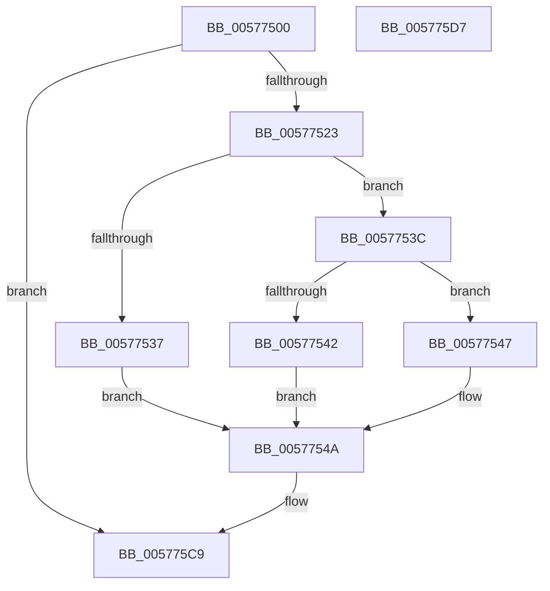

# XmShrOp

- RVA: `0x00577500`–`0x005775D8` (길이 `216` bytes)
- VA: `0x0000000140577500`
- 실행 섹션: `.text`
- PDB 이름 있음: `예`; PDB Function 태그: `아니요`
- unwind 정보 RVA: `0x0005CF00`
- 디코드: `68`개 명령, `216/216` bytes 표시
- 미해석 바이트: `0` (있으면 어셈블리에 `.byte`로 보존)

> 이 문서는 커널 이미지의 기계어와 PDB 기호를 분석해 생성했습니다. 4번과 5번은 함수 원형과 자료형을 바이너리 사용 방식에서 추정한 C 해석이며 원본 소스 복구 결과는 아닙니다.

## 1. Dependencies

- 직접 호출 지점: **1**; 고유 호출 대상: **1**
- 직접 호출자로 확인된 함수: **0**
- RIP 상대 이미지 참조: **1**

### Outgoing calls
- `0x005775CC` → [XmStoreResult](../47/XmStoreResult_function_004739FC.md) (function, `0x004739FC`)

### Direct callers
- 이 함수 시작 RVA로 연결되는 직접 call은 확인되지 않았습니다. 간접 호출은 완전히 역산할 수 없습니다.

### Static image references
- `0x00577559` → RVA `0x0001A190` (`.rdata`; read)

## 2. Other-region calls and transfers

- 다른 실행 섹션으로 향하는 call: **0**
- 별도 외부 분기/꼬리 이동을 확인하지 못했습니다.

## 3. Assembly (complete function range)

```asm
00577500  40 53                           push rbx
00577502  48 83 EC 20                     sub rsp, 0x20
00577506  44 8B 41 78                     mov r8d, dword ptr [rcx + 0x78]
0057750A  4C 8B C9                        mov r9, rcx
0057750D  8B 51 68                        mov edx, dword ptr [rcx + 0x68]
00577510  8B 49 6C                        mov ecx, dword ptr [rcx + 0x6c]
00577513  42 8D 1C C5 07 00 00 00         lea ebx, [r8*8 + 7]
0057751B  85 C9                           test ecx, ecx
0057751D  0F 84 A6 00 00 00               je 0x1405775c9
00577523  44 8B D2                        mov r10d, edx
00577526  44 8B DA                        mov r11d, edx
00577529  41 D3 EA                        shr r10d, cl
0057752C  FF C9                           dec ecx
0057752E  41 D3 EB                        shr r11d, cl
00577531  41 83 F8 03                     cmp r8d, 3
00577535  75 05                           jne 0x14057753c
00577537  C1 EA 1F                        shr edx, 0x1f
0057753A  EB 0E                           jmp 0x14057754a
0057753C  41 83 F8 01                     cmp r8d, 1
00577540  75 05                           jne 0x140577547
00577542  C1 EA 0F                        shr edx, 0xf
00577545  EB 03                           jmp 0x14057754a
00577547  C1 EA 07                        shr edx, 7
0057754A  41 8B 41 10                     mov eax, dword ptr [r9 + 0x10]
0057754E  8B C8                           mov ecx, eax
00577550  C1 E2 0B                        shl edx, 0xb
00577553  41 33 CB                        xor ecx, r11d
00577556  83 E1 01                        and ecx, 1
00577559  4C 8D 1D 30 2C AA FF            lea r11, [rip - 0x55d3d0]
00577560  33 C8                           xor ecx, eax
00577562  41 8B C2                        mov eax, r10d
00577565  33 D1                           xor edx, ecx
00577567  48 C1 E8 04                     shr rax, 4
0057756B  83 E0 0F                        and eax, 0xf
0057756E  81 E2 00 08 00 00               and edx, 0x800
00577574  33 D1                           xor edx, ecx
00577576  41 8B CA                        mov ecx, r10d
00577579  83 E2 FB                        and edx, 0xfffffffb
0057757C  83 E1 0F                        and ecx, 0xf
0057757F  46 0F B6 04 18                  movzx r8d, byte ptr [rax + r11]
00577584  42 0F B6 04 19                  movzx eax, byte ptr [rcx + r11]
00577589  8B CB                           mov ecx, ebx
0057758B  44 03 C0                        add r8d, eax
0057758E  41 8B C2                        mov eax, r10d
00577591  41 F7 D0                        not r8d
00577594  41 83 E0 01                     and r8d, 1
00577598  41 C1 E0 02                     shl r8d, 2
0057759C  44 33 C2                        xor r8d, edx
0057759F  41 83 E0 BF                     and r8d, 0xffffffbf
005775A3  F7 D8                           neg eax
005775A5  41 8B C2                        mov eax, r10d
005775A8  1B D2                           sbb edx, edx
005775AA  D3 E8                           shr eax, cl
005775AC  C1 E0 07                        shl eax, 7
005775AF  F7 D2                           not edx
005775B1  83 E2 40                        and edx, 0x40
005775B4  44 0B C2                        or r8d, edx
005775B7  41 8B D2                        mov edx, r10d
005775BA  41 33 C0                        xor eax, r8d
005775BD  25 80 00 00 00                  and eax, 0x80
005775C2  41 33 C0                        xor eax, r8d
005775C5  41 89 41 10                     mov dword ptr [r9 + 0x10], eax
005775C9  49 8B C9                        mov rcx, r9
005775CC  E8 2B C4 EF FF                  call 0x1404739fc
005775D1  48 83 C4 20                     add rsp, 0x20
005775D5  5B                              pop rbx
005775D6  C3                              ret
005775D7  CC                              int3
```

## 4. C-style interpretation (structured pseudocode)

```c
__int64 __fastcall XmShrOp(__int64 a1)
{
    __int64 result;
    __int64 v_r10;
    __int64 v_r11;
    __int64 v_rsp;

    v_rsp = (v_rsp) - (32);
    if ((unsigned int)((unsigned int)(*(unsigned int *)(a1 + 108))) == 0) goto loc_005775C9;
    v_r10 = (unsigned int)(((unsigned int)((unsigned int)((unsigned int)(*(unsigned int *)(a1 + 104))))) >> ((unsigned __int8)((unsigned int)(*(unsigned int *)(a1 + 108)))));
    a1 = (unsigned int)(((unsigned int)(*(unsigned int *)(a1 + 108))) - 1);
    v_r11 = (unsigned int)(((unsigned int)((unsigned int)((unsigned int)(*(unsigned int *)(a1 + 104))))) >> ((unsigned __int8)(a1)));
    if (((unsigned int)((unsigned int)(*(unsigned int *)(a1 + 120)))) != 3) goto loc_0057753C;
    a2 = (unsigned int)(((unsigned int)(*(unsigned int *)(a1 + 104))) >> (31));
    goto loc_0057754A;
loc_0057753C:
    if (((unsigned int)((unsigned int)(*(unsigned int *)(a1 + 120)))) != 1) goto loc_00577547;
    a2 = (unsigned int)((a2) >> (15));
    goto loc_0057754A;
loc_00577547:
    a2 = (unsigned int)((a2) >> (7));
loc_0057754A:
    a2 = (unsigned int)((a2) << (11));
    a1 = (unsigned int)(((unsigned int)((unsigned int)((unsigned int)(*(unsigned int *)(a1 + 16))))) ^ ((unsigned int)(v_r11)));
    a1 = (unsigned int)((a1) & (1));
    a1 = (unsigned int)((a1) ^ ((unsigned int)((unsigned int)(*(unsigned int *)(a1 + 16)))));
    a2 = (unsigned int)((a2) ^ ((unsigned int)(a1)));
    result = ((unsigned int)((unsigned int)(v_r10))) >> (4);
    result = (unsigned int)((result) & (15));
    a2 = (unsigned int)((a2) & (0x800ULL));
    a2 = (unsigned int)((a2) ^ ((unsigned int)(a1)));
    a2 = (unsigned int)((a2) & (0xFFFFFFFBULL));
    a1 = (unsigned int)(((unsigned int)((unsigned int)(v_r10))) & (15));
    a3 = (unsigned int)((*(unsigned __int8 *)(result + v_rip - 5624784 * 1)) + ((unsigned int)(*(unsigned __int8 *)(a1 + v_rip - 5624784 * 1))));
    a3 = (unsigned int)(~(a3));
    a3 = (unsigned int)((a3) & (1));
    a3 = (unsigned int)((a3) << (2));
    a3 = (unsigned int)((a3) ^ ((unsigned int)(a2)));
    a3 = (unsigned int)((a3) & (0xFFFFFFBFULL));
    result = (unsigned int)(-((unsigned int)((unsigned int)(v_r10))));
    result = (unsigned int)(((unsigned int)((unsigned int)(v_r10))) >> ((unsigned __int8)((unsigned int)((unsigned int)((unsigned int)(*(unsigned int *)(a1 + 120)) * 8 + 7)))));
    result = (unsigned int)((result) << (7));
    a2 = (unsigned int)(~(a2));
    a2 = (unsigned int)((a2) & (64));
    a3 = (unsigned int)((a3) | ((unsigned int)(a2)));
    result = (unsigned int)((result) ^ ((unsigned int)(a3)));
    result = (unsigned int)((result) & (128));
    result = (unsigned int)((result) ^ ((unsigned int)(a3)));
    *(unsigned int *)(a1 + 16) = (unsigned int)(result);
loc_005775C9:
    result = XmStoreResult(a1, (unsigned int)((unsigned int)(v_r10)), a3, a1);
    v_rsp = (v_rsp) + (32);
    return result;
}
```

## 5. (Beta) C Style

```c
int64_t XmShrOp(void *Arg1)
{
    uint8_t *arg1 = (uint8_t *)Arg1;

    int64_t result;
    int64_t local_r10;
    int64_t local_r11;
    int64_t local_rsp;

    local_rsp = (local_rsp) - (32);
    if ((uint32_t)((uint32_t)(*(uint32_t *)(arg1 + 0x6C))) == 0) goto loc_005775C9;
    local_r10 = (uint32_t)(((uint32_t)((uint32_t)((uint32_t)(*(uint32_t *)(arg1 + 0x68))))) >> ((uint8_t)((uint32_t)(*(uint32_t *)(arg1 + 0x6C)))));
    Arg1 = (uint32_t)(((uint32_t)(*(uint32_t *)(arg1 + 0x6C))) - 1);
    local_r11 = (uint32_t)(((uint32_t)((uint32_t)((uint32_t)(*(uint32_t *)(arg1 + 0x68))))) >> ((uint8_t)(Arg1)));
    if (((uint32_t)((uint32_t)(*(uint32_t *)(arg1 + 0x78)))) != 3) goto loc_0057753C;
    a2 = (uint32_t)(((uint32_t)(*(uint32_t *)(arg1 + 0x68))) >> (31));
    goto loc_0057754A;
loc_0057753C:
    if (((uint32_t)((uint32_t)(*(uint32_t *)(arg1 + 0x78)))) != 1) goto loc_00577547;
    a2 = (uint32_t)((a2) >> (15));
    goto loc_0057754A;
loc_00577547:
    a2 = (uint32_t)((a2) >> (7));
loc_0057754A:
    a2 = (uint32_t)((a2) << (11));
    Arg1 = (uint32_t)(((uint32_t)((uint32_t)((uint32_t)(*(uint32_t *)(arg1 + 0x10))))) ^ ((uint32_t)(local_r11)));
    Arg1 = (uint32_t)((Arg1) & (1));
    Arg1 = (uint32_t)((Arg1) ^ ((uint32_t)((uint32_t)(*(uint32_t *)(arg1 + 0x10)))));
    a2 = (uint32_t)((a2) ^ ((uint32_t)(Arg1)));
    result = ((uint32_t)((uint32_t)(local_r10))) >> (4);
    result = (uint32_t)((result) & (15));
    a2 = (uint32_t)((a2) & (0x800ULL));
    a2 = (uint32_t)((a2) ^ ((uint32_t)(Arg1)));
    a2 = (uint32_t)((a2) & (0xFFFFFFFBULL));
    Arg1 = (uint32_t)(((uint32_t)((uint32_t)(local_r10))) & (15));
    a3 = (uint32_t)((*(uint8_t *)(result + v_rip - 0x55D3D0 * 1)) + ((uint32_t)(*(uint8_t *)(arg1 + v_rip - 0x55D3D0 * 1))));
    a3 = (uint32_t)(~(a3));
    a3 = (uint32_t)((a3) & (1));
    a3 = (uint32_t)((a3) << (2));
    a3 = (uint32_t)((a3) ^ ((uint32_t)(a2)));
    a3 = (uint32_t)((a3) & (0xFFFFFFBFULL));
    result = (uint32_t)(-((uint32_t)((uint32_t)(local_r10))));
    result = (uint32_t)(((uint32_t)((uint32_t)(local_r10))) >> ((uint8_t)((uint32_t)((uint32_t)((uint32_t)(*(uint32_t *)(arg1 + 0x78)) * 8 + 7)))));
    result = (uint32_t)((result) << (7));
    a2 = (uint32_t)(~(a2));
    a2 = (uint32_t)((a2) & (64));
    a3 = (uint32_t)((a3) | ((uint32_t)(a2)));
    result = (uint32_t)((result) ^ ((uint32_t)(a3)));
    result = (uint32_t)((result) & (128));
    result = (uint32_t)((result) ^ ((uint32_t)(a3)));
    *(uint32_t *)(arg1 + 0x10) = (uint32_t)(result);
loc_005775C9:
    result = XmStoreResult(Arg1, (uint32_t)((uint32_t)(local_r10)), a3, Arg1);
    local_rsp = (local_rsp) + (32);
    return result;
}
```

### 관측된 메모리 오프셋

구조체 형식이 확인되지 않은 접근은 인자 기준의 오프셋으로만 기록했습니다.

| 기준 인자 | 오프셋 표현 | 폭 (bit) | 접근 |
|---|---:|---:|---|
| `Arg1` | `+ 0x10` | `32` | `R` |
| `Arg1` | `+ 0x10` | `32` | `W` |
| `Arg1` | `+ 0x68` | `32` | `R` |
| `Arg1` | `+ 0x6C` | `32` | `R` |
| `Arg1` | `+ 0x78` | `32` | `R` |

## 6. Execution-region graph

[열기: 2D/3D 그래프와 함수 탐색 컨트롤 패널](../../../control-panel.html?section=text&rva=0x00577500&view=graph)

- 2D 그래프는 위에서 아래로 흐르고, 3D 그래프는 빈 공간을 드래그해 회전합니다. Shift+드래그는 이동, 휠은 확대·축소, 함수 노드 선택은 대상 보고서 이동입니다.

### Static fallback


