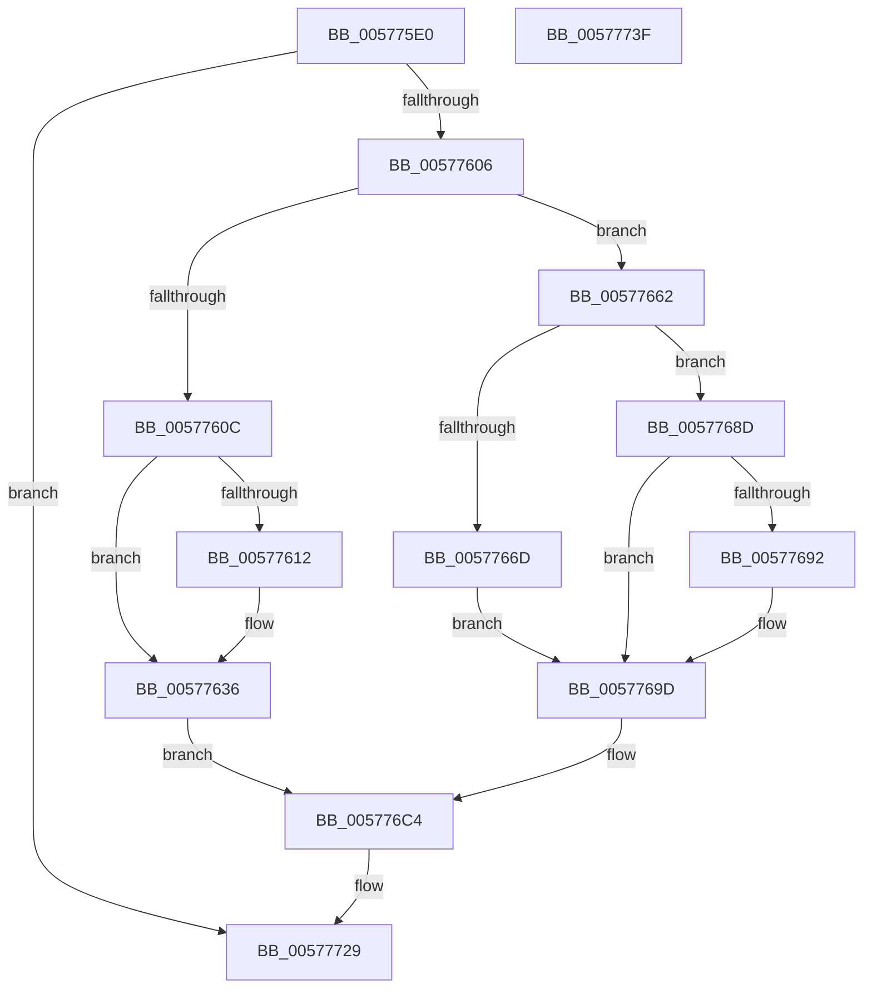

# XmShrdOp

- RVA: `0x005775E0`–`0x00577740` (길이 `352` bytes)
- VA: `0x00000001405775E0`
- 실행 섹션: `.text`
- PDB 이름 있음: `예`; PDB Function 태그: `아니요`
- unwind 정보 RVA: `0x0005CAAC`
- 디코드: `106`개 명령, `352/352` bytes 표시
- 미해석 바이트: `0` (있으면 어셈블리에 `.byte`로 보존)

> 이 문서는 커널 이미지의 기계어와 PDB 기호를 분석해 생성했습니다. 4번과 5번은 함수 원형과 자료형을 바이너리 사용 방식에서 추정한 C 해석이며 원본 소스 복구 결과는 아닙니다.

## 1. Dependencies

- 직접 호출 지점: **1**; 고유 호출 대상: **1**
- 직접 호출자로 확인된 함수: **0**
- RIP 상대 이미지 참조: **1**

### Outgoing calls
- `0x0057772F` → [XmStoreResult](../47/XmStoreResult_function_004739FC.md) (function, `0x004739FC`)

### Direct callers
- 이 함수 시작 RVA로 연결되는 직접 call은 확인되지 않았습니다. 간접 호출은 완전히 역산할 수 없습니다.

### Static image references
- `0x005776C7` → RVA `0x0001A190` (`.rdata`; read)

## 2. Other-region calls and transfers

- 다른 실행 섹션으로 향하는 call: **0**
- 별도 외부 분기/꼬리 이동을 확인하지 못했습니다.

## 3. Assembly (complete function range)

```asm
005775E0  48 89 5C 24 08                  mov qword ptr [rsp + 8], rbx
005775E5  57                              push rdi
005775E6  48 83 EC 20                     sub rsp, 0x20
005775EA  44 0F B6 91 90 00 00 00         movzx r10d, byte ptr [rcx + 0x90]
005775F2  48 8B D9                        mov rbx, rcx
005775F5  44 8B 59 6C                     mov r11d, dword ptr [rcx + 0x6c]
005775F9  44 8B 49 68                     mov r9d, dword ptr [rcx + 0x68]
005775FD  45 85 D2                        test r10d, r10d
00577600  0F 84 23 01 00 00               je 0x140577729
00577606  83 79 78 03                     cmp dword ptr [rcx + 0x78], 3
0057760A  75 56                           jne 0x140577662
0057760C  41 83 FA 01                     cmp r10d, 1
00577610  75 24                           jne 0x140577636
00577612  8B 51 10                        mov edx, dword ptr [rcx + 0x10]
00577615  45 8B C1                        mov r8d, r9d
00577618  41 C1 E8 14                     shr r8d, 0x14
0057761C  41 8B C3                        mov eax, r11d
0057761F  C1 E0 0B                        shl eax, 0xb
00577622  44 33 C0                        xor r8d, eax
00577625  44 33 C2                        xor r8d, edx
00577628  41 81 E0 00 08 00 00            and r8d, 0x800
0057762F  44 33 C2                        xor r8d, edx
00577632  44 89 41 10                     mov dword ptr [rcx + 0x10], r8d
00577636  41 8D 4A FF                     lea ecx, [r10 - 1]
0057763A  45 8B C1                        mov r8d, r9d
0057763D  41 D3 E8                        shr r8d, cl
00577640  41 8B C1                        mov eax, r9d
00577643  B9 20 00 00 00                  mov ecx, 0x20
00577648  41 2B CA                        sub ecx, r10d
0057764B  41 D3 E3                        shl r11d, cl
0057764E  41 8B CA                        mov ecx, r10d
00577651  D3 E8                           shr eax, cl
00577653  45 8B CB                        mov r9d, r11d
00577656  44 0B C8                        or r9d, eax
00577659  45 8B D1                        mov r10d, r9d
0057765C  41 C1 EA 1F                     shr r10d, 0x1f
00577660  EB 62                           jmp 0x1405776c4
00577662  BF 10 00 00 00                  mov edi, 0x10
00577667  41 83 FA 01                     cmp r10d, 1
0057766B  75 20                           jne 0x14057768d
0057766D  8B 49 10                        mov ecx, dword ptr [rcx + 0x10]
00577670  41 8B D1                        mov edx, r9d
00577673  C1 EA 04                        shr edx, 4
00577676  41 8B C3                        mov eax, r11d
00577679  C1 E0 0B                        shl eax, 0xb
0057767C  33 D0                           xor edx, eax
0057767E  33 D1                           xor edx, ecx
00577680  81 E2 00 08 00 00               and edx, 0x800
00577686  33 D1                           xor edx, ecx
00577688  89 53 10                        mov dword ptr [rbx + 0x10], edx
0057768B  EB 10                           jmp 0x14057769d
0057768D  44 3B D7                        cmp r10d, edi
00577690  76 0B                           jbe 0x14057769d
00577692  41 83 C2 F0                     add r10d, -0x10
00577696  45 0F B7 CB                     movzx r9d, r11w
0057769A  45 33 DB                        xor r11d, r11d
0057769D  41 8D 4A FF                     lea ecx, [r10 - 1]
005776A1  45 8B C1                        mov r8d, r9d
005776A4  41 2B FA                        sub edi, r10d
005776A7  41 D3 E8                        shr r8d, cl
005776AA  40 8A CF                        mov cl, dil
005776AD  41 D3 E3                        shl r11d, cl
005776B0  41 8B CA                        mov ecx, r10d
005776B3  41 D3 E9                        shr r9d, cl
005776B6  45 0B D9                        or r11d, r9d
005776B9  45 0F B7 CB                     movzx r9d, r11w
005776BD  45 8B D1                        mov r10d, r9d
005776C0  41 C1 EA 0F                     shr r10d, 0xf
005776C4  8B 43 10                        mov eax, dword ptr [rbx + 0x10]
005776C7  4C 8D 1D C2 2A AA FF            lea r11, [rip - 0x55d53e]
005776CE  8B D0                           mov edx, eax
005776D0  41 8B C9                        mov ecx, r9d
005776D3  41 33 D0                        xor edx, r8d
005776D6  83 E1 0F                        and ecx, 0xf
005776D9  83 E2 01                        and edx, 1
005776DC  33 D0                           xor edx, eax
005776DE  41 8B C1                        mov eax, r9d
005776E1  48 C1 E8 04                     shr rax, 4
005776E5  83 E2 FB                        and edx, 0xfffffffb
005776E8  83 E0 0F                        and eax, 0xf
005776EB  46 0F B6 04 18                  movzx r8d, byte ptr [rax + r11]
005776F0  42 0F B6 04 19                  movzx eax, byte ptr [rcx + r11]
005776F5  44 03 C0                        add r8d, eax
005776F8  41 8B C1                        mov eax, r9d
005776FB  41 F7 D0                        not r8d
005776FE  41 83 E0 01                     and r8d, 1
00577702  41 C1 E0 02                     shl r8d, 2
00577706  44 33 C2                        xor r8d, edx
00577709  41 83 E0 BF                     and r8d, 0xffffffbf
0057770D  F7 D8                           neg eax
0057770F  1B C9                           sbb ecx, ecx
00577711  41 C1 E2 07                     shl r10d, 7
00577715  F7 D1                           not ecx
00577717  83 E1 40                        and ecx, 0x40
0057771A  44 0B C1                        or r8d, ecx
0057771D  41 0F BA F0 07                  btr r8d, 7
00577722  45 0B C2                        or r8d, r10d
00577725  44 89 43 10                     mov dword ptr [rbx + 0x10], r8d
00577729  41 8B D1                        mov edx, r9d
0057772C  48 8B CB                        mov rcx, rbx
0057772F  E8 C8 C2 EF FF                  call 0x1404739fc
00577734  48 8B 5C 24 30                  mov rbx, qword ptr [rsp + 0x30]
00577739  48 83 C4 20                     add rsp, 0x20
0057773D  5F                              pop rdi
0057773E  C3                              ret
0057773F  CC                              int3
```

## 4. C-style interpretation (structured pseudocode)

```c
__int64 __fastcall XmShrdOp(__int64 a1)
{
    __int64 result;
    __int64 v_r10;
    __int64 v_r11;
    __int64 v_rdi;
    __int64 v_rsp;
    unsigned __int64 v_stack_p8;

    v_stack_p8 = v_rbx;
    v_rsp = (v_rsp) - (32);
    if ((unsigned int)(*(unsigned __int8 *)(a1 + 144)) == 0) goto loc_00577729;
    if ((*(unsigned int *)(a1 + 120)) != 3) goto loc_00577662;
    if (((unsigned int)(*(unsigned __int8 *)(a1 + 144))) == 1) {
        a2 = *(unsigned int *)(a1 + 16);
        a3 = (unsigned int)((unsigned int)(*(unsigned int *)(a1 + 104)));
        a3 = (unsigned int)((a3) >> (20));
        result = (unsigned int)((unsigned int)(*(unsigned int *)(a1 + 108)));
        result = (unsigned int)((result) << (11));
        a3 = (unsigned int)((a3) ^ ((unsigned int)(result)));
        a3 = (unsigned int)((a3) ^ ((unsigned int)(a2)));
        a3 = (unsigned int)((a3) & (0x800ULL));
        a3 = (unsigned int)((a3) ^ ((unsigned int)(a2)));
        *(unsigned int *)(a1 + 16) = (unsigned int)(a3);
    }
    a3 = (unsigned int)(((unsigned int)((unsigned int)((unsigned int)(*(unsigned int *)(a1 + 104))))) >> ((unsigned __int8)(*(unsigned __int8 *)(a1 + 144) - 1)));
    a1 = (unsigned int)((32) - ((unsigned int)(*(unsigned __int8 *)(a1 + 144))));
    v_r11 = (unsigned int)(((unsigned int)(*(unsigned int *)(a1 + 108))) << ((unsigned __int8)(a1)));
    result = (unsigned int)(((unsigned int)((unsigned int)((unsigned int)(*(unsigned int *)(a1 + 104))))) >> ((unsigned __int8)((unsigned int)((unsigned int)(*(unsigned __int8 *)(a1 + 144))))));
    a4 = (unsigned int)(((unsigned int)((unsigned int)(v_r11))) | ((unsigned int)(result)));
    v_r10 = (unsigned int)(((unsigned int)((unsigned int)(a4))) >> (31));
    goto loc_005776C4;
loc_00577662:
    if (((unsigned int)(v_r10)) != 1) goto loc_0057768D;
    a2 = (unsigned int)(((unsigned int)((unsigned int)(a4))) >> (4));
    result = (unsigned int)(((unsigned int)((unsigned int)(v_r11))) << (11));
    a2 = (unsigned int)((a2) ^ ((unsigned int)(result)));
    a2 = (unsigned int)((a2) ^ ((unsigned int)((unsigned int)(*(unsigned int *)((unsigned int)((unsigned int)(*(unsigned __int8 *)(a1 + 144))) + 16)))));
    a2 = (unsigned int)((a2) & (0x800ULL));
    a2 = (unsigned int)((a2) ^ ((unsigned int)((unsigned int)(*(unsigned int *)((unsigned int)((unsigned int)(*(unsigned __int8 *)(a1 + 144))) + 16)))));
    *(unsigned int *)(a1 + 16) = (unsigned int)(a2);
    goto loc_0057769D;
loc_0057768D:
    if (((unsigned int)(v_r10)) >= = 16) {
        v_r10 = (unsigned int)((v_r10) + (-16));
        a4 = (unsigned __int16)(v_r11);
        v_r11 = 0;
    }
    v_rdi = (unsigned int)((16) - ((unsigned int)(v_r10)));
    a3 = (unsigned int)(((unsigned int)((unsigned int)(a4))) >> ((unsigned __int8)(v_r10 - 1)));
    v_r11 = (unsigned int)((v_r11) << ((unsigned __int8)((unsigned __int8)(v_rdi))));
    a4 = (unsigned int)((a4) >> ((unsigned __int8)((unsigned int)((unsigned int)(v_r10)))));
    v_r11 = (unsigned int)((v_r11) | ((unsigned int)(a4)));
    v_r10 = (unsigned int)(((unsigned int)((unsigned int)((unsigned __int16)(v_r11)))) >> (15));
loc_005776C4:
    a2 = (unsigned int)(((unsigned int)((unsigned int)((unsigned int)(*(unsigned int *)(a1 + 16))))) ^ ((unsigned int)(a3)));
    a1 = (unsigned int)(((unsigned int)((unsigned int)((unsigned __int16)(v_r11)))) & (15));
    a2 = (unsigned int)((a2) & (1));
    a2 = (unsigned int)((a2) ^ ((unsigned int)((unsigned int)(*(unsigned int *)(a1 + 16)))));
    result = ((unsigned int)((unsigned int)((unsigned __int16)(v_r11)))) >> (4);
    a2 = (unsigned int)((a2) & (0xFFFFFFFBULL));
    result = (unsigned int)((result) & (15));
    a3 = (unsigned int)((*(unsigned __int8 *)(result + v_rip - 5625150 * 1)) + ((unsigned int)(*(unsigned __int8 *)(a1 + v_rip - 5625150 * 1))));
    a3 = (unsigned int)(~(a3));
    a3 = (unsigned int)((a3) & (1));
    a3 = (unsigned int)((a3) << (2));
    a3 = (unsigned int)((a3) ^ ((unsigned int)(a2)));
    a3 = (unsigned int)((a3) & (0xFFFFFFBFULL));
    result = (unsigned int)(-((unsigned int)((unsigned int)((unsigned __int16)(v_r11)))));
    v_r10 = (unsigned int)((v_r10) << (7));
    a1 = (unsigned int)(~(a1));
    a1 = (unsigned int)((a1) & (64));
    a3 = (unsigned int)((a3) | ((unsigned int)(a1)));
    a3 = (unsigned int)((a3) | ((unsigned int)(v_r10)));
    *(unsigned int *)(a1 + 16) = (unsigned int)(a3);
loc_00577729:
    result = XmStoreResult(a1, (unsigned int)((unsigned int)((unsigned __int16)(v_r11))), a3, (unsigned __int16)(v_r11));
    v_rsp = (v_rsp) + (32);
    return result;
}
```

## 5. (Beta) C Style

```c
int64_t XmShrdOp(void *Arg1)
{
    uint8_t *arg1 = (uint8_t *)Arg1;

    int64_t result;
    int64_t local_r10;
    int64_t local_r11;
    int64_t local_rdi;
    int64_t local_rsp;
    uint64_t v_stack_p8;

    v_stack_p8 = local_rbx;
    local_rsp = (local_rsp) - (32);
    if ((uint32_t)(*(uint8_t *)(arg1 + 0x90)) == 0) goto loc_00577729;
    if ((*(uint32_t *)(arg1 + 0x78)) != 3) goto loc_00577662;
    if (((uint32_t)(*(uint8_t *)(arg1 + 0x90))) == 1) {
        a2 = *(uint32_t *)(arg1 + 0x10);
        a3 = (uint32_t)((uint32_t)(*(uint32_t *)(arg1 + 0x68)));
        a3 = (uint32_t)((a3) >> (20));
        result = (uint32_t)((uint32_t)(*(uint32_t *)(arg1 + 0x6C)));
        result = (uint32_t)((result) << (11));
        a3 = (uint32_t)((a3) ^ ((uint32_t)(result)));
        a3 = (uint32_t)((a3) ^ ((uint32_t)(a2)));
        a3 = (uint32_t)((a3) & (0x800ULL));
        a3 = (uint32_t)((a3) ^ ((uint32_t)(a2)));
        *(uint32_t *)(arg1 + 0x10) = (uint32_t)(a3);
    }
    a3 = (uint32_t)(((uint32_t)((uint32_t)((uint32_t)(*(uint32_t *)(arg1 + 0x68))))) >> ((uint8_t)(*(uint8_t *)(arg1 + 0x90) - 1)));
    Arg1 = (uint32_t)((32) - ((uint32_t)(*(uint8_t *)(arg1 + 0x90))));
    local_r11 = (uint32_t)(((uint32_t)(*(uint32_t *)(arg1 + 0x6C))) << ((uint8_t)(Arg1)));
    result = (uint32_t)(((uint32_t)((uint32_t)((uint32_t)(*(uint32_t *)(arg1 + 0x68))))) >> ((uint8_t)((uint32_t)((uint32_t)(*(uint8_t *)(arg1 + 0x90))))));
    a4 = (uint32_t)(((uint32_t)((uint32_t)(local_r11))) | ((uint32_t)(result)));
    local_r10 = (uint32_t)(((uint32_t)((uint32_t)(a4))) >> (31));
    goto loc_005776C4;
loc_00577662:
    if (((uint32_t)(local_r10)) != 1) goto loc_0057768D;
    a2 = (uint32_t)(((uint32_t)((uint32_t)(a4))) >> (4));
    result = (uint32_t)(((uint32_t)((uint32_t)(local_r11))) << (11));
    a2 = (uint32_t)((a2) ^ ((uint32_t)(result)));
    a2 = (uint32_t)((a2) ^ ((uint32_t)((uint32_t)(*(uint32_t *)((uint32_t)((uint32_t)(*(uint8_t *)(arg1 + 0x90))) + 0x10)))));
    a2 = (uint32_t)((a2) & (0x800ULL));
    a2 = (uint32_t)((a2) ^ ((uint32_t)((uint32_t)(*(uint32_t *)((uint32_t)((uint32_t)(*(uint8_t *)(arg1 + 0x90))) + 0x10)))));
    *(uint32_t *)(arg1 + 0x10) = (uint32_t)(a2);
    goto loc_0057769D;
loc_0057768D:
    if (((uint32_t)(local_r10)) >= = 16) {
        local_r10 = (uint32_t)((local_r10) + (-16));
        a4 = (uint16_t)(local_r11);
        local_r11 = 0;
    }
    local_rdi = (uint32_t)((16) - ((uint32_t)(local_r10)));
    a3 = (uint32_t)(((uint32_t)((uint32_t)(a4))) >> ((uint8_t)(local_r10 - 1)));
    local_r11 = (uint32_t)((local_r11) << ((uint8_t)((uint8_t)(local_rdi))));
    a4 = (uint32_t)((a4) >> ((uint8_t)((uint32_t)((uint32_t)(local_r10)))));
    local_r11 = (uint32_t)((local_r11) | ((uint32_t)(a4)));
    local_r10 = (uint32_t)(((uint32_t)((uint32_t)((uint16_t)(local_r11)))) >> (15));
loc_005776C4:
    a2 = (uint32_t)(((uint32_t)((uint32_t)((uint32_t)(*(uint32_t *)(arg1 + 0x10))))) ^ ((uint32_t)(a3)));
    Arg1 = (uint32_t)(((uint32_t)((uint32_t)((uint16_t)(local_r11)))) & (15));
    a2 = (uint32_t)((a2) & (1));
    a2 = (uint32_t)((a2) ^ ((uint32_t)((uint32_t)(*(uint32_t *)(arg1 + 0x10)))));
    result = ((uint32_t)((uint32_t)((uint16_t)(local_r11)))) >> (4);
    a2 = (uint32_t)((a2) & (0xFFFFFFFBULL));
    result = (uint32_t)((result) & (15));
    a3 = (uint32_t)((*(uint8_t *)(result + v_rip - 0x55D53E * 1)) + ((uint32_t)(*(uint8_t *)(arg1 + v_rip - 0x55D53E * 1))));
    a3 = (uint32_t)(~(a3));
    a3 = (uint32_t)((a3) & (1));
    a3 = (uint32_t)((a3) << (2));
    a3 = (uint32_t)((a3) ^ ((uint32_t)(a2)));
    a3 = (uint32_t)((a3) & (0xFFFFFFBFULL));
    result = (uint32_t)(-((uint32_t)((uint32_t)((uint16_t)(local_r11)))));
    local_r10 = (uint32_t)((local_r10) << (7));
    Arg1 = (uint32_t)(~(Arg1));
    Arg1 = (uint32_t)((Arg1) & (64));
    a3 = (uint32_t)((a3) | ((uint32_t)(Arg1)));
    a3 = (uint32_t)((a3) | ((uint32_t)(local_r10)));
    *(uint32_t *)(arg1 + 0x10) = (uint32_t)(a3);
loc_00577729:
    result = XmStoreResult(Arg1, (uint32_t)((uint32_t)((uint16_t)(local_r11))), a3, (uint16_t)(local_r11));
    local_rsp = (local_rsp) + (32);
    return result;
}
```

### 관측된 메모리 오프셋

구조체 형식이 확인되지 않은 접근은 인자 기준의 오프셋으로만 기록했습니다.

| 기준 인자 | 오프셋 표현 | 폭 (bit) | 접근 |
|---|---:|---:|---|
| `Arg1` | `+ 0x10` | `32` | `R` |
| `Arg1` | `+ 0x10` | `32` | `W` |
| `Arg1` | `+ 0x68` | `32` | `R` |
| `Arg1` | `+ 0x6C` | `32` | `R` |
| `Arg1` | `+ 0x78` | `32` | `R` |
| `Arg1` | `+ 0x90` | `8` | `R` |

## 6. Execution-region graph

[열기: 2D/3D 그래프와 함수 탐색 컨트롤 패널](../../../control-panel.html?section=text&rva=0x005775E0&view=graph)

- 2D 그래프는 위에서 아래로 흐르고, 3D 그래프는 빈 공간을 드래그해 회전합니다. Shift+드래그는 이동, 휠은 확대·축소, 함수 노드 선택은 대상 보고서 이동입니다.

### Static fallback


