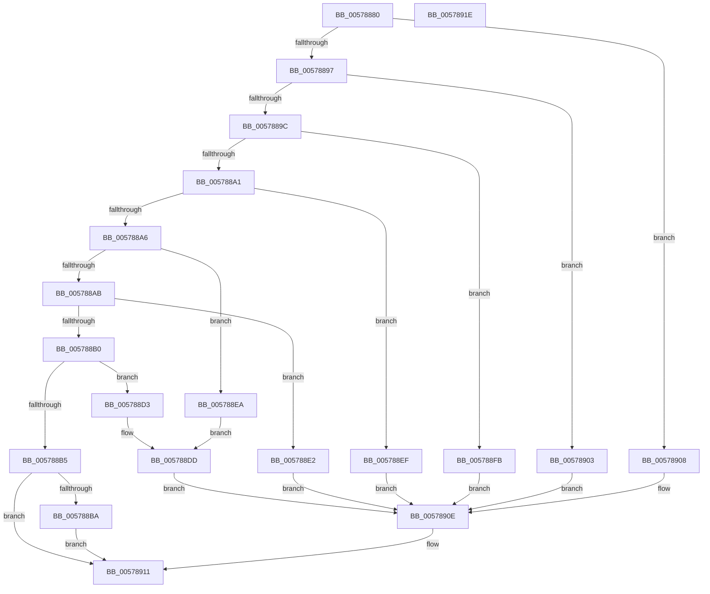

# XmSxxOp

- RVA: `0x00578880`–`0x0057891F` (길이 `159` bytes)
- VA: `0x0000000140578880`
- 실행 섹션: `.text`
- PDB 이름 있음: `예`; PDB Function 태그: `아니요`
- unwind 정보 RVA: `0x0005C788`
- 디코드: `61`개 명령, `159/159` bytes 표시
- 미해석 바이트: `0` (있으면 어셈블리에 `.byte`로 보존)

> 이 문서는 커널 이미지의 기계어와 PDB 기호를 분석해 생성했습니다. 4번과 5번은 함수 원형과 자료형을 바이너리 사용 방식에서 추정한 C 해석이며 원본 소스 복구 결과는 아닙니다.

## 1. Dependencies

- 직접 호출 지점: **1**; 고유 호출 대상: **1**
- 직접 호출자로 확인된 함수: **0**
- RIP 상대 이미지 참조: **0**

### Outgoing calls
- `0x00578914` → [XmStoreResult](../47/XmStoreResult_function_004739FC.md) (function, `0x004739FC`)

### Direct callers
- 이 함수 시작 RVA로 연결되는 직접 call은 확인되지 않았습니다. 간접 호출은 완전히 역산할 수 없습니다.

### Static image references
- 디코드된 RIP-relative 메모리 참조가 없습니다.

## 2. Other-region calls and transfers

- 다른 실행 섹션으로 향하는 call: **0**
- 별도 외부 분기/꼬리 이동을 확인하지 못했습니다.

## 3. Assembly (complete function range)

```asm
00578880  48 83 EC 28                     sub rsp, 0x28
00578884  8B 41 6C                        mov eax, dword ptr [rcx + 0x6c]
00578887  33 D2                           xor edx, edx
00578889  44 8B C0                        mov r8d, eax
0057888C  44 8D 4A 01                     lea r9d, [rdx + 1]
00578890  45 23 C1                        and r8d, r9d
00578893  D1 E8                           shr eax, 1
00578895  74 71                           je 0x140578908
00578897  41 2B C1                        sub eax, r9d
0057889A  74 67                           je 0x140578903
0057889C  41 2B C1                        sub eax, r9d
0057889F  74 5A                           je 0x1405788fb
005788A1  41 2B C1                        sub eax, r9d
005788A4  74 49                           je 0x1405788ef
005788A6  41 2B C1                        sub eax, r9d
005788A9  74 3F                           je 0x1405788ea
005788AB  41 2B C1                        sub eax, r9d
005788AE  74 32                           je 0x1405788e2
005788B0  41 2B C1                        sub eax, r9d
005788B3  74 1E                           je 0x1405788d3
005788B5  41 3B C1                        cmp eax, r9d
005788B8  75 57                           jne 0x140578911
005788BA  8B 41 10                        mov eax, dword ptr [rcx + 0x10]
005788BD  8B D0                           mov edx, eax
005788BF  C1 EA 04                        shr edx, 4
005788C2  33 D0                           xor edx, eax
005788C4  83 E0 40                        and eax, 0x40
005788C7  D1 EA                           shr edx, 1
005788C9  83 E2 40                        and edx, 0x40
005788CC  0B D0                           or edx, eax
005788CE  C1 EA 06                        shr edx, 6
005788D1  EB 3E                           jmp 0x140578911
005788D3  8B 41 10                        mov eax, dword ptr [rcx + 0x10]
005788D6  8B D0                           mov edx, eax
005788D8  C1 EA 04                        shr edx, 4
005788DB  33 D0                           xor edx, eax
005788DD  C1 EA 07                        shr edx, 7
005788E0  EB 2C                           jmp 0x14057890e
005788E2  8B 51 10                        mov edx, dword ptr [rcx + 0x10]
005788E5  C1 EA 02                        shr edx, 2
005788E8  EB 24                           jmp 0x14057890e
005788EA  8B 51 10                        mov edx, dword ptr [rcx + 0x10]
005788ED  EB EE                           jmp 0x1405788dd
005788EF  8B 41 10                        mov eax, dword ptr [rcx + 0x10]
005788F2  8B D0                           mov edx, eax
005788F4  C1 EA 06                        shr edx, 6
005788F7  0B D0                           or edx, eax
005788F9  EB 13                           jmp 0x14057890e
005788FB  8B 51 10                        mov edx, dword ptr [rcx + 0x10]
005788FE  C1 EA 06                        shr edx, 6
00578901  EB 0B                           jmp 0x14057890e
00578903  8B 51 10                        mov edx, dword ptr [rcx + 0x10]
00578906  EB 06                           jmp 0x14057890e
00578908  8B 51 10                        mov edx, dword ptr [rcx + 0x10]
0057890B  C1 EA 0B                        shr edx, 0xb
0057890E  41 23 D1                        and edx, r9d
00578911  41 33 D0                        xor edx, r8d
00578914  E8 E3 B0 EF FF                  call 0x1404739fc
00578919  48 83 C4 28                     add rsp, 0x28
0057891D  C3                              ret
0057891E  CC                              int3
```

## 4. C-style interpretation (structured pseudocode)

```c
__int64 __fastcall XmSxxOp(__int64 a1, int a2)
{
    __int64 result;
    __int64 v_rsp;

    v_rsp = (v_rsp) - (40);
    a2 = 0;
    a3 = (unsigned int)(((unsigned int)((unsigned int)((unsigned int)(*(unsigned int *)(a1 + 108))))) & ((unsigned int)(a2 + 1)));
    result = (unsigned int)(((unsigned int)(*(unsigned int *)(a1 + 108))) >> (1));
    if (condition_is_equal) goto loc_00578908;
    result = (unsigned int)((result) - ((unsigned int)(a2 + 1)));
    if (condition_is_equal) goto loc_00578903;
    result = (unsigned int)((result) - ((unsigned int)(a2 + 1)));
    if (condition_is_equal) goto loc_005788FB;
    result = (unsigned int)((result) - ((unsigned int)(a2 + 1)));
    if (condition_is_equal) goto loc_005788EF;
    result = (unsigned int)((result) - ((unsigned int)(a2 + 1)));
    if (condition_is_equal) goto loc_005788EA;
    result = (unsigned int)((result) - ((unsigned int)(a2 + 1)));
    if (condition_is_equal) goto loc_005788E2;
    result = (unsigned int)((result) - ((unsigned int)(a2 + 1)));
    if (condition_is_equal) goto loc_005788D3;
    if (((unsigned int)(result)) != ((unsigned int)(a2 + 1))) goto loc_00578911;
    a2 = (unsigned int)(((unsigned int)((unsigned int)((unsigned int)(*(unsigned int *)(a1 + 16))))) >> (4));
    a2 = (unsigned int)((a2) ^ ((unsigned int)((unsigned int)(*(unsigned int *)(a1 + 16)))));
    result = (unsigned int)(((unsigned int)(*(unsigned int *)(a1 + 16))) & (64));
    a2 = (unsigned int)((a2) >> (1));
    a2 = (unsigned int)((a2) & (64));
    a2 = (unsigned int)((a2) | ((unsigned int)(result)));
    a2 = (unsigned int)((a2) >> (6));
    goto loc_00578911;
loc_005788D3:
    a2 = (unsigned int)(((unsigned int)((unsigned int)((unsigned int)(*(unsigned int *)(a1 + 16))))) >> (4));
    a2 = (unsigned int)((a2) ^ ((unsigned int)((unsigned int)(*(unsigned int *)(a1 + 16)))));
loc_005788DD:
    a2 = (unsigned int)((a2) >> (7));
    goto loc_0057890E;
loc_005788E2:
    a2 = (unsigned int)(((unsigned int)(*(unsigned int *)(a1 + 16))) >> (2));
    goto loc_0057890E;
loc_005788EA:
    goto loc_005788DD;
loc_005788EF:
    a2 = (unsigned int)(((unsigned int)((unsigned int)((unsigned int)(*(unsigned int *)(a1 + 16))))) >> (6));
    a2 = (unsigned int)((a2) | ((unsigned int)((unsigned int)(*(unsigned int *)(a1 + 16)))));
    goto loc_0057890E;
loc_005788FB:
    a2 = (unsigned int)(((unsigned int)(*(unsigned int *)(a1 + 16))) >> (6));
    goto loc_0057890E;
loc_00578903:
    goto loc_0057890E;
loc_00578908:
    a2 = (unsigned int)(((unsigned int)(*(unsigned int *)(a1 + 16))) >> (11));
loc_0057890E:
    a2 = (unsigned int)((a2) & ((unsigned int)(a2 + 1)));
loc_00578911:
    a2 = (unsigned int)((a2) ^ ((unsigned int)(a3)));
    result = XmStoreResult(a1, a2, a3, a2 + 1);
    v_rsp = (v_rsp) + (40);
    return result;
}
```

## 5. (Beta) C Style

```c
int64_t XmSxxOp(void *Arg1, int32_t Arg2)
{
    uint8_t *arg1 = (uint8_t *)Arg1;

    int64_t result;
    int64_t local_rsp;

    local_rsp = (local_rsp) - (40);
    Arg2 = 0;
    a3 = (uint32_t)(((uint32_t)((uint32_t)((uint32_t)(*(uint32_t *)(arg1 + 0x6C))))) & ((uint32_t)(Arg2 + 1)));
    result = (uint32_t)(((uint32_t)(*(uint32_t *)(arg1 + 0x6C))) >> (1));
    if (condition_is_equal) goto loc_00578908;
    result = (uint32_t)((result) - ((uint32_t)(Arg2 + 1)));
    if (condition_is_equal) goto loc_00578903;
    result = (uint32_t)((result) - ((uint32_t)(Arg2 + 1)));
    if (condition_is_equal) goto loc_005788FB;
    result = (uint32_t)((result) - ((uint32_t)(Arg2 + 1)));
    if (condition_is_equal) goto loc_005788EF;
    result = (uint32_t)((result) - ((uint32_t)(Arg2 + 1)));
    if (condition_is_equal) goto loc_005788EA;
    result = (uint32_t)((result) - ((uint32_t)(Arg2 + 1)));
    if (condition_is_equal) goto loc_005788E2;
    result = (uint32_t)((result) - ((uint32_t)(Arg2 + 1)));
    if (condition_is_equal) goto loc_005788D3;
    if (((uint32_t)(result)) != ((uint32_t)(Arg2 + 1))) goto loc_00578911;
    Arg2 = (uint32_t)(((uint32_t)((uint32_t)((uint32_t)(*(uint32_t *)(arg1 + 0x10))))) >> (4));
    Arg2 = (uint32_t)((Arg2) ^ ((uint32_t)((uint32_t)(*(uint32_t *)(arg1 + 0x10)))));
    result = (uint32_t)(((uint32_t)(*(uint32_t *)(arg1 + 0x10))) & (64));
    Arg2 = (uint32_t)((Arg2) >> (1));
    Arg2 = (uint32_t)((Arg2) & (64));
    Arg2 = (uint32_t)((Arg2) | ((uint32_t)(result)));
    Arg2 = (uint32_t)((Arg2) >> (6));
    goto loc_00578911;
loc_005788D3:
    Arg2 = (uint32_t)(((uint32_t)((uint32_t)((uint32_t)(*(uint32_t *)(arg1 + 0x10))))) >> (4));
    Arg2 = (uint32_t)((Arg2) ^ ((uint32_t)((uint32_t)(*(uint32_t *)(arg1 + 0x10)))));
loc_005788DD:
    Arg2 = (uint32_t)((Arg2) >> (7));
    goto loc_0057890E;
loc_005788E2:
    Arg2 = (uint32_t)(((uint32_t)(*(uint32_t *)(arg1 + 0x10))) >> (2));
    goto loc_0057890E;
loc_005788EA:
    goto loc_005788DD;
loc_005788EF:
    Arg2 = (uint32_t)(((uint32_t)((uint32_t)((uint32_t)(*(uint32_t *)(arg1 + 0x10))))) >> (6));
    Arg2 = (uint32_t)((Arg2) | ((uint32_t)((uint32_t)(*(uint32_t *)(arg1 + 0x10)))));
    goto loc_0057890E;
loc_005788FB:
    Arg2 = (uint32_t)(((uint32_t)(*(uint32_t *)(arg1 + 0x10))) >> (6));
    goto loc_0057890E;
loc_00578903:
    goto loc_0057890E;
loc_00578908:
    Arg2 = (uint32_t)(((uint32_t)(*(uint32_t *)(arg1 + 0x10))) >> (11));
loc_0057890E:
    Arg2 = (uint32_t)((Arg2) & ((uint32_t)(Arg2 + 1)));
loc_00578911:
    Arg2 = (uint32_t)((Arg2) ^ ((uint32_t)(a3)));
    result = XmStoreResult(Arg1, Arg2, a3, Arg2 + 1);
    local_rsp = (local_rsp) + (40);
    return result;
}
```

### 관측된 메모리 오프셋

구조체 형식이 확인되지 않은 접근은 인자 기준의 오프셋으로만 기록했습니다.

| 기준 인자 | 오프셋 표현 | 폭 (bit) | 접근 |
|---|---:|---:|---|
| `Arg1` | `+ 0x10` | `32` | `R` |
| `Arg1` | `+ 0x6C` | `32` | `R` |

## 6. Execution-region graph

[열기: 2D/3D 그래프와 함수 탐색 컨트롤 패널](../../../control-panel.html?section=text&rva=0x00578880&view=graph)

- 2D 그래프는 위에서 아래로 흐르고, 3D 그래프는 빈 공간을 드래그해 회전합니다. Shift+드래그는 이동, 휠은 확대·축소, 함수 노드 선택은 대상 보고서 이동입니다.

### Static fallback


