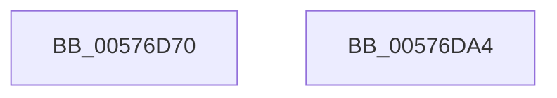

# XmXaddOp

- RVA: `0x00576D70`–`0x00576DA5` (길이 `53` bytes)
- VA: `0x0000000140576D70`
- 실행 섹션: `.text`
- PDB 이름 있음: `예`; PDB Function 태그: `아니요`
- unwind 정보 RVA: `0x0005CAAC`
- 디코드: `17`개 명령, `53/53` bytes 표시
- 미해석 바이트: `0` (있으면 어셈블리에 `.byte`로 보존)

> 이 문서는 커널 이미지의 기계어와 PDB 기호를 분석해 생성했습니다. 4번과 5번은 함수 원형과 자료형을 바이너리 사용 방식에서 추정한 C 해석이며 원본 소스 복구 결과는 아닙니다.

## 1. Dependencies

- 직접 호출 지점: **2**; 고유 호출 대상: **2**
- 직접 호출자로 확인된 함수: **0**
- RIP 상대 이미지 참조: **0**

### Outgoing calls
- `0x00576D82` → [XmAddOperands](../47/XmAddOperands_function_00472EA0.md) (function, `0x00472EA0`)
- `0x00576D94` → [XmStoreResult](../47/XmStoreResult_function_004739FC.md) (function, `0x004739FC`)

### Direct callers
- 이 함수 시작 RVA로 연결되는 직접 call은 확인되지 않았습니다. 간접 호출은 완전히 역산할 수 없습니다.

### Static image references
- 디코드된 RIP-relative 메모리 참조가 없습니다.

## 2. Other-region calls and transfers

- 다른 실행 섹션으로 향하는 call: **0**
- 별도 외부 분기/꼬리 이동을 확인하지 못했습니다.

## 3. Assembly (complete function range)

```asm
00576D70  48 89 5C 24 08                  mov qword ptr [rsp + 8], rbx
00576D75  57                              push rdi
00576D76  48 83 EC 20                     sub rsp, 0x20
00576D7A  8B 59 68                        mov ebx, dword ptr [rcx + 0x68]
00576D7D  33 D2                           xor edx, edx
00576D7F  48 8B F9                        mov rdi, rcx
00576D82  E8 19 C1 EF FF                  call 0x140472ea0
00576D87  48 8B 47 60                     mov rax, qword ptr [rdi + 0x60]
00576D8B  8B D3                           mov edx, ebx
00576D8D  48 8B CF                        mov rcx, rdi
00576D90  48 89 47 58                     mov qword ptr [rdi + 0x58], rax
00576D94  E8 63 CC EF FF                  call 0x1404739fc
00576D99  48 8B 5C 24 30                  mov rbx, qword ptr [rsp + 0x30]
00576D9E  48 83 C4 20                     add rsp, 0x20
00576DA2  5F                              pop rdi
00576DA3  C3                              ret
00576DA4  CC                              int3
```

## 4. C-style interpretation (structured pseudocode)

```c
__int64 __fastcall XmXaddOp(__int64 a1, int a2)
{
    __int64 result;
    __int64 v_rsp;
    unsigned __int64 v_stack_p8;

    v_stack_p8 = v_rbx;
    v_rsp = (v_rsp) - (32);
    a2 = 0;
    result = XmAddOperands(a1, a2, a3, a4);
    *(unsigned __int64 *)(a1 + 88) = *(unsigned __int64 *)(a1 + 96);
    result = XmStoreResult(a1, (unsigned int)((unsigned int)((unsigned int)(*(unsigned int *)(a1 + 104)))), a3, a4);
    v_rsp = (v_rsp) + (32);
    return result;
}
```

## 5. (Beta) C Style

```c
int64_t XmXaddOp(void *Arg1, int32_t Arg2)
{
    uint8_t *arg1 = (uint8_t *)Arg1;

    int64_t result;
    int64_t local_rsp;
    uint64_t v_stack_p8;

    v_stack_p8 = local_rbx;
    local_rsp = (local_rsp) - (32);
    Arg2 = 0;
    result = XmAddOperands(Arg1, Arg2, a3, a4);
    *(uint64_t *)(arg1 + 0x58) = *(uint64_t *)(arg1 + 0x60);
    result = XmStoreResult(Arg1, (uint32_t)((uint32_t)((uint32_t)(*(uint32_t *)(arg1 + 0x68)))), a3, a4);
    local_rsp = (local_rsp) + (32);
    return result;
}
```

### 관측된 메모리 오프셋

구조체 형식이 확인되지 않은 접근은 인자 기준의 오프셋으로만 기록했습니다.

| 기준 인자 | 오프셋 표현 | 폭 (bit) | 접근 |
|---|---:|---:|---|
| `Arg1` | `+ 0x58` | `64` | `W` |
| `Arg1` | `+ 0x60` | `64` | `R` |
| `Arg1` | `+ 0x68` | `32` | `R` |

## 6. Execution-region graph

[열기: 2D/3D 그래프와 함수 탐색 컨트롤 패널](../../../control-panel.html?section=text&rva=0x00576D70&view=graph)

- 2D 그래프는 위에서 아래로 흐르고, 3D 그래프는 빈 공간을 드래그해 회전합니다. Shift+드래그는 이동, 휠은 확대·축소, 함수 노드 선택은 대상 보고서 이동입니다.

### Static fallback


