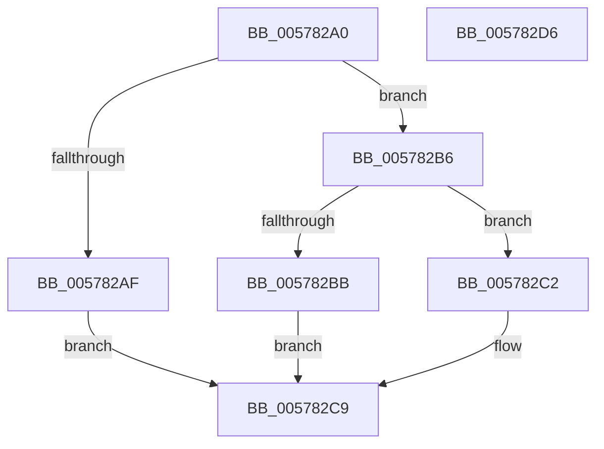

# XmXchgOp

- RVA: `0x005782A0`–`0x005782D7` (길이 `55` bytes)
- VA: `0x00000001405782A0`
- 실행 섹션: `.text`
- PDB 이름 있음: `예`; PDB Function 태그: `아니요`
- unwind 정보 RVA: `0x0005C788`
- 디코드: `20`개 명령, `55/55` bytes 표시
- 미해석 바이트: `0` (있으면 어셈블리에 `.byte`로 보존)

> 이 문서는 커널 이미지의 기계어와 PDB 기호를 분석해 생성했습니다. 4번과 5번은 함수 원형과 자료형을 바이너리 사용 방식에서 추정한 C 해석이며 원본 소스 복구 결과는 아닙니다.

## 1. Dependencies

- 직접 호출 지점: **1**; 고유 호출 대상: **1**
- 직접 호출자로 확인된 함수: **0**
- RIP 상대 이미지 참조: **0**

### Outgoing calls
- `0x005782CC` → [XmStoreResult](../47/XmStoreResult_function_004739FC.md) (function, `0x004739FC`)

### Direct callers
- 이 함수 시작 RVA로 연결되는 직접 call은 확인되지 않았습니다. 간접 호출은 완전히 역산할 수 없습니다.

### Static image references
- 디코드된 RIP-relative 메모리 참조가 없습니다.

## 2. Other-region calls and transfers

- 다른 실행 섹션으로 향하는 call: **0**
- 별도 외부 분기/꼬리 이동을 확인하지 못했습니다.

## 3. Assembly (complete function range)

```asm
005782A0  48 83 EC 28                     sub rsp, 0x28
005782A4  8B 41 78                        mov eax, dword ptr [rcx + 0x78]
005782A7  48 8B 51 60                     mov rdx, qword ptr [rcx + 0x60]
005782AB  85 C0                           test eax, eax
005782AD  75 07                           jne 0x1405782b6
005782AF  8A 41 68                        mov al, byte ptr [rcx + 0x68]
005782B2  88 02                           mov byte ptr [rdx], al
005782B4  EB 13                           jmp 0x1405782c9
005782B6  83 F8 03                        cmp eax, 3
005782B9  75 07                           jne 0x1405782c2
005782BB  8B 41 68                        mov eax, dword ptr [rcx + 0x68]
005782BE  89 02                           mov dword ptr [rdx], eax
005782C0  EB 07                           jmp 0x1405782c9
005782C2  0F B7 41 68                     movzx eax, word ptr [rcx + 0x68]
005782C6  66 89 02                        mov word ptr [rdx], ax
005782C9  8B 51 6C                        mov edx, dword ptr [rcx + 0x6c]
005782CC  E8 2B B7 EF FF                  call 0x1404739fc
005782D1  48 83 C4 28                     add rsp, 0x28
005782D5  C3                              ret
005782D6  CC                              int3
```

## 4. C-style interpretation (structured pseudocode)

```c
__int64 __fastcall XmXchgOp(__int64 a1)
{
    __int64 result;
    __int64 v_rsp;

    v_rsp = (v_rsp) - (40);
    if ((unsigned int)((unsigned int)(*(unsigned int *)(a1 + 120))) != 0) goto loc_005782B6;
    *(unsigned __int8 *)(*(unsigned __int64 *)(a1 + 96)) = (unsigned __int8)(*(unsigned __int8 *)(a1 + 104));
    goto loc_005782C9;
loc_005782B6:
    if (((unsigned int)(*(unsigned __int8 *)(a1 + 104))) != 3) goto loc_005782C2;
    *(unsigned int *)(*(unsigned __int64 *)(a1 + 96)) = (unsigned int)((unsigned int)(*(unsigned int *)(a1 + 104)));
    goto loc_005782C9;
loc_005782C2:
    *(unsigned __int16 *)(*(unsigned __int64 *)(a1 + 96)) = (unsigned __int16)(*(unsigned __int16 *)(a1 + 104));
loc_005782C9:
    result = XmStoreResult(a1, (unsigned int)(*(unsigned int *)(a1 + 108)), a3, a4);
    v_rsp = (v_rsp) + (40);
    return result;
}
```

## 5. (Beta) C Style

```c
int64_t XmXchgOp(void *Arg1)
{
    uint8_t *arg1 = (uint8_t *)Arg1;

    int64_t result;
    int64_t local_rsp;

    local_rsp = (local_rsp) - (40);
    if ((uint32_t)((uint32_t)(*(uint32_t *)(arg1 + 0x78))) != 0) goto loc_005782B6;
    *(uint8_t *)(*(uint64_t *)(arg1 + 0x60)) = (uint8_t)(*(uint8_t *)(arg1 + 0x68));
    goto loc_005782C9;
loc_005782B6:
    if (((uint32_t)(*(uint8_t *)(arg1 + 0x68))) != 3) goto loc_005782C2;
    *(uint32_t *)(*(uint64_t *)(arg1 + 0x60)) = (uint32_t)((uint32_t)(*(uint32_t *)(arg1 + 0x68)));
    goto loc_005782C9;
loc_005782C2:
    *(uint16_t *)(*(uint64_t *)(arg1 + 0x60)) = (uint16_t)(*(uint16_t *)(arg1 + 0x68));
loc_005782C9:
    result = XmStoreResult(Arg1, (uint32_t)(*(uint32_t *)(arg1 + 0x6C)), a3, a4);
    local_rsp = (local_rsp) + (40);
    return result;
}
```

### 관측된 메모리 오프셋

구조체 형식이 확인되지 않은 접근은 인자 기준의 오프셋으로만 기록했습니다.

| 기준 인자 | 오프셋 표현 | 폭 (bit) | 접근 |
|---|---:|---:|---|
| `Arg1` | `+ 0x60` | `64` | `R` |
| `Arg1` | `+ 0x68` | `8` | `R` |
| `Arg1` | `+ 0x68` | `16` | `R` |
| `Arg1` | `+ 0x68` | `32` | `R` |
| `Arg1` | `+ 0x6C` | `32` | `R` |
| `Arg1` | `+ 0x78` | `32` | `R` |

## 6. Execution-region graph

[열기: 2D/3D 그래프와 함수 탐색 컨트롤 패널](../../../control-panel.html?section=text&rva=0x005782A0&view=graph)

- 2D 그래프는 위에서 아래로 흐르고, 3D 그래프는 빈 공간을 드래그해 회전합니다. Shift+드래그는 이동, 휠은 확대·축소, 함수 노드 선택은 대상 보고서 이동입니다.

### Static fallback


