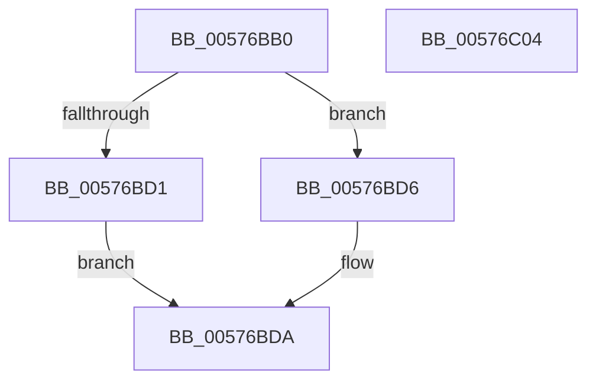

# XmXlatOpcode

- RVA: `0x00576BB0`–`0x00576C05` (길이 `85` bytes)
- VA: `0x0000000140576BB0`
- 실행 섹션: `.text`
- PDB 이름 있음: `예`; PDB Function 태그: `아니요`
- unwind 정보 RVA: `0x0005CAAC`
- 디코드: `25`개 명령, `85/85` bytes 표시
- 미해석 바이트: `0` (있으면 어셈블리에 `.byte`로 보존)

> 이 문서는 커널 이미지의 기계어와 PDB 기호를 분석해 생성했습니다. 4번과 5번은 함수 원형과 자료형을 바이너리 사용 방식에서 추정한 C 해석이며 원본 소스 복구 결과는 아닙니다.

## 1. Dependencies

- 직접 호출 지점: **2**; 고유 호출 대상: **2**
- 직접 호출자로 확인된 함수: **0**
- RIP 상대 이미지 참조: **0**

### Outgoing calls
- `0x00576BE0` → [XmGetOffsetAddress](XmGetOffsetAddress_function_00578B84.md) (function, `0x00578B84`)
- `0x00576BEB` → [XmSetSourceValue](../47/XmSetSourceValue_function_004737A8.md) (function, `0x004737A8`)

### Direct callers
- 이 함수 시작 RVA로 연결되는 직접 call은 확인되지 않았습니다. 간접 호출은 완전히 역산할 수 없습니다.

### Static image references
- 디코드된 RIP-relative 메모리 참조가 없습니다.

## 2. Other-region calls and transfers

- 다른 실행 섹션으로 향하는 call: **0**
- 별도 외부 분기/꼬리 이동을 확인하지 못했습니다.

## 3. Assembly (complete function range)

```asm
00576BB0  48 89 5C 24 08                  mov qword ptr [rsp + 8], rbx
00576BB5  57                              push rdi
00576BB6  48 83 EC 20                     sub rsp, 0x20
00576BBA  83 61 78 00                     and dword ptr [rcx + 0x78], 0
00576BBE  48 8D 79 18                     lea rdi, [rcx + 0x18]
00576BC2  48 8B D9                        mov rbx, rcx
00576BC5  0F B6 0F                        movzx ecx, byte ptr [rdi]
00576BC8  80 BB 89 00 00 00 00            cmp byte ptr [rbx + 0x89], 0
00576BCF  74 05                           je 0x140576bd6
00576BD1  8B 43 24                        mov eax, dword ptr [rbx + 0x24]
00576BD4  EB 04                           jmp 0x140576bda
00576BD6  0F B7 43 24                     movzx eax, word ptr [rbx + 0x24]
00576BDA  8D 14 01                        lea edx, [rcx + rax]
00576BDD  48 8B CB                        mov rcx, rbx
00576BE0  E8 9F 1F 00 00                  call 0x140578b84
00576BE5  48 8B D0                        mov rdx, rax
00576BE8  48 8B CB                        mov rcx, rbx
00576BEB  E8 B8 CB EF FF                  call 0x1404737a8
00576BF0  48 89 7B 58                     mov qword ptr [rbx + 0x58], rdi
00576BF4  B8 01 00 00 00                  mov eax, 1
00576BF9  48 8B 5C 24 30                  mov rbx, qword ptr [rsp + 0x30]
00576BFE  48 83 C4 20                     add rsp, 0x20
00576C02  5F                              pop rdi
00576C03  C3                              ret
00576C04  CC                              int3
```

## 4. C-style interpretation (structured pseudocode)

```c
__int64 __fastcall XmXlatOpcode(__int64 a1)
{
    __int64 result;
    __int64 v_rsp;
    unsigned __int64 v_stack_p8;

    v_stack_p8 = v_rbx;
    v_rsp = (v_rsp) - (32);
    if ((*(unsigned __int8 *)(a1 + 137)) == 0) goto loc_00576BD6;
    goto loc_00576BDA;
loc_00576BD6:
loc_00576BDA:
    result = XmGetOffsetAddress(a1, *(unsigned __int8 *)(a1 + 24) + *(unsigned __int16 *)(a1 + 36) * 1, a3, a4);
    result = XmSetSourceValue(a1, result, a3, a4);
    *(unsigned __int64 *)(a1 + 88) = a1 + 24;
    v_rsp = (v_rsp) + (32);
    return 1;
}
```

## 5. (Beta) C Style

```c
int64_t XmXlatOpcode(void *Arg1)
{
    uint8_t *arg1 = (uint8_t *)Arg1;

    int64_t result;
    int64_t local_rsp;
    uint64_t v_stack_p8;

    v_stack_p8 = local_rbx;
    local_rsp = (local_rsp) - (32);
    if ((*(uint8_t *)(arg1 + 0x89)) == 0) goto loc_00576BD6;
    goto loc_00576BDA;
loc_00576BD6:
loc_00576BDA:
    result = XmGetOffsetAddress(Arg1, *(uint8_t *)(arg1 + 0x18) + *(uint16_t *)(arg1 + 0x24) * 1, a3, a4);
    result = XmSetSourceValue(Arg1, result, a3, a4);
    *(void **)(arg1 + 0x58) = Arg1 + 24;
    local_rsp = (local_rsp) + (32);
    return 1;
}
```

### 관측된 메모리 오프셋

구조체 형식이 확인되지 않은 접근은 인자 기준의 오프셋으로만 기록했습니다.

| 기준 인자 | 오프셋 표현 | 폭 (bit) | 접근 |
|---|---:|---:|---|
| `Arg1` | `+ 0x0` | `8` | `R` |
| `Arg1` | `+ 0x18` | `64` | `R` |
| `Arg1` | `+ 0x24` | `16` | `R` |
| `Arg1` | `+ 0x24` | `32` | `R` |
| `Arg1` | `+ 0x58` | `64` | `W` |
| `Arg1` | `+ 0x78` | `32` | `R/W` |
| `Arg1` | `+ 0x89` | `8` | `R` |

## 6. Execution-region graph

[열기: 2D/3D 그래프와 함수 탐색 컨트롤 패널](../../../control-panel.html?section=text&rva=0x00576BB0&view=graph)

- 2D 그래프는 위에서 아래로 흐르고, 3D 그래프는 빈 공간을 드래그해 회전합니다. Shift+드래그는 이동, 휠은 확대·축소, 함수 노드 선택은 대상 보고서 이동입니다.

### Static fallback


