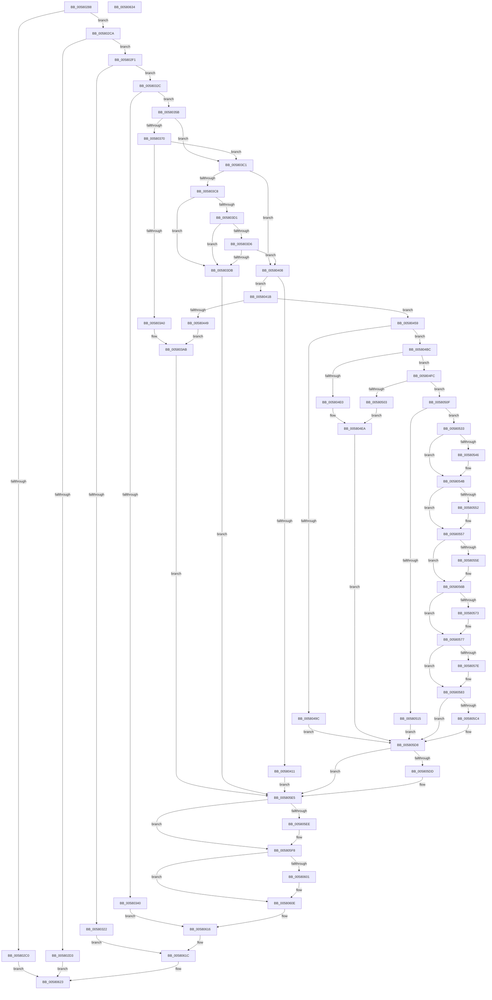

# DbgkCaptureLiveKernelDump

- RVA: `0x00580288`–`0x00580635` (길이 `941` bytes)
- VA: `0x0000000140580288`
- 실행 섹션: `.text`
- PDB 이름 있음: `예`; PDB Function 태그: `아니요`
- unwind 정보 RVA: `0x000C5A38`
- 디코드: `247`개 명령, `941/941` bytes 표시
- 미해석 바이트: `0` (있으면 어셈블리에 `.byte`로 보존)

> 이 문서는 커널 이미지의 기계어와 PDB 기호를 분석해 생성했습니다. 4번과 5번은 함수 원형과 자료형을 바이너리 사용 방식에서 추정한 C 해석이며 원본 소스 복구 결과는 아닙니다.

## 1. Dependencies

- 직접 호출 지점: **21**; 고유 호출 대상: **11**
- 직접 호출자로 확인된 함수: **1**
- RIP 상대 이미지 참조: **14**

### Outgoing calls
- `0x005802CA` → [DbgkpWerIsFullLiveDumpDisabled](../../page/71/DbgkpWerIsFullLiveDumpDisabled_function_00712470.md) (function, `0x00712470`)
- `0x005802E2` → [DbgPrintEx](../35/DbgPrintEx_function_00359290.md) (function, `0x00359290`)
- `0x00580333` → [DbgkpWerAllocatePool](../../page/70/DbgkpWerAllocatePool_function_00704D00.md) (function, `0x00704D00`)
- `0x0058034C` → [DbgPrintEx](../35/DbgPrintEx_function_00359290.md) (function, `0x00359290`)
- `0x00580395` → [ObReferenceObjectByHandleWithTag](../../page/86/ObReferenceObjectByHandleWithTag_function_00869610.md) (function, `0x00869610`)
- `0x005803B7` → [DbgPrintEx](../35/DbgPrintEx_function_00359290.md) (function, `0x00359290`)
- `0x005803FE` → [DbgPrintEx](../35/DbgPrintEx_function_00359290.md) (function, `0x00359290`)
- `0x0058043E` → [ObReferenceObjectByHandleWithTag](../../page/86/ObReferenceObjectByHandleWithTag_function_00869610.md) (function, `0x00869610`)
- `0x0058048D` → [ObOpenObjectByPointerWithTag](../../page/A8/ObOpenObjectByPointerWithTag_function_00A87920.md) (function, `0x00A87920`)
- `0x005804B2` → [DbgPrintEx](../35/DbgPrintEx_function_00359290.md) (function, `0x00359290`)
- `0x005804D5` → [ZwQueryInformationFile](../6A/ZwQueryInformationFile_function_006AD2F0.md) (function, `0x006AD2F0`)
- `0x005804F2` → [DbgPrintEx](../35/DbgPrintEx_function_00359290.md) (function, `0x00359290`)
- `0x00580529` → [DbgPrintEx](../35/DbgPrintEx_function_00359290.md) (function, `0x00359290`)
- `0x00580592` → [DbgPrintEx](../35/DbgPrintEx_function_00359290.md) (function, `0x00359290`)
- `0x005805B9` → [IoCaptureLiveDump](../4E/IoCaptureLiveDump_function_004E085C.md) (function, `0x004E085C`)
- `0x005805D3` → [DbgPrintEx](../35/DbgPrintEx_function_00359290.md) (function, `0x00359290`)
- `0x005805E0` → [ZwClose](../6A/ZwClose_function_006AD2B0.md) (function, `0x006AD2B0`)
- `0x005805F3` → [ObfDereferenceObjectWithTag](../2F/ObfDereferenceObjectWithTag_function_002F78E0.md) (function, `0x002F78E0`)
- `0x00580609` → [ObfDereferenceObjectWithTag](../2F/ObfDereferenceObjectWithTag_function_002F78E0.md) (function, `0x002F78E0`)
- `0x00580611` → [DbgkpWerFreePool](../../page/71/DbgkpWerFreePool_function_00712450.md) (function, `0x00712450`)
- `0x0058061C` → [KeLeaveCriticalRegion](../25/KeLeaveCriticalRegion_function_0025D8B0.md) (function, `0x0025D8B0`)

### Direct callers
- [sub_00B3F842](../../page/B3/Unknown_function_00B3F842.md) at `0x00B3FD74`

### Static image references
- `0x005802D8` → RVA `0x006C92F0` (` ?? ::FNODOBFM::`string'`; read)
- `0x00580317` → RVA `0x00F8F20C` (`.data`; read/write)
- `0x00580340` → RVA `0x006C9400` (` ?? ::FNODOBFM::`string'`; read)
- `0x00580370` → RVA `0x00FC6B80` (`ALMOSTRO`; read)
- `0x005803A4` → RVA `0x006C9430` (` ?? ::FNODOBFM::`string'`; read)
- `0x005803DE` → RVA `0x006C9330` (` ?? ::FNODOBFM::`string'`; read)
- `0x0058041B` → RVA `0x00FC6AE0` (`ALMOSTRO`; read)
- `0x0058044D` → RVA `0x006C93A0` (` ?? ::FNODOBFM::`string'`; read)
- `0x005804A3` → RVA `0x006C94F0` (` ?? ::FNODOBFM::`string'`; read)
- `0x005804E3` → RVA `0x006C9540` (` ?? ::FNODOBFM::`string'`; read)
- `0x00580506` → RVA `0x006C9460` (` ?? ::FNODOBFM::`string'`; read)
- `0x00580515` → RVA `0x006C94B0` (` ?? ::FNODOBFM::`string'`; read)
- `0x00580588` → RVA `0x006C9580` (` ?? ::FNODOBFM::`string'`; read)
- `0x005805C6` → RVA `0x006C95B0` (` ?? ::FNODOBFM::`string'`; read)

## 2. Other-region calls and transfers

- 다른 실행 섹션으로 향하는 call: **6**
  - `0x005802CA` → [DbgkpWerIsFullLiveDumpDisabled](../../page/71/DbgkpWerIsFullLiveDumpDisabled_function_00712470.md) (`.text` → `PAGE`)
  - `0x00580333` → [DbgkpWerAllocatePool](../../page/70/DbgkpWerAllocatePool_function_00704D00.md) (`.text` → `PAGE`)
  - `0x00580395` → [ObReferenceObjectByHandleWithTag](../../page/86/ObReferenceObjectByHandleWithTag_function_00869610.md) (`.text` → `PAGE`)
  - `0x0058043E` → [ObReferenceObjectByHandleWithTag](../../page/86/ObReferenceObjectByHandleWithTag_function_00869610.md) (`.text` → `PAGE`)
  - `0x0058048D` → [ObOpenObjectByPointerWithTag](../../page/A8/ObOpenObjectByPointerWithTag_function_00A87920.md) (`.text` → `PAGE`)
  - `0x00580611` → [DbgkpWerFreePool](../../page/71/DbgkpWerFreePool_function_00712450.md) (`.text` → `PAGE`)
- 별도 외부 분기/꼬리 이동을 확인하지 못했습니다.

## 3. Assembly (complete function range)

```asm
00580288  40 55                           push rbp
0058028A  53                              push rbx
0058028B  56                              push rsi
0058028C  57                              push rdi
0058028D  41 54                           push r12
0058028F  41 55                           push r13
00580291  41 56                           push r14
00580293  41 57                           push r15
00580295  48 8B EC                        mov rbp, rsp
00580298  48 83 EC 58                     sub rsp, 0x58
0058029C  33 FF                           xor edi, edi
0058029E  0F 57 C0                        xorps xmm0, xmm0
005802A1  89 7D 48                        mov dword ptr [rbp + 0x48], edi
005802A4  48 8B F1                        mov rsi, rcx
005802A7  0F 11 45 E8                     movups xmmword ptr [rbp - 0x18], xmm0
005802AB  65 48 8B 04 25 88 01 00 00      mov rax, qword ptr gs:[0x188]
005802B4  44 8A A0 32 02 00 00            mov r12b, byte ptr [rax + 0x232]
005802BB  48 85 C9                        test rcx, rcx
005802BE  75 0A                           jne 0x1405802ca
005802C0  B8 0D 00 00 C0                  mov eax, 0xc000000d
005802C5  E9 59 03 00 00                  jmp 0x140580623
005802CA  E8 A1 21 19 00                  call 0x140712470
005802CF  84 C0                           test al, al
005802D1  74 1E                           je 0x1405802f1
005802D3  BA 01 00 00 00                  mov edx, 1
005802D8  4C 8D 05 11 90 14 00            lea r8, [rip + 0x149011]
005802DF  8D 4A 04                        lea ecx, [rdx + 4]
005802E2  E8 A9 8F DD FF                  call 0x140359290
005802E7  B8 04 08 00 C0                  mov eax, 0xc0000804
005802EC  E9 32 03 00 00                  jmp 0x140580623
005802F1  65 48 8B 04 25 88 01 00 00      mov rax, qword ptr gs:[0x188]
005802FA  41 BF 01 00 00 00               mov r15d, 1
00580300  48 89 7D 50                     mov qword ptr [rbp + 0x50], rdi
00580304  48 89 7D 58                     mov qword ptr [rbp + 0x58], rdi
00580308  48 89 7D 60                     mov qword ptr [rbp + 0x60], rdi
0058030C  66 FF 88 E4 01 00 00            dec word ptr [rax + 0x1e4]
00580313  41 8B C7                        mov eax, r15d
00580316  90                              nop
00580317  87 05 EF EE A0 00               xchg dword ptr [rip + 0xa0eeef], eax
0058031D  41 3B C7                        cmp eax, r15d
00580320  75 0A                           jne 0x14058032c
00580322  BB 2D 02 00 C0                  mov ebx, 0xc000022d
00580327  E9 F0 02 00 00                  jmp 0x14058061c
0058032C  BB 38 00 00 00                  mov ebx, 0x38
00580331  8B CB                           mov ecx, ebx
00580333  E8 C8 49 18 00                  call 0x140704d00
00580338  4C 8B F0                        mov r14, rax
0058033B  48 85 C0                        test rax, rax
0058033E  75 1B                           jne 0x14058035b
00580340  4C 8D 05 B9 90 14 00            lea r8, [rip + 0x1490b9]
00580347  33 D2                           xor edx, edx
00580349  8D 4B CD                        lea ecx, [rbx - 0x33]
0058034C  E8 3F 8F DD FF                  call 0x140359290
00580351  BB 17 00 00 C0                  mov ebx, 0xc0000017
00580356  E9 BB 02 00 00                  jmp 0x140580616
0058035B  41 BD 02 00 00 00               mov r13d, 2
00580361  89 58 04                        mov dword ptr [rax + 4], ebx
00580364  44 89 28                        mov dword ptr [rax], r13d
00580367  48 8B 4E 30                     mov rcx, qword ptr [rsi + 0x30]
0058036B  48 85 C9                        test rcx, rcx
0058036E  74 51                           je 0x1405803c1
00580370  4C 8B 05 09 68 A4 00            mov r8, qword ptr [rip + 0xa46809]
00580377  48 8D 45 50                     lea rax, [rbp + 0x50]
0058037B  48 89 7C 24 30                  mov qword ptr [rsp + 0x30], rdi
00580380  45 8A CC                        mov r9b, r12b
00580383  48 89 44 24 28                  mov qword ptr [rsp + 0x28], rax
00580388  BA 01 00 10 00                  mov edx, 0x100001
0058038D  C7 44 24 20 44 62 67 57         mov dword ptr [rsp + 0x20], 0x57676244
00580395  E8 76 92 2E 00                  call 0x140869610
0058039A  8B D8                           mov ebx, eax
0058039C  85 C0                           test eax, eax
0058039E  79 21                           jns 0x1405803c1
005803A0  4C 8B 4E 30                     mov r9, qword ptr [rsi + 0x30]
005803A4  4C 8D 05 85 90 14 00            lea r8, [rip + 0x149085]
005803AB  41 8B D7                        mov edx, r15d
005803AE  89 44 24 20                     mov dword ptr [rsp + 0x20], eax
005803B2  B9 05 00 00 00                  mov ecx, 5
005803B7  E8 D4 8E DD FF                  call 0x140359290
005803BC  E9 24 02 00 00                  jmp 0x1405805e5
005803C1  8B 46 38                        mov eax, dword ptr [rsi + 0x38]
005803C4  A8 10                           test al, 0x10
005803C6  74 40                           je 0x140580408
005803C8  48 8B 46 40                     mov rax, qword ptr [rsi + 0x40]
005803CC  48 85 C0                        test rax, rax
005803CF  74 0A                           je 0x1405803db
005803D1  44 39 2E                        cmp dword ptr [rsi], r13d
005803D4  72 05                           jb 0x1405803db
005803D6  39 7E 3C                        cmp dword ptr [rsi + 0x3c], edi
005803D9  74 2D                           je 0x140580408
005803DB  44 8B 0E                        mov r9d, dword ptr [rsi]
005803DE  4C 8D 05 4B 8F 14 00            lea r8, [rip + 0x148f4b]
005803E5  48 89 44 24 28                  mov qword ptr [rsp + 0x28], rax
005803EA  41 8B D7                        mov edx, r15d
005803ED  8B 46 3C                        mov eax, dword ptr [rsi + 0x3c]
005803F0  B9 05 00 00 00                  mov ecx, 5
005803F5  89 44 24 20                     mov dword ptr [rsp + 0x20], eax
005803F9  BB 0D 00 00 C0                  mov ebx, 0xc000000d
005803FE  E8 8D 8E DD FF                  call 0x140359290
00580403  E9 DD 01 00 00                  jmp 0x1405805e5
00580408  48 8B 4E 28                     mov rcx, qword ptr [rsi + 0x28]
0058040C  48 85 C9                        test rcx, rcx
0058040F  75 0A                           jne 0x14058041b
00580411  BB 0D 00 00 C0                  mov ebx, 0xc000000d
00580416  E9 CA 01 00 00                  jmp 0x1405805e5
0058041B  4C 8B 05 BE 66 A4 00            mov r8, qword ptr [rip + 0xa466be]
00580422  48 8D 45 58                     lea rax, [rbp + 0x58]
00580426  48 89 7C 24 30                  mov qword ptr [rsp + 0x30], rdi
0058042B  45 8A CC                        mov r9b, r12b
0058042E  48 89 44 24 28                  mov qword ptr [rsp + 0x28], rax
00580433  41 8B D5                        mov edx, r13d
00580436  C7 44 24 20 44 62 67 57         mov dword ptr [rsp + 0x20], 0x57676244
0058043E  E8 CD 91 2E 00                  call 0x140869610
00580443  8B D8                           mov ebx, eax
00580445  85 C0                           test eax, eax
00580447  79 10                           jns 0x140580459
00580449  4C 8B 4E 28                     mov r9, qword ptr [rsi + 0x28]
0058044D  4C 8D 05 4C 8F 14 00            lea r8, [rip + 0x148f4c]
00580454  E9 52 FF FF FF                  jmp 0x1405803ab
00580459  4C 8B 65 58                     mov r12, qword ptr [rbp + 0x58]
0058045D  48 8D 45 60                     lea rax, [rbp + 0x60]
00580461  48 89 44 24 38                  mov qword ptr [rsp + 0x38], rax
00580466  45 8B CD                        mov r9d, r13d
00580469  48 8B 05 70 66 A4 00            mov rax, qword ptr [rip + 0xa46670]
00580470  45 33 C0                        xor r8d, r8d
00580473  C7 44 24 30 44 62 67 57         mov dword ptr [rsp + 0x30], 0x57676244
0058047B  BA 00 02 00 00                  mov edx, 0x200
00580480  40 88 7C 24 28                  mov byte ptr [rsp + 0x28], dil
00580485  49 8B CC                        mov rcx, r12
00580488  48 89 44 24 20                  mov qword ptr [rsp + 0x20], rax
0058048D  E8 8E 74 50 00                  call 0x140a87920
00580492  4C 8B 6D 60                     mov r13, qword ptr [rbp + 0x60]
00580496  8B D8                           mov ebx, eax
00580498  85 C0                           test eax, eax
0058049A  79 20                           jns 0x1405804bc
0058049C  4D 8B CC                        mov r9, r12
0058049F  89 44 24 20                     mov dword ptr [rsp + 0x20], eax
005804A3  4C 8D 05 46 90 14 00            lea r8, [rip + 0x149046]
005804AA  41 8B D7                        mov edx, r15d
005804AD  B9 05 00 00 00                  mov ecx, 5
005804B2  E8 D9 8D DD FF                  call 0x140359290
005804B7  E9 1C 01 00 00                  jmp 0x1405805d8
005804BC  41 B9 04 00 00 00               mov r9d, 4
005804C2  C7 44 24 20 10 00 00 00         mov dword ptr [rsp + 0x20], 0x10
005804CA  4C 8D 45 48                     lea r8, [rbp + 0x48]
005804CE  49 8B CD                        mov rcx, r13
005804D1  48 8D 55 E8                     lea rdx, [rbp - 0x18]
005804D5  E8 16 CE 12 00                  call 0x1406ad2f0
005804DA  8B D8                           mov ebx, eax
005804DC  85 C0                           test eax, eax
005804DE  79 1C                           jns 0x1405804fc
005804E0  44 8B C8                        mov r9d, eax
005804E3  4C 8D 05 56 90 14 00            lea r8, [rip + 0x149056]
005804EA  41 8B D7                        mov edx, r15d
005804ED  B9 05 00 00 00                  mov ecx, 5
005804F2  E8 99 8D DD FF                  call 0x140359290
005804F7  E9 DC 00 00 00                  jmp 0x1405805d8
005804FC  8B 5D E8                        mov ebx, dword ptr [rbp - 0x18]
005804FF  85 DB                           test ebx, ebx
00580501  79 0C                           jns 0x14058050f
00580503  44 8B CB                        mov r9d, ebx
00580506  4C 8D 05 53 8F 14 00            lea r8, [rip + 0x148f53]
0058050D  EB DB                           jmp 0x1405804ea
0058050F  F6 45 48 30                     test byte ptr [rbp + 0x48], 0x30
00580513  75 1E                           jne 0x140580533
00580515  4C 8D 05 94 8F 14 00            lea r8, [rip + 0x148f94]
0058051C  41 8B D7                        mov edx, r15d
0058051F  B9 05 00 00 00                  mov ecx, 5
00580524  BB 0D 00 00 C0                  mov ebx, 0xc000000d
00580529  E8 62 8D DD FF                  call 0x140359290
0058052E  E9 A5 00 00 00                  jmp 0x1405805d8
00580533  48 8B 45 50                     mov rax, qword ptr [rbp + 0x50]
00580537  49 89 46 10                     mov qword ptr [r14 + 0x10], rax
0058053B  4D 89 6E 08                     mov qword ptr [r14 + 8], r13
0058053F  8B 46 38                        mov eax, dword ptr [rsi + 0x38]
00580542  A8 04                           test al, 4
00580544  74 05                           je 0x14058054b
00580546  41 83 4E 18 04                  or dword ptr [r14 + 0x18], 4
0058054B  8B 46 38                        mov eax, dword ptr [rsi + 0x38]
0058054E  A8 08                           test al, 8
00580550  74 05                           je 0x140580557
00580552  41 83 4E 18 10                  or dword ptr [r14 + 0x18], 0x10
00580557  8B 46 38                        mov eax, dword ptr [rsi + 0x38]
0058055A  A8 10                           test al, 0x10
0058055C  74 0D                           je 0x14058056b
0058055E  41 83 4E 18 20                  or dword ptr [r14 + 0x18], 0x20
00580563  48 8B 46 40                     mov rax, qword ptr [rsi + 0x40]
00580567  49 89 46 30                     mov qword ptr [r14 + 0x30], rax
0058056B  8B 46 3C                        mov eax, dword ptr [rsi + 0x3c]
0058056E  41 84 C7                        test r15b, al
00580571  74 04                           je 0x140580577
00580573  45 09 7E 1C                     or dword ptr [r14 + 0x1c], r15d
00580577  8B 46 3C                        mov eax, dword ptr [rsi + 0x3c]
0058057A  A8 02                           test al, 2
0058057C  74 05                           je 0x140580583
0058057E  41 83 4E 1C 02                  or dword ptr [r14 + 0x1c], 2
00580583  BA 03 00 00 00                  mov edx, 3
00580588  4C 8D 05 F1 8F 14 00            lea r8, [rip + 0x148ff1]
0058058F  8D 4A 02                        lea ecx, [rdx + 2]
00580592  E8 F9 8C DD FF                  call 0x140359290
00580597  48 8B 46 20                     mov rax, qword ptr [rsi + 0x20]
0058059B  4C 8B 4E 18                     mov r9, qword ptr [rsi + 0x18]
0058059F  4C 8B 46 10                     mov r8, qword ptr [rsi + 0x10]
005805A3  48 8B 56 08                     mov rdx, qword ptr [rsi + 8]
005805A7  8B 4E 04                        mov ecx, dword ptr [rsi + 4]
005805AA  48 89 7C 24 30                  mov qword ptr [rsp + 0x30], rdi
005805AF  4C 89 74 24 28                  mov qword ptr [rsp + 0x28], r14
005805B4  48 89 44 24 20                  mov qword ptr [rsp + 0x20], rax
005805B9  E8 9E 02 F6 FF                  call 0x1404e085c
005805BE  8B D8                           mov ebx, eax
005805C0  85 C0                           test eax, eax
005805C2  79 14                           jns 0x1405805d8
005805C4  33 D2                           xor edx, edx
005805C6  4C 8D 05 E3 8F 14 00            lea r8, [rip + 0x148fe3]
005805CD  44 8B C8                        mov r9d, eax
005805D0  8D 4A 05                        lea ecx, [rdx + 5]
005805D3  E8 B8 8C DD FF                  call 0x140359290
005805D8  4D 85 ED                        test r13, r13
005805DB  74 08                           je 0x1405805e5
005805DD  49 8B CD                        mov rcx, r13
005805E0  E8 CB CC 12 00                  call 0x1406ad2b0
005805E5  48 8B 4D 50                     mov rcx, qword ptr [rbp + 0x50]
005805E9  48 85 C9                        test rcx, rcx
005805EC  74 0A                           je 0x1405805f8
005805EE  BA 44 62 67 57                  mov edx, 0x57676244
005805F3  E8 E8 72 D7 FF                  call 0x1402f78e0
005805F8  4C 8B 65 58                     mov r12, qword ptr [rbp + 0x58]
005805FC  4D 85 E4                        test r12, r12
005805FF  74 0D                           je 0x14058060e
00580601  BA 44 62 67 57                  mov edx, 0x57676244
00580606  49 8B CC                        mov rcx, r12
00580609  E8 D2 72 D7 FF                  call 0x1402f78e0
0058060E  49 8B CE                        mov rcx, r14
00580611  E8 3A 1E 19 00                  call 0x140712450
00580616  87 3D F0 EB A0 00               xchg dword ptr [rip + 0xa0ebf0], edi
0058061C  E8 8F D2 CD FF                  call 0x14025d8b0
00580621  8B C3                           mov eax, ebx
00580623  48 83 C4 58                     add rsp, 0x58
00580627  41 5F                           pop r15
00580629  41 5E                           pop r14
0058062B  41 5D                           pop r13
0058062D  41 5C                           pop r12
0058062F  5F                              pop rdi
00580630  5E                              pop rsi
00580631  5B                              pop rbx
00580632  5D                              pop rbp
00580633  C3                              ret
00580634  CC                              int3
```

## 4. C-style interpretation (structured pseudocode)

```c
__int64 __fastcall DbgkCaptureLiveKernelDump(__int64 a1)
{
    __int64 result;
    __int64 v_rdi;
    __int64 v_rsp;
    unsigned __int64 v_stack_m58;
    unsigned __int64 v_stack_m60;
    unsigned __int64 v_stack_m68;
    unsigned __int64 v_stack_m70;
    unsigned int v_stack_m78;
    unsigned __int64 v_stack_p10;
    unsigned __int64 v_stack_p18;
    unsigned __int64 v_stack_p20;
    unsigned int v_stack_p8;

    v_rsp = (v_rsp) - (88);
    v_rdi = 0;
    v_stack_p8 = 0;
    v_stack_m58 = v_xmm0;
    if (a1 != 0) goto loc_005802CA;
    goto loc_00580623;
loc_005802CA:
    result = DbgkpWerIsFullLiveDumpDisabled(a1, a2, a3, a4);
    if ((unsigned __int8)(result) == 0) goto loc_005802F1;
    result = DbgPrintEx(1 + 4, 1, v_rip + 1347601, a4);
    goto loc_00580623;
loc_005802F1:
    v_stack_p10 = 0;
    v_stack_p18 = 0;
    v_stack_p20 = 0;
    if (1 != 1) goto loc_0058032C;
    goto loc_0058061C;
loc_0058032C:
    result = DbgkpWerAllocatePool(56, 1, v_rip + 1347601, a4);
    if (result != 0) goto loc_0058035B;
    a2 = 0;
    result = DbgPrintEx(56 - 51, a2, v_rip + 1347769, a4);
    goto loc_00580616;
loc_0058035B:
    *(unsigned int *)(result + 4) = (unsigned int)((unsigned int)(0xC0000017ULL));
    *(unsigned int *)(result) = 2;
    if (*(unsigned __int64 *)(a1 + 48) == 0) goto loc_005803C1;
    v_stack_m68 = 0;
    v_stack_m70 = v_stack_p10;
    v_stack_m78 = 0x57676244ULL;
    result = ObReferenceObjectByHandleWithTag(*(unsigned __int64 *)(a1 + 48), (unsigned int)(0x100001ULL), *(unsigned __int64 *)(v_rip + 10774537), (unsigned __int8)(*(unsigned __int8 *)(*(unsigned __int64 *)(gs_base + (0 + 392)) + 562)));
    if (!sign_flag) goto loc_005803C1;
loc_005803AB:
    v_stack_m78 = (unsigned int)(result);
    result = DbgPrintEx(5, 1, v_rip + 1347717, *(unsigned __int64 *)(a1 + 48));
    goto loc_005805E5;
loc_005803C1:
    if ((((unsigned __int8)((unsigned int)(*(unsigned int *)(a1 + 56)))) & (16)) == 0) goto loc_00580408;
    if (*(unsigned __int64 *)(a1 + 64) == 0) goto loc_005803DB;
    if ((*(unsigned int *)(a1)) < 2) goto loc_005803DB;
    if ((*(unsigned int *)(a1 + 60)) == 0) goto loc_00580408;
loc_005803DB:
    v_stack_m70 = *(unsigned __int64 *)(a1 + 64);
    v_stack_m78 = (unsigned int)((unsigned int)(*(unsigned int *)(a1 + 60)));
    result = DbgPrintEx(5, 1, v_rip + 1347403, (unsigned int)(*(unsigned int *)(a1)));
    goto loc_005805E5;
loc_00580408:
    if (*(unsigned __int64 *)(a1 + 40) != 0) goto loc_0058041B;
    goto loc_005805E5;
loc_0058041B:
    v_stack_m68 = 0;
    v_stack_m70 = v_stack_p18;
    v_stack_m78 = 0x57676244ULL;
    result = ObReferenceObjectByHandleWithTag(*(unsigned __int64 *)(a1 + 40), 2, *(unsigned __int64 *)(v_rip + 10774206), (unsigned __int8)(*(unsigned __int8 *)(*(unsigned __int64 *)(gs_base + (0 + 392)) + 562)));
    if (!sign_flag) goto loc_00580459;
    goto loc_005803AB;
loc_00580459:
    v_stack_m60 = v_stack_p20;
    a3 = 0;
    v_stack_m68 = 0x57676244ULL;
    v_stack_m70 = 0;
    v_stack_m78 = *(unsigned __int64 *)(v_rip + 10774128);
    result = ObOpenObjectByPointerWithTag(v_stack_p18, 512, a3, 2);
    if (!sign_flag) goto loc_005804BC;
    v_stack_m78 = (unsigned int)(result);
    result = DbgPrintEx(5, 1, v_rip + 1347654, v_stack_p18);
    goto loc_005805D8;
loc_005804BC:
    v_stack_m78 = 16;
    result = ZwQueryInformationFile(v_stack_p20, v_stack_m58, v_stack_p8, 4);
    if (!sign_flag) goto loc_005804FC;
loc_005804EA:
    result = DbgPrintEx(5, 1, v_rip + 1347670, (unsigned int)((unsigned int)(result)));
    goto loc_005805D8;
loc_005804FC:
    if (!sign_flag) goto loc_0058050F;
    goto loc_005804EA;
loc_0058050F:
    if (((v_stack_p8) & (48)) != 0) goto loc_00580533;
    result = DbgPrintEx(5, 1, v_rip + 1347476, (unsigned int)((unsigned int)((unsigned int)(v_stack_m58))));
    goto loc_005805D8;
loc_00580533:
    *(unsigned __int64 *)(result + 16) = v_stack_p10;
    *(unsigned __int64 *)(result + 8) = v_stack_p20;
    if ((((unsigned __int8)((unsigned int)(*(unsigned int *)(a1 + 56)))) & (4)) != 0) {
    }
    if ((((unsigned __int8)((unsigned int)(*(unsigned int *)(a1 + 56)))) & (8)) != 0) {
    }
    result = (unsigned int)(*(unsigned int *)(a1 + 56));
    if ((((unsigned __int8)((unsigned int)(*(unsigned int *)(a1 + 56)))) & (16)) != 0) {
        result = *(unsigned __int64 *)(a1 + 64);
        *(unsigned __int64 *)(result + 48) = result;
    }
    if (((1) & ((unsigned __int8)((unsigned int)(*(unsigned int *)(a1 + 60))))) != 0) {
    }
    if ((((unsigned __int8)((unsigned int)(*(unsigned int *)(a1 + 60)))) & (2)) != 0) {
    }
    result = DbgPrintEx(3 + 2, 3, v_rip + 1347569, (unsigned int)((unsigned int)((unsigned int)(v_stack_m58))));
    v_stack_m68 = 0;
    v_stack_m70 = result;
    v_stack_m78 = *(unsigned __int64 *)(a1 + 32);
    result = IoCaptureLiveDump((unsigned int)(*(unsigned int *)(a1 + 4)), *(unsigned __int64 *)(a1 + 8), *(unsigned __int64 *)(a1 + 16), *(unsigned __int64 *)(a1 + 24));
    if (sign_flag) {
        a2 = 0;
        a3 = v_rip + 1347555;
        a4 = (unsigned int)(result);
        a1 = a2 + 5;
        result = DbgPrintEx(a1, a2, a3, a4);
    }
    if (v_stack_p20 != 0) {
        a1 = v_stack_p20;
        result = ZwClose(a1, a2, a3, a4);
    }
    if (v_stack_p10 != 0) {
        a2 = 0x57676244ULL;
        result = ObfDereferenceObjectWithTag(v_stack_p10, a2, a3, a4);
    }
    if (v_stack_p18 != 0) {
        a2 = 0x57676244ULL;
        a1 = v_stack_p18;
        result = ObfDereferenceObjectWithTag(a1, a2, a3, a4);
    }
    result = DbgkpWerFreePool(result, a2, a3, a4);
loc_00580616:
loc_0058061C:
    result = KeLeaveCriticalRegion(result, a2, a3, a4);
loc_00580623:
    v_rsp = (v_rsp) + (88);
    return (unsigned int)((unsigned int)((unsigned int)((unsigned int)(result))));
}
```

## 5. (Beta) C Style

```c
int64_t DbgkCaptureLiveKernelDump(void *Arg1)
{
    uint8_t *arg1 = (uint8_t *)Arg1;

    int64_t result;
    int64_t local_rdi;
    int64_t local_rsp;
    uint64_t v_stack_m58;
    uint64_t v_stack_m60;
    uint64_t v_stack_m68;
    uint64_t v_stack_m70;
    uint32_t v_stack_m78;
    uint64_t v_stack_p10;
    uint64_t v_stack_p18;
    uint64_t v_stack_p20;
    uint32_t v_stack_p8;

    local_rsp = (local_rsp) - (88);
    local_rdi = 0;
    v_stack_p8 = 0;
    v_stack_m58 = v_xmm0;
    if (Arg1 != NULL) goto loc_005802CA;
    goto loc_00580623;
loc_005802CA:
    result = DbgkpWerIsFullLiveDumpDisabled(Arg1, a2, a3, a4);
    if ((uint8_t)(result) == 0) goto loc_005802F1;
    result = DbgPrintEx(1 + 4, 1, v_rip + 1347601, a4);
    goto loc_00580623;
loc_005802F1:
    v_stack_p10 = 0;
    v_stack_p18 = 0;
    v_stack_p20 = 0;
    if (1 != 1) goto loc_0058032C;
    goto loc_0058061C;
loc_0058032C:
    result = DbgkpWerAllocatePool(56, 1, v_rip + 1347601, a4);
    if (result != 0) goto loc_0058035B;
    a2 = 0;
    result = DbgPrintEx(56 - 51, a2, v_rip + 1347769, a4);
    goto loc_00580616;
loc_0058035B:
    *(uint32_t *)(result + 0x4) = (uint32_t)((uint32_t)(0xC0000017ULL));
    *(uint32_t *)(result) = 2;
    if (*(uint64_t *)(arg1 + 0x30) == 0) goto loc_005803C1;
    v_stack_m68 = 0;
    v_stack_m70 = v_stack_p10;
    v_stack_m78 = 0x57676244ULL;
    result = ObReferenceObjectByHandleWithTag(*(uint64_t *)(arg1 + 0x30), (uint32_t)(0x100001ULL), *(uint64_t *)(v_rip + 0xA46809), (uint8_t)(*(uint8_t *)(*(uint64_t *)(gs_base + (0 + 0x188)) + 0x232)));
    if (!sign_flag) goto loc_005803C1;
loc_005803AB:
    v_stack_m78 = (uint32_t)(result);
    result = DbgPrintEx(5, 1, v_rip + 1347717, *(uint64_t *)(arg1 + 0x30));
    goto loc_005805E5;
loc_005803C1:
    if ((((uint8_t)((uint32_t)(*(uint32_t *)(arg1 + 0x38)))) & (16)) == 0) goto loc_00580408;
    if (*(uint64_t *)(arg1 + 0x40) == 0) goto loc_005803DB;
    if ((*(uint32_t *)(arg1)) < 2) goto loc_005803DB;
    if ((*(uint32_t *)(arg1 + 0x3C)) == 0) goto loc_00580408;
loc_005803DB:
    v_stack_m70 = *(uint64_t *)(arg1 + 0x40);
    v_stack_m78 = (uint32_t)((uint32_t)(*(uint32_t *)(arg1 + 0x3C)));
    result = DbgPrintEx(5, 1, v_rip + 1347403, (uint32_t)(*(uint32_t *)(arg1)));
    goto loc_005805E5;
loc_00580408:
    if (*(uint64_t *)(arg1 + 0x28) != 0) goto loc_0058041B;
    goto loc_005805E5;
loc_0058041B:
    v_stack_m68 = 0;
    v_stack_m70 = v_stack_p18;
    v_stack_m78 = 0x57676244ULL;
    result = ObReferenceObjectByHandleWithTag(*(uint64_t *)(arg1 + 0x28), 2, *(uint64_t *)(v_rip + 0xA466BE), (uint8_t)(*(uint8_t *)(*(uint64_t *)(gs_base + (0 + 0x188)) + 0x232)));
    if (!sign_flag) goto loc_00580459;
    goto loc_005803AB;
loc_00580459:
    v_stack_m60 = v_stack_p20;
    a3 = 0;
    v_stack_m68 = 0x57676244ULL;
    v_stack_m70 = 0;
    v_stack_m78 = *(uint64_t *)(v_rip + 0xA46670);
    result = ObOpenObjectByPointerWithTag(v_stack_p18, 512, a3, 2);
    if (!sign_flag) goto loc_005804BC;
    v_stack_m78 = (uint32_t)(result);
    result = DbgPrintEx(5, 1, v_rip + 1347654, v_stack_p18);
    goto loc_005805D8;
loc_005804BC:
    v_stack_m78 = 16;
    result = ZwQueryInformationFile(v_stack_p20, v_stack_m58, v_stack_p8, 4);
    if (!sign_flag) goto loc_005804FC;
loc_005804EA:
    result = DbgPrintEx(5, 1, v_rip + 1347670, (uint32_t)((uint32_t)(result)));
    goto loc_005805D8;
loc_005804FC:
    if (!sign_flag) goto loc_0058050F;
    goto loc_005804EA;
loc_0058050F:
    if (((v_stack_p8) & (48)) != 0) goto loc_00580533;
    result = DbgPrintEx(5, 1, v_rip + 1347476, (uint32_t)((uint32_t)((uint32_t)(v_stack_m58))));
    goto loc_005805D8;
loc_00580533:
    *(uint64_t *)(result + 0x10) = v_stack_p10;
    *(uint64_t *)(result + 0x8) = v_stack_p20;
    if ((((uint8_t)((uint32_t)(*(uint32_t *)(arg1 + 0x38)))) & (4)) != 0) {
    }
    if ((((uint8_t)((uint32_t)(*(uint32_t *)(arg1 + 0x38)))) & (8)) != 0) {
    }
    result = (uint32_t)(*(uint32_t *)(arg1 + 0x38));
    if ((((uint8_t)((uint32_t)(*(uint32_t *)(arg1 + 0x38)))) & (16)) != 0) {
        result = *(uint64_t *)(arg1 + 0x40);
        *(uint64_t *)(result + 0x30) = result;
    }
    if (((1) & ((uint8_t)((uint32_t)(*(uint32_t *)(arg1 + 0x3C))))) != 0) {
    }
    if ((((uint8_t)((uint32_t)(*(uint32_t *)(arg1 + 0x3C)))) & (2)) != 0) {
    }
    result = DbgPrintEx(3 + 2, 3, v_rip + 1347569, (uint32_t)((uint32_t)((uint32_t)(v_stack_m58))));
    v_stack_m68 = 0;
    v_stack_m70 = result;
    v_stack_m78 = *(uint64_t *)(arg1 + 0x20);
    result = IoCaptureLiveDump((uint32_t)(*(uint32_t *)(arg1 + 0x4)), *(uint64_t *)(arg1 + 0x8), *(uint64_t *)(arg1 + 0x10), *(uint64_t *)(arg1 + 0x18));
    if (sign_flag) {
        a2 = 0;
        a3 = v_rip + 1347555;
        a4 = (uint32_t)(result);
        Arg1 = a2 + 5;
        result = DbgPrintEx(Arg1, a2, a3, a4);
    }
    if (v_stack_p20 != 0) {
        Arg1 = v_stack_p20;
        result = ZwClose(Arg1, a2, a3, a4);
    }
    if (v_stack_p10 != 0) {
        a2 = 0x57676244ULL;
        result = ObfDereferenceObjectWithTag(v_stack_p10, a2, a3, a4);
    }
    if (v_stack_p18 != 0) {
        a2 = 0x57676244ULL;
        Arg1 = v_stack_p18;
        result = ObfDereferenceObjectWithTag(Arg1, a2, a3, a4);
    }
    result = DbgkpWerFreePool(result, a2, a3, a4);
loc_00580616:
loc_0058061C:
    result = KeLeaveCriticalRegion(result, a2, a3, a4);
loc_00580623:
    local_rsp = (local_rsp) + (88);
    return (uint32_t)((uint32_t)((uint32_t)((uint32_t)(result))));
}
```

### 관측된 메모리 오프셋

구조체 형식이 확인되지 않은 접근은 인자 기준의 오프셋으로만 기록했습니다.

| 기준 인자 | 오프셋 표현 | 폭 (bit) | 접근 |
|---|---:|---:|---|
| `Arg1` | `+ 0x0` | `32` | `R` |
| `Arg1` | `+ 0x4` | `32` | `R` |
| `Arg1` | `+ 0x8` | `64` | `R` |
| `Arg1` | `+ 0x10` | `64` | `R` |
| `Arg1` | `+ 0x18` | `64` | `R` |
| `Arg1` | `+ 0x20` | `64` | `R` |
| `Arg1` | `+ 0x28` | `64` | `R` |
| `Arg1` | `+ 0x30` | `64` | `R` |
| `Arg1` | `+ 0x38` | `32` | `R` |
| `Arg1` | `+ 0x3C` | `32` | `R` |
| `Arg1` | `+ 0x40` | `64` | `R` |

## 6. Execution-region graph

[열기: 2D/3D 그래프와 함수 탐색 컨트롤 패널](../../../control-panel.html?section=text&rva=0x00580288&view=graph)

- 2D 그래프는 위에서 아래로 흐르고, 3D 그래프는 빈 공간을 드래그해 회전합니다. Shift+드래그는 이동, 휠은 확대·축소, 함수 노드 선택은 대상 보고서 이동입니다.

### Static fallback


