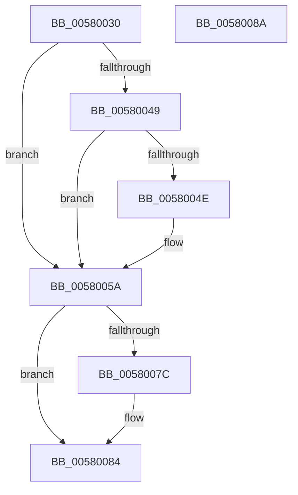

# DbgkpLkmdSnapKernelStackSegmentCallback

- RVA: `0x00580030`–`0x0058008B` (길이 `91` bytes)
- VA: `0x0000000140580030`
- 실행 섹션: `.text`
- PDB 이름 있음: `예`; PDB Function 태그: `아니요`
- unwind 정보 RVA: `0x00064C80`
- 디코드: `28`개 명령, `91/91` bytes 표시
- 미해석 바이트: `0` (있으면 어셈블리에 `.byte`로 보존)

> 이 문서는 커널 이미지의 기계어와 PDB 기호를 분석해 생성했습니다. 4번과 5번은 함수 원형과 자료형을 바이너리 사용 방식에서 추정한 C 해석이며 원본 소스 복구 결과는 아닙니다.

## 1. Dependencies

- 직접 호출 지점: **1**; 고유 호출 대상: **1**
- 직접 호출자로 확인된 함수: **0**
- RIP 상대 이미지 참조: **0**

### Outgoing calls
- `0x00580073` → [DbgkpLkmdSnapDataEx](../57/DbgkpLkmdSnapDataEx_function_0057FDD4.md) (function, `0x0057FDD4`)

### Direct callers
- 이 함수 시작 RVA로 연결되는 직접 call은 확인되지 않았습니다. 간접 호출은 완전히 역산할 수 없습니다.

### Static image references
- 디코드된 RIP-relative 메모리 참조가 없습니다.

## 2. Other-region calls and transfers

- 다른 실행 섹션으로 향하는 call: **0**
- 별도 외부 분기/꼬리 이동을 확인하지 못했습니다.

## 3. Assembly (complete function range)

```asm
00580030  40 53                           push rbx
00580032  48 83 EC 30                     sub rsp, 0x30
00580036  49 8B 40 08                     mov rax, qword ptr [r8 + 8]
0058003A  45 33 C9                        xor r9d, r9d
0058003D  48 8B 4A 08                     mov rcx, qword ptr [rdx + 8]
00580041  49 8B D8                        mov rbx, r8
00580044  48 3B C1                        cmp rax, rcx
00580047  72 11                           jb 0x14058005a
00580049  48 3B 02                        cmp rax, qword ptr [rdx]
0058004C  73 0C                           jae 0x14058005a
0058004E  45 38 48 10                     cmp byte ptr [r8 + 0x10], r9b
00580052  41 8D 41 05                     lea eax, [r9 + 5]
00580056  44 0F 44 C8                     cmove r9d, eax
0058005A  44 8B 02                        mov r8d, dword ptr [rdx]
0058005D  44 2B 42 08                     sub r8d, dword ptr [rdx + 8]
00580061  48 8B D1                        mov rdx, rcx
00580064  48 8B 0B                        mov rcx, qword ptr [rbx]
00580067  48 83 64 24 28 00               and qword ptr [rsp + 0x28], 0
0058006D  48 83 64 24 20 00               and qword ptr [rsp + 0x20], 0
00580073  E8 5C FD FF FF                  call 0x14057fdd4
00580078  85 C0                           test eax, eax
0058007A  78 08                           js 0x140580084
0058007C  48 8B 43 18                     mov rax, qword ptr [rbx + 0x18]
00580080  83 48 04 02                     or dword ptr [rax + 4], 2
00580084  48 83 C4 30                     add rsp, 0x30
00580088  5B                              pop rbx
00580089  C3                              ret
0058008A  CC                              int3
```

## 4. C-style interpretation (structured pseudocode)

```c
__int64 __fastcall DbgkpLkmdSnapKernelStackSegmentCallback(__int64 a1, __int64 a2, __int64 a3, int a4)
{
    __int64 result;
    __int64 v_rsp;
    unsigned __int64 v_stack_m10;
    unsigned __int64 v_stack_m18;

    v_rsp = (v_rsp) - (48);
    a4 = 0;
    if ((*(unsigned __int64 *)(a3 + 8)) < (*(unsigned __int64 *)(a2 + 8))) goto loc_0058005A;
    result = *(unsigned __int64 *)(a3 + 8);
    if ((*(unsigned __int64 *)(a3 + 8)) < (*(unsigned __int64 *)(a2))) {
        result = a4 + 5;
        if ((*(unsigned __int8 *)(a3 + 16)) == 0) { a4 = (unsigned int)(result); }
    }
    a3 = (unsigned int)(((unsigned int)(*(unsigned int *)(a2))) - (*(unsigned int *)(a2 + 8)));
    result = DbgkpLkmdSnapDataEx(*(unsigned __int64 *)(a3), *(unsigned __int64 *)(a2 + 8), a3, a4);
    if (!(sign_flag)) {
        result = *(unsigned __int64 *)(a3 + 24);
    }
    v_rsp = (v_rsp) + (48);
    return result;
}
```

## 5. (Beta) C Style

```c
int64_t DbgkpLkmdSnapKernelStackSegmentCallback(int64_t Arg1, void *Arg2, void *Arg3, int32_t Arg4)
{
    uint8_t *arg2 = (uint8_t *)Arg2;
    uint8_t *arg3 = (uint8_t *)Arg3;

    int64_t result;
    int64_t local_rsp;
    uint64_t v_stack_m10;
    uint64_t v_stack_m18;

    local_rsp = (local_rsp) - (48);
    Arg4 = 0;
    if ((*(uint64_t *)(arg3 + 0x8)) < (*(uint64_t *)(arg2 + 0x8))) goto loc_0058005A;
    result = *(uint64_t *)(arg3 + 0x8);
    if ((*(uint64_t *)(arg3 + 0x8)) < (*(uint64_t *)(arg2))) {
        result = Arg4 + 5;
        if ((*(uint8_t *)(arg3 + 0x10)) == 0) { Arg4 = (uint32_t)(result); }
    }
    Arg3 = (uint32_t)(((uint32_t)(*(uint32_t *)(arg2))) - (*(uint32_t *)(arg2 + 0x8)));
    result = DbgkpLkmdSnapDataEx(*(uint64_t *)(arg3), *(uint64_t *)(arg2 + 0x8), Arg3, Arg4);
    if (!(sign_flag)) {
        result = *(uint64_t *)(arg3 + 0x18);
    }
    local_rsp = (local_rsp) + (48);
    return result;
}
```

### 관측된 메모리 오프셋

구조체 형식이 확인되지 않은 접근은 인자 기준의 오프셋으로만 기록했습니다.

| 기준 인자 | 오프셋 표현 | 폭 (bit) | 접근 |
|---|---:|---:|---|
| `Arg2` | `+ 0x0` | `32` | `R` |
| `Arg2` | `+ 0x0` | `64` | `R` |
| `Arg2` | `+ 0x8` | `32` | `R` |
| `Arg2` | `+ 0x8` | `64` | `R` |
| `Arg3` | `+ 0x0` | `64` | `R` |
| `Arg3` | `+ 0x8` | `64` | `R` |
| `Arg3` | `+ 0x10` | `8` | `R` |
| `Arg3` | `+ 0x18` | `64` | `R` |

## 6. Execution-region graph

[열기: 2D/3D 그래프와 함수 탐색 컨트롤 패널](../../../control-panel.html?section=text&rva=0x00580030&view=graph)

- 2D 그래프는 위에서 아래로 흐르고, 3D 그래프는 빈 공간을 드래그해 회전합니다. Shift+드래그는 이동, 휠은 확대·축소, 함수 노드 선택은 대상 보고서 이동입니다.

### Static fallback


