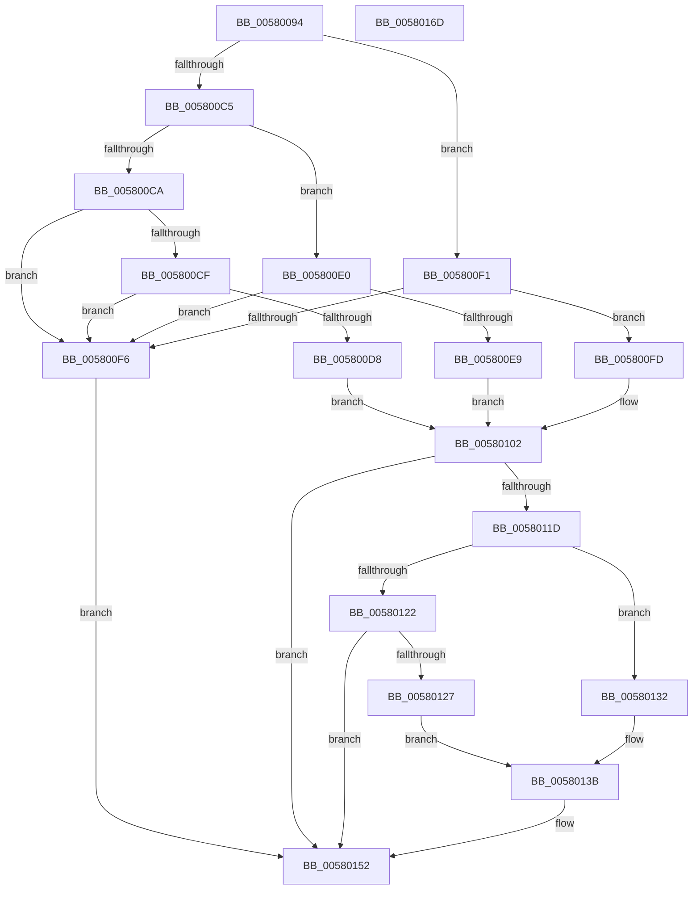

# DbgkpLkmdSnapObject

- RVA: `0x00580094`–`0x0058016E` (길이 `218` bytes)
- VA: `0x0000000140580094`
- 실행 섹션: `.text`
- PDB 이름 있음: `예`; PDB Function 태그: `아니요`
- unwind 정보 RVA: `0x000C5A00`
- 디코드: `64`개 명령, `218/218` bytes 표시
- 미해석 바이트: `0` (있으면 어셈블리에 `.byte`로 보존)

> 이 문서는 커널 이미지의 기계어와 PDB 기호를 분석해 생성했습니다. 4번과 5번은 함수 원형과 자료형을 바이너리 사용 방식에서 추정한 C 해석이며 원본 소스 복구 결과는 아닙니다.

## 1. Dependencies

- 직접 호출 지점: **2**; 고유 호출 대상: **1**
- 직접 호출자로 확인된 함수: **1**
- RIP 상대 이미지 참조: **0**

### Outgoing calls
- `0x00580114` → [DbgkpLkmdSnapDataEx](../57/DbgkpLkmdSnapDataEx_function_0057FDD4.md) (function, `0x0057FDD4`)
- `0x0058014D` → [DbgkpLkmdSnapDataEx](../57/DbgkpLkmdSnapDataEx_function_0057FDD4.md) (function, `0x0057FDD4`)

### Direct callers
- [DbgkpLkmdSnapPendingIrps](../../page/71/DbgkpLkmdSnapPendingIrps_function_00711984.md) at `0x00711A4F`
- [DbgkpLkmdSnapPendingIrps](../../page/71/DbgkpLkmdSnapPendingIrps_function_00711984.md) at `0x00711A66`
- [DbgkpLkmdSnapPendingIrps](../../page/71/DbgkpLkmdSnapPendingIrps_function_00711984.md) at `0x00711A81`

### Static image references
- 디코드된 RIP-relative 메모리 참조가 없습니다.

## 2. Other-region calls and transfers

- 다른 실행 섹션으로 향하는 call: **0**
- 별도 외부 분기/꼬리 이동을 확인하지 못했습니다.

## 3. Assembly (complete function range)

```asm
00580094  48 8B C4                        mov rax, rsp
00580097  48 89 58 08                     mov qword ptr [rax + 8], rbx
0058009B  48 89 68 10                     mov qword ptr [rax + 0x10], rbp
0058009F  48 89 70 18                     mov qword ptr [rax + 0x18], rsi
005800A3  48 89 78 20                     mov qword ptr [rax + 0x20], rdi
005800A7  41 57                           push r15
005800A9  48 83 EC 30                     sub rsp, 0x30
005800AD  33 FF                           xor edi, edi
005800AF  48 8B E9                        mov rbp, rcx
005800B2  33 F6                           xor esi, esi
005800B4  41 8B C0                        mov eax, r8d
005800B7  41 8B D8                        mov ebx, r8d
005800BA  8D 4F 03                        lea ecx, [rdi + 3]
005800BD  44 8D 7F 04                     lea r15d, [rdi + 4]
005800C1  2B C1                           sub eax, ecx
005800C3  74 2C                           je 0x1405800f1
005800C5  83 E8 01                        sub eax, 1
005800C8  74 16                           je 0x1405800e0
005800CA  83 F8 01                        cmp eax, 1
005800CD  75 27                           jne 0x1405800f6
005800CF  66 83 3A 05                     cmp word ptr [rdx], 5
005800D3  48 8B FA                        mov rdi, rdx
005800D6  75 1E                           jne 0x1405800f6
005800D8  41 B8 D8 00 00 00               mov r8d, 0xd8
005800DE  EB 22                           jmp 0x140580102
005800E0  48 8B F2                        mov rsi, rdx
005800E3  66 44 39 3A                     cmp word ptr [rdx], r15w
005800E7  75 0D                           jne 0x1405800f6
005800E9  41 B8 50 01 00 00               mov r8d, 0x150
005800EF  EB 11                           jmp 0x140580102
005800F1  66 39 0A                        cmp word ptr [rdx], cx
005800F4  74 07                           je 0x1405800fd
005800F6  B8 05 00 00 C0                  mov eax, 0xc0000005
005800FB  EB 55                           jmp 0x140580152
005800FD  44 0F B7 42 02                  movzx r8d, word ptr [rdx + 2]
00580102  48 83 64 24 28 00               and qword ptr [rsp + 0x28], 0
00580108  45 33 C9                        xor r9d, r9d
0058010B  48 83 64 24 20 00               and qword ptr [rsp + 0x20], 0
00580111  48 8B CD                        mov rcx, rbp
00580114  E8 BB FC FF FF                  call 0x14057fdd4
00580119  85 C0                           test eax, eax
0058011B  78 35                           js 0x140580152
0058011D  41 2B DF                        sub ebx, r15d
00580120  74 10                           je 0x140580132
00580122  83 FB 01                        cmp ebx, 1
00580125  75 2B                           jne 0x140580152
00580127  44 0F B7 47 5A                  movzx r8d, word ptr [rdi + 0x5a]
0058012C  48 8B 57 60                     mov rdx, qword ptr [rdi + 0x60]
00580130  EB 09                           jmp 0x14058013b
00580132  44 0F B7 46 3A                  movzx r8d, word ptr [rsi + 0x3a]
00580137  48 8B 56 40                     mov rdx, qword ptr [rsi + 0x40]
0058013B  48 83 64 24 28 00               and qword ptr [rsp + 0x28], 0
00580141  45 33 C9                        xor r9d, r9d
00580144  48 83 64 24 20 00               and qword ptr [rsp + 0x20], 0
0058014A  48 8B CD                        mov rcx, rbp
0058014D  E8 82 FC FF FF                  call 0x14057fdd4
00580152  48 8B 5C 24 40                  mov rbx, qword ptr [rsp + 0x40]
00580157  48 8B 6C 24 48                  mov rbp, qword ptr [rsp + 0x48]
0058015C  48 8B 74 24 50                  mov rsi, qword ptr [rsp + 0x50]
00580161  48 8B 7C 24 58                  mov rdi, qword ptr [rsp + 0x58]
00580166  48 83 C4 30                     add rsp, 0x30
0058016A  41 5F                           pop r15
0058016C  C3                              ret
0058016D  CC                              int3
```

## 4. C-style interpretation (structured pseudocode)

```c
__int64 __fastcall DbgkpLkmdSnapObject(__int64 a1, __int64 a2, int a3, int a4)
{
    __int64 result;
    __int64 v_rbx;
    __int64 v_rdi;
    __int64 v_rsi;
    __int64 v_rsp;
    unsigned __int64 v_stack_m10;
    unsigned __int64 v_stack_m18;
    unsigned __int64 v_stack_p10;
    unsigned __int64 v_stack_p18;
    unsigned __int64 v_stack_p20;
    unsigned __int64 v_stack_p8;

    *(unsigned __int64 *)(v_rsp + 8) = v_rbx;
    *(unsigned __int64 *)(v_rsp + 16) = v_rbp;
    *(unsigned __int64 *)(v_rsp + 24) = v_rsi;
    *(unsigned __int64 *)(v_rsp + 32) = v_rdi;
    v_rsp = (v_rsp) - (48);
    v_rdi = 0;
    v_rsi = 0;
    result = (unsigned int)(((unsigned int)(a3)) - ((unsigned int)(v_rdi + 3)));
    if (condition_is_equal) goto loc_005800F1;
    result = (unsigned int)((result) - (1));
    if (condition_is_equal) goto loc_005800E0;
    if (((unsigned int)(result)) != 1) goto loc_005800F6;
    if ((*(unsigned __int16 *)(a2)) != 5) goto loc_005800F6;
    goto loc_00580102;
loc_005800E0:
    if ((*(unsigned __int16 *)(a2)) != ((unsigned __int16)(v_rdi + 4))) goto loc_005800F6;
    goto loc_00580102;
loc_005800F1:
    if ((*(unsigned __int16 *)(a2)) == ((unsigned __int16)(v_rdi + 3))) goto loc_005800FD;
loc_005800F6:
    goto loc_00580152;
loc_005800FD:
loc_00580102:
    a4 = 0;
    result = DbgkpLkmdSnapDataEx(a1, a2, *(unsigned __int16 *)(a2 + 2), a4);
    if (sign_flag) goto loc_00580152;
    v_rbx = (unsigned int)(((unsigned int)(a3)) - ((unsigned int)(v_rdi + 4)));
    if (condition_is_equal) goto loc_00580132;
    if (((unsigned int)(v_rbx)) != 1) goto loc_00580152;
    goto loc_0058013B;
loc_00580132:
loc_0058013B:
    a4 = 0;
    result = DbgkpLkmdSnapDataEx(a1, *(unsigned __int64 *)(a2 + 64), *(unsigned __int16 *)(a2 + 58), a4);
loc_00580152:
    v_rsp = (v_rsp) + (48);
    return result;
}
```

## 5. (Beta) C Style

```c
int64_t DbgkpLkmdSnapObject(int64_t Arg1, void *Arg2, int32_t Arg3, int32_t Arg4)
{
    uint8_t *arg2 = (uint8_t *)Arg2;

    int64_t result;
    int64_t local_rbx;
    int64_t local_rdi;
    int64_t local_rsi;
    int64_t local_rsp;
    uint64_t v_stack_m10;
    uint64_t v_stack_m18;
    uint64_t v_stack_p10;
    uint64_t v_stack_p18;
    uint64_t v_stack_p20;
    uint64_t v_stack_p8;

    *(uint64_t *)(local_rsp + 0x8) = local_rbx;
    *(uint64_t *)(local_rsp + 0x10) = local_rbp;
    *(uint64_t *)(local_rsp + 0x18) = local_rsi;
    *(uint64_t *)(local_rsp + 0x20) = local_rdi;
    local_rsp = (local_rsp) - (48);
    local_rdi = 0;
    local_rsi = 0;
    result = (uint32_t)(((uint32_t)(Arg3)) - ((uint32_t)(local_rdi + 3)));
    if (condition_is_equal) goto loc_005800F1;
    result = (uint32_t)((result) - (1));
    if (condition_is_equal) goto loc_005800E0;
    if (((uint32_t)(result)) != 1) goto loc_005800F6;
    if ((*(uint16_t *)(arg2)) != 5) goto loc_005800F6;
    goto loc_00580102;
loc_005800E0:
    if ((*(uint16_t *)(arg2)) != ((uint16_t)(local_rdi + 4))) goto loc_005800F6;
    goto loc_00580102;
loc_005800F1:
    if ((*(uint16_t *)(arg2)) == ((uint16_t)(local_rdi + 3))) goto loc_005800FD;
loc_005800F6:
    goto loc_00580152;
loc_005800FD:
loc_00580102:
    Arg4 = 0;
    result = DbgkpLkmdSnapDataEx(Arg1, Arg2, *(uint16_t *)(arg2 + 0x2), Arg4);
    if (sign_flag) goto loc_00580152;
    local_rbx = (uint32_t)(((uint32_t)(Arg3)) - ((uint32_t)(local_rdi + 4)));
    if (condition_is_equal) goto loc_00580132;
    if (((uint32_t)(local_rbx)) != 1) goto loc_00580152;
    goto loc_0058013B;
loc_00580132:
loc_0058013B:
    Arg4 = 0;
    result = DbgkpLkmdSnapDataEx(Arg1, *(uint64_t *)(arg2 + 0x40), *(uint16_t *)(arg2 + 0x3A), Arg4);
loc_00580152:
    local_rsp = (local_rsp) + (48);
    return result;
}
```

### 관측된 메모리 오프셋

구조체 형식이 확인되지 않은 접근은 인자 기준의 오프셋으로만 기록했습니다.

| 기준 인자 | 오프셋 표현 | 폭 (bit) | 접근 |
|---|---:|---:|---|
| `Arg2` | `+ 0x0` | `16` | `R` |
| `Arg2` | `+ 0x2` | `16` | `R` |

## 6. Execution-region graph

[열기: 2D/3D 그래프와 함수 탐색 컨트롤 패널](../../../control-panel.html?section=text&rva=0x00580094&view=graph)

- 2D 그래프는 위에서 아래로 흐르고, 3D 그래프는 빈 공간을 드래그해 회전합니다. Shift+드래그는 이동, 휠은 확대·축소, 함수 노드 선택은 대상 보고서 이동입니다.

### Static fallback


