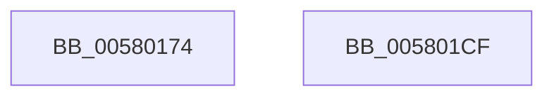

# DbgkpLkmdSnapThread

- RVA: `0x00580174`–`0x005801D0` (길이 `92` bytes)
- VA: `0x0000000140580174`
- 실행 섹션: `.text`
- PDB 이름 있음: `예`; PDB Function 태그: `아니요`
- unwind 정보 RVA: `0x0005C954`
- 디코드: `26`개 명령, `92/92` bytes 표시
- 미해석 바이트: `0` (있으면 어셈블리에 `.byte`로 보존)

> 이 문서는 커널 이미지의 기계어와 PDB 기호를 분석해 생성했습니다. 4번과 5번은 함수 원형과 자료형을 바이너리 사용 방식에서 추정한 C 해석이며 원본 소스 복구 결과는 아닙니다.

## 1. Dependencies

- 직접 호출 지점: **2**; 고유 호출 대상: **2**
- 직접 호출자로 확인된 함수: **1**
- RIP 상대 이미지 참조: **1**

### Outgoing calls
- `0x005801A4` → [KeEnumerateQueueApc](../5B/KeEnumerateQueueApc_function_005BE290.md) (function, `0x005BE290`)
- `0x005801B5` → [DbgkpLkmdLaunchSnapApc](../../page/71/DbgkpLkmdLaunchSnapApc_function_00711844.md) (function, `0x00711844`)

### Direct callers
- [DbgkCaptureLiveDump](../../page/71/DbgkCaptureLiveDump_function_0071113C.md) at `0x007113C5`

### Static image references
- `0x00580197` → RVA `0x0057FD80` (`DbgkpLkmdEnumApcOrDpcDataCallback`; read)

## 2. Other-region calls and transfers

- 다른 실행 섹션으로 향하는 call: **1**
  - `0x005801B5` → [DbgkpLkmdLaunchSnapApc](../../page/71/DbgkpLkmdLaunchSnapApc_function_00711844.md) (`.text` → `PAGE`)
- 별도 외부 분기/꼬리 이동을 확인하지 못했습니다.

## 3. Assembly (complete function range)

```asm
00580174  48 89 5C 24 08                  mov qword ptr [rsp + 8], rbx
00580179  48 89 6C 24 10                  mov qword ptr [rsp + 0x10], rbp
0058017E  48 89 74 24 18                  mov qword ptr [rsp + 0x18], rsi
00580183  57                              push rdi
00580184  48 83 EC 20                     sub rsp, 0x20
00580188  49 8B F8                        mov rdi, r8
0058018B  49 8B D9                        mov rbx, r9
0058018E  4C 8B C1                        mov r8, rcx
00580191  48 8B F2                        mov rsi, rdx
00580194  48 8B E9                        mov rbp, rcx
00580197  48 8D 15 E2 FB FF FF            lea rdx, [rip - 0x41e]
0058019E  48 8B CF                        mov rcx, rdi
005801A1  45 33 C9                        xor r9d, r9d
005801A4  E8 E7 E0 03 00                  call 0x1405be290
005801A9  4C 8B CB                        mov r9, rbx
005801AC  4C 8B C7                        mov r8, rdi
005801AF  48 8B D6                        mov rdx, rsi
005801B2  48 8B CD                        mov rcx, rbp
005801B5  E8 8A 16 19 00                  call 0x140711844
005801BA  48 8B 5C 24 30                  mov rbx, qword ptr [rsp + 0x30]
005801BF  48 8B 6C 24 38                  mov rbp, qword ptr [rsp + 0x38]
005801C4  48 8B 74 24 40                  mov rsi, qword ptr [rsp + 0x40]
005801C9  48 83 C4 20                     add rsp, 0x20
005801CD  5F                              pop rdi
005801CE  C3                              ret
005801CF  CC                              int3
```

## 4. C-style interpretation (structured pseudocode)

```c
__int64 __fastcall DbgkpLkmdSnapThread(__int64 a1, __int64 a2, __int64 a3, __int64 a4)
{
    __int64 result;
    __int64 v_rsp;
    unsigned __int64 v_stack_p10;
    unsigned __int64 v_stack_p18;
    unsigned __int64 v_stack_p8;

    v_stack_p8 = v_rbx;
    v_stack_p10 = v_rbp;
    v_stack_p18 = v_rsi;
    v_rsp = (v_rsp) - (32);
    a4 = 0;
    result = KeEnumerateQueueApc(a3, v_rip - 1054, a1, a4);
    result = DbgkpLkmdLaunchSnapApc(a1, a2, a3, 0);
    v_rsp = (v_rsp) + (32);
    return result;
}
```

## 5. (Beta) C Style

```c
int64_t DbgkpLkmdSnapThread(int64_t Arg1, int64_t Arg2, int64_t Arg3, int64_t Arg4)
{
    int64_t result;
    int64_t local_rsp;
    uint64_t v_stack_p10;
    uint64_t v_stack_p18;
    uint64_t v_stack_p8;

    v_stack_p8 = local_rbx;
    v_stack_p10 = local_rbp;
    v_stack_p18 = local_rsi;
    local_rsp = (local_rsp) - (32);
    Arg4 = 0;
    result = KeEnumerateQueueApc(Arg3, v_rip - 1054, Arg1, Arg4);
    result = DbgkpLkmdLaunchSnapApc(Arg1, Arg2, Arg3, 0);
    local_rsp = (local_rsp) + (32);
    return result;
}
```

## 6. Execution-region graph

[열기: 2D/3D 그래프와 함수 탐색 컨트롤 패널](../../../control-panel.html?section=text&rva=0x00580174&view=graph)

- 2D 그래프는 위에서 아래로 흐르고, 3D 그래프는 빈 공간을 드래그해 회전합니다. Shift+드래그는 이동, 휠은 확대·축소, 함수 노드 선택은 대상 보고서 이동입니다.

### Static fallback


