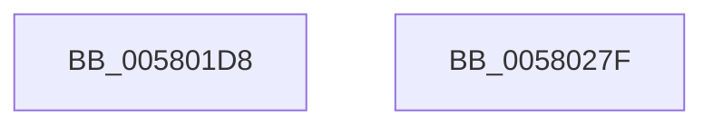

# DbgkpLkmdSqmIncrementDword

- RVA: `0x005801D8`–`0x00580280` (길이 `168` bytes)
- VA: `0x00000001405801D8`
- 실행 섹션: `.text`
- PDB 이름 있음: `예`; PDB Function 태그: `아니요`
- unwind 정보 RVA: `0x000BC74C`
- 디코드: `38`개 명령, `168/168` bytes 표시
- 미해석 바이트: `0` (있으면 어셈블리에 `.byte`로 보존)

> 이 문서는 커널 이미지의 기계어와 PDB 기호를 분석해 생성했습니다. 4번과 5번은 함수 원형과 자료형을 바이너리 사용 방식에서 추정한 C 해석이며 원본 소스 복구 결과는 아닙니다.

## 1. Dependencies

- 직접 호출 지점: **2**; 고유 호출 대상: **2**
- 직접 호출자로 확인된 함수: **2**
- RIP 상대 이미지 참조: **3**

### Outgoing calls
- `0x00580265` → [EtwWriteEx](../25/EtwWriteEx_function_0025F0D0.md) (function, `0x0025F0D0`)
- `0x00580271` → [_security_check_cookie](../6A/_security_check_cookie_function_006AC640.md) (function, `0x006AC640`)

### Direct callers
- [DbgkCaptureLiveDump](../../page/71/DbgkCaptureLiveDump_function_0071113C.md) at `0x007111F8`
- [DbgkpLkmdSqmStatus](../../page/71/DbgkpLkmdSqmStatus_function_00711DEC.md) at `0x00711E08`
- [DbgkpLkmdSqmStatus](../../page/71/DbgkpLkmdSqmStatus_function_00711DEC.md) at `0x00711E1C`
- [DbgkpLkmdSqmStatus](../../page/71/DbgkpLkmdSqmStatus_function_00711DEC.md) at `0x00711E32`
- [DbgkpLkmdSqmStatus](../../page/71/DbgkpLkmdSqmStatus_function_00711DEC.md) at `0x00711E48`
- [DbgkpLkmdSqmStatus](../../page/71/DbgkpLkmdSqmStatus_function_00711DEC.md) at `0x00711E5A`
- [DbgkpLkmdSqmStatus](../../page/71/DbgkpLkmdSqmStatus_function_00711DEC.md) at `0x00711E67`

### Static image references
- `0x005801E9` → RVA `0x00E0A740` (`.data`; read)
- `0x00580219` → RVA `0x00026330` (`.rdata`; read)
- `0x00580245` → RVA `0x00E0A8A0` (`.data`; read)

## 2. Other-region calls and transfers

- 다른 실행 섹션으로 향하는 call: **0**
- 별도 외부 분기/꼬리 이동을 확인하지 못했습니다.

## 3. Assembly (complete function range)

```asm
005801D8  89 54 24 10                     mov dword ptr [rsp + 0x10], edx
005801DC  55                              push rbp
005801DD  48 8D 6C 24 A9                  lea rbp, [rsp - 0x57]
005801E2  48 81 EC A0 00 00 00            sub rsp, 0xa0
005801E9  48 8B 05 50 A5 88 00            mov rax, qword ptr [rip + 0x88a550]
005801F0  48 33 C4                        xor rax, rsp
005801F3  48 89 45 47                     mov qword ptr [rbp + 0x47], rax
005801F7  BA 04 00 00 00                  mov edx, 4
005801FC  C7 45 FF 01 00 00 00            mov dword ptr [rbp - 1], 1
00580203  45 33 C0                        xor r8d, r8d
00580206  48 89 55 0F                     mov qword ptr [rbp + 0xf], rdx
0058020A  48 8D 45 F7                     lea rax, [rbp - 9]
0058020E  48 89 55 2F                     mov qword ptr [rbp + 0x2f], rdx
00580212  48 89 45 07                     mov qword ptr [rbp + 7], rax
00580216  45 33 C9                        xor r9d, r9d
00580219  48 8D 05 10 61 AA FF            lea rax, [rip - 0x559ef0]
00580220  48 89 55 3F                     mov qword ptr [rbp + 0x3f], rdx
00580224  48 89 45 17                     mov qword ptr [rbp + 0x17], rax
00580228  48 8D 45 6F                     lea rax, [rbp + 0x6f]
0058022C  48 89 45 27                     mov qword ptr [rbp + 0x27], rax
00580230  48 8D 45 FF                     lea rax, [rbp - 1]
00580234  48 89 45 37                     mov qword ptr [rbp + 0x37], rax
00580238  48 8D 45 07                     lea rax, [rbp + 7]
0058023C  48 89 44 24 38                  mov qword ptr [rsp + 0x38], rax
00580241  89 54 24 30                     mov dword ptr [rsp + 0x30], edx
00580245  48 8D 15 54 A6 88 00            lea rdx, [rip + 0x88a654]
0058024C  4C 89 44 24 28                  mov qword ptr [rsp + 0x28], r8
00580251  4C 89 44 24 20                  mov qword ptr [rsp + 0x20], r8
00580256  C7 45 F7 06 00 00 00            mov dword ptr [rbp - 9], 6
0058025D  48 C7 45 1F 10 00 00 00         mov qword ptr [rbp + 0x1f], 0x10
00580265  E8 66 EE CD FF                  call 0x14025f0d0
0058026A  48 8B 4D 47                     mov rcx, qword ptr [rbp + 0x47]
0058026E  48 33 CC                        xor rcx, rsp
00580271  E8 CA C3 12 00                  call 0x1406ac640
00580276  48 81 C4 A0 00 00 00            add rsp, 0xa0
0058027D  5D                              pop rbp
0058027E  C3                              ret
0058027F  CC                              int3
```

## 4. C-style interpretation (structured pseudocode)

```c
__int64 __fastcall DbgkpLkmdSqmIncrementDword(__int64 a1, int a2, int a3, int a4)
{
    __int64 result;
    __int64 v_rsp;
    unsigned __int64 v_stack_m18;
    unsigned __int64 v_stack_m20;
    unsigned __int64 v_stack_m28;
    unsigned __int64 v_stack_m30;
    unsigned __int64 v_stack_m38;
    unsigned __int64 v_stack_m40;
    unsigned __int64 v_stack_m48;
    unsigned __int64 v_stack_m50;
    unsigned __int64 v_stack_m58;
    unsigned __int64 v_stack_m5F;
    unsigned int v_stack_m60;
    unsigned __int64 v_stack_m68;
    unsigned __int64 v_stack_m70;
    unsigned int v_stack_m78;
    unsigned __int64 v_stack_m80;
    unsigned __int64 v_stack_m88;
    unsigned int v_stack_p10;

    v_stack_p10 = a2;
    v_rsp = (v_rsp) - (160);
    result = (*(unsigned __int64 *)(v_rip + 8955216)) ^ (v_rsp);
    v_stack_m18 = result;
    v_stack_m60 = 1;
    a3 = 0;
    v_stack_m50 = 4;
    v_stack_m30 = 4;
    v_stack_m58 = v_stack_m68;
    a4 = 0;
    v_stack_m20 = 4;
    v_stack_m48 = v_rip - 5611248;
    v_stack_m38 = v_stack_p10;
    v_stack_m28 = v_stack_m60;
    v_stack_m70 = v_stack_m58;
    v_stack_m78 = 4;
    v_stack_m80 = 0;
    v_stack_m88 = 0;
    v_stack_m68 = 6;
    v_stack_m40 = 16;
    result = EtwWriteEx(a1, v_rip + 8955476, a3, a4);
    a1 = (v_stack_m18) ^ (v_rsp);
    result = _security_check_cookie(a1, v_rip + 8955476, a3, a4);
    v_rsp = (v_rsp) + (160);
    return result;
}
```

## 5. (Beta) C Style

```c
int64_t DbgkpLkmdSqmIncrementDword(int64_t Arg1, int32_t Arg2, int32_t Arg3, int32_t Arg4)
{
    int64_t result;
    int64_t local_rsp;
    uint64_t v_stack_m18;
    uint64_t v_stack_m20;
    uint64_t v_stack_m28;
    uint64_t v_stack_m30;
    uint64_t v_stack_m38;
    uint64_t v_stack_m40;
    uint64_t v_stack_m48;
    uint64_t v_stack_m50;
    uint64_t v_stack_m58;
    uint64_t v_stack_m5F;
    uint32_t v_stack_m60;
    uint64_t v_stack_m68;
    uint64_t v_stack_m70;
    uint32_t v_stack_m78;
    uint64_t v_stack_m80;
    uint64_t v_stack_m88;
    uint32_t v_stack_p10;

    v_stack_p10 = Arg2;
    local_rsp = (local_rsp) - (160);
    result = (*(uint64_t *)(v_rip + 0x88A550)) ^ (local_rsp);
    v_stack_m18 = result;
    v_stack_m60 = 1;
    Arg3 = 0;
    v_stack_m50 = 4;
    v_stack_m30 = 4;
    v_stack_m58 = v_stack_m68;
    Arg4 = 0;
    v_stack_m20 = 4;
    v_stack_m48 = v_rip - 5611248;
    v_stack_m38 = v_stack_p10;
    v_stack_m28 = v_stack_m60;
    v_stack_m70 = v_stack_m58;
    v_stack_m78 = 4;
    v_stack_m80 = 0;
    v_stack_m88 = 0;
    v_stack_m68 = 6;
    v_stack_m40 = 16;
    result = EtwWriteEx(Arg1, v_rip + 8955476, Arg3, Arg4);
    Arg1 = (v_stack_m18) ^ (local_rsp);
    result = _security_check_cookie(Arg1, v_rip + 8955476, Arg3, Arg4);
    local_rsp = (local_rsp) + (160);
    return result;
}
```

## 6. Execution-region graph

[열기: 2D/3D 그래프와 함수 탐색 컨트롤 패널](../../../control-panel.html?section=text&rva=0x005801D8&view=graph)

- 2D 그래프는 위에서 아래로 흐르고, 3D 그래프는 빈 공간을 드래그해 회전합니다. Shift+드래그는 이동, 휠은 확대·축소, 함수 노드 선택은 대상 보고서 이동입니다.

### Static fallback


