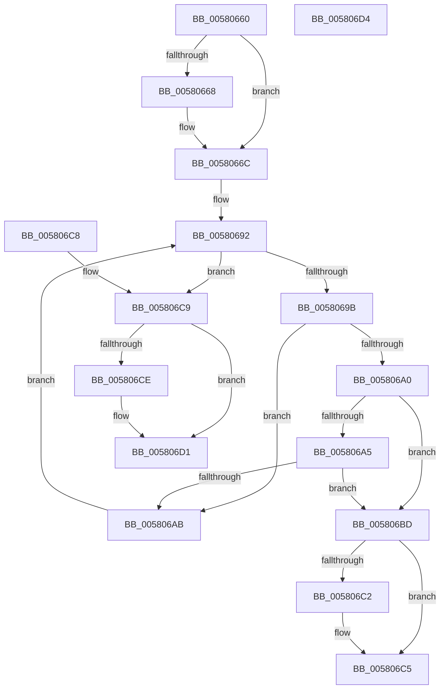

# DbgkpTriageDumpCheckPresentHashTable

- RVA: `0x00580660`–`0x005806D5` (길이 `117` bytes)
- VA: `0x0000000140580660`
- 실행 섹션: `.text`
- PDB 이름 있음: `예`; PDB Function 태그: `아니요`
- unwind 정보 RVA: `0x000DB714`
- 디코드: `38`개 명령, `117/117` bytes 표시
- 미해석 바이트: `0` (있으면 어셈블리에 `.byte`로 보존)

> 이 문서는 커널 이미지의 기계어와 PDB 기호를 분석해 생성했습니다. 4번과 5번은 함수 원형과 자료형을 바이너리 사용 방식에서 추정한 C 해석이며 원본 소스 복구 결과는 아닙니다.

## 1. Dependencies

- 직접 호출 지점: **0**; 고유 호출 대상: **0**
- 직접 호출자로 확인된 함수: **2**
- RIP 상대 이미지 참조: **0**

### Outgoing calls
- 직접 디코드된 call 명령이 없습니다.

### Direct callers
- [DbgkpTriageDumpSnapData](DbgkpTriageDumpSnapData_function_005806E0.md) at `0x00580779`
- [DbgkpTriageDumpIsMemoryBlockPresent](../../page/71/DbgkpTriageDumpIsMemoryBlockPresent_function_00712B30.md) at `0x00712B4C`

### Static image references
- 디코드된 RIP-relative 메모리 참조가 없습니다.

## 2. Other-region calls and transfers

- 다른 실행 섹션으로 향하는 call: **0**
- 별도 외부 분기/꼬리 이동을 확인하지 못했습니다.

## 3. Assembly (complete function range)

```asm
00580660  4C 8B DA                        mov r11, rdx
00580663  4D 85 C9                        test r9, r9
00580666  74 04                           je 0x14058066c
00580668  49 83 09 FF                     or qword ptr [r9], 0xffffffffffffffff
0058066C  4D 8B D3                        mov r10, r11
0058066F  48 B8 57 AC F4 69 5E 79 D1 92   movabs rax, 0x92d1795e69f4ac57
00580679  49 C1 EA 04                     shr r10, 4
0058067D  49 F7 E2                        mul r10
00580680  48 C1 EA 0B                     shr rdx, 0xb
00580684  48 69 C2 F3 0D 00 00            imul rax, rdx, 0xdf3
0058068B  48 8B 51 20                     mov rdx, qword ptr [rcx + 0x20]
0058068F  4C 2B D0                        sub r10, rax
00580692  4A 8B 04 D2                     mov rax, qword ptr [rdx + r10*8]
00580696  48 85 C0                        test rax, rax
00580699  74 2E                           je 0x1405806c9
0058069B  4C 39 18                        cmp qword ptr [rax], r11
0058069E  75 0B                           jne 0x1405806ab
005806A0  45 85 C0                        test r8d, r8d
005806A3  74 18                           je 0x1405806bd
005806A5  44 39 40 0C                     cmp dword ptr [rax + 0xc], r8d
005806A9  74 12                           je 0x1405806bd
005806AB  49 8D 42 01                     lea rax, [r10 + 1]
005806AF  48 3D F3 0D 00 00               cmp rax, 0xdf3
005806B5  4D 1B D2                        sbb r10, r10
005806B8  4C 23 D0                        and r10, rax
005806BB  EB D5                           jmp 0x140580692
005806BD  4D 85 C9                        test r9, r9
005806C0  74 03                           je 0x1405806c5
005806C2  4D 89 11                        mov qword ptr [r9], r10
005806C5  B0 01                           mov al, 1
005806C7  C3                              ret
005806C8  CC                              int3
005806C9  4D 85 C9                        test r9, r9
005806CC  74 03                           je 0x1405806d1
005806CE  4D 89 11                        mov qword ptr [r9], r10
005806D1  32 C0                           xor al, al
005806D3  C3                              ret
005806D4  CC                              int3
```

## 4. C-style interpretation (structured pseudocode)

```c
__int64 __fastcall DbgkpTriageDumpCheckPresentHashTable(__int64 a1, __int64 a2, int a3, __int64 a4)
{
    __int64 result;
    __int64 v_r10;

    if (a4 != 0) {
    }
    v_r10 = (a2) >> (4);
    a2 = (a2) >> (11);
    result = (result) * (a2);
    v_r10 = (v_r10) - (result);
loc_00580692:
    if (*(unsigned __int64 *)(*(unsigned __int64 *)(a1 + 32) + v_r10 * 8) == 0) goto loc_005806C9;
    if ((*(unsigned __int64 *)(*(unsigned __int64 *)(*(unsigned __int64 *)(a1 + 32) + v_r10 * 8))) != a2) goto loc_005806AB;
    if (a3 == 0) goto loc_005806BD;
    if ((*(unsigned int *)(*(unsigned __int64 *)(*(unsigned __int64 *)(a1 + 32) + v_r10 * 8) + 12)) == a3) goto loc_005806BD;
loc_005806AB:
    v_r10 = (v_r10) & (v_r10 + 1);
    goto loc_00580692;
loc_005806BD:
    if (a4 != 0) {
        *(unsigned __int64 *)(a4) = v_r10;
    }
    return 1;
loc_005806C9:
    if (a4 != 0) {
        *(unsigned __int64 *)(a4) = v_r10;
    }
    result = 0;
    return result;
}
```

## 5. (Beta) C Style

```c
int64_t DbgkpTriageDumpCheckPresentHashTable(void *Arg1, int64_t Arg2, int32_t Arg3, int64_t Arg4)
{
    uint8_t *arg1 = (uint8_t *)Arg1;

    int64_t result;
    int64_t local_r10;

    if (Arg4 != 0) {
    }
    local_r10 = (Arg2) >> (4);
    Arg2 = (Arg2) >> (11);
    result = (result) * (Arg2);
    local_r10 = (local_r10) - (result);
loc_00580692:
    if (*(uint64_t *)(*(uint64_t *)(arg1 + 0x20) + local_r10 * 8) == 0) goto loc_005806C9;
    if ((*(uint64_t *)(*(uint64_t *)(*(uint64_t *)(arg1 + 0x20) + local_r10 * 8))) != Arg2) goto loc_005806AB;
    if (Arg3 == 0) goto loc_005806BD;
    if ((*(uint32_t *)(*(uint64_t *)(*(uint64_t *)(arg1 + 0x20) + local_r10 * 8) + 0xC)) == Arg3) goto loc_005806BD;
loc_005806AB:
    local_r10 = (local_r10) & (local_r10 + 1);
    goto loc_00580692;
loc_005806BD:
    if (Arg4 != 0) {
        *(uint64_t *)(Arg4) = local_r10;
    }
    return 1;
loc_005806C9:
    if (Arg4 != 0) {
        *(uint64_t *)(Arg4) = local_r10;
    }
    result = 0;
    return result;
}
```

### 관측된 메모리 오프셋

구조체 형식이 확인되지 않은 접근은 인자 기준의 오프셋으로만 기록했습니다.

| 기준 인자 | 오프셋 표현 | 폭 (bit) | 접근 |
|---|---:|---:|---|
| `Arg1` | `+ 0x20` | `64` | `R` |

## 6. Execution-region graph

[열기: 2D/3D 그래프와 함수 탐색 컨트롤 패널](../../../control-panel.html?section=text&rva=0x00580660&view=graph)

- 2D 그래프는 위에서 아래로 흐르고, 3D 그래프는 빈 공간을 드래그해 회전합니다. Shift+드래그는 이동, 휠은 확대·축소, 함수 노드 선택은 대상 보고서 이동입니다.

### Static fallback


