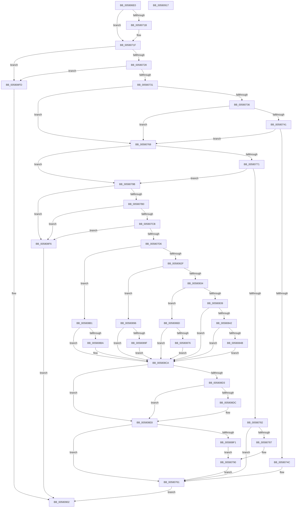

# DbgkpTriageDumpSnapData

- RVA: `0x005806E0`–`0x00580918` (길이 `568` bytes)
- VA: `0x00000001405806E0`
- 실행 섹션: `.text`
- PDB 이름 있음: `예`; PDB Function 태그: `아니요`
- unwind 정보 RVA: `0x000BE6C8`
- 디코드: `146`개 명령, `568/568` bytes 표시
- 미해석 바이트: `0` (있으면 어셈블리에 `.byte`로 보존)

> 이 문서는 커널 이미지의 기계어와 PDB 기호를 분석해 생성했습니다. 4번과 5번은 함수 원형과 자료형을 바이너리 사용 방식에서 추정한 C 해석이며 원본 소스 복구 결과는 아닙니다.

## 1. Dependencies

- 직접 호출 지점: **4**; 고유 호출 대상: **3**
- 직접 호출자로 확인된 함수: **0**
- RIP 상대 이미지 참조: **0**

### Outgoing calls
- `0x00580756` → [memcpy](../6C/memcpy_function_006C6840.md) (function, `0x006C6840`)
- `0x00580779` → [DbgkpTriageDumpCheckPresentHashTable](DbgkpTriageDumpCheckPresentHashTable_function_00580660.md) (function, `0x00580660`)
- `0x005807BE` → [RtlULongSub](../4A/RtlULongSub_function_004A1DA8.md) (function, `0x004A1DA8`)
- `0x005807E0` → [memcpy](../6C/memcpy_function_006C6840.md) (function, `0x006C6840`)

### Direct callers
- 이 함수 시작 RVA로 연결되는 직접 call은 확인되지 않았습니다. 간접 호출은 완전히 역산할 수 없습니다.

### Static image references
- 디코드된 RIP-relative 메모리 참조가 없습니다.

## 2. Other-region calls and transfers

- 다른 실행 섹션으로 향하는 call: **0**
- 별도 외부 분기/꼬리 이동을 확인하지 못했습니다.

## 3. Assembly (complete function range)

```asm
005806E0  48 89 5C 24 18                  mov qword ptr [rsp + 0x18], rbx
005806E5  55                              push rbp
005806E6  56                              push rsi
005806E7  57                              push rdi
005806E8  41 54                           push r12
005806EA  41 55                           push r13
005806EC  41 56                           push r14
005806EE  41 57                           push r15
005806F0  48 83 EC 20                     sub rsp, 0x20
005806F4  48 83 4C 24 68 FF               or qword ptr [rsp + 0x68], 0xffffffffffffffff
005806FA  41 8B F1                        mov esi, r9d
005806FD  83 64 24 60 00                  and dword ptr [rsp + 0x60], 0
00580702  48 8B EA                        mov rbp, rdx
00580705  4C 8B B4 24 88 00 00 00         mov r14, qword ptr [rsp + 0x88]
0058070D  48 8B F9                        mov rdi, rcx
00580710  48 8B 19                        mov rbx, qword ptr [rcx]
00580713  45 8B F8                        mov r15d, r8d
00580716  4D 85 F6                        test r14, r14
00580719  74 04                           je 0x14058071f
0058071B  49 83 26 00                     and qword ptr [r14], 0
0058071F  48 85 ED                        test rbp, rbp
00580722  0F 84 D5 01 00 00               je 0x1405808fd
00580728  45 85 C0                        test r8d, r8d
0058072B  0F 84 CC 01 00 00               je 0x1405808fd
00580731  83 FE 01                        cmp esi, 1
00580734  75 32                           jne 0x140580768
00580736  48 83 BC 24 80 00 00 00 00      cmp qword ptr [rsp + 0x80], 0
0058073F  75 27                           jne 0x140580768
00580741  8B 83 38 10 00 00               mov eax, dword ptr [rbx + 0x1038]
00580747  40 84 C6                        test sil, al
0058074A  75 1C                           jne 0x140580768
0058074C  4D 8B C7                        mov r8, r15
0058074F  48 8D 8B 48 03 00 00            lea rcx, [rbx + 0x348]
00580756  E8 E5 60 14 00                  call 0x1406c6840
0058075B  09 B3 38 10 00 00               or dword ptr [rbx + 0x1038], esi
00580761  33 C0                           xor eax, eax
00580763  E9 9A 01 00 00                  jmp 0x140580902
00580768  4C 8B 61 20                     mov r12, qword ptr [rcx + 0x20]
0058076C  4D 85 E4                        test r12, r12
0058076F  74 2A                           je 0x14058079b
00580771  4C 8D 4C 24 68                  lea r9, [rsp + 0x68]
00580776  45 8B C7                        mov r8d, r15d
00580779  E8 E2 FE FF FF                  call 0x140580660
0058077E  84 C0                           test al, al
00580780  74 19                           je 0x14058079b
00580782  4D 85 F6                        test r14, r14
00580785  74 DA                           je 0x140580761
00580787  48 8B 44 24 68                  mov rax, qword ptr [rsp + 0x68]
0058078C  49 8B 0C C4                     mov rcx, qword ptr [r12 + rax*8]
00580790  8B 41 08                        mov eax, dword ptr [rcx + 8]
00580793  48 03 07                        add rax, qword ptr [rdi]
00580796  49 89 06                        mov qword ptr [r14], rax
00580799  EB C6                           jmp 0x140580761
0058079B  45 8D 6F 07                     lea r13d, [r15 + 7]
0058079F  41 83 E5 F8                     and r13d, 0xfffffff8
005807A3  45 8D 55 10                     lea r10d, [r13 + 0x10]
005807A7  45 3B D5                        cmp r10d, r13d
005807AA  0F 82 46 01 00 00               jb 0x1405808f6
005807B0  8B 51 18                        mov edx, dword ptr [rcx + 0x18]
005807B3  4C 8D 44 24 60                  lea r8, [rsp + 0x60]
005807B8  8B 8B 78 20 00 00               mov ecx, dword ptr [rbx + 0x2078]
005807BE  E8 E5 15 F2 FF                  call 0x1404a1da8
005807C3  85 C0                           test eax, eax
005807C5  0F 88 2B 01 00 00               js 0x1405808f6
005807CB  44 3B 54 24 60                  cmp r10d, dword ptr [rsp + 0x60]
005807D0  0F 87 20 01 00 00               ja 0x1405808f6
005807D6  48 8D 0C 13                     lea rcx, [rbx + rdx]
005807DA  4D 8B C7                        mov r8, r15
005807DD  48 8B D5                        mov rdx, rbp
005807E0  E8 5B 60 14 00                  call 0x1406c6840
005807E5  0F BA AB 38 10 00 00 0B         bts dword ptr [rbx + 0x1038], 0xb
005807ED  45 33 C0                        xor r8d, r8d
005807F0  83 83 78 20 00 00 F0            add dword ptr [rbx + 0x2078], -0x10
005807F7  FF 83 7C 20 00 00               inc dword ptr [rbx + 0x207c]
005807FD  8B 8B 78 20 00 00               mov ecx, dword ptr [rbx + 0x2078]
00580803  48 8B 84 24 80 00 00 00         mov rax, qword ptr [rsp + 0x80]
0058080B  48 03 CB                        add rcx, rbx
0058080E  48 85 C0                        test rax, rax
00580811  48 0F 44 C5                     cmove rax, rbp
00580815  48 89 01                        mov qword ptr [rcx], rax
00580818  8B 47 18                        mov eax, dword ptr [rdi + 0x18]
0058081B  89 41 08                        mov dword ptr [rcx + 8], eax
0058081E  44 89 79 0C                     mov dword ptr [rcx + 0xc], r15d
00580822  44 01 6F 18                     add dword ptr [rdi + 0x18], r13d
00580826  83 EE 02                        sub esi, 2
00580829  0F 84 82 00 00 00               je 0x1405808b1
0058082F  83 EE 01                        sub esi, 1
00580832  74 62                           je 0x140580896
00580834  83 EE 01                        sub esi, 1
00580837  74 34                           je 0x14058086d
00580839  83 FE 01                        cmp esi, 1
0058083C  0F 85 88 00 00 00               jne 0x1405808ca
00580842  44 39 83 28 20 00 00            cmp dword ptr [rbx + 0x2028], r8d
00580849  75 7F                           jne 0x1405808ca
0058084B  8B 41 08                        mov eax, dword ptr [rcx + 8]
0058084E  89 83 28 20 00 00               mov dword ptr [rbx + 0x2028], eax
00580854  8B 41 0C                        mov eax, dword ptr [rcx + 0xc]
00580857  89 83 2C 20 00 00               mov dword ptr [rbx + 0x202c], eax
0058085D  48 89 AB 48 20 00 00            mov qword ptr [rbx + 0x2048], rbp
00580864  83 8B 38 10 00 00 20            or dword ptr [rbx + 0x1038], 0x20
0058086B  EB 5D                           jmp 0x1405808ca
0058086D  44 39 83 20 20 00 00            cmp dword ptr [rbx + 0x2020], r8d
00580874  75 54                           jne 0x1405808ca
00580876  8B 41 08                        mov eax, dword ptr [rcx + 8]
00580879  89 83 20 20 00 00               mov dword ptr [rbx + 0x2020], eax
0058087F  83 8B 38 10 00 00 08            or dword ptr [rbx + 0x1038], 8
00580886  48 8B 45 28                     mov rax, qword ptr [rbp + 0x28]
0058088A  48 25 00 F0 FF FF               and rax, 0xfffffffffffff000
00580890  48 89 43 10                     mov qword ptr [rbx + 0x10], rax
00580894  EB 34                           jmp 0x1405808ca
00580896  44 39 83 24 20 00 00            cmp dword ptr [rbx + 0x2024], r8d
0058089D  75 2B                           jne 0x1405808ca
0058089F  8B 41 08                        mov eax, dword ptr [rcx + 8]
005808A2  89 83 24 20 00 00               mov dword ptr [rbx + 0x2024], eax
005808A8  83 8B 38 10 00 00 10            or dword ptr [rbx + 0x1038], 0x10
005808AF  EB 19                           jmp 0x1405808ca
005808B1  44 39 83 1C 20 00 00            cmp dword ptr [rbx + 0x201c], r8d
005808B8  75 10                           jne 0x1405808ca
005808BA  8B 41 08                        mov eax, dword ptr [rcx + 8]
005808BD  89 83 1C 20 00 00               mov dword ptr [rbx + 0x201c], eax
005808C3  83 8B 38 10 00 00 04            or dword ptr [rbx + 0x1038], 4
005808CA  48 8B 47 20                     mov rax, qword ptr [rdi + 0x20]
005808CE  48 85 C0                        test rax, rax
005808D1  74 15                           je 0x1405808e8
005808D3  81 7F 28 F9 06 00 00            cmp dword ptr [rdi + 0x28], 0x6f9
005808DA  73 0C                           jae 0x1405808e8
005808DC  48 8B 54 24 68                  mov rdx, qword ptr [rsp + 0x68]
005808E1  48 89 0C D0                     mov qword ptr [rax + rdx*8], rcx
005808E5  FF 47 28                        inc dword ptr [rdi + 0x28]
005808E8  4D 85 F6                        test r14, r14
005808EB  0F 84 70 FE FF FF               je 0x140580761
005808F1  E9 9A FE FF FF                  jmp 0x140580790
005808F6  B8 9A 00 00 C0                  mov eax, 0xc000009a
005808FB  EB 05                           jmp 0x140580902
005808FD  B8 0D 00 00 C0                  mov eax, 0xc000000d
00580902  48 8B 5C 24 70                  mov rbx, qword ptr [rsp + 0x70]
00580907  48 83 C4 20                     add rsp, 0x20
0058090B  41 5F                           pop r15
0058090D  41 5E                           pop r14
0058090F  41 5D                           pop r13
00580911  41 5C                           pop r12
00580913  5F                              pop rdi
00580914  5E                              pop rsi
00580915  5D                              pop rbp
00580916  C3                              ret
00580917  CC                              int3
```

## 4. C-style interpretation (structured pseudocode)

```c
__int64 __fastcall DbgkpTriageDumpSnapData(__int64 a1, __int64 a2, int a3, int a4, __int64 a5, __int64 a6)
{
    __int64 result;
    __int64 v_r13;
    __int64 v_rsi;
    __int64 v_rsp;
    unsigned __int64 v_stack_p10;
    unsigned __int64 v_stack_p18;
    unsigned int v_stack_p8;

    v_stack_p18 = v_rbx;
    v_rsp = (v_rsp) - (32);
    if (a6 != 0) {
    }
    if (a2 == 0) goto loc_005808FD;
    if (a3 == 0) goto loc_005808FD;
    if (((unsigned int)((unsigned int)(a4))) != 1) goto loc_00580768;
    if (a5 != 0) goto loc_00580768;
    if ((((unsigned __int8)((unsigned int)(a4))) & ((unsigned __int8)((unsigned int)(*(unsigned int *)(*(unsigned __int64 *)(a1) + 4152))))) != 0) goto loc_00580768;
    result = memcpy(*(unsigned __int64 *)(a1) + 840, a2, (unsigned int)(a3), a4);
loc_00580761:
    result = 0;
    goto loc_00580902;
loc_00580768:
    if (*(unsigned __int64 *)(*(unsigned __int64 *)(a1) + 840 + 32) == 0) goto loc_0058079B;
    result = DbgkpTriageDumpCheckPresentHashTable(*(unsigned __int64 *)(a1) + 840, a2, (unsigned int)((unsigned int)((unsigned int)(a3))), v_stack_p10);
    if ((unsigned __int8)(result) == 0) goto loc_0058079B;
    if (a6 == 0) goto loc_00580761;
loc_00580790:
    result = ((unsigned int)(*(unsigned int *)(*(unsigned __int64 *)(*(unsigned __int64 *)(*(unsigned __int64 *)(a1) + 840 + 32) + v_stack_p10 * 8) + 8))) + (*(unsigned __int64 *)(a1));
    *(unsigned __int64 *)(a6) = result;
    goto loc_00580761;
loc_0058079B:
    v_r13 = (unsigned int)(((unsigned int)(a3) + 7) & (0xFFFFFFF8ULL));
    if (((unsigned int)(v_r13 + 16)) < ((unsigned int)(v_r13))) goto loc_005808F6;
    result = RtlULongSub((unsigned int)(*(unsigned int *)(*(unsigned __int64 *)(a1) + 8312)), (unsigned int)(*(unsigned int *)(*(unsigned __int64 *)(*(unsigned __int64 *)(*(unsigned __int64 *)(a1) + 840 + 32) + v_stack_p10 * 8) + 24)), v_stack_p8, v_stack_p10);
    if (sign_flag) goto loc_005808F6;
    if (((unsigned int)(v_r13 + 16)) > v_stack_p8) goto loc_005808F6;
    result = memcpy(*(unsigned __int64 *)(a1) + (unsigned int)(*(unsigned int *)(*(unsigned __int64 *)(*(unsigned __int64 *)(*(unsigned __int64 *)(a1) + 840 + 32) + v_stack_p10 * 8) + 24)) * 1, a2, (unsigned int)(a3), v_stack_p10);
    a3 = 0;
    a1 = ((unsigned int)(*(unsigned int *)(*(unsigned __int64 *)(a1) + 8312))) + (*(unsigned __int64 *)(a1));
    if (a5 == 0) { a5 = a2; }
    *(unsigned __int64 *)(a1) = a5;
    *(unsigned int *)(a1 + 8) = (unsigned int)((unsigned int)(*(unsigned int *)(a1 + 24)));
    *(unsigned int *)(a1 + 12) = (unsigned int)((unsigned int)(a3));
    v_rsi = (unsigned int)(((unsigned int)(a4)) - (2));
    if (condition_is_equal) goto loc_005808B1;
    v_rsi = (unsigned int)((v_rsi) - (1));
    if (condition_is_equal) goto loc_00580896;
    v_rsi = (unsigned int)((v_rsi) - (1));
    if (condition_is_equal) goto loc_0058086D;
    if (((unsigned int)(v_rsi)) != 1) goto loc_005808CA;
    if ((*(unsigned int *)(*(unsigned __int64 *)(a1) + 8232)) != 0) goto loc_005808CA;
    *(unsigned int *)(*(unsigned __int64 *)(a1) + 8232) = (unsigned int)((unsigned int)(*(unsigned int *)(a1 + 8)));
    *(unsigned int *)(*(unsigned __int64 *)(a1) + 8236) = (unsigned int)((unsigned int)(*(unsigned int *)(a1 + 12)));
    *(unsigned __int64 *)(*(unsigned __int64 *)(a1) + 8264) = a2;
    goto loc_005808CA;
loc_0058086D:
    if ((*(unsigned int *)(*(unsigned __int64 *)(a1) + 8224)) != 0) goto loc_005808CA;
    *(unsigned int *)(*(unsigned __int64 *)(a1) + 8224) = (unsigned int)((unsigned int)(*(unsigned int *)(a1 + 8)));
    result = (*(unsigned __int64 *)(a2 + 40)) & (0xFFFFFFFFFFFFF000ULL);
    *(unsigned __int64 *)(*(unsigned __int64 *)(a1) + 16) = result;
    goto loc_005808CA;
loc_00580896:
    if ((*(unsigned int *)(*(unsigned __int64 *)(a1) + 8228)) != 0) goto loc_005808CA;
    *(unsigned int *)(*(unsigned __int64 *)(a1) + 8228) = (unsigned int)((unsigned int)(*(unsigned int *)(a1 + 8)));
    goto loc_005808CA;
loc_005808B1:
    result = (unsigned int)(*(unsigned int *)(a1 + 8));
    if ((*(unsigned int *)(*(unsigned __int64 *)(a1) + 8220)) == 0) {
        result = *(unsigned int *)(a1 + 8);
        *(unsigned int *)(*(unsigned __int64 *)(a1) + 8220) = (unsigned int)(result);
    }
    if (*(unsigned __int64 *)(a1 + 32) == 0) goto loc_005808E8;
    if ((*(unsigned int *)(a1 + 40)) < 0x6F9ULL) {
        a2 = v_stack_p10;
        *(unsigned __int64 *)(*(unsigned __int64 *)(a1 + 32) + a2 * 8) = a1;
    }
    if (a6 == 0) goto loc_00580761;
    goto loc_00580790;
loc_005808F6:
    goto loc_00580902;
loc_005808FD:
loc_00580902:
    v_rsp = (v_rsp) + (32);
    return (unsigned int)(0xC000000DULL);
}
```

## 5. (Beta) C Style

```c
int64_t DbgkpTriageDumpSnapData(void *Arg1, int64_t Arg2, void *Arg3, int32_t Arg4, int64_t Arg5, int64_t Arg6)
{
    uint8_t *arg1 = (uint8_t *)Arg1;
    uint8_t *arg3 = (uint8_t *)Arg3;

    int64_t result;
    int64_t local_r13;
    int64_t local_rsi;
    int64_t local_rsp;
    uint64_t v_stack_p10;
    uint64_t v_stack_p18;
    uint32_t v_stack_p8;

    v_stack_p18 = local_rbx;
    local_rsp = (local_rsp) - (32);
    if (Arg6 != 0) {
    }
    if (Arg2 == 0) goto loc_005808FD;
    if (Arg3 == NULL) goto loc_005808FD;
    if (((uint32_t)((uint32_t)(Arg4))) != 1) goto loc_00580768;
    if (Arg5 != 0) goto loc_00580768;
    if ((((uint8_t)((uint32_t)(Arg4))) & ((uint8_t)((uint32_t)(*(uint32_t *)(*(uint64_t *)(arg1) + 0x1038))))) != 0) goto loc_00580768;
    result = memcpy(*(uint64_t *)(arg1) + 840, Arg2, (uint32_t)(Arg3), Arg4);
loc_00580761:
    result = 0;
    goto loc_00580902;
loc_00580768:
    if (*(uint64_t *)(*(uint64_t *)(arg1) + 0x348 + 0x20) == 0) goto loc_0058079B;
    result = DbgkpTriageDumpCheckPresentHashTable(*(uint64_t *)(arg1) + 840, Arg2, (uint32_t)((uint32_t)((uint32_t)(Arg3))), v_stack_p10);
    if ((uint8_t)(result) == 0) goto loc_0058079B;
    if (Arg6 == 0) goto loc_00580761;
loc_00580790:
    result = ((uint32_t)(*(uint32_t *)(*(uint64_t *)(*(uint64_t *)(*(uint64_t *)(arg1) + 0x348 + 0x20) + v_stack_p10 * 8) + 0x8))) + (*(uint64_t *)(arg1));
    *(uint64_t *)(Arg6) = result;
    goto loc_00580761;
loc_0058079B:
    local_r13 = (uint32_t)(((uint32_t)(Arg3) + 7) & (0xFFFFFFF8ULL));
    if (((uint32_t)(local_r13 + 16)) < ((uint32_t)(local_r13))) goto loc_005808F6;
    result = RtlULongSub((uint32_t)(*(uint32_t *)(*(uint64_t *)(arg1) + 0x2078)), (uint32_t)(*(uint32_t *)(*(uint64_t *)(*(uint64_t *)(*(uint64_t *)(arg1) + 0x348 + 0x20) + v_stack_p10 * 8) + 0x18)), v_stack_p8, v_stack_p10);
    if (sign_flag) goto loc_005808F6;
    if (((uint32_t)(local_r13 + 16)) > v_stack_p8) goto loc_005808F6;
    result = memcpy(*(uint64_t *)(arg1) + (uint32_t)(*(uint32_t *)(*(uint64_t *)(*(uint64_t *)(*(uint64_t *)(arg1) + 0x348 + 0x20) + v_stack_p10 * 8) + 0x18)) * 1, Arg2, (uint32_t)(Arg3), v_stack_p10);
    Arg3 = 0;
    Arg1 = ((uint32_t)(*(uint32_t *)(*(uint64_t *)(arg1) + 0x2078))) + (*(uint64_t *)(arg1));
    if (Arg5 == 0) { Arg5 = Arg2; }
    *(uint64_t *)(arg1) = Arg5;
    *(uint32_t *)(arg1 + 0x8) = (uint32_t)((uint32_t)(*(uint32_t *)(arg1 + 0x18)));
    *(uint32_t *)(arg1 + 0xC) = (uint32_t)((uint32_t)(Arg3));
    local_rsi = (uint32_t)(((uint32_t)(Arg4)) - (2));
    if (condition_is_equal) goto loc_005808B1;
    local_rsi = (uint32_t)((local_rsi) - (1));
    if (condition_is_equal) goto loc_00580896;
    local_rsi = (uint32_t)((local_rsi) - (1));
    if (condition_is_equal) goto loc_0058086D;
    if (((uint32_t)(local_rsi)) != 1) goto loc_005808CA;
    if ((*(uint32_t *)(*(uint64_t *)(arg1) + 0x2028)) != 0) goto loc_005808CA;
    *(uint32_t *)(*(uint64_t *)(arg1) + 0x2028) = (uint32_t)((uint32_t)(*(uint32_t *)(arg1 + 0x8)));
    *(uint32_t *)(*(uint64_t *)(arg1) + 0x202C) = (uint32_t)((uint32_t)(*(uint32_t *)(arg1 + 0xC)));
    *(uint64_t *)(*(uint64_t *)(arg1) + 0x2048) = Arg2;
    goto loc_005808CA;
loc_0058086D:
    if ((*(uint32_t *)(*(uint64_t *)(arg1) + 0x2020)) != 0) goto loc_005808CA;
    *(uint32_t *)(*(uint64_t *)(arg1) + 0x2020) = (uint32_t)((uint32_t)(*(uint32_t *)(arg1 + 0x8)));
    result = (*(uint64_t *)(Arg2 + 0x28)) & (0xFFFFFFFFFFFFF000ULL);
    *(uint64_t *)(*(uint64_t *)(arg1) + 0x10) = result;
    goto loc_005808CA;
loc_00580896:
    if ((*(uint32_t *)(*(uint64_t *)(arg1) + 0x2024)) != 0) goto loc_005808CA;
    *(uint32_t *)(*(uint64_t *)(arg1) + 0x2024) = (uint32_t)((uint32_t)(*(uint32_t *)(arg1 + 0x8)));
    goto loc_005808CA;
loc_005808B1:
    result = (uint32_t)(*(uint32_t *)(arg1 + 0x8));
    if ((*(uint32_t *)(*(uint64_t *)(arg1) + 0x201C)) == 0) {
        result = *(uint32_t *)(arg1 + 0x8);
        *(uint32_t *)(*(uint64_t *)(arg1) + 0x201C) = (uint32_t)(result);
    }
    if (*(uint64_t *)(arg1 + 0x20) == 0) goto loc_005808E8;
    if ((*(uint32_t *)(arg1 + 0x28)) < 0x6F9ULL) {
        Arg2 = v_stack_p10;
        *(void **)(*(uint64_t *)(arg1 + 0x20) + Arg2 * 8) = Arg1;
    }
    if (Arg6 == 0) goto loc_00580761;
    goto loc_00580790;
loc_005808F6:
    goto loc_00580902;
loc_005808FD:
loc_00580902:
    local_rsp = (local_rsp) + (32);
    return (uint32_t)(0xC000000DULL);
}
```

### 관측된 메모리 오프셋

구조체 형식이 확인되지 않은 접근은 인자 기준의 오프셋으로만 기록했습니다.

| 기준 인자 | 오프셋 표현 | 폭 (bit) | 접근 |
|---|---:|---:|---|
| `Arg1` | `+ 0x0` | `64` | `R` |
| `Arg1` | `+ 0x18` | `32` | `R` |
| `Arg1` | `+ 0x18` | `32` | `R/W` |
| `Arg1` | `+ 0x20` | `64` | `R` |
| `Arg1` | `+ 0x28` | `32` | `R` |
| `Arg1` | `+ 0x28` | `32` | `R/W` |
| `Arg3` | `+ 0x7` | `32` | `R` |
| `Arg3` | `+ 0x10` | `32` | `R` |

## 6. Execution-region graph

[열기: 2D/3D 그래프와 함수 탐색 컨트롤 패널](../../../control-panel.html?section=text&rva=0x005806E0&view=graph)

- 2D 그래프는 위에서 아래로 흐르고, 3D 그래프는 빈 공간을 드래그해 회전합니다. Shift+드래그는 이동, 휠은 확대·축소, 함수 노드 선택은 대상 보고서 이동입니다.

### Static fallback


