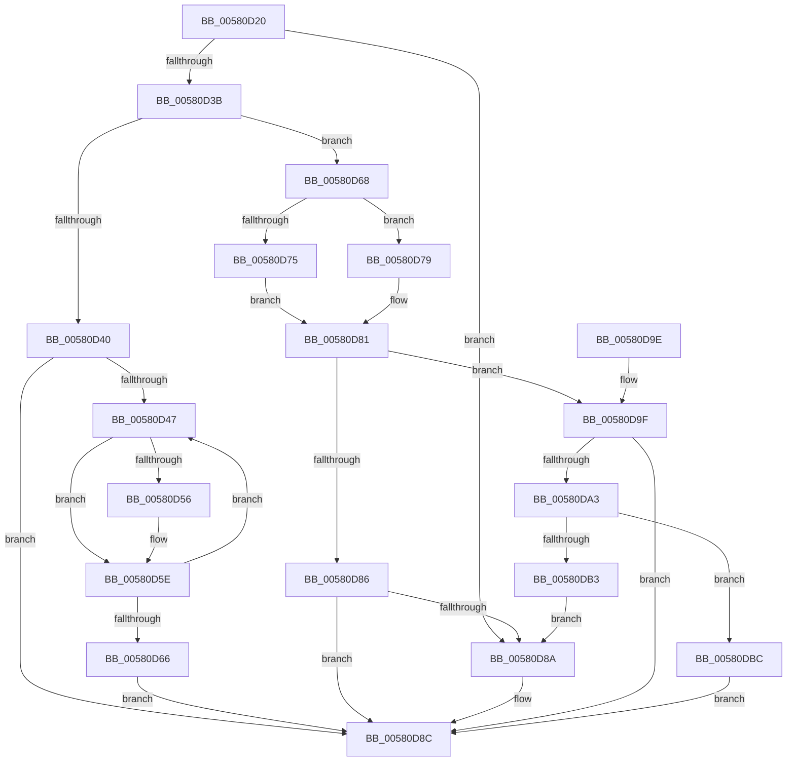

# EmpEvaluatePermuteRuleEntries

- RVA: `0x00580D20`–`0x00580DC2` (길이 `162` bytes)
- VA: `0x0000000140580D20`
- 실행 섹션: `.text`
- PDB 이름 있음: `예`; PDB Function 태그: `아니요`
- unwind 정보 RVA: `0x000B544C`
- 디코드: `57`개 명령, `162/162` bytes 표시
- 미해석 바이트: `0` (있으면 어셈블리에 `.byte`로 보존)

> 이 문서는 커널 이미지의 기계어와 PDB 기호를 분석해 생성했습니다. 4번과 5번은 함수 원형과 자료형을 바이너리 사용 방식에서 추정한 C 해석이며 원본 소스 복구 결과는 아닙니다.

## 1. Dependencies

- 직접 호출 지점: **1**; 고유 호출 대상: **1**
- 직접 호출자로 확인된 함수: **2**
- RIP 상대 이미지 참조: **0**

### Outgoing calls
- `0x00580D7C` → [EmpEvaluatePermuteRuleEntries](EmpEvaluatePermuteRuleEntries_function_00580D20.md) (function, `0x00580D20`)

### Direct callers
- [EmpEvaluatePermuteRuleEntries](EmpEvaluatePermuteRuleEntries_function_00580D20.md) at `0x00580D7C`
- [EmpEvaluateUpdateRuleEvalState](EmpEvaluateUpdateRuleEvalState_function_00580DC8.md) at `0x00580EA1`
- [EmpEvaluateUpdateRuleEvalState](EmpEvaluateUpdateRuleEvalState_function_00580DC8.md) at `0x00580EF5`

### Static image references
- 디코드된 RIP-relative 메모리 참조가 없습니다.

## 2. Other-region calls and transfers

- 다른 실행 섹션으로 향하는 call: **0**
- 별도 외부 분기/꼬리 이동을 확인하지 못했습니다.

## 3. Assembly (complete function range)

```asm
00580D20  48 89 5C 24 08                  mov qword ptr [rsp + 8], rbx
00580D25  48 89 74 24 10                  mov qword ptr [rsp + 0x10], rsi
00580D2A  57                              push rdi
00580D2B  48 83 EC 20                     sub rsp, 0x20
00580D2F  33 DB                           xor ebx, ebx
00580D31  49 8B F0                        mov rsi, r8
00580D34  4C 8B D1                        mov r10, rcx
00580D37  85 D2                           test edx, edx
00580D39  74 4F                           je 0x140580d8a
00580D3B  45 84 C9                        test r9b, r9b
00580D3E  74 28                           je 0x140580d68
00580D40  8B D3                           mov edx, ebx
00580D42  39 59 30                        cmp dword ptr [rcx + 0x30], ebx
00580D45  76 45                           jbe 0x140580d8c
00580D47  49 8B 42 38                     mov rax, qword ptr [r10 + 0x38]
00580D4B  8B CA                           mov ecx, edx
00580D4D  4C 8B 04 C8                     mov r8, qword ptr [rax + rcx*8]
00580D51  4C 3B C6                        cmp r8, rsi
00580D54  74 08                           je 0x140580d5e
00580D56  49 8B 40 28                     mov rax, qword ptr [r8 + 0x28]
00580D5A  49 89 40 20                     mov qword ptr [r8 + 0x20], rax
00580D5E  FF C2                           inc edx
00580D60  41 3B 52 30                     cmp edx, dword ptr [r10 + 0x30]
00580D64  72 E1                           jb 0x140580d47
00580D66  EB 24                           jmp 0x140580d8c
00580D68  48 8B 41 38                     mov rax, qword ptr [rcx + 0x38]
00580D6C  83 EA 01                        sub edx, 1
00580D6F  48 8B 3C D0                     mov rdi, qword ptr [rax + rdx*8]
00580D73  75 04                           jne 0x140580d79
00580D75  B0 01                           mov al, 1
00580D77  EB 08                           jmp 0x140580d81
00580D79  45 33 C9                        xor r9d, r9d
00580D7C  E8 9F FF FF FF                  call 0x140580d20
00580D81  48 3B FE                        cmp rdi, rsi
00580D84  75 19                           jne 0x140580d9f
00580D86  84 C0                           test al, al
00580D88  74 02                           je 0x140580d8c
00580D8A  B3 01                           mov bl, 1
00580D8C  48 8B 74 24 38                  mov rsi, qword ptr [rsp + 0x38]
00580D91  8A C3                           mov al, bl
00580D93  48 8B 5C 24 30                  mov rbx, qword ptr [rsp + 0x30]
00580D98  48 83 C4 20                     add rsp, 0x20
00580D9C  5F                              pop rdi
00580D9D  C3                              ret
00580D9E  CC                              int3
00580D9F  84 C0                           test al, al
00580DA1  74 E9                           je 0x140580d8c
00580DA3  48 8B 47 20                     mov rax, qword ptr [rdi + 0x20]
00580DA7  48 8D 57 28                     lea rdx, [rdi + 0x28]
00580DAB  48 8B 08                        mov rcx, qword ptr [rax]
00580DAE  48 3B CA                        cmp rcx, rdx
00580DB1  75 09                           jne 0x140580dbc
00580DB3  48 8B 02                        mov rax, qword ptr [rdx]
00580DB6  48 89 47 20                     mov qword ptr [rdi + 0x20], rax
00580DBA  EB CE                           jmp 0x140580d8a
00580DBC  48 89 4F 20                     mov qword ptr [rdi + 0x20], rcx
00580DC0  EB CA                           jmp 0x140580d8c
```

## 4. C-style interpretation (structured pseudocode)

```c
__int64 __fastcall EmpEvaluatePermuteRuleEntries(__int64 a1, int a2, __int64 a3, int a4)
{
    __int64 result;
    __int64 v_rbx;
    __int64 v_rsp;
    unsigned __int64 v_stack_p10;
    unsigned __int64 v_stack_p8;

    v_stack_p8 = v_rbx;
    v_stack_p10 = v_rsi;
    v_rsp = (v_rsp) - (32);
    v_rbx = 0;
    if (a2 == 0) goto loc_00580D8A;
    if ((unsigned __int8)(a4) == 0) goto loc_00580D68;
    if ((*(unsigned int *)(a1 + 48)) <= 0) goto loc_00580D8C;
loc_00580D47:
    result = *(unsigned __int64 *)(a1 + 56);
    if ((*(unsigned __int64 *)(*(unsigned __int64 *)(a1 + 56) + 0 * 8)) != a3) {
        result = *(unsigned __int64 *)(*(unsigned __int64 *)(*(unsigned __int64 *)(a1 + 56) + 0 * 8) + 40);
        *(unsigned __int64 *)(*(unsigned __int64 *)(*(unsigned __int64 *)(a1 + 56) + 0 * 8) + 32) = result;
    }
    a2 = (unsigned int)((0) + 1);
    if (a2 < (*(unsigned int *)(a1 + 48))) goto loc_00580D47;
    goto loc_00580D8C;
loc_00580D68:
    a2 = (unsigned int)((a2) - (1));
    if (condition_is_not_equal) goto loc_00580D79;
    goto loc_00580D81;
loc_00580D79:
    a4 = 0;
    result = EmpEvaluatePermuteRuleEntries(0, a2, *(unsigned __int64 *)(*(unsigned __int64 *)(a1 + 56) + 0 * 8), a4);
loc_00580D81:
    if ((*(unsigned __int64 *)(*(unsigned __int64 *)(0 + 56) + a2 * 8)) != a3) goto loc_00580D9F;
    if ((unsigned __int8)(result) != 0) {
        v_rbx = 1;
    }
    v_rsp = (v_rsp) + (32);
    return (unsigned __int8)(v_rbx);
loc_00580D9F:
    if ((unsigned __int8)((unsigned __int8)(v_rbx)) == 0) goto loc_00580D8C;
    if ((*(unsigned __int64 *)(*(unsigned __int64 *)(*(unsigned __int64 *)(*(unsigned __int64 *)(0 + 56) + a2 * 8) + 32))) != (*(unsigned __int64 *)(*(unsigned __int64 *)(0 + 56) + a2 * 8) + 40)) goto loc_00580DBC;
    *(unsigned __int64 *)(*(unsigned __int64 *)(*(unsigned __int64 *)(0 + 56) + a2 * 8) + 32) = *(unsigned __int64 *)(*(unsigned __int64 *)(*(unsigned __int64 *)(0 + 56) + a2 * 8) + 40);
    goto loc_00580D8A;
loc_00580DBC:
    *(unsigned __int64 *)(*(unsigned __int64 *)(*(unsigned __int64 *)(0 + 56) + a2 * 8) + 32) = *(unsigned __int64 *)(*(unsigned __int64 *)(*(unsigned __int64 *)(*(unsigned __int64 *)(0 + 56) + a2 * 8) + 32));
    goto loc_00580D8C;
}
```

## 5. (Beta) C Style

```c
int64_t EmpEvaluatePermuteRuleEntries(void *Arg1, int32_t Arg2, int64_t Arg3, int32_t Arg4)
{
    uint8_t *arg1 = (uint8_t *)Arg1;

    int64_t result;
    int64_t local_rbx;
    int64_t local_rsp;
    uint64_t v_stack_p10;
    uint64_t v_stack_p8;

    v_stack_p8 = local_rbx;
    v_stack_p10 = local_rsi;
    local_rsp = (local_rsp) - (32);
    local_rbx = 0;
    if (Arg2 == 0) goto loc_00580D8A;
    if ((uint8_t)(Arg4) == 0) goto loc_00580D68;
    if ((*(uint32_t *)(arg1 + 0x30)) <= 0) goto loc_00580D8C;
loc_00580D47:
    result = *(uint64_t *)(arg1 + 0x38);
    if ((*(uint64_t *)(*(uint64_t *)(arg1 + 0x38) + 0x0 * 8)) != Arg3) {
        result = *(uint64_t *)(*(uint64_t *)(*(uint64_t *)(arg1 + 0x38) + 0x0 * 8) + 0x28);
        *(uint64_t *)(*(uint64_t *)(*(uint64_t *)(arg1 + 0x38) + 0x0 * 8) + 0x20) = result;
    }
    Arg2 = (uint32_t)((0) + 1);
    if (Arg2 < (*(uint32_t *)(arg1 + 0x30))) goto loc_00580D47;
    goto loc_00580D8C;
loc_00580D68:
    Arg2 = (uint32_t)((Arg2) - (1));
    if (condition_is_not_equal) goto loc_00580D79;
    goto loc_00580D81;
loc_00580D79:
    Arg4 = 0;
    result = EmpEvaluatePermuteRuleEntries(0, Arg2, *(uint64_t *)(*(uint64_t *)(arg1 + 0x38) + 0x0 * 8), Arg4);
loc_00580D81:
    if ((*(uint64_t *)(*(uint64_t *)(0 + 0x38) + Arg2 * 8)) != Arg3) goto loc_00580D9F;
    if ((uint8_t)(result) != 0) {
        local_rbx = 1;
    }
    local_rsp = (local_rsp) + (32);
    return (uint8_t)(local_rbx);
loc_00580D9F:
    if ((uint8_t)((uint8_t)(local_rbx)) == 0) goto loc_00580D8C;
    if ((*(uint64_t *)(*(uint64_t *)(*(uint64_t *)(*(uint64_t *)(0 + 0x38) + Arg2 * 8) + 0x20))) != (*(uint64_t *)(*(uint64_t *)(0 + 0x38) + Arg2 * 8) + 40)) goto loc_00580DBC;
    *(uint64_t *)(*(uint64_t *)(*(uint64_t *)(0 + 0x38) + Arg2 * 8) + 0x20) = *(uint64_t *)(*(uint64_t *)(*(uint64_t *)(0 + 0x38) + Arg2 * 8) + 0x28);
    goto loc_00580D8A;
loc_00580DBC:
    *(uint64_t *)(*(uint64_t *)(*(uint64_t *)(0 + 0x38) + Arg2 * 8) + 0x20) = *(uint64_t *)(*(uint64_t *)(*(uint64_t *)(*(uint64_t *)(0 + 0x38) + Arg2 * 8) + 0x20));
    goto loc_00580D8C;
}
```

### 관측된 메모리 오프셋

구조체 형식이 확인되지 않은 접근은 인자 기준의 오프셋으로만 기록했습니다.

| 기준 인자 | 오프셋 표현 | 폭 (bit) | 접근 |
|---|---:|---:|---|
| `Arg1` | `+ 0x30` | `32` | `R` |
| `Arg1` | `+ 0x38` | `64` | `R` |

## 6. Execution-region graph

[열기: 2D/3D 그래프와 함수 탐색 컨트롤 패널](../../../control-panel.html?section=text&rva=0x00580D20&view=graph)

- 2D 그래프는 위에서 아래로 흐르고, 3D 그래프는 빈 공간을 드래그해 회전합니다. Shift+드래그는 이동, 휠은 확대·축소, 함수 노드 선택은 대상 보고서 이동입니다.

### Static fallback


