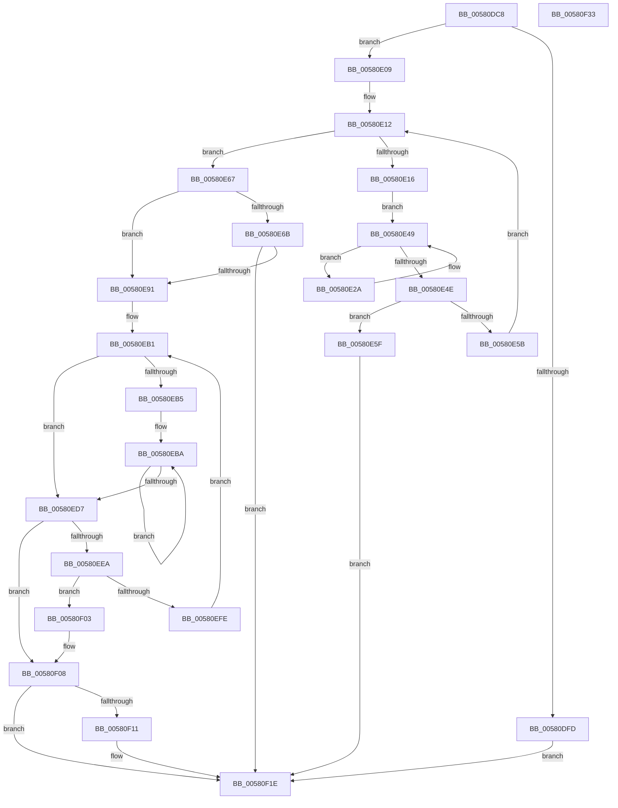

# EmpEvaluateUpdateRuleEvalState

- RVA: `0x00580DC8`–`0x00580F34` (길이 `364` bytes)
- VA: `0x0000000140580DC8`
- 실행 섹션: `.text`
- PDB 이름 있음: `예`; PDB Function 태그: `아니요`
- unwind 정보 RVA: `0x000BD538`
- 디코드: `113`개 명령, `364/364` bytes 표시
- 미해석 바이트: `0` (있으면 어셈블리에 `.byte`로 보존)

> 이 문서는 커널 이미지의 기계어와 PDB 기호를 분석해 생성했습니다. 4번과 5번은 함수 원형과 자료형을 바이너리 사용 방식에서 추정한 C 해석이며 원본 소스 복구 결과는 아닙니다.

## 1. Dependencies

- 직접 호출 지점: **6**; 고유 호출 대상: **5**
- 직접 호출자로 확인된 함수: **1**
- RIP 상대 이미지 참조: **0**

### Outgoing calls
- `0x00580E36` → [guard_dispatch_icall](../6B/guard_dispatch_icall_function_006BAAD0.md) (function, `0x006BAAD0`)
- `0x00580E7D` → [ExAllocatePool2](../../poolcode/B8/ExAllocatePool2_function_00B820F0.md) (function, `0x00B820F0`)
- `0x00580EA1` → [EmpEvaluatePermuteRuleEntries](EmpEvaluatePermuteRuleEntries_function_00580D20.md) (function, `0x00580D20`)
- `0x00580EE0` → [EmpEvaluateTargetRule](../44/EmpEvaluateTargetRule_function_00442E50.md) (function, `0x00442E50`)
- `0x00580EF5` → [EmpEvaluatePermuteRuleEntries](EmpEvaluatePermuteRuleEntries_function_00580D20.md) (function, `0x00580D20`)
- `0x00580F19` → [ExFreePoolWithTag](../../poolcode/B8/ExFreePoolWithTag_function_00B82870.md) (function, `0x00B82870`)

### Direct callers
- [sub_006F7FE4](../6F/Unknown_function_006F7FE4.md) at `0x006F8038`

### Static image references
- 디코드된 RIP-relative 메모리 참조가 없습니다.

## 2. Other-region calls and transfers

- 다른 실행 섹션으로 향하는 call: **2**
  - `0x00580E7D` → [ExAllocatePool2](../../poolcode/B8/ExAllocatePool2_function_00B820F0.md) (`.text` → `POOLCODE`)
  - `0x00580F19` → [ExFreePoolWithTag](../../poolcode/B8/ExFreePoolWithTag_function_00B82870.md) (`.text` → `POOLCODE`)
- 별도 외부 분기/꼬리 이동을 확인하지 못했습니다.

## 3. Assembly (complete function range)

```asm
00580DC8  48 89 5C 24 20                  mov qword ptr [rsp + 0x20], rbx
00580DCD  48 89 54 24 10                  mov qword ptr [rsp + 0x10], rdx
00580DD2  48 89 4C 24 08                  mov qword ptr [rsp + 8], rcx
00580DD7  55                              push rbp
00580DD8  56                              push rsi
00580DD9  57                              push rdi
00580DDA  41 54                           push r12
00580DDC  41 55                           push r13
00580DDE  41 56                           push r14
00580DE0  41 57                           push r15
00580DE2  48 83 EC 20                     sub rsp, 0x20
00580DE6  48 8B 59 08                     mov rbx, qword ptr [rcx + 8]
00580DEA  45 33 FF                        xor r15d, r15d
00580DED  33 F6                           xor esi, esi
00580DEF  44 89 7C 24 70                  mov dword ptr [rsp + 0x70], r15d
00580DF4  8B 7B 30                        mov edi, dword ptr [rbx + 0x30]
00580DF7  40 38 73 14                     cmp byte ptr [rbx + 0x14], sil
00580DFB  75 0C                           jne 0x140580e09
00580DFD  C7 43 10 01 00 00 00            mov dword ptr [rbx + 0x10], 1
00580E04  E9 15 01 00 00                  jmp 0x140580f1e
00580E09  4C 8D 6B 38                     lea r13, [rbx + 0x38]
00580E0D  33 ED                           xor ebp, ebp
00580E0F  4D 8B F5                        mov r14, r13
00580E12  3B EF                           cmp ebp, edi
00580E14  73 51                           jae 0x140580e67
00580E16  4C 8D 73 38                     lea r14, [rbx + 0x38]
00580E1A  49 8B 0E                        mov rcx, qword ptr [r14]
00580E1D  48 8B 04 E9                     mov rax, qword ptr [rcx + rbp*8]
00580E21  48 83 C0 38                     add rax, 0x38
00580E25  4C 8B 38                        mov r15, qword ptr [rax]
00580E28  EB 1F                           jmp 0x140580e49
00580E2A  49 8B 47 F0                     mov rax, qword ptr [r15 - 0x10]
00580E2E  49 8B 57 F8                     mov rdx, qword ptr [r15 - 8]
00580E32  48 8B 0C E9                     mov rcx, qword ptr [rcx + rbp*8]
00580E36  E8 95 9C 13 00                  call 0x1406baad0
00580E3B  49 8B 0E                        mov rcx, qword ptr [r14]
00580E3E  4D 8B 3F                        mov r15, qword ptr [r15]
00580E41  48 8B 04 E9                     mov rax, qword ptr [rcx + rbp*8]
00580E45  48 83 C0 38                     add rax, 0x38
00580E49  4C 3B F8                        cmp r15, rax
00580E4C  75 DC                           jne 0x140580e2a
00580E4E  48 8B 04 E9                     mov rax, qword ptr [rcx + rbp*8]
00580E52  48 83 C0 28                     add rax, 0x28
00580E56  48 39 00                        cmp qword ptr [rax], rax
00580E59  74 04                           je 0x140580e5f
00580E5B  FF C5                           inc ebp
00580E5D  EB B3                           jmp 0x140580e12
00580E5F  21 73 10                        and dword ptr [rbx + 0x10], esi
00580E62  E9 B7 00 00 00                  jmp 0x140580f1e
00580E67  85 FF                           test edi, edi
00580E69  74 26                           je 0x140580e91
00580E6B  48 8B D7                        mov rdx, rdi
00580E6E  B9 00 01 00 00                  mov ecx, 0x100
00580E73  48 C1 E2 03                     shl rdx, 3
00580E77  41 B8 45 4D 65 76               mov r8d, 0x76654d45
00580E7D  E8 6E 12 60 00                  call 0x140b820f0
00580E82  48 8B F0                        mov rsi, rax
00580E85  4D 8B F5                        mov r14, r13
00580E88  48 85 C0                        test rax, rax
00580E8B  0F 84 8D 00 00 00               je 0x140580f1e
00580E91  4C 8B 64 24 68                  mov r12, qword ptr [rsp + 0x68]
00580E96  41 B1 01                        mov r9b, 1
00580E99  4D 8B C4                        mov r8, r12
00580E9C  8B D7                           mov edx, edi
00580E9E  48 8B CB                        mov rcx, rbx
00580EA1  E8 7A FE FF FF                  call 0x140580d20
00580EA6  48 8B 6C 24 60                  mov rbp, qword ptr [rsp + 0x60]
00580EAB  41 BF 02 00 00 00               mov r15d, 2
00580EB1  85 FF                           test edi, edi
00580EB3  74 22                           je 0x140580ed7
00580EB5  33 D2                           xor edx, edx
00580EB7  4C 8B C7                        mov r8, rdi
00580EBA  49 8B 06                        mov rax, qword ptr [r14]
00580EBD  48 8B 0C 02                     mov rcx, qword ptr [rdx + rax]
00580EC1  48 8B 41 20                     mov rax, qword ptr [rcx + 0x20]
00580EC5  48 83 E8 10                     sub rax, 0x10
00580EC9  48 89 04 32                     mov qword ptr [rdx + rsi], rax
00580ECD  48 8D 52 08                     lea rdx, [rdx + 8]
00580ED1  49 83 E8 01                     sub r8, 1
00580ED5  75 E3                           jne 0x140580eba
00580ED7  44 8B C7                        mov r8d, edi
00580EDA  48 8B D6                        mov rdx, rsi
00580EDD  48 8B CD                        mov rcx, rbp
00580EE0  E8 6B 1F EC FF                  call 0x140442e50
00580EE5  41 3B C7                        cmp eax, r15d
00580EE8  74 1E                           je 0x140580f08
00580EEA  45 33 C9                        xor r9d, r9d
00580EED  4D 8B C4                        mov r8, r12
00580EF0  8B D7                           mov edx, edi
00580EF2  48 8B CB                        mov rcx, rbx
00580EF5  E8 26 FE FF FF                  call 0x140580d20
00580EFA  84 C0                           test al, al
00580EFC  75 05                           jne 0x140580f03
00580EFE  4D 8B F5                        mov r14, r13
00580F01  EB AE                           jmp 0x140580eb1
00580F03  44 8B 7C 24 70                  mov r15d, dword ptr [rsp + 0x70]
00580F08  44 89 7B 10                     mov dword ptr [rbx + 0x10], r15d
00580F0C  48 85 F6                        test rsi, rsi
00580F0F  74 0D                           je 0x140580f1e
00580F11  BA 45 4D 65 76                  mov edx, 0x76654d45
00580F16  48 8B CE                        mov rcx, rsi
00580F19  E8 52 19 60 00                  call 0x140b82870
00580F1E  48 8B 5C 24 78                  mov rbx, qword ptr [rsp + 0x78]
00580F23  48 83 C4 20                     add rsp, 0x20
00580F27  41 5F                           pop r15
00580F29  41 5E                           pop r14
00580F2B  41 5D                           pop r13
00580F2D  41 5C                           pop r12
00580F2F  5F                              pop rdi
00580F30  5E                              pop rsi
00580F31  5D                              pop rbp
00580F32  C3                              ret
00580F33  CC                              int3
```

## 4. C-style interpretation (structured pseudocode)

```c
__int64 __fastcall EmpEvaluateUpdateRuleEvalState(__int64 a1, __int64 a2)
{
    __int64 result;
    __int64 v_r15;
    __int64 v_rbp;
    __int64 v_rsi;
    __int64 v_rsp;
    unsigned __int64 v_stack_p10;
    unsigned int v_stack_p18;
    unsigned __int64 v_stack_p20;
    unsigned __int64 v_stack_p8;

    v_stack_p20 = v_rbx;
    v_stack_p10 = a2;
    v_stack_p8 = a1;
    v_rsp = (v_rsp) - (32);
    v_r15 = 0;
    v_rsi = 0;
    v_stack_p18 = 0;
    if ((*(unsigned __int8 *)(*(unsigned __int64 *)(a1 + 8) + 20)) != 0) goto loc_00580E09;
    *(unsigned int *)(*(unsigned __int64 *)(a1 + 8) + 16) = 1;
    goto loc_00580F1E;
loc_00580E09:
    v_rbp = 0;
loc_00580E12:
    if (0 >= ((unsigned int)((unsigned int)(*(unsigned int *)(*(unsigned __int64 *)(a1 + 8) + 48))))) goto loc_00580E67;
    result = (*(unsigned __int64 *)(*(unsigned __int64 *)(*(unsigned __int64 *)(a1 + 8) + 56) + v_rbp * 8)) + (56);
    goto loc_00580E49;
loc_00580E2A:
    result = guard_dispatch_icall(*(unsigned __int64 *)(*(unsigned __int64 *)(*(unsigned __int64 *)(a1 + 8) + 56) + v_rbp * 8), *(unsigned __int64 *)(*(unsigned __int64 *)(result) - 8), a3, a4);
    result = (*(unsigned __int64 *)(*(unsigned __int64 *)(*(unsigned __int64 *)(a1 + 8) + 56) + v_rbp * 8)) + (56);
loc_00580E49:
    if ((*(unsigned __int64 *)(*(unsigned __int64 *)(result))) != result) goto loc_00580E2A;
    result = (*(unsigned __int64 *)(*(unsigned __int64 *)(*(unsigned __int64 *)(a1 + 8) + 56) + v_rbp * 8)) + (40);
    if ((*(unsigned __int64 *)(result)) == result) goto loc_00580E5F;
    v_rbp = (unsigned int)((v_rbp) + 1);
    goto loc_00580E12;
loc_00580E5F:
    goto loc_00580F1E;
loc_00580E67:
    if ((unsigned int)((unsigned int)(*(unsigned int *)(*(unsigned __int64 *)(a1 + 8) + 48))) == 0) goto loc_00580E91;
    a2 = ((unsigned int)(*(unsigned int *)(*(unsigned __int64 *)(a1 + 8) + 48))) << (3);
    result = ExAllocatePool2(256, a2, (unsigned int)(0x76654D45ULL), a4);
    if (result == 0) goto loc_00580F1E;
loc_00580E91:
    result = EmpEvaluatePermuteRuleEntries(*(unsigned __int64 *)(a1 + 8), (unsigned int)((unsigned int)((unsigned int)(*(unsigned int *)(*(unsigned __int64 *)(a1 + 8) + 48)))), v_stack_p10, 1);
loc_00580EB1:
    if ((unsigned int)((unsigned int)(*(unsigned int *)(*(unsigned __int64 *)(a1 + 8) + 48))) == 0) goto loc_00580ED7;
    a2 = 0;
loc_00580EBA:
    result = (*(unsigned __int64 *)(*(unsigned __int64 *)(a2 + *(unsigned __int64 *)(*(unsigned __int64 *)(a1 + 8) + 56) * 1) + 32)) - (16);
    *(unsigned __int64 *)(a2 + result * 1) = result;
    a3 = ((unsigned int)(*(unsigned int *)(*(unsigned __int64 *)(a1 + 8) + 48))) - (1);
    if (condition_is_not_equal) goto loc_00580EBA;
loc_00580ED7:
    result = EmpEvaluateTargetRule(v_stack_p8, result, (unsigned int)((unsigned int)((unsigned int)(*(unsigned int *)(*(unsigned __int64 *)(a1 + 8) + 48)))), 1);
    if (((unsigned int)(result)) == 2) goto loc_00580F08;
    a4 = 0;
    result = EmpEvaluatePermuteRuleEntries(*(unsigned __int64 *)(a1 + 8), (unsigned int)((unsigned int)((unsigned int)(*(unsigned int *)(*(unsigned __int64 *)(a1 + 8) + 48)))), v_stack_p10, a4);
    if ((unsigned __int8)(result) != 0) goto loc_00580F03;
    goto loc_00580EB1;
loc_00580F03:
loc_00580F08:
    *(unsigned int *)(*(unsigned __int64 *)(a1 + 8) + 16) = (unsigned int)((unsigned int)(v_stack_p18));
    if (result != 0) {
        a2 = 0x76654D45ULL;
        a1 = result;
        result = ExFreePoolWithTag(a1, a2, v_stack_p10, a4);
    }
    v_rsp = (v_rsp) + (32);
    return result;
}
```

## 5. (Beta) C Style

```c
int64_t EmpEvaluateUpdateRuleEvalState(void *Arg1, int64_t Arg2)
{
    uint8_t *arg1 = (uint8_t *)Arg1;

    int64_t result;
    int64_t local_r15;
    int64_t local_rbp;
    int64_t local_rsi;
    int64_t local_rsp;
    uint64_t v_stack_p10;
    uint32_t v_stack_p18;
    uint64_t v_stack_p20;
    uint64_t v_stack_p8;

    v_stack_p20 = local_rbx;
    v_stack_p10 = Arg2;
    v_stack_p8 = Arg1;
    local_rsp = (local_rsp) - (32);
    local_r15 = 0;
    local_rsi = 0;
    v_stack_p18 = 0;
    if ((*(uint8_t *)(*(uint64_t *)(arg1 + 0x8) + 0x14)) != 0) goto loc_00580E09;
    *(uint32_t *)(*(uint64_t *)(arg1 + 0x8) + 0x10) = 1;
    goto loc_00580F1E;
loc_00580E09:
    local_rbp = 0;
loc_00580E12:
    if (0 >= ((uint32_t)((uint32_t)(*(uint32_t *)(*(uint64_t *)(arg1 + 0x8) + 0x30))))) goto loc_00580E67;
    result = (*(uint64_t *)(*(uint64_t *)(*(uint64_t *)(arg1 + 0x8) + 0x38) + local_rbp * 8)) + (56);
    goto loc_00580E49;
loc_00580E2A:
    result = guard_dispatch_icall(*(uint64_t *)(*(uint64_t *)(*(uint64_t *)(arg1 + 0x8) + 0x38) + local_rbp * 8), *(uint64_t *)(*(uint64_t *)(result) - 0x8), a3, a4);
    result = (*(uint64_t *)(*(uint64_t *)(*(uint64_t *)(arg1 + 0x8) + 0x38) + local_rbp * 8)) + (56);
loc_00580E49:
    if ((*(uint64_t *)(*(uint64_t *)(result))) != result) goto loc_00580E2A;
    result = (*(uint64_t *)(*(uint64_t *)(*(uint64_t *)(arg1 + 0x8) + 0x38) + local_rbp * 8)) + (40);
    if ((*(uint64_t *)(result)) == result) goto loc_00580E5F;
    local_rbp = (uint32_t)((local_rbp) + 1);
    goto loc_00580E12;
loc_00580E5F:
    goto loc_00580F1E;
loc_00580E67:
    if ((uint32_t)((uint32_t)(*(uint32_t *)(*(uint64_t *)(arg1 + 0x8) + 0x30))) == 0) goto loc_00580E91;
    Arg2 = ((uint32_t)(*(uint32_t *)(*(uint64_t *)(arg1 + 0x8) + 0x30))) << (3);
    result = ExAllocatePool2(256, Arg2, (uint32_t)(0x76654D45ULL), a4);
    if (result == 0) goto loc_00580F1E;
loc_00580E91:
    result = EmpEvaluatePermuteRuleEntries(*(uint64_t *)(arg1 + 0x8), (uint32_t)((uint32_t)((uint32_t)(*(uint32_t *)(*(uint64_t *)(arg1 + 0x8) + 0x30)))), v_stack_p10, 1);
loc_00580EB1:
    if ((uint32_t)((uint32_t)(*(uint32_t *)(*(uint64_t *)(arg1 + 0x8) + 0x30))) == 0) goto loc_00580ED7;
    Arg2 = 0;
loc_00580EBA:
    result = (*(uint64_t *)(*(uint64_t *)(Arg2 + *(uint64_t *)(*(uint64_t *)(arg1 + 0x8) + 0x38) * 1) + 0x20)) - (16);
    *(uint64_t *)(Arg2 + result * 1) = result;
    a3 = ((uint32_t)(*(uint32_t *)(*(uint64_t *)(arg1 + 0x8) + 0x30))) - (1);
    if (condition_is_not_equal) goto loc_00580EBA;
loc_00580ED7:
    result = EmpEvaluateTargetRule(v_stack_p8, result, (uint32_t)((uint32_t)((uint32_t)(*(uint32_t *)(*(uint64_t *)(arg1 + 0x8) + 0x30)))), 1);
    if (((uint32_t)(result)) == 2) goto loc_00580F08;
    a4 = 0;
    result = EmpEvaluatePermuteRuleEntries(*(uint64_t *)(arg1 + 0x8), (uint32_t)((uint32_t)((uint32_t)(*(uint32_t *)(*(uint64_t *)(arg1 + 0x8) + 0x30)))), v_stack_p10, a4);
    if ((uint8_t)(result) != 0) goto loc_00580F03;
    goto loc_00580EB1;
loc_00580F03:
loc_00580F08:
    *(uint32_t *)(*(uint64_t *)(arg1 + 0x8) + 0x10) = (uint32_t)((uint32_t)(v_stack_p18));
    if (result != 0) {
        Arg2 = 0x76654D45ULL;
        Arg1 = result;
        result = ExFreePoolWithTag(Arg1, Arg2, v_stack_p10, a4);
    }
    local_rsp = (local_rsp) + (32);
    return result;
}
```

### 관측된 메모리 오프셋

구조체 형식이 확인되지 않은 접근은 인자 기준의 오프셋으로만 기록했습니다.

| 기준 인자 | 오프셋 표현 | 폭 (bit) | 접근 |
|---|---:|---:|---|
| `Arg1` | `+ 0x8` | `64` | `R` |

## 6. Execution-region graph

[열기: 2D/3D 그래프와 함수 탐색 컨트롤 패널](../../../control-panel.html?section=text&rva=0x00580DC8&view=graph)

- 2D 그래프는 위에서 아래로 흐르고, 3D 그래프는 빈 공간을 드래그해 회전합니다. Shift+드래그는 이동, 휠은 확대·축소, 함수 노드 선택은 대상 보고서 이동입니다.

### Static fallback


