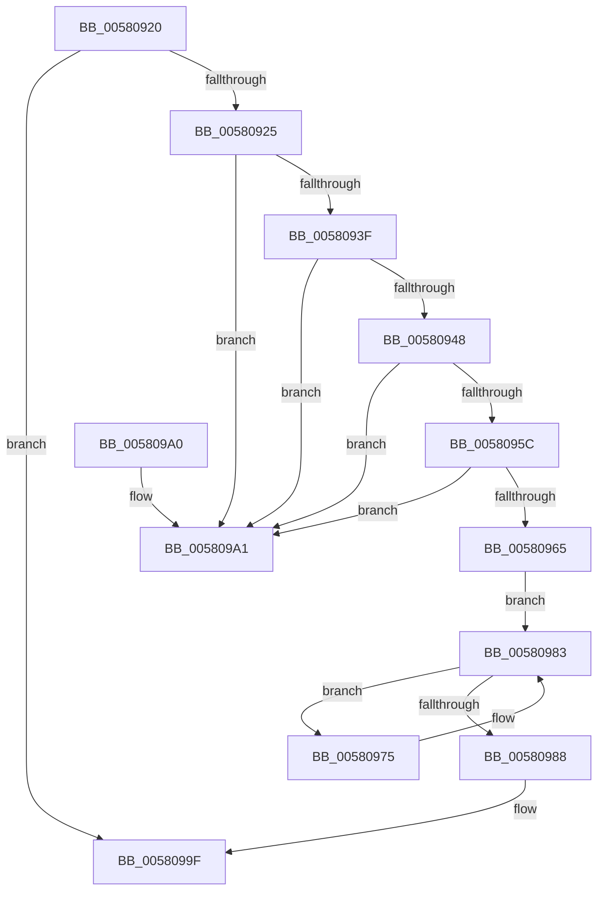

# EmpProviderDeregisterEntry

- RVA: `0x00580920`–`0x005809A8` (길이 `136` bytes)
- VA: `0x0000000140580920`
- 실행 섹션: `.text`
- PDB 이름 있음: `예`; PDB Function 태그: `아니요`
- unwind 정보 RVA: `0x000C5AD4`
- 디코드: `43`개 명령, `136/136` bytes 표시
- 미해석 바이트: `0` (있으면 어셈블리에 `.byte`로 보존)

> 이 문서는 커널 이미지의 기계어와 PDB 기호를 분석해 생성했습니다. 4번과 5번은 함수 원형과 자료형을 바이너리 사용 방식에서 추정한 C 해석이며 원본 소스 복구 결과는 아닙니다.

## 1. Dependencies

- 직접 호출 지점: **2**; 고유 호출 대상: **2**
- 직접 호출자로 확인된 함수: **2**
- RIP 상대 이미지 참조: **0**

### Outgoing calls
- `0x0058097B` → [EmpQueueRuleUpdateState](EmpQueueRuleUpdateState_function_005809B0.md) (function, `0x005809B0`)
- `0x00580990` → [ExFreePoolWithTag](../../poolcode/B8/ExFreePoolWithTag_function_00B82870.md) (function, `0x00B82870`)

### Direct callers
- [EmProviderDeregister](../../page/71/EmProviderDeregister_function_00713060.md) at `0x00713165`
- [EmProviderDeregisterEntry](../../page/71/EmProviderDeregisterEntry_function_00713230.md) at `0x0071327B`

### Static image references
- 디코드된 RIP-relative 메모리 참조가 없습니다.

## 2. Other-region calls and transfers

- 다른 실행 섹션으로 향하는 call: **1**
  - `0x00580990` → [ExFreePoolWithTag](../../poolcode/B8/ExFreePoolWithTag_function_00B82870.md) (`.text` → `POOLCODE`)
- 별도 외부 분기/꼬리 이동을 확인하지 못했습니다.

## 3. Assembly (complete function range)

```asm
00580920  48 85 C9                        test rcx, rcx
00580923  74 7A                           je 0x14058099f
00580925  48 89 5C 24 08                  mov qword ptr [rsp + 8], rbx
0058092A  57                              push rdi
0058092B  48 83 EC 20                     sub rsp, 0x20
0058092F  48 8D 41 18                     lea rax, [rcx + 0x18]
00580933  48 8B D9                        mov rbx, rcx
00580936  48 8B 10                        mov rdx, qword ptr [rax]
00580939  48 39 42 08                     cmp qword ptr [rdx + 8], rax
0058093D  75 62                           jne 0x1405809a1
0058093F  48 8B 48 08                     mov rcx, qword ptr [rax + 8]
00580943  48 39 01                        cmp qword ptr [rcx], rax
00580946  75 59                           jne 0x1405809a1
00580948  48 89 11                        mov qword ptr [rcx], rdx
0058094B  48 8D 43 28                     lea rax, [rbx + 0x28]
0058094F  48 89 4A 08                     mov qword ptr [rdx + 8], rcx
00580953  48 8B 10                        mov rdx, qword ptr [rax]
00580956  48 39 42 08                     cmp qword ptr [rdx + 8], rax
0058095A  75 45                           jne 0x1405809a1
0058095C  48 8B 48 08                     mov rcx, qword ptr [rax + 8]
00580960  48 39 01                        cmp qword ptr [rcx], rax
00580963  75 3C                           jne 0x1405809a1
00580965  48 89 11                        mov qword ptr [rcx], rdx
00580968  48 89 4A 08                     mov qword ptr [rdx + 8], rcx
0058096C  48 8B 03                        mov rax, qword ptr [rbx]
0058096F  48 8B 78 48                     mov rdi, qword ptr [rax + 0x48]
00580973  EB 0E                           jmp 0x140580983
00580975  48 8B 4F F8                     mov rcx, qword ptr [rdi - 8]
00580979  33 D2                           xor edx, edx
0058097B  E8 30 00 00 00                  call 0x1405809b0
00580980  48 8B 3F                        mov rdi, qword ptr [rdi]
00580983  48 85 FF                        test rdi, rdi
00580986  75 ED                           jne 0x140580975
00580988  BA 45 4D 70 72                  mov edx, 0x72704d45
0058098D  48 8B CB                        mov rcx, rbx
00580990  E8 DB 1E 60 00                  call 0x140b82870
00580995  48 8B 5C 24 30                  mov rbx, qword ptr [rsp + 0x30]
0058099A  48 83 C4 20                     add rsp, 0x20
0058099E  5F                              pop rdi
0058099F  C3                              ret
005809A0  CC                              int3
005809A1  B9 03 00 00 00                  mov ecx, 3
005809A6  CD 29                           int 0x29
```

## 4. C-style interpretation (structured pseudocode)

```c
__int64 __fastcall EmpProviderDeregisterEntry(__int64 a1)
{
    __int64 result;
    __int64 v_rsp;
    unsigned __int64 v_stack_p8;

    if (a1 == 0) goto loc_0058099F;
    v_stack_p8 = v_rbx;
    v_rsp = (v_rsp) - (32);
    if ((*(unsigned __int64 *)(*(unsigned __int64 *)(a1 + 24) + 8)) != (a1 + 24)) goto loc_005809A1;
    if ((*(unsigned __int64 *)(*(unsigned __int64 *)(a1 + 24 + 8))) != (a1 + 24)) goto loc_005809A1;
    *(unsigned __int64 *)(*(unsigned __int64 *)(a1 + 24 + 8)) = *(unsigned __int64 *)(a1 + 24);
    *(unsigned __int64 *)(*(unsigned __int64 *)(a1 + 24) + 8) = *(unsigned __int64 *)(a1 + 24 + 8);
    if ((*(unsigned __int64 *)(*(unsigned __int64 *)(a1 + 40) + 8)) != (a1 + 40)) goto loc_005809A1;
    if ((*(unsigned __int64 *)(*(unsigned __int64 *)(a1 + 40 + 8))) != (a1 + 40)) goto loc_005809A1;
    *(unsigned __int64 *)(*(unsigned __int64 *)(a1 + 40 + 8)) = *(unsigned __int64 *)(a1 + 40);
    *(unsigned __int64 *)(*(unsigned __int64 *)(a1 + 40) + 8) = *(unsigned __int64 *)(a1 + 40 + 8);
    goto loc_00580983;
loc_00580975:
    a2 = 0;
    result = EmpQueueRuleUpdateState(*(unsigned __int64 *)(*(unsigned __int64 *)(*(unsigned __int64 *)(a1) + 72) - 8), a2, a3, a4);
loc_00580983:
    if (*(unsigned __int64 *)(*(unsigned __int64 *)(*(unsigned __int64 *)(a1) + 72)) != 0) goto loc_00580975;
    result = ExFreePoolWithTag(a1, (unsigned int)(0x72704D45ULL), a3, a4);
    v_rsp = (v_rsp) + (32);
loc_0058099F:
    return result;
loc_005809A1:
    return result;
}
```

## 5. (Beta) C Style

```c
int64_t EmpProviderDeregisterEntry(int64_t Arg1)
{
    int64_t result;
    int64_t local_rsp;
    uint64_t v_stack_p8;

    if (Arg1 == 0) goto loc_0058099F;
    v_stack_p8 = local_rbx;
    local_rsp = (local_rsp) - (32);
    if ((*(uint64_t *)(*(uint64_t *)(Arg1 + 0x18) + 0x8)) != (Arg1 + 24)) goto loc_005809A1;
    if ((*(uint64_t *)(*(uint64_t *)(Arg1 + 0x18 + 0x8))) != (Arg1 + 24)) goto loc_005809A1;
    *(uint64_t *)(*(uint64_t *)(Arg1 + 0x18 + 0x8)) = *(uint64_t *)(Arg1 + 0x18);
    *(uint64_t *)(*(uint64_t *)(Arg1 + 0x18) + 0x8) = *(uint64_t *)(Arg1 + 0x18 + 0x8);
    if ((*(uint64_t *)(*(uint64_t *)(Arg1 + 0x28) + 0x8)) != (Arg1 + 40)) goto loc_005809A1;
    if ((*(uint64_t *)(*(uint64_t *)(Arg1 + 0x28 + 0x8))) != (Arg1 + 40)) goto loc_005809A1;
    *(uint64_t *)(*(uint64_t *)(Arg1 + 0x28 + 0x8)) = *(uint64_t *)(Arg1 + 0x28);
    *(uint64_t *)(*(uint64_t *)(Arg1 + 0x28) + 0x8) = *(uint64_t *)(Arg1 + 0x28 + 0x8);
    goto loc_00580983;
loc_00580975:
    a2 = 0;
    result = EmpQueueRuleUpdateState(*(uint64_t *)(*(uint64_t *)(*(uint64_t *)(Arg1) + 0x48) - 0x8), a2, a3, a4);
loc_00580983:
    if (*(uint64_t *)(*(uint64_t *)(*(uint64_t *)(Arg1) + 0x48)) != 0) goto loc_00580975;
    result = ExFreePoolWithTag(Arg1, (uint32_t)(0x72704D45ULL), a3, a4);
    local_rsp = (local_rsp) + (32);
loc_0058099F:
    return result;
loc_005809A1:
    return result;
}
```

## 6. Execution-region graph

[열기: 2D/3D 그래프와 함수 탐색 컨트롤 패널](../../../control-panel.html?section=text&rva=0x00580920&view=graph)

- 2D 그래프는 위에서 아래로 흐르고, 3D 그래프는 빈 공간을 드래그해 회전합니다. Shift+드래그는 이동, 휠은 확대·축소, 함수 노드 선택은 대상 보고서 이동입니다.

### Static fallback


