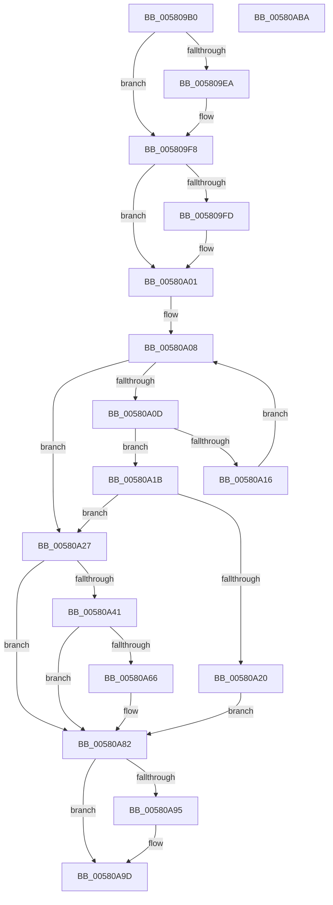

# EmpQueueRuleUpdateState

- RVA: `0x005809B0`–`0x00580ABB` (길이 `267` bytes)
- VA: `0x00000001405809B0`
- 실행 섹션: `.text`
- PDB 이름 있음: `예`; PDB Function 태그: `아니요`
- unwind 정보 RVA: `0x0005C954`
- 디코드: `69`개 명령, `267/267` bytes 표시
- 미해석 바이트: `0` (있으면 어셈블리에 `.byte`로 보존)

> 이 문서는 커널 이미지의 기계어와 PDB 기호를 분석해 생성했습니다. 4번과 5번은 함수 원형과 자료형을 바이너리 사용 방식에서 추정한 C 해석이며 원본 소스 복구 결과는 아닙니다.

## 1. Dependencies

- 직접 호출 지점: **6**; 고유 호출 대상: **6**
- 직접 호출자로 확인된 함수: **5**
- RIP 상대 이미지 참조: **7**

### Outgoing calls
- `0x005809D9` → [KeAbPreAcquire](../21/KeAbPreAcquire_function_00210230.md) (function, `0x00210230`)
- `0x005809F3` → [ExfAcquirePushLockExclusiveEx](../20/ExfAcquirePushLockExclusiveEx_function_0020FC90.md) (function, `0x0020FC90`)
- `0x00580A37` → [ExAllocatePool2](../../poolcode/B8/ExAllocatePool2_function_00B820F0.md) (function, `0x00B820F0`)
- `0x00580A7D` → [ExQueueWorkItem](../2F/ExQueueWorkItem_function_002F9520.md) (function, `0x002F9520`)
- `0x00580A98` → [ExfTryToWakePushLock](../26/ExfTryToWakePushLock_function_00265DD0.md) (function, `0x00265DD0`)
- `0x00580AA0` → [KeAbPostRelease](../2E/KeAbPostRelease_function_002E1600.md) (function, `0x002E1600`)

### Direct callers
- [EmpProviderDeregisterEntry](EmpProviderDeregisterEntry_function_00580920.md) at `0x0058097B`
- [EmpClientRuleRegisterNotification](../../page/71/EmpClientRuleRegisterNotification_function_00712DE4.md) at `0x00712F81`
- [EmProviderDeregister](../../page/71/EmProviderDeregister_function_00713060.md) at `0x00713141`
- [EmProviderDeregister](../../page/71/EmProviderDeregister_function_00713060.md) at `0x007131AA`
- [EmProviderRegisterEntry](../../page/71/EmProviderRegisterEntry_function_00713300.md) at `0x00713497`
- [EmpProviderRegister](../../page/AC/EmpProviderRegister_function_00ACC5D0.md) at `0x00ACC91E`
- [EmpProviderRegister](../../page/AC/EmpProviderRegister_function_00ACC5D0.md) at `0x00ACC951`

### Static image references
- `0x005809C7` → RVA `0x00F8F200` (`.data`; read)
- `0x00580A01` → RVA `0x00F8F180` (`.data`; read)
- `0x00580A56` → RVA `0x00F8F170` (`.data`; read)
- `0x00580A5D` → RVA `0x00F8F180` (`.data`; write)
- `0x00580A6B` → RVA `0x00F8F1C0` (`.data`; read)
- `0x00580A72` → RVA `0x00F8F170` (`.data`; read/write)
- `0x00580A86` → RVA `0x00F8F200` (`.data`; read/write)

## 2. Other-region calls and transfers

- 다른 실행 섹션으로 향하는 call: **1**
  - `0x00580A37` → [ExAllocatePool2](../../poolcode/B8/ExAllocatePool2_function_00B820F0.md) (`.text` → `POOLCODE`)
- 별도 외부 분기/꼬리 이동을 확인하지 못했습니다.

## 3. Assembly (complete function range)

```asm
005809B0  48 89 5C 24 08                  mov qword ptr [rsp + 8], rbx
005809B5  48 89 6C 24 10                  mov qword ptr [rsp + 0x10], rbp
005809BA  48 89 74 24 18                  mov qword ptr [rsp + 0x18], rsi
005809BF  57                              push rdi
005809C0  48 83 EC 20                     sub rsp, 0x20
005809C4  48 8B F2                        mov rsi, rdx
005809C7  48 8D 2D 32 E8 A0 00            lea rbp, [rip + 0xa0e832]
005809CE  48 8B F9                        mov rdi, rcx
005809D1  45 33 C0                        xor r8d, r8d
005809D4  48 8B CD                        mov rcx, rbp
005809D7  33 D2                           xor edx, edx
005809D9  E8 52 F8 C8 FF                  call 0x140210230
005809DE  F0 48 0F BA 6D 00 00            lock bts qword ptr [rbp], 0
005809E5  48 8B D8                        mov rbx, rax
005809E8  73 0E                           jae 0x1405809f8
005809EA  4C 8B C5                        mov r8, rbp
005809ED  48 8B D0                        mov rdx, rax
005809F0  48 8B CD                        mov rcx, rbp
005809F3  E8 98 F2 C8 FF                  call 0x14020fc90
005809F8  48 85 DB                        test rbx, rbx
005809FB  74 04                           je 0x140580a01
005809FD  C6 43 0A 01                     mov byte ptr [rbx + 0xa], 1
00580A01  48 8B 05 78 E7 A0 00            mov rax, qword ptr [rip + 0xa0e778]
00580A08  48 85 C0                        test rax, rax
00580A0B  74 1A                           je 0x140580a27
00580A0D  48 8D 48 F8                     lea rcx, [rax - 8]
00580A11  48 39 39                        cmp qword ptr [rcx], rdi
00580A14  74 05                           je 0x140580a1b
00580A16  48 8B 00                        mov rax, qword ptr [rax]
00580A19  EB ED                           jmp 0x140580a08
00580A1B  48 85 C9                        test rcx, rcx
00580A1E  74 07                           je 0x140580a27
00580A20  48 83 61 10 00                  and qword ptr [rcx + 0x10], 0
00580A25  EB 5B                           jmp 0x140580a82
00580A27  BA 18 00 00 00                  mov edx, 0x18
00580A2C  B9 00 01 00 00                  mov ecx, 0x100
00580A31  41 B8 45 4D 71 75               mov r8d, 0x75714d45
00580A37  E8 B4 16 60 00                  call 0x140b820f0
00580A3C  48 85 C0                        test rax, rax
00580A3F  74 41                           je 0x140580a82
00580A41  48 89 38                        mov qword ptr [rax], rdi
00580A44  48 8D 48 08                     lea rcx, [rax + 8]
00580A48  48 89 70 10                     mov qword ptr [rax + 0x10], rsi
00580A4C  48 8B 05 2D E7 A0 00            mov rax, qword ptr [rip + 0xa0e72d]
00580A53  48 89 01                        mov qword ptr [rcx], rax
00580A56  83 3D 13 E7 A0 00 00            cmp dword ptr [rip + 0xa0e713], 0
00580A5D  48 89 0D 1C E7 A0 00            mov qword ptr [rip + 0xa0e71c], rcx
00580A64  75 1C                           jne 0x140580a82
00580A66  B8 01 00 00 00                  mov eax, 1
00580A6B  48 8D 0D 4E E7 A0 00            lea rcx, [rip + 0xa0e74e]
00580A72  87 05 F8 E6 A0 00               xchg dword ptr [rip + 0xa0e6f8], eax
00580A78  BA 01 00 00 00                  mov edx, 1
00580A7D  E8 9E 8A D7 FF                  call 0x1402f9520
00580A82  48 83 C8 FF                     or rax, 0xffffffffffffffff
00580A86  F0 48 0F C1 05 71 E7 A0 00      lock xadd qword ptr [rip + 0xa0e771], rax
00580A8F  24 06                           and al, 6
00580A91  3C 02                           cmp al, 2
00580A93  75 08                           jne 0x140580a9d
00580A95  48 8B CD                        mov rcx, rbp
00580A98  E8 33 53 CE FF                  call 0x140265dd0
00580A9D  48 8B CD                        mov rcx, rbp
00580AA0  E8 5B 0B D6 FF                  call 0x1402e1600
00580AA5  48 8B 5C 24 30                  mov rbx, qword ptr [rsp + 0x30]
00580AAA  48 8B 6C 24 38                  mov rbp, qword ptr [rsp + 0x38]
00580AAF  48 8B 74 24 40                  mov rsi, qword ptr [rsp + 0x40]
00580AB4  48 83 C4 20                     add rsp, 0x20
00580AB8  5F                              pop rdi
00580AB9  C3                              ret
00580ABA  CC                              int3
```

## 4. C-style interpretation (structured pseudocode)

```c
__int64 __fastcall EmpQueueRuleUpdateState(__int64 a1, __int64 a2, int a3)
{
    __int64 result;
    __int64 v_rsp;
    unsigned __int64 v_stack_p10;
    unsigned __int64 v_stack_p18;
    unsigned __int64 v_stack_p8;

    v_stack_p8 = v_rbx;
    v_stack_p10 = v_rbp;
    v_stack_p18 = v_rsi;
    v_rsp = (v_rsp) - (32);
    a3 = 0;
    a2 = 0;
    result = KeAbPreAcquire(v_rip + 10545202, a2, a3, a4);
    if (!(condition_is_above_or_equal)) {
        a3 = v_rip + 10545202;
        a2 = result;
        a1 = v_rip + 10545202;
        result = ExfAcquirePushLockExclusiveEx(a1, a2, a3, a4);
    }
    if (result != 0) {
        *(unsigned __int8 *)(result + 10) = 1;
    }
loc_00580A08:
    if (*(unsigned __int64 *)(v_rip + 10545016) == 0) goto loc_00580A27;
    if ((*(unsigned __int64 *)(*(unsigned __int64 *)(v_rip + 10545016) - 8)) == a1) goto loc_00580A1B;
    goto loc_00580A08;
loc_00580A1B:
    if (*(unsigned __int64 *)(v_rip + 10545016) - 8 == 0) goto loc_00580A27;
    goto loc_00580A82;
loc_00580A27:
    result = ExAllocatePool2(256, 24, (unsigned int)(0x75714D45ULL), a4);
    if (result == 0) goto loc_00580A82;
    *(unsigned __int64 *)(result) = a1;
    *(unsigned __int64 *)(result + 16) = a2;
    *(unsigned __int64 *)(result + 8) = *(unsigned __int64 *)(v_rip + 10544941);
    *(unsigned __int64 *)(v_rip + 10544924) = result + 8;
    result = *(unsigned __int64 *)(v_rip + 10544941);
    if ((*(unsigned int *)(v_rip + 10544915)) == 0) {
        result = 1;
        a1 = v_rip + 10544974;
        a2 = 1;
        result = ExQueueWorkItem(a1, a2, (unsigned int)(0x75714D45ULL), a4);
    }
    result = (result) | (-1);
    result = (unsigned __int8)((result) & (6));
    if (((unsigned __int8)(result)) == 2) {
        a1 = v_rip + 10545202;
        result = ExfTryToWakePushLock(a1, a2, (unsigned int)(0x75714D45ULL), a4);
    }
    result = KeAbPostRelease(v_rip + 10545202, a2, (unsigned int)(0x75714D45ULL), a4);
    v_rsp = (v_rsp) + (32);
    return result;
}
```

## 5. (Beta) C Style

```c
int64_t EmpQueueRuleUpdateState(int64_t Arg1, int64_t Arg2, int32_t Arg3)
{
    int64_t result;
    int64_t local_rsp;
    uint64_t v_stack_p10;
    uint64_t v_stack_p18;
    uint64_t v_stack_p8;

    v_stack_p8 = local_rbx;
    v_stack_p10 = local_rbp;
    v_stack_p18 = local_rsi;
    local_rsp = (local_rsp) - (32);
    Arg3 = 0;
    Arg2 = 0;
    result = KeAbPreAcquire(v_rip + 10545202, Arg2, Arg3, a4);
    if (!(condition_is_above_or_equal)) {
        Arg3 = v_rip + 10545202;
        Arg2 = result;
        Arg1 = v_rip + 10545202;
        result = ExfAcquirePushLockExclusiveEx(Arg1, Arg2, Arg3, a4);
    }
    if (result != 0) {
        *(uint8_t *)(result + 0xA) = 1;
    }
loc_00580A08:
    if (*(uint64_t *)(v_rip + 0xA0E778) == 0) goto loc_00580A27;
    if ((*(uint64_t *)(*(uint64_t *)(v_rip + 0xA0E778) - 0x8)) == Arg1) goto loc_00580A1B;
    goto loc_00580A08;
loc_00580A1B:
    if (*(uint64_t *)(v_rip + 0xA0E778) - 8 == 0) goto loc_00580A27;
    goto loc_00580A82;
loc_00580A27:
    result = ExAllocatePool2(256, 24, (uint32_t)(0x75714D45ULL), a4);
    if (result == 0) goto loc_00580A82;
    *(uint64_t *)(result) = Arg1;
    *(uint64_t *)(result + 0x10) = Arg2;
    *(uint64_t *)(result + 0x8) = *(uint64_t *)(v_rip + 0xA0E72D);
    *(uint64_t *)(v_rip + 0xA0E71C) = result + 8;
    result = *(uint64_t *)(v_rip + 0xA0E72D);
    if ((*(uint32_t *)(v_rip + 0xA0E713)) == 0) {
        result = 1;
        Arg1 = v_rip + 10544974;
        Arg2 = 1;
        result = ExQueueWorkItem(Arg1, Arg2, (uint32_t)(0x75714D45ULL), a4);
    }
    result = (result) | (-1);
    result = (uint8_t)((result) & (6));
    if (((uint8_t)(result)) == 2) {
        Arg1 = v_rip + 10545202;
        result = ExfTryToWakePushLock(Arg1, Arg2, (uint32_t)(0x75714D45ULL), a4);
    }
    result = KeAbPostRelease(v_rip + 10545202, Arg2, (uint32_t)(0x75714D45ULL), a4);
    local_rsp = (local_rsp) + (32);
    return result;
}
```

## 6. Execution-region graph

[열기: 2D/3D 그래프와 함수 탐색 컨트롤 패널](../../../control-panel.html?section=text&rva=0x005809B0&view=graph)

- 2D 그래프는 위에서 아래로 흐르고, 3D 그래프는 빈 공간을 드래그해 회전합니다. Shift+드래그는 이동, 휠은 확대·축소, 함수 노드 선택은 대상 보고서 이동입니다.

### Static fallback


