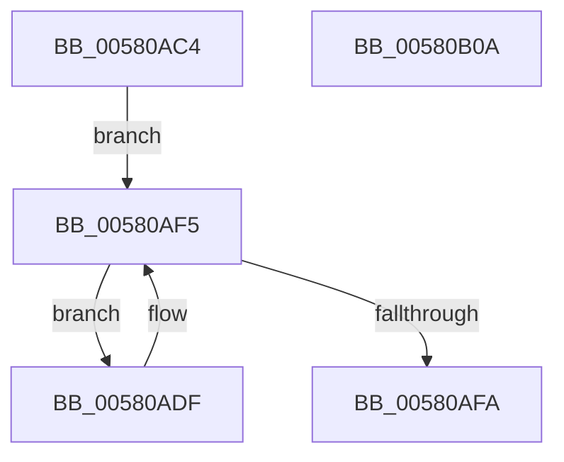

# EmpRuleStateChangeNotify

- RVA: `0x00580AC4`–`0x00580B0B` (길이 `71` bytes)
- VA: `0x0000000140580AC4`
- 실행 섹션: `.text`
- PDB 이름 있음: `예`; PDB Function 태그: `아니요`
- unwind 정보 RVA: `0x00060BC4`
- 디코드: `22`개 명령, `71/71` bytes 표시
- 미해석 바이트: `0` (있으면 어셈블리에 `.byte`로 보존)

> 이 문서는 커널 이미지의 기계어와 PDB 기호를 분석해 생성했습니다. 4번과 5번은 함수 원형과 자료형을 바이너리 사용 방식에서 추정한 C 해석이며 원본 소스 복구 결과는 아닙니다.

## 1. Dependencies

- 직접 호출 지점: **1**; 고유 호출 대상: **1**
- 직접 호출자로 확인된 함수: **1**
- RIP 상대 이미지 참조: **0**

### Outgoing calls
- `0x00580AED` → [guard_dispatch_icall](../6B/guard_dispatch_icall_function_006BAAD0.md) (function, `0x006BAAD0`)

### Direct callers
- [EmpUpdateRuleState](../49/EmpUpdateRuleState_function_0049CD48.md) at `0x0049CE0A`

### Static image references
- 디코드된 RIP-relative 메모리 참조가 없습니다.

## 2. Other-region calls and transfers

- 다른 실행 섹션으로 향하는 call: **0**
- 별도 외부 분기/꼬리 이동을 확인하지 못했습니다.

## 3. Assembly (complete function range)

```asm
00580AC4  48 89 5C 24 08                  mov qword ptr [rsp + 8], rbx
00580AC9  48 89 74 24 10                  mov qword ptr [rsp + 0x10], rsi
00580ACE  57                              push rdi
00580ACF  48 83 EC 20                     sub rsp, 0x20
00580AD3  48 8D 79 50                     lea rdi, [rcx + 0x50]
00580AD7  48 8B F1                        mov rsi, rcx
00580ADA  48 8B 1F                        mov rbx, qword ptr [rdi]
00580ADD  EB 16                           jmp 0x140580af5
00580ADF  48 8B 43 F0                     mov rax, qword ptr [rbx - 0x10]
00580AE3  48 8B D6                        mov rdx, rsi
00580AE6  4C 8B 43 F8                     mov r8, qword ptr [rbx - 8]
00580AEA  8B 4E 10                        mov ecx, dword ptr [rsi + 0x10]
00580AED  E8 DE 9F 13 00                  call 0x1406baad0
00580AF2  48 8B 1B                        mov rbx, qword ptr [rbx]
00580AF5  48 3B DF                        cmp rbx, rdi
00580AF8  75 E5                           jne 0x140580adf
00580AFA  48 8B 5C 24 30                  mov rbx, qword ptr [rsp + 0x30]
00580AFF  48 8B 74 24 38                  mov rsi, qword ptr [rsp + 0x38]
00580B04  48 83 C4 20                     add rsp, 0x20
00580B08  5F                              pop rdi
00580B09  C3                              ret
00580B0A  CC                              int3
```

## 4. C-style interpretation (structured pseudocode)

```c
__int64 __fastcall EmpRuleStateChangeNotify(__int64 a1)
{
    __int64 result;
    __int64 v_rsp;
    unsigned __int64 v_stack_p10;
    unsigned __int64 v_stack_p8;

    v_stack_p8 = v_rbx;
    v_stack_p10 = v_rsi;
    v_rsp = (v_rsp) - (32);
    goto loc_00580AF5;
loc_00580ADF:
    result = guard_dispatch_icall((unsigned int)(*(unsigned int *)(a1 + 16)), a1, *(unsigned __int64 *)(*(unsigned __int64 *)(a1 + 80) - 8), a4);
loc_00580AF5:
    if ((*(unsigned __int64 *)(*(unsigned __int64 *)(a1 + 80))) != (a1 + 80)) goto loc_00580ADF;
    v_rsp = (v_rsp) + (32);
    return result;
}
```

## 5. (Beta) C Style

```c
int64_t EmpRuleStateChangeNotify(void *Arg1)
{
    uint8_t *arg1 = (uint8_t *)Arg1;

    int64_t result;
    int64_t local_rsp;
    uint64_t v_stack_p10;
    uint64_t v_stack_p8;

    v_stack_p8 = local_rbx;
    v_stack_p10 = local_rsi;
    local_rsp = (local_rsp) - (32);
    goto loc_00580AF5;
loc_00580ADF:
    result = guard_dispatch_icall((uint32_t)(*(uint32_t *)(arg1 + 0x10)), Arg1, *(uint64_t *)(*(uint64_t *)(arg1 + 0x50) - 0x8), a4);
loc_00580AF5:
    if ((*(uint64_t *)(*(uint64_t *)(arg1 + 0x50))) != (Arg1 + 80)) goto loc_00580ADF;
    local_rsp = (local_rsp) + (32);
    return result;
}
```

### 관측된 메모리 오프셋

구조체 형식이 확인되지 않은 접근은 인자 기준의 오프셋으로만 기록했습니다.

| 기준 인자 | 오프셋 표현 | 폭 (bit) | 접근 |
|---|---:|---:|---|
| `Arg1` | `+ 0x0` | `64` | `R` |
| `Arg1` | `+ 0x10` | `32` | `R` |
| `Arg1` | `+ 0x50` | `64` | `R` |

## 6. Execution-region graph

[열기: 2D/3D 그래프와 함수 탐색 컨트롤 패널](../../../control-panel.html?section=text&rva=0x00580AC4&view=graph)

- 2D 그래프는 위에서 아래로 흐르고, 3D 그래프는 빈 공간을 드래그해 회전합니다. Shift+드래그는 이동, 휠은 확대·축소, 함수 노드 선택은 대상 보고서 이동입니다.

### Static fallback


