# EmpRuleUpdateWorkerThread

- RVA: `0x00580B20`–`0x00580CA7` (길이 `391` bytes)
- VA: `0x0000000140580B20`
- 실행 섹션: `.text`
- PDB 이름 있음: `예`; PDB Function 태그: `아니요`
- unwind 정보 RVA: `0x00060300`
- 디코드: `104`개 명령, `391/391` bytes 표시
- 미해석 바이트: `0` (있으면 어셈블리에 `.byte`로 보존)

> 이 문서는 커널 이미지의 기계어와 PDB 기호를 분석해 생성했습니다. 4번과 5번은 함수 원형과 자료형을 바이너리 사용 방식에서 추정한 C 해석이며 원본 소스 복구 결과는 아닙니다.

## 1. Dependencies

- 직접 호출 지점: **14**; 고유 호출 대상: **6**
- 직접 호출자로 확인된 함수: **0**
- RIP 상대 이미지 참조: **7**

### Outgoing calls
- `0x00580B47` → [KeAbPreAcquire](../21/KeAbPreAcquire_function_00210230.md) (function, `0x00210230`)
- `0x00580B61` → [ExfAcquirePushLockExclusiveEx](../20/ExfAcquirePushLockExclusiveEx_function_0020FC90.md) (function, `0x0020FC90`)
- `0x00580BAB` → [ExfTryToWakePushLock](../26/ExfTryToWakePushLock_function_00265DD0.md) (function, `0x00265DD0`)
- `0x00580BB3` → [KeAbPostRelease](../2E/KeAbPostRelease_function_002E1600.md) (function, `0x002E1600`)
- `0x00580BC4` → [KeAbPreAcquire](../21/KeAbPreAcquire_function_00210230.md) (function, `0x00210230`)
- `0x00580BDD` → [ExfAcquirePushLockExclusiveEx](../20/ExfAcquirePushLockExclusiveEx_function_0020FC90.md) (function, `0x0020FC90`)
- `0x00580BF2` → [EmpUpdateRuleState](../49/EmpUpdateRuleState_function_0049CD48.md) (function, `0x0049CD48`)
- `0x00580C0C` → [ExfTryToWakePushLock](../26/ExfTryToWakePushLock_function_00265DD0.md) (function, `0x00265DD0`)
- `0x00580C14` → [KeAbPostRelease](../2E/KeAbPostRelease_function_002E1600.md) (function, `0x002E1600`)
- `0x00580C21` → [ExFreePoolWithTag](../../poolcode/B8/ExFreePoolWithTag_function_00B82870.md) (function, `0x00B82870`)
- `0x00580C2E` → [KeAbPreAcquire](../21/KeAbPreAcquire_function_00210230.md) (function, `0x00210230`)
- `0x00580C48` → [ExfAcquirePushLockExclusiveEx](../20/ExfAcquirePushLockExclusiveEx_function_0020FC90.md) (function, `0x0020FC90`)
- `0x00580C7A` → [ExfTryToWakePushLock](../26/ExfTryToWakePushLock_function_00265DD0.md) (function, `0x00265DD0`)
- `0x00580C82` → [KeAbPostRelease](../2E/KeAbPostRelease_function_002E1600.md) (function, `0x002E1600`)

### Direct callers
- 이 함수 시작 RVA로 연결되는 직접 call은 확인되지 않았습니다. 간접 호출은 완전히 역산할 수 없습니다.

### Static image references
- `0x00580B38` → RVA `0x00F8F200` (`.data`; read)
- `0x00580B71` → RVA `0x00F8F180` (`.data`; read)
- `0x00580B85` → RVA `0x00F8F1E0` (`.data`; read)
- `0x00580B8F` → RVA `0x00F8F180` (`.data`; write)
- `0x00580B99` → RVA `0x00F8F200` (`.data`; read/write)
- `0x00580BFA` → RVA `0x00F8F1E0` (`.data`; read/write)
- `0x00580C87` → RVA `0x00F8F170` (`.data`; read/write)

## 2. Other-region calls and transfers

- 다른 실행 섹션으로 향하는 call: **1**
  - `0x00580C21` → [ExFreePoolWithTag](../../poolcode/B8/ExFreePoolWithTag_function_00B82870.md) (`.text` → `POOLCODE`)
- 별도 외부 분기/꼬리 이동을 확인하지 못했습니다.

## 3. Assembly (complete function range)

```asm
00580B20  48 89 5C 24 08                  mov qword ptr [rsp + 8], rbx
00580B25  48 89 6C 24 10                  mov qword ptr [rsp + 0x10], rbp
00580B2A  48 89 74 24 18                  mov qword ptr [rsp + 0x18], rsi
00580B2F  57                              push rdi
00580B30  41 56                           push r14
00580B32  41 57                           push r15
00580B34  48 83 EC 20                     sub rsp, 0x20
00580B38  48 8D 2D C1 E6 A0 00            lea rbp, [rip + 0xa0e6c1]
00580B3F  45 33 C0                        xor r8d, r8d
00580B42  48 8B CD                        mov rcx, rbp
00580B45  33 D2                           xor edx, edx
00580B47  E8 E4 F6 C8 FF                  call 0x140210230
00580B4C  F0 48 0F BA 6D 00 00            lock bts qword ptr [rbp], 0
00580B53  48 8B D8                        mov rbx, rax
00580B56  73 0E                           jae 0x140580b66
00580B58  4C 8B C5                        mov r8, rbp
00580B5B  48 8B D0                        mov rdx, rax
00580B5E  48 8B CD                        mov rcx, rbp
00580B61  E8 2A F1 C8 FF                  call 0x14020fc90
00580B66  33 FF                           xor edi, edi
00580B68  48 85 DB                        test rbx, rbx
00580B6B  74 04                           je 0x140580b71
00580B6D  C6 43 0A 01                     mov byte ptr [rbx + 0xa], 1
00580B71  48 8B 35 08 E6 A0 00            mov rsi, qword ptr [rip + 0xa0e608]
00580B78  48 83 CB FF                     or rbx, 0xffffffffffffffff
00580B7C  48 85 F6                        test rsi, rsi
00580B7F  0F 84 E1 00 00 00               je 0x140580c66
00580B85  4C 8D 3D 54 E6 A0 00            lea r15, [rip + 0xa0e654]
00580B8C  48 8B 06                        mov rax, qword ptr [rsi]
00580B8F  48 89 05 EA E5 A0 00            mov qword ptr [rip + 0xa0e5ea], rax
00580B96  48 8B C3                        mov rax, rbx
00580B99  F0 48 0F C1 05 5E E6 A0 00      lock xadd qword ptr [rip + 0xa0e65e], rax
00580BA2  24 06                           and al, 6
00580BA4  3C 02                           cmp al, 2
00580BA6  75 08                           jne 0x140580bb0
00580BA8  48 8B CD                        mov rcx, rbp
00580BAB  E8 20 52 CE FF                  call 0x140265dd0
00580BB0  48 8B CD                        mov rcx, rbp
00580BB3  E8 48 0A D6 FF                  call 0x1402e1600
00580BB8  45 33 C0                        xor r8d, r8d
00580BBB  4C 8D 76 F8                     lea r14, [rsi - 8]
00580BBF  33 D2                           xor edx, edx
00580BC1  49 8B CF                        mov rcx, r15
00580BC4  E8 67 F6 C8 FF                  call 0x140210230
00580BC9  F0 49 0F BA 2F 00               lock bts qword ptr [r15], 0
00580BCF  48 8B F0                        mov rsi, rax
00580BD2  73 0E                           jae 0x140580be2
00580BD4  4D 8B C7                        mov r8, r15
00580BD7  48 8B D0                        mov rdx, rax
00580BDA  49 8B CF                        mov rcx, r15
00580BDD  E8 AE F0 C8 FF                  call 0x14020fc90
00580BE2  48 85 F6                        test rsi, rsi
00580BE5  74 04                           je 0x140580beb
00580BE7  C6 46 0A 01                     mov byte ptr [rsi + 0xa], 1
00580BEB  49 8B 56 10                     mov rdx, qword ptr [r14 + 0x10]
00580BEF  49 8B 0E                        mov rcx, qword ptr [r14]
00580BF2  E8 51 C1 F1 FF                  call 0x14049cd48
00580BF7  48 8B C3                        mov rax, rbx
00580BFA  F0 48 0F C1 05 DD E5 A0 00      lock xadd qword ptr [rip + 0xa0e5dd], rax
00580C03  24 06                           and al, 6
00580C05  3C 02                           cmp al, 2
00580C07  75 08                           jne 0x140580c11
00580C09  49 8B CF                        mov rcx, r15
00580C0C  E8 BF 51 CE FF                  call 0x140265dd0
00580C11  49 8B CF                        mov rcx, r15
00580C14  E8 E7 09 D6 FF                  call 0x1402e1600
00580C19  BA 45 4D 71 75                  mov edx, 0x75714d45
00580C1E  49 8B CE                        mov rcx, r14
00580C21  E8 4A 1C 60 00                  call 0x140b82870
00580C26  45 33 C0                        xor r8d, r8d
00580C29  33 D2                           xor edx, edx
00580C2B  48 8B CD                        mov rcx, rbp
00580C2E  E8 FD F5 C8 FF                  call 0x140210230
00580C33  F0 48 0F BA 6D 00 00            lock bts qword ptr [rbp], 0
00580C3A  48 8B F0                        mov rsi, rax
00580C3D  73 0E                           jae 0x140580c4d
00580C3F  4C 8B C5                        mov r8, rbp
00580C42  48 8B D0                        mov rdx, rax
00580C45  48 8B CD                        mov rcx, rbp
00580C48  E8 43 F0 C8 FF                  call 0x14020fc90
00580C4D  48 85 F6                        test rsi, rsi
00580C50  74 04                           je 0x140580c56
00580C52  C6 46 0A 01                     mov byte ptr [rsi + 0xa], 1
00580C56  48 8B 35 23 E5 A0 00            mov rsi, qword ptr [rip + 0xa0e523]
00580C5D  48 85 F6                        test rsi, rsi
00580C60  0F 85 26 FF FF FF               jne 0x140580b8c
00580C66  F0 48 0F C1 1D 91 E5 A0 00      lock xadd qword ptr [rip + 0xa0e591], rbx
00580C6F  80 E3 06                        and bl, 6
00580C72  80 FB 02                        cmp bl, 2
00580C75  75 08                           jne 0x140580c7f
00580C77  48 8B CD                        mov rcx, rbp
00580C7A  E8 51 51 CE FF                  call 0x140265dd0
00580C7F  48 8B CD                        mov rcx, rbp
00580C82  E8 79 09 D6 FF                  call 0x1402e1600
00580C87  87 3D E3 E4 A0 00               xchg dword ptr [rip + 0xa0e4e3], edi
00580C8D  48 8B 5C 24 40                  mov rbx, qword ptr [rsp + 0x40]
00580C92  48 8B 6C 24 48                  mov rbp, qword ptr [rsp + 0x48]
00580C97  48 8B 74 24 50                  mov rsi, qword ptr [rsp + 0x50]
00580C9C  48 83 C4 20                     add rsp, 0x20
00580CA0  41 5F                           pop r15
00580CA2  41 5E                           pop r14
00580CA4  5F                              pop rdi
00580CA5  C3                              ret
00580CA6  CC                              int3
```

## 4. C-style interpretation (structured pseudocode)

```c
__int64 __fastcall EmpRuleUpdateWorkerThread(__int64 a1, int a2, int a3)
{
    __int64 result;
    __int64 v_rbx;
    __int64 v_rdi;
    __int64 v_rsp;
    unsigned __int64 v_stack_p10;
    unsigned __int64 v_stack_p18;
    unsigned __int64 v_stack_p8;

    v_stack_p8 = v_rbx;
    v_stack_p10 = v_rbp;
    v_stack_p18 = v_rsi;
    v_rsp = (v_rsp) - (32);
    a3 = 0;
    a2 = 0;
    result = KeAbPreAcquire(v_rip + 10544833, a2, a3, a4);
    if (!(condition_is_above_or_equal)) {
        a3 = v_rip + 10544833;
        a2 = result;
        a1 = v_rip + 10544833;
        result = ExfAcquirePushLockExclusiveEx(a1, a2, a3, a4);
    }
    v_rdi = 0;
    if (result != 0) {
        *(unsigned __int8 *)(result + 10) = 1;
    }
    v_rbx = (result) | (-1);
    if (*(unsigned __int64 *)(v_rip + 10544648) == 0) goto loc_00580C66;
loc_00580B8C:
    *(unsigned __int64 *)(v_rip + 10544618) = *(unsigned __int64 *)(*(unsigned __int64 *)(v_rip + 10544648));
    result = (unsigned __int8)((v_rbx) & (6));
    if (((unsigned __int8)(result)) == 2) {
        a1 = v_rip + 10544833;
        result = ExfTryToWakePushLock(a1, a2, a3, a4);
    }
    result = KeAbPostRelease(v_rip + 10544833, a2, a3, a4);
    a3 = 0;
    a2 = 0;
    result = KeAbPreAcquire(v_rip + 10544724, a2, a3, a4);
    if (!(condition_is_above_or_equal)) {
        a3 = v_rip + 10544724;
        a2 = result;
        a1 = v_rip + 10544724;
        result = ExfAcquirePushLockExclusiveEx(a1, a2, a3, a4);
    }
    if (result != 0) {
        *(unsigned __int8 *)(result + 10) = 1;
    }
    result = EmpUpdateRuleState(*(unsigned __int64 *)(*(unsigned __int64 *)(v_rip + 10544648) - 8), *(unsigned __int64 *)(*(unsigned __int64 *)(v_rip + 10544648) - 8 + 16), a3, a4);
    result = (unsigned __int8)((v_rbx) & (6));
    if (((unsigned __int8)(result)) == 2) {
        a1 = v_rip + 10544724;
        result = ExfTryToWakePushLock(a1, *(unsigned __int64 *)(*(unsigned __int64 *)(v_rip + 10544648) - 8 + 16), a3, a4);
    }
    result = KeAbPostRelease(v_rip + 10544724, *(unsigned __int64 *)(*(unsigned __int64 *)(v_rip + 10544648) - 8 + 16), a3, a4);
    result = ExFreePoolWithTag(*(unsigned __int64 *)(v_rip + 10544648) - 8, (unsigned int)(0x75714D45ULL), a3, a4);
    a3 = 0;
    a2 = 0;
    result = KeAbPreAcquire(v_rip + 10544833, a2, a3, a4);
    if (!(condition_is_above_or_equal)) {
        a3 = v_rip + 10544833;
        a2 = result;
        a1 = v_rip + 10544833;
        result = ExfAcquirePushLockExclusiveEx(a1, a2, a3, a4);
    }
    if (result != 0) {
        *(unsigned __int8 *)(result + 10) = 1;
    }
    if (*(unsigned __int64 *)(v_rip + 10544419) != 0) goto loc_00580B8C;
loc_00580C66:
    v_rbx = (unsigned __int8)((v_rbx) & (6));
    if (((unsigned __int8)(v_rbx)) == 2) {
        a1 = v_rip + 10544833;
        result = ExfTryToWakePushLock(a1, a2, a3, a4);
    }
    result = KeAbPostRelease(v_rip + 10544833, a2, a3, a4);
    v_rsp = (v_rsp) + (32);
    return result;
}
```

## 5. (Beta) C Style

```c
int64_t EmpRuleUpdateWorkerThread(int64_t Arg1, int32_t Arg2, int32_t Arg3)
{
    int64_t result;
    int64_t local_rbx;
    int64_t local_rdi;
    int64_t local_rsp;
    uint64_t v_stack_p10;
    uint64_t v_stack_p18;
    uint64_t v_stack_p8;

    v_stack_p8 = local_rbx;
    v_stack_p10 = local_rbp;
    v_stack_p18 = local_rsi;
    local_rsp = (local_rsp) - (32);
    Arg3 = 0;
    Arg2 = 0;
    result = KeAbPreAcquire(v_rip + 10544833, Arg2, Arg3, a4);
    if (!(condition_is_above_or_equal)) {
        Arg3 = v_rip + 10544833;
        Arg2 = result;
        Arg1 = v_rip + 10544833;
        result = ExfAcquirePushLockExclusiveEx(Arg1, Arg2, Arg3, a4);
    }
    local_rdi = 0;
    if (result != 0) {
        *(uint8_t *)(result + 0xA) = 1;
    }
    local_rbx = (result) | (-1);
    if (*(uint64_t *)(v_rip + 0xA0E608) == 0) goto loc_00580C66;
loc_00580B8C:
    *(uint64_t *)(v_rip + 0xA0E5EA) = *(uint64_t *)(*(uint64_t *)(v_rip + 0xA0E608));
    result = (uint8_t)((local_rbx) & (6));
    if (((uint8_t)(result)) == 2) {
        Arg1 = v_rip + 10544833;
        result = ExfTryToWakePushLock(Arg1, Arg2, Arg3, a4);
    }
    result = KeAbPostRelease(v_rip + 10544833, Arg2, Arg3, a4);
    Arg3 = 0;
    Arg2 = 0;
    result = KeAbPreAcquire(v_rip + 10544724, Arg2, Arg3, a4);
    if (!(condition_is_above_or_equal)) {
        Arg3 = v_rip + 10544724;
        Arg2 = result;
        Arg1 = v_rip + 10544724;
        result = ExfAcquirePushLockExclusiveEx(Arg1, Arg2, Arg3, a4);
    }
    if (result != 0) {
        *(uint8_t *)(result + 0xA) = 1;
    }
    result = EmpUpdateRuleState(*(uint64_t *)(*(uint64_t *)(v_rip + 0xA0E608) - 0x8), *(uint64_t *)(*(uint64_t *)(v_rip + 0xA0E608) - 0x8 + 0x10), Arg3, a4);
    result = (uint8_t)((local_rbx) & (6));
    if (((uint8_t)(result)) == 2) {
        Arg1 = v_rip + 10544724;
        result = ExfTryToWakePushLock(Arg1, *(uint64_t *)(*(uint64_t *)(v_rip + 0xA0E608) - 0x8 + 0x10), Arg3, a4);
    }
    result = KeAbPostRelease(v_rip + 10544724, *(uint64_t *)(*(uint64_t *)(v_rip + 0xA0E608) - 0x8 + 0x10), Arg3, a4);
    result = ExFreePoolWithTag(*(uint64_t *)(v_rip + 0xA0E608) - 8, (uint32_t)(0x75714D45ULL), Arg3, a4);
    Arg3 = 0;
    Arg2 = 0;
    result = KeAbPreAcquire(v_rip + 10544833, Arg2, Arg3, a4);
    if (!(condition_is_above_or_equal)) {
        Arg3 = v_rip + 10544833;
        Arg2 = result;
        Arg1 = v_rip + 10544833;
        result = ExfAcquirePushLockExclusiveEx(Arg1, Arg2, Arg3, a4);
    }
    if (result != 0) {
        *(uint8_t *)(result + 0xA) = 1;
    }
    if (*(uint64_t *)(v_rip + 0xA0E523) != 0) goto loc_00580B8C;
loc_00580C66:
    local_rbx = (uint8_t)((local_rbx) & (6));
    if (((uint8_t)(local_rbx)) == 2) {
        Arg1 = v_rip + 10544833;
        result = ExfTryToWakePushLock(Arg1, Arg2, Arg3, a4);
    }
    result = KeAbPostRelease(v_rip + 10544833, Arg2, Arg3, a4);
    local_rsp = (local_rsp) + (32);
    return result;
}
```

## 6. Execution-region graph

[열기: 2D/3D 그래프와 함수 탐색 컨트롤 패널](../../../control-panel.html?section=text&rva=0x00580B20&view=graph)

- 2D 그래프는 위에서 아래로 흐르고, 3D 그래프는 빈 공간을 드래그해 회전합니다. Shift+드래그는 이동, 휠은 확대·축소, 함수 노드 선택은 대상 보고서 이동입니다.

### Static fallback

```mermaid
flowchart TD
  bb_00580B20[BB_00580B20]
  bb_00580B58[BB_00580B58]
  bb_00580B66[BB_00580B66]
  bb_00580B6D[BB_00580B6D]
  bb_00580B71[BB_00580B71]
  bb_00580B85[BB_00580B85]
  bb_00580B8C[BB_00580B8C]
  bb_00580BA8[BB_00580BA8]
  bb_00580BB0[BB_00580BB0]
  bb_00580BD4[BB_00580BD4]
  bb_00580BE2[BB_00580BE2]
  bb_00580BE7[BB_00580BE7]
  bb_00580BEB[BB_00580BEB]
  bb_00580C09[BB_00580C09]
  bb_00580C11[BB_00580C11]
  bb_00580C3F[BB_00580C3F]
  bb_00580C4D[BB_00580C4D]
  bb_00580C52[BB_00580C52]
  bb_00580C56[BB_00580C56]
  bb_00580C66[BB_00580C66]
  bb_00580C77[BB_00580C77]
  bb_00580C7F[BB_00580C7F]
  bb_00580CA6[BB_00580CA6]
  bb_00580B20 -->|branch| bb_00580B66
  bb_00580B20 -->|fallthrough| bb_00580B58
  bb_00580B58 -->|flow| bb_00580B66
  bb_00580B66 -->|branch| bb_00580B71
  bb_00580B66 -->|fallthrough| bb_00580B6D
  bb_00580B6D -->|flow| bb_00580B71
  bb_00580B71 -->|branch| bb_00580C66
  bb_00580B71 -->|fallthrough| bb_00580B85
  bb_00580B85 -->|flow| bb_00580B8C
  bb_00580B8C -->|branch| bb_00580BB0
  bb_00580B8C -->|fallthrough| bb_00580BA8
  bb_00580BA8 -->|flow| bb_00580BB0
  bb_00580BB0 -->|branch| bb_00580BE2
  bb_00580BB0 -->|fallthrough| bb_00580BD4
  bb_00580BD4 -->|flow| bb_00580BE2
  bb_00580BE2 -->|branch| bb_00580BEB
  bb_00580BE2 -->|fallthrough| bb_00580BE7
  bb_00580BE7 -->|flow| bb_00580BEB
  bb_00580BEB -->|branch| bb_00580C11
  bb_00580BEB -->|fallthrough| bb_00580C09
  bb_00580C09 -->|flow| bb_00580C11
  bb_00580C11 -->|branch| bb_00580C4D
  bb_00580C11 -->|fallthrough| bb_00580C3F
  bb_00580C3F -->|flow| bb_00580C4D
  bb_00580C4D -->|branch| bb_00580C56
  bb_00580C4D -->|fallthrough| bb_00580C52
  bb_00580C52 -->|flow| bb_00580C56
  bb_00580C56 -->|branch| bb_00580B8C
  bb_00580C56 -->|fallthrough| bb_00580C66
  bb_00580C66 -->|branch| bb_00580C7F
  bb_00580C66 -->|fallthrough| bb_00580C77
  bb_00580C77 -->|flow| bb_00580C7F
```


