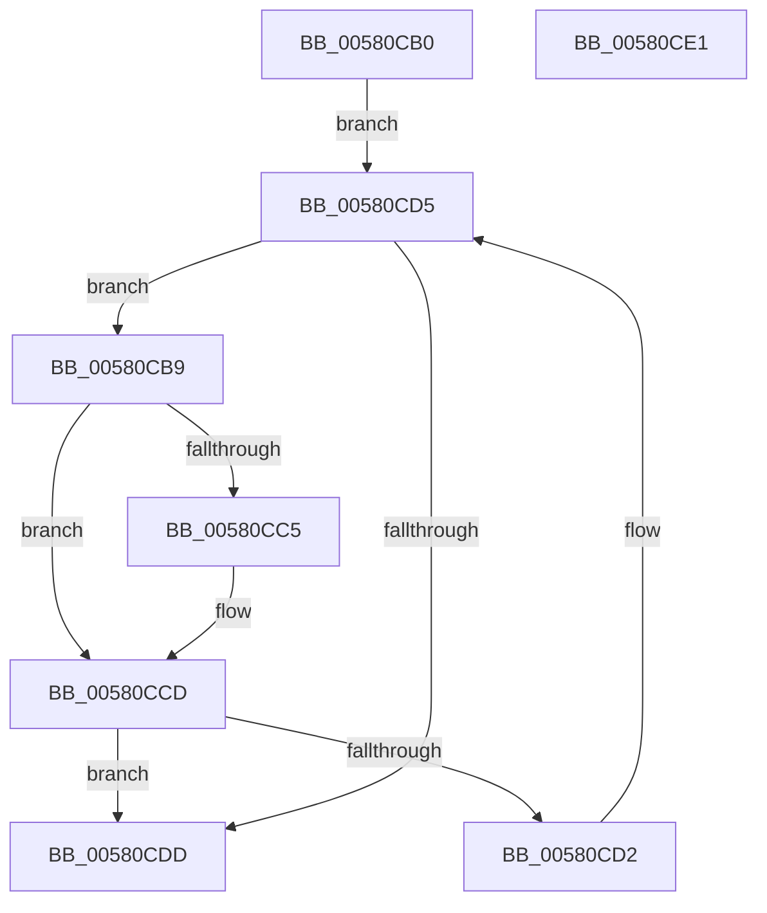

# EmpSearchCallbackDatabase

- RVA: `0x00580CB0`–`0x00580CE2` (길이 `50` bytes)
- VA: `0x0000000140580CB0`
- 실행 섹션: `.text`
- PDB 이름 있음: `예`; PDB Function 태그: `아니요`
- unwind 정보 RVA: `0x000DB714`
- 디코드: `17`개 명령, `50/50` bytes 표시
- 미해석 바이트: `0` (있으면 어셈블리에 `.byte`로 보존)

> 이 문서는 커널 이미지의 기계어와 PDB 기호를 분석해 생성했습니다. 4번과 5번은 함수 원형과 자료형을 바이너리 사용 방식에서 추정한 C 해석이며 원본 소스 복구 결과는 아닙니다.

## 1. Dependencies

- 직접 호출 지점: **0**; 고유 호출 대상: **0**
- 직접 호출자로 확인된 함수: **3**
- RIP 상대 이미지 참조: **1**

### Outgoing calls
- 직접 디코드된 call 명령이 없습니다.

### Direct callers
- [EmpProviderRegister](../../page/AC/EmpProviderRegister_function_00ACC5D0.md) at `0x00ACC7F3`
- [EmpParseCallbacks](../../init/C2/EmpParseCallbacks_function_00C2657C.md) at `0x00C26655`
- [EmpParseRuleTerm](../../init/C2/EmpParseRuleTerm_function_00C26FC0.md) at `0x00C27053`

### Static image references
- `0x00580CB0` → RVA `0x00F8F1A0` (`.data`; read)

## 2. Other-region calls and transfers

- 다른 실행 섹션으로 향하는 call: **0**
- 별도 외부 분기/꼬리 이동을 확인하지 못했습니다.

## 3. Assembly (complete function range)

```asm
00580CB0  48 8B 15 E9 E4 A0 00            mov rdx, qword ptr [rip + 0xa0e4e9]
00580CB7  EB 1C                           jmp 0x140580cd5
00580CB9  4C 8D 42 D8                     lea r8, [rdx - 0x28]
00580CBD  4D 8B 08                        mov r9, qword ptr [r8]
00580CC0  4C 2B 09                        sub r9, qword ptr [rcx]
00580CC3  75 08                           jne 0x140580ccd
00580CC5  4D 8B 48 08                     mov r9, qword ptr [r8 + 8]
00580CC9  4C 2B 49 08                     sub r9, qword ptr [rcx + 8]
00580CCD  4D 85 C9                        test r9, r9
00580CD0  74 0B                           je 0x140580cdd
00580CD2  48 8B 12                        mov rdx, qword ptr [rdx]
00580CD5  45 33 C0                        xor r8d, r8d
00580CD8  48 85 D2                        test rdx, rdx
00580CDB  75 DC                           jne 0x140580cb9
00580CDD  49 8B C0                        mov rax, r8
00580CE0  C3                              ret
00580CE1  CC                              int3
```

## 4. C-style interpretation (structured pseudocode)

```c
__int64 __fastcall EmpSearchCallbackDatabase(__int64 a1)
{
    goto loc_00580CD5;
loc_00580CB9:
    a4 = (*(unsigned __int64 *)(*(unsigned __int64 *)(v_rip + 10544361) - 40)) - (*(unsigned __int64 *)(a1));
    if (!(condition_is_not_equal)) {
        a4 = *(unsigned __int64 *)(*(unsigned __int64 *)(v_rip + 10544361) - 40 + 8);
        a4 = (a4) - (*(unsigned __int64 *)(a1 + 8));
    }
    if (a4 == 0) goto loc_00580CDD;
loc_00580CD5:
    a3 = 0;
    if (*(unsigned __int64 *)(*(unsigned __int64 *)(v_rip + 10544361)) != 0) goto loc_00580CB9;
loc_00580CDD:
    return 0;
}
```

## 5. (Beta) C Style

```c
int64_t EmpSearchCallbackDatabase(void *Arg1)
{
    uint8_t *arg1 = (uint8_t *)Arg1;

    goto loc_00580CD5;
loc_00580CB9:
    a4 = (*(uint64_t *)(*(uint64_t *)(v_rip + 0xA0E4E9) - 0x28)) - (*(uint64_t *)(arg1));
    if (!(condition_is_not_equal)) {
        a4 = *(uint64_t *)(*(uint64_t *)(v_rip + 0xA0E4E9) - 0x28 + 0x8);
        a4 = (a4) - (*(uint64_t *)(arg1 + 0x8));
    }
    if (a4 == 0) goto loc_00580CDD;
loc_00580CD5:
    a3 = 0;
    if (*(uint64_t *)(*(uint64_t *)(v_rip + 0xA0E4E9)) != 0) goto loc_00580CB9;
loc_00580CDD:
    return 0;
}
```

### 관측된 메모리 오프셋

구조체 형식이 확인되지 않은 접근은 인자 기준의 오프셋으로만 기록했습니다.

| 기준 인자 | 오프셋 표현 | 폭 (bit) | 접근 |
|---|---:|---:|---|
| `Arg1` | `+ 0x0` | `64` | `R` |
| `Arg1` | `+ 0x8` | `64` | `R` |

## 6. Execution-region graph

[열기: 2D/3D 그래프와 함수 탐색 컨트롤 패널](../../../control-panel.html?section=text&rva=0x00580CB0&view=graph)

- 2D 그래프는 위에서 아래로 흐르고, 3D 그래프는 빈 공간을 드래그해 회전합니다. Shift+드래그는 이동, 휠은 확대·축소, 함수 노드 선택은 대상 보고서 이동입니다.

### Static fallback


