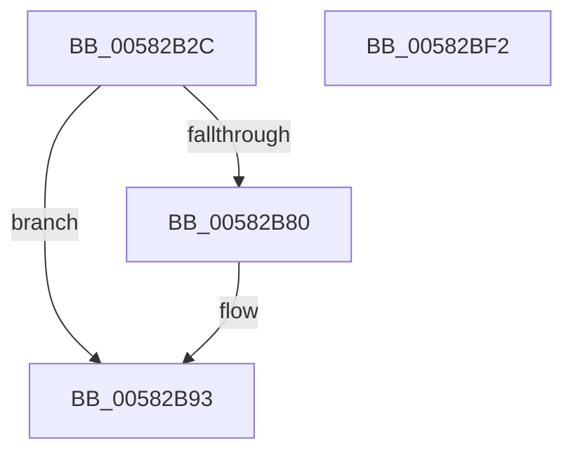

# FsFilterInit

- RVA: `0x00582B2C`–`0x00582BF3` (길이 `199` bytes)
- VA: `0x0000000140582B2C`
- 실행 섹션: `.text`
- PDB 이름 있음: `예`; PDB Function 태그: `아니요`
- unwind 정보 RVA: `0x0005CF00`
- 디코드: `42`개 명령, `199/199` bytes 표시
- 미해석 바이트: `0` (있으면 어셈블리에 `.byte`로 보존)

> 이 문서는 커널 이미지의 기계어와 PDB 기호를 분석해 생성했습니다. 4번과 5번은 함수 원형과 자료형을 바이너리 사용 방식에서 추정한 C 해석이며 원본 소스 복구 결과는 아닙니다.

## 1. Dependencies

- 직접 호출 지점: **3**; 고유 호출 대상: **2**
- 직접 호출자로 확인된 함수: **1**
- RIP 상대 이미지 참조: **15**

### Outgoing calls
- `0x00582B42` → [ExAllocatePool2](../../poolcode/B8/ExAllocatePool2_function_00B820F0.md) (function, `0x00B820F0`)
- `0x00582B61` → [ExAllocatePool2](../../poolcode/B8/ExAllocatePool2_function_00B820F0.md) (function, `0x00B820F0`)
- `0x00582B8C` → [ExFreePoolWithTag](../../poolcode/B8/ExFreePoolWithTag_function_00B82870.md) (function, `0x00B82870`)

### Direct callers
- [FsRtlInitSystem](../../init/C2/FsRtlInitSystem_function_00C28EEC.md) at `0x00C28FEC`

### Static image references
- `0x00582B4C` → RVA `0x00F8F040` (`.data`; write)
- `0x00582B69` → RVA `0x00F8F038` (`.data`; write)
- `0x00582B80` → RVA `0x00F8F040` (`.data`; read)
- `0x00582B98` → RVA `0x00F8F022` (`.data`; write)
- `0x00582B9F` → RVA `0x00F8F028` (`.data`; read)
- `0x00582BA6` → RVA `0x00F8F020` (`.data`; write)
- `0x00582BAD` → RVA `0x00F8F030` (`.data`; write)
- `0x00582BB4` → RVA `0x00F8F028` (`.data`; write)
- `0x00582BBB` → RVA `0x00F8F068` (`.data`; read)
- `0x00582BC2` → RVA `0x00F8F070` (`.data`; write)
- `0x00582BC9` → RVA `0x00F8F068` (`.data`; write)
- `0x00582BD2` → RVA `0x00F8F024` (`.data`; write)
- `0x00582BD8` → RVA `0x00F8F060` (`.data`; write)
- `0x00582BDF` → RVA `0x00F8F062` (`.data`; write)
- `0x00582BE6` → RVA `0x00F8F064` (`.data`; write)

## 2. Other-region calls and transfers

- 다른 실행 섹션으로 향하는 call: **3**
  - `0x00582B42` → [ExAllocatePool2](../../poolcode/B8/ExAllocatePool2_function_00B820F0.md) (`.text` → `POOLCODE`)
  - `0x00582B61` → [ExAllocatePool2](../../poolcode/B8/ExAllocatePool2_function_00B820F0.md) (`.text` → `POOLCODE`)
  - `0x00582B8C` → [ExFreePoolWithTag](../../poolcode/B8/ExFreePoolWithTag_function_00B82870.md) (`.text` → `POOLCODE`)
- 별도 외부 분기/꼬리 이동을 확인하지 못했습니다.

## 3. Assembly (complete function range)

```asm
00582B2C  40 53                           push rbx
00582B2E  48 83 EC 20                     sub rsp, 0x20
00582B32  BA C8 03 00 00                  mov edx, 0x3c8
00582B37  B9 40 00 00 00                  mov ecx, 0x40
00582B3C  41 B8 46 53 6D 67               mov r8d, 0x676d5346
00582B42  E8 A9 F5 5F 00                  call 0x140b820f0
00582B47  BA C8 03 00 00                  mov edx, 0x3c8
00582B4C  48 89 05 ED C4 A0 00            mov qword ptr [rip + 0xa0c4ed], rax
00582B53  B9 40 00 00 00                  mov ecx, 0x40
00582B58  41 B8 46 53 6D 67               mov r8d, 0x676d5346
00582B5E  48 8B D8                        mov rbx, rax
00582B61  E8 8A F5 5F 00                  call 0x140b820f0
00582B66  48 F7 DB                        neg rbx
00582B69  48 89 05 C8 C4 A0 00            mov qword ptr [rip + 0xa0c4c8], rax
00582B70  BB 9A 00 00 C0                  mov ebx, 0xc000009a
00582B75  1B C9                           sbb ecx, ecx
00582B77  F7 D1                           not ecx
00582B79  23 CB                           and ecx, ebx
00582B7B  48 85 C0                        test rax, rax
00582B7E  75 13                           jne 0x140582b93
00582B80  48 8B 0D B9 C4 A0 00            mov rcx, qword ptr [rip + 0xa0c4b9]
00582B87  BA 46 53 6D 67                  mov edx, 0x676d5346
00582B8C  E8 DF FC 5F 00                  call 0x140b82870
00582B91  8B CB                           mov ecx, ebx
00582B93  BA 01 00 00 00                  mov edx, 1
00582B98  C6 05 83 C4 A0 00 06            mov byte ptr [rip + 0xa0c483], 6
00582B9F  48 8D 05 82 C4 A0 00            lea rax, [rip + 0xa0c482]
00582BA6  66 89 15 73 C4 A0 00            mov word ptr [rip + 0xa0c473], dx
00582BAD  48 89 05 7C C4 A0 00            mov qword ptr [rip + 0xa0c47c], rax
00582BB4  48 89 05 6D C4 A0 00            mov qword ptr [rip + 0xa0c46d], rax
00582BBB  48 8D 05 A6 C4 A0 00            lea rax, [rip + 0xa0c4a6]
00582BC2  48 89 05 A7 C4 A0 00            mov qword ptr [rip + 0xa0c4a7], rax
00582BC9  48 89 05 98 C4 A0 00            mov qword ptr [rip + 0xa0c498], rax
00582BD0  8B C1                           mov eax, ecx
00582BD2  89 15 4C C4 A0 00               mov dword ptr [rip + 0xa0c44c], edx
00582BD8  66 89 15 81 C4 A0 00            mov word ptr [rip + 0xa0c481], dx
00582BDF  C6 05 7C C4 A0 00 06            mov byte ptr [rip + 0xa0c47c], 6
00582BE6  89 15 78 C4 A0 00               mov dword ptr [rip + 0xa0c478], edx
00582BEC  48 83 C4 20                     add rsp, 0x20
00582BF0  5B                              pop rbx
00582BF1  C3                              ret
00582BF2  CC                              int3
```

## 4. C-style interpretation (structured pseudocode)

```c
__int64 __fastcall FsFilterInit(void)
{
    __int64 result;
    __int64 v_rbx;
    __int64 v_rsp;

    v_rsp = (v_rsp) - (32);
    result = ExAllocatePool2(64, 968, (unsigned int)(0x676D5346ULL), a4);
    *(unsigned __int64 *)(v_rip + 10536173) = result;
    result = ExAllocatePool2(64, 968, (unsigned int)(0x676D5346ULL), a4);
    v_rbx = -(result);
    *(unsigned __int64 *)(v_rip + 10536136) = result;
    a1 = (unsigned int)(~(64));
    a1 = (unsigned int)((a1) & ((unsigned int)((unsigned int)(0xC000009AULL))));
    if (result == 0) {
        a1 = *(unsigned __int64 *)(v_rip + 10536121);
        a2 = 0x676D5346ULL;
        result = ExFreePoolWithTag(a1, a2, (unsigned int)(0x676D5346ULL), a4);
        a1 = (unsigned int)((unsigned int)(0xC000009AULL));
    }
    *(unsigned __int8 *)(v_rip + 10536067) = 6;
    *(unsigned __int16 *)(v_rip + 10536051) = 1;
    *(unsigned __int64 *)(v_rip + 10536060) = v_rip + 10536066;
    *(unsigned __int64 *)(v_rip + 10536045) = v_rip + 10536066;
    *(unsigned __int64 *)(v_rip + 10536103) = v_rip + 10536102;
    *(unsigned __int64 *)(v_rip + 10536088) = v_rip + 10536102;
    *(unsigned int *)(v_rip + 10536012) = 1;
    *(unsigned __int16 *)(v_rip + 10536065) = 1;
    *(unsigned __int8 *)(v_rip + 10536060) = 6;
    *(unsigned int *)(v_rip + 10536056) = 1;
    v_rsp = (v_rsp) + (32);
    return (unsigned int)((unsigned int)(a1));
}
```

## 5. (Beta) C Style

```c
void FsFilterInit(void)
{
    int64_t result;
    int64_t local_rbx;
    int64_t local_rsp;

    local_rsp = (local_rsp) - (32);
    result = ExAllocatePool2(64, 968, (uint32_t)(0x676D5346ULL), a4);
    *(uint64_t *)(v_rip + 0xA0C4ED) = result;
    result = ExAllocatePool2(64, 968, (uint32_t)(0x676D5346ULL), a4);
    local_rbx = -(result);
    *(uint64_t *)(v_rip + 0xA0C4C8) = result;
    a1 = (uint32_t)(~(64));
    a1 = (uint32_t)((a1) & ((uint32_t)((uint32_t)(0xC000009AULL))));
    if (result == 0) {
        a1 = *(uint64_t *)(v_rip + 0xA0C4B9);
        a2 = 0x676D5346ULL;
        result = ExFreePoolWithTag(a1, a2, (uint32_t)(0x676D5346ULL), a4);
        a1 = (uint32_t)((uint32_t)(0xC000009AULL));
    }
    *(uint8_t *)(v_rip + 0xA0C483) = 6;
    *(uint16_t *)(v_rip + 0xA0C473) = 1;
    *(uint64_t *)(v_rip + 0xA0C47C) = v_rip + 10536066;
    *(uint64_t *)(v_rip + 0xA0C46D) = v_rip + 10536066;
    *(uint64_t *)(v_rip + 0xA0C4A7) = v_rip + 10536102;
    *(uint64_t *)(v_rip + 0xA0C498) = v_rip + 10536102;
    *(uint32_t *)(v_rip + 0xA0C44C) = 1;
    *(uint16_t *)(v_rip + 0xA0C481) = 1;
    *(uint8_t *)(v_rip + 0xA0C47C) = 6;
    *(uint32_t *)(v_rip + 0xA0C478) = 1;
    local_rsp = (local_rsp) + (32);
    return (uint32_t)((uint32_t)(a1));
}
```

## 6. Execution-region graph

[열기: 2D/3D 그래프와 함수 탐색 컨트롤 패널](../../../control-panel.html?section=text&rva=0x00582B2C&view=graph)

- 2D 그래프는 위에서 아래로 흐르고, 3D 그래프는 빈 공간을 드래그해 회전합니다. Shift+드래그는 이동, 휠은 확대·축소, 함수 노드 선택은 대상 보고서 이동입니다.

### Static fallback


