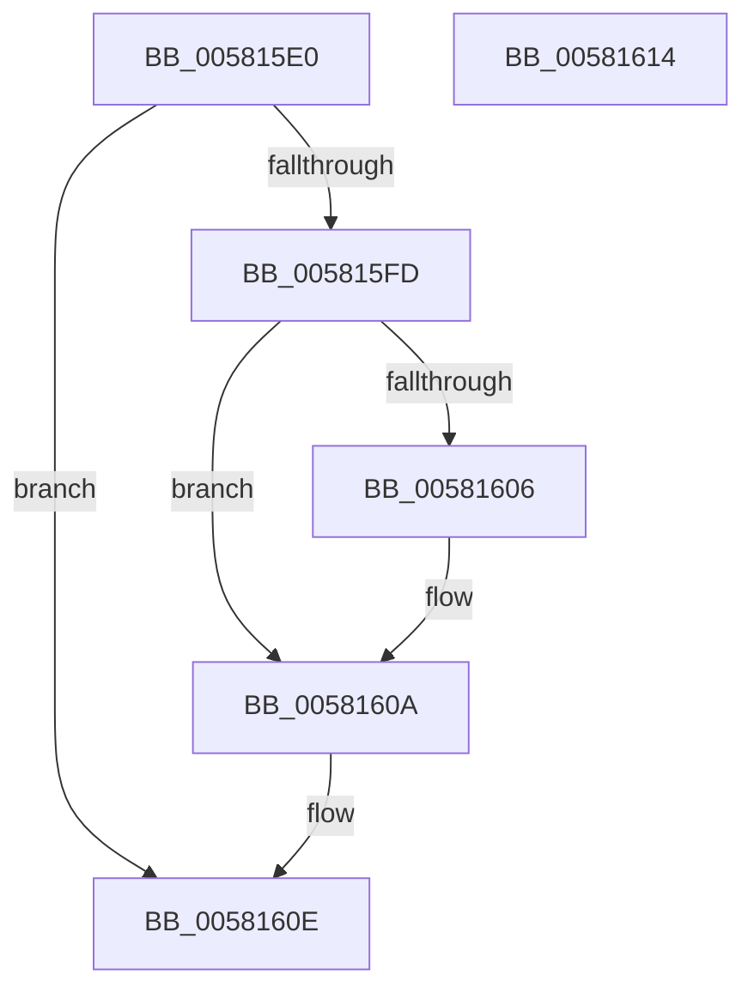

# FsRtlAllocateAePushLock

- RVA: `0x005815E0`–`0x00581615` (길이 `53` bytes)
- VA: `0x00000001405815E0`
- 실행 섹션: `.text`
- PDB 이름 있음: `예`; PDB Function 태그: `아니요`
- unwind 정보 RVA: `0x0005CF00`
- 디코드: `18`개 명령, `53/53` bytes 표시
- 미해석 바이트: `0` (있으면 어셈블리에 `.byte`로 보존)

> 이 문서는 커널 이미지의 기계어와 PDB 기호를 분석해 생성했습니다. 4번과 5번은 함수 원형과 자료형을 바이너리 사용 방식에서 추정한 C 해석이며 원본 소스 복구 결과는 아닙니다.

## 1. Dependencies

- 직접 호출 지점: **1**; 고유 호출 대상: **1**
- 직접 호출자로 확인된 함수: **0**
- RIP 상대 이미지 참조: **0**

### Outgoing calls
- `0x005815F3` → [ExAllocatePoolWithTag](../../poolcode/B8/ExAllocatePoolWithTag_function_00B82010.md) (function, `0x00B82010`)

### Direct callers
- 이 함수 시작 RVA로 연결되는 직접 call은 확인되지 않았습니다. 간접 호출은 완전히 역산할 수 없습니다.

### Static image references
- 디코드된 RIP-relative 메모리 참조가 없습니다.

## 2. Other-region calls and transfers

- 다른 실행 섹션으로 향하는 call: **1**
  - `0x005815F3` → [ExAllocatePoolWithTag](../../poolcode/B8/ExAllocatePoolWithTag_function_00B82010.md) (`.text` → `POOLCODE`)
- 별도 외부 분기/꼬리 이동을 확인하지 못했습니다.

## 3. Assembly (complete function range)

```asm
005815E0  40 53                           push rbx
005815E2  48 83 EC 20                     sub rsp, 0x20
005815E6  8B D9                           mov ebx, ecx
005815E8  44 8B C2                        mov r8d, edx
005815EB  BA 10 00 00 00                  mov edx, 0x10
005815F0  83 E3 01                        and ebx, 1
005815F3  E8 18 0A 60 00                  call 0x140b82010
005815F8  48 85 C0                        test rax, rax
005815FB  74 11                           je 0x14058160e
005815FD  48 83 60 08 00                  and qword ptr [rax + 8], 0
00581602  85 DB                           test ebx, ebx
00581604  74 04                           je 0x14058160a
00581606  83 48 08 04                     or dword ptr [rax + 8], 4
0058160A  48 83 20 00                     and qword ptr [rax], 0
0058160E  48 83 C4 20                     add rsp, 0x20
00581612  5B                              pop rbx
00581613  C3                              ret
00581614  CC                              int3
```

## 4. C-style interpretation (structured pseudocode)

```c
__int64 __fastcall FsRtlAllocateAePushLock(int a1, int a2)
{
    __int64 result;
    __int64 v_rbx;
    __int64 v_rsp;

    v_rsp = (v_rsp) - (32);
    v_rbx = (unsigned int)(((unsigned int)(a1)) & (1));
    result = ExAllocatePoolWithTag(a1, 16, (unsigned int)(a2), a4);
    if (result == 0) goto loc_0058160E;
    if ((unsigned int)(v_rbx) != 0) {
    }
loc_0058160E:
    v_rsp = (v_rsp) + (32);
    return result;
}
```

## 5. (Beta) C Style

```c
int64_t FsRtlAllocateAePushLock(int32_t Arg1, int32_t Arg2)
{
    int64_t result;
    int64_t local_rbx;
    int64_t local_rsp;

    local_rsp = (local_rsp) - (32);
    local_rbx = (uint32_t)(((uint32_t)(Arg1)) & (1));
    result = ExAllocatePoolWithTag(Arg1, 16, (uint32_t)(Arg2), a4);
    if (result == 0) goto loc_0058160E;
    if ((uint32_t)(local_rbx) != 0) {
    }
loc_0058160E:
    local_rsp = (local_rsp) + (32);
    return result;
}
```

## 6. Execution-region graph

[열기: 2D/3D 그래프와 함수 탐색 컨트롤 패널](../../../control-panel.html?section=text&rva=0x005815E0&view=graph)

- 2D 그래프는 위에서 아래로 흐르고, 3D 그래프는 빈 공간을 드래그해 회전합니다. Shift+드래그는 이동, 휠은 확대·축소, 함수 노드 선택은 대상 보고서 이동입니다.

### Static fallback


