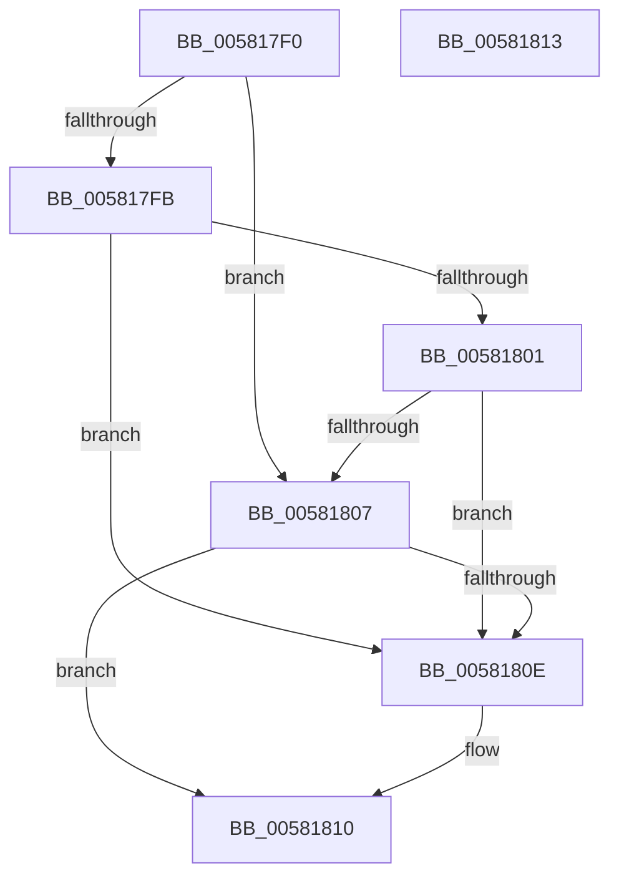

# FsRtlAreThereCurrentOrInProgressFileLocks

- RVA: `0x005817F0`–`0x00581814` (길이 `36` bytes)
- VA: `0x00000001405817F0`
- 실행 섹션: `.text`
- PDB 이름 있음: `예`; PDB Function 태그: `아니요`
- unwind 정보 RVA: `0x000DB714`
- 디코드: `15`개 명령, `36/36` bytes 표시
- 미해석 바이트: `0` (있으면 어셈블리에 `.byte`로 보존)

> 이 문서는 커널 이미지의 기계어와 PDB 기호를 분석해 생성했습니다. 4번과 5번은 함수 원형과 자료형을 바이너리 사용 방식에서 추정한 C 해석이며 원본 소스 복구 결과는 아닙니다.

## 1. Dependencies

- 직접 호출 지점: **0**; 고유 호출 대상: **0**
- 직접 호출자로 확인된 함수: **0**
- RIP 상대 이미지 참조: **0**

### Outgoing calls
- 직접 디코드된 call 명령이 없습니다.

### Direct callers
- 이 함수 시작 RVA로 연결되는 직접 call은 확인되지 않았습니다. 간접 호출은 완전히 역산할 수 없습니다.

### Static image references
- 디코드된 RIP-relative 메모리 참조가 없습니다.

## 2. Other-region calls and transfers

- 다른 실행 섹션으로 향하는 call: **0**
- 별도 외부 분기/꼬리 이동을 확인하지 못했습니다.

## 3. Assembly (complete function range)

```asm
005817F0  48 8B 41 18                     mov rax, qword ptr [rcx + 0x18]
005817F4  33 D2                           xor edx, edx
005817F6  48 85 C0                        test rax, rax
005817F9  74 0C                           je 0x140581807
005817FB  48 39 50 20                     cmp qword ptr [rax + 0x20], rdx
005817FF  75 0D                           jne 0x14058180e
00581801  48 39 50 28                     cmp qword ptr [rax + 0x28], rdx
00581805  75 07                           jne 0x14058180e
00581807  8B 41 58                        mov eax, dword ptr [rcx + 0x58]
0058180A  85 C0                           test eax, eax
0058180C  74 02                           je 0x140581810
0058180E  B2 01                           mov dl, 1
00581810  8A C2                           mov al, dl
00581812  C3                              ret
00581813  CC                              int3
```

## 4. C-style interpretation (structured pseudocode)

```c
__int64 __fastcall FsRtlAreThereCurrentOrInProgressFileLocks(__int64 a1, int a2)
{
    a2 = 0;
    if (*(unsigned __int64 *)(a1 + 24) == 0) goto loc_00581807;
    if ((*(unsigned __int64 *)(*(unsigned __int64 *)(a1 + 24) + 32)) != 0) goto loc_0058180E;
    if ((*(unsigned __int64 *)(*(unsigned __int64 *)(a1 + 24) + 40)) != 0) goto loc_0058180E;
loc_00581807:
    if ((unsigned int)((unsigned int)(*(unsigned int *)(a1 + 88))) != 0) {
        a2 = 1;
    }
    return (unsigned __int8)(a2);
}
```

## 5. (Beta) C Style

```c
int64_t FsRtlAreThereCurrentOrInProgressFileLocks(void *Arg1, int32_t Arg2)
{
    uint8_t *arg1 = (uint8_t *)Arg1;

    Arg2 = 0;
    if (*(uint64_t *)(arg1 + 0x18) == 0) goto loc_00581807;
    if ((*(uint64_t *)(*(uint64_t *)(arg1 + 0x18) + 0x20)) != 0) goto loc_0058180E;
    if ((*(uint64_t *)(*(uint64_t *)(arg1 + 0x18) + 0x28)) != 0) goto loc_0058180E;
loc_00581807:
    if ((uint32_t)((uint32_t)(*(uint32_t *)(arg1 + 0x58))) != 0) {
        Arg2 = 1;
    }
    return (uint8_t)(Arg2);
}
```

### 관측된 메모리 오프셋

구조체 형식이 확인되지 않은 접근은 인자 기준의 오프셋으로만 기록했습니다.

| 기준 인자 | 오프셋 표현 | 폭 (bit) | 접근 |
|---|---:|---:|---|
| `Arg1` | `+ 0x18` | `64` | `R` |
| `Arg1` | `+ 0x58` | `32` | `R` |

## 6. Execution-region graph

[열기: 2D/3D 그래프와 함수 탐색 컨트롤 패널](../../../control-panel.html?section=text&rva=0x005817F0&view=graph)

- 2D 그래프는 위에서 아래로 흐르고, 3D 그래프는 빈 공간을 드래그해 회전합니다. Shift+드래그는 이동, 휠은 확대·축소, 함수 노드 선택은 대상 보고서 이동입니다.

### Static fallback


