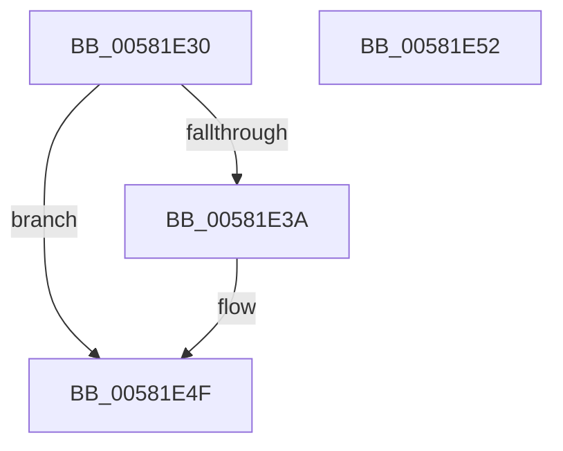

# FsRtlCurrentOplock

- RVA: `0x00581E30`–`0x00581E53` (길이 `35` bytes)
- VA: `0x0000000140581E30`
- 실행 섹션: `.text`
- PDB 이름 있음: `예`; PDB Function 태그: `아니요`
- unwind 정보 RVA: `0x000DB714`
- 디코드: `11`개 명령, `35/35` bytes 표시
- 미해석 바이트: `0` (있으면 어셈블리에 `.byte`로 보존)

> 이 문서는 커널 이미지의 기계어와 PDB 기호를 분석해 생성했습니다. 4번과 5번은 함수 원형과 자료형을 바이너리 사용 방식에서 추정한 C 해석이며 원본 소스 복구 결과는 아닙니다.

## 1. Dependencies

- 직접 호출 지점: **0**; 고유 호출 대상: **0**
- 직접 호출자로 확인된 함수: **0**
- RIP 상대 이미지 참조: **0**

### Outgoing calls
- 직접 디코드된 call 명령이 없습니다.

### Direct callers
- 이 함수 시작 RVA로 연결되는 직접 call은 확인되지 않았습니다. 간접 호출은 완전히 역산할 수 없습니다.

### Static image references
- 디코드된 RIP-relative 메모리 참조가 없습니다.

## 2. Other-region calls and transfers

- 다른 실행 섹션으로 향하는 call: **0**
- 별도 외부 분기/꼬리 이동을 확인하지 못했습니다.

## 3. Assembly (complete function range)

```asm
00581E30  48 8B 01                        mov rax, qword ptr [rcx]
00581E33  33 D2                           xor edx, edx
00581E35  48 85 C0                        test rax, rax
00581E38  74 15                           je 0x140581e4f
00581E3A  F7 80 90 00 00 00 1E 70 00 00   test dword ptr [rax + 0x90], 0x701e
00581E44  B9 01 00 00 00                  mov ecx, 1
00581E49  0F B6 D2                        movzx edx, dl
00581E4C  0F 45 D1                        cmovne edx, ecx
00581E4F  8A C2                           mov al, dl
00581E51  C3                              ret
00581E52  CC                              int3
```

## 4. C-style interpretation (structured pseudocode)

```c
__int64 __fastcall FsRtlCurrentOplock(__int64 a1, int a2)
{
    a2 = 0;
    if (*(unsigned __int64 *)(a1) != 0) {
        a1 = 1;
        a2 = 0;
        if (((*(unsigned int *)(*(unsigned __int64 *)(a1) + 144)) & (0x701EULL)) != 0) { a2 = (unsigned int)(a1); }
    }
    return (unsigned __int8)(a2);
}
```

## 5. (Beta) C Style

```c
int64_t FsRtlCurrentOplock(void *Arg1, int32_t Arg2)
{
    uint8_t *arg1 = (uint8_t *)Arg1;

    Arg2 = 0;
    if (*(uint64_t *)(arg1) != 0) {
        Arg1 = 1;
        Arg2 = 0;
        if (((*(uint32_t *)(*(uint64_t *)(arg1) + 0x90)) & (0x701EULL)) != 0) { Arg2 = (uint32_t)(Arg1); }
    }
    return (uint8_t)(Arg2);
}
```

### 관측된 메모리 오프셋

구조체 형식이 확인되지 않은 접근은 인자 기준의 오프셋으로만 기록했습니다.

| 기준 인자 | 오프셋 표현 | 폭 (bit) | 접근 |
|---|---:|---:|---|
| `Arg1` | `+ 0x0` | `64` | `R` |

## 6. Execution-region graph

[열기: 2D/3D 그래프와 함수 탐색 컨트롤 패널](../../../control-panel.html?section=text&rva=0x00581E30&view=graph)

- 2D 그래프는 위에서 아래로 흐르고, 3D 그래프는 빈 공간을 드래그해 회전합니다. Shift+드래그는 이동, 휠은 확대·축소, 함수 노드 선택은 대상 보고서 이동입니다.

### Static fallback


