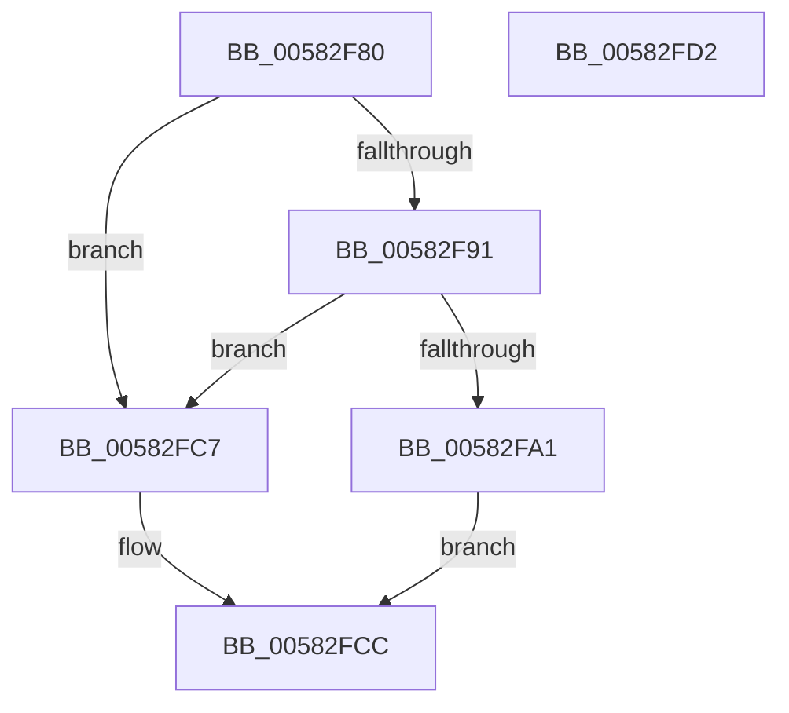

# FsRtlDisallowLegacyFilterOnDevice

- RVA: `0x00582F80`–`0x00582FD3` (길이 `83` bytes)
- VA: `0x0000000140582F80`
- 실행 섹션: `.text`
- PDB 이름 있음: `예`; PDB Function 태그: `아니요`
- unwind 정보 RVA: `0x0005CF00`
- 디코드: `23`개 명령, `83/83` bytes 표시
- 미해석 바이트: `0` (있으면 어셈블리에 `.byte`로 보존)

> 이 문서는 커널 이미지의 기계어와 PDB 기호를 분석해 생성했습니다. 4번과 5번은 함수 원형과 자료형을 바이너리 사용 방식에서 추정한 C 해석이며 원본 소스 복구 결과는 아닙니다.

## 1. Dependencies

- 직접 호출 지점: **2**; 고유 호출 대상: **2**
- 직접 호출자로 확인된 함수: **0**
- RIP 상대 이미지 참조: **0**

### Outgoing calls
- `0x00582FA6` → [KeAcquireQueuedSpinLock](../27/KeAcquireQueuedSpinLock_function_00273D80.md) (function, `0x00273D80`)
- `0x00582FBE` → [KeReleaseQueuedSpinLock](../27/KeReleaseQueuedSpinLock_function_00272540.md) (function, `0x00272540`)

### Direct callers
- 이 함수 시작 RVA로 연결되는 직접 call은 확인되지 않았습니다. 간접 호출은 완전히 역산할 수 없습니다.

### Static image references
- 디코드된 RIP-relative 메모리 참조가 없습니다.

## 2. Other-region calls and transfers

- 다른 실행 섹션으로 향하는 call: **0**
- 별도 외부 분기/꼬리 이동을 확인하지 못했습니다.

## 3. Assembly (complete function range)

```asm
00582F80  40 53                           push rbx
00582F82  48 83 EC 20                     sub rsp, 0x20
00582F86  8B 41 48                        mov eax, dword ptr [rcx + 0x48]
00582F89  48 8B D9                        mov rbx, rcx
00582F8C  83 F8 35                        cmp eax, 0x35
00582F8F  77 36                           ja 0x140582fc7
00582F91  48 B9 08 01 10 00 01 00 20 00   movabs rcx, 0x20000100100108
00582F9B  48 0F A3 C1                     bt rcx, rax
00582F9F  73 26                           jae 0x140582fc7
00582FA1  B9 0A 00 00 00                  mov ecx, 0xa
00582FA6  E8 D5 0D CF FF                  call 0x140273d80
00582FAB  48 8B 93 38 01 00 00            mov rdx, qword ptr [rbx + 0x138]
00582FB2  B9 0A 00 00 00                  mov ecx, 0xa
00582FB7  0F BA 6A 20 0D                  bts dword ptr [rdx + 0x20], 0xd
00582FBC  8A D0                           mov dl, al
00582FBE  E8 7D F5 CE FF                  call 0x140272540
00582FC3  33 C0                           xor eax, eax
00582FC5  EB 05                           jmp 0x140582fcc
00582FC7  B8 0D 00 00 C0                  mov eax, 0xc000000d
00582FCC  48 83 C4 20                     add rsp, 0x20
00582FD0  5B                              pop rbx
00582FD1  C3                              ret
00582FD2  CC                              int3
```

## 4. C-style interpretation (structured pseudocode)

```c
__int64 __fastcall FsRtlDisallowLegacyFilterOnDevice(__int64 a1)
{
    __int64 result;
    __int64 v_rsp;

    v_rsp = (v_rsp) - (32);
    if (((unsigned int)((unsigned int)(*(unsigned int *)(a1 + 72)))) > 53) goto loc_00582FC7;
    if (((unsigned int)((unsigned int)(*(unsigned int *)(a1 + 72)))) >= 53) goto loc_00582FC7;
    result = KeAcquireQueuedSpinLock(10, a2, a3, a4);
    result = KeReleaseQueuedSpinLock(10, (unsigned __int8)(result), a3, a4);
    result = 0;
    goto loc_00582FCC;
loc_00582FC7:
loc_00582FCC:
    v_rsp = (v_rsp) + (32);
    return (unsigned int)(0xC000000DULL);
}
```

## 5. (Beta) C Style

```c
int64_t FsRtlDisallowLegacyFilterOnDevice(void *Arg1)
{
    uint8_t *arg1 = (uint8_t *)Arg1;

    int64_t result;
    int64_t local_rsp;

    local_rsp = (local_rsp) - (32);
    if (((uint32_t)((uint32_t)(*(uint32_t *)(arg1 + 0x48)))) > 53) goto loc_00582FC7;
    if (((uint32_t)((uint32_t)(*(uint32_t *)(arg1 + 0x48)))) >= 53) goto loc_00582FC7;
    result = KeAcquireQueuedSpinLock(10, a2, a3, a4);
    result = KeReleaseQueuedSpinLock(10, (uint8_t)(result), a3, a4);
    result = 0;
    goto loc_00582FCC;
loc_00582FC7:
loc_00582FCC:
    local_rsp = (local_rsp) + (32);
    return (uint32_t)(0xC000000DULL);
}
```

### 관측된 메모리 오프셋

구조체 형식이 확인되지 않은 접근은 인자 기준의 오프셋으로만 기록했습니다.

| 기준 인자 | 오프셋 표현 | 폭 (bit) | 접근 |
|---|---:|---:|---|
| `Arg1` | `+ 0x48` | `32` | `R` |
| `Arg1` | `+ 0x138` | `64` | `R` |

## 6. Execution-region graph

[열기: 2D/3D 그래프와 함수 탐색 컨트롤 패널](../../../control-panel.html?section=text&rva=0x00582F80&view=graph)

- 2D 그래프는 위에서 아래로 흐르고, 3D 그래프는 빈 공간을 드래그해 회전합니다. Shift+드래그는 이동, 휠은 확대·축소, 함수 노드 선택은 대상 보고서 이동입니다.

### Static fallback


