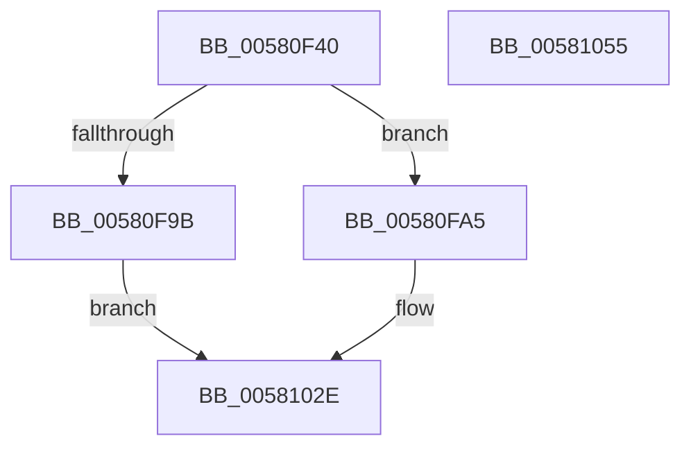

# FsRtlGetFileExtents

- RVA: `0x00580F40`–`0x00581056` (길이 `278` bytes)
- VA: `0x0000000140580F40`
- 실행 섹션: `.text`
- PDB 이름 있음: `예`; PDB Function 태그: `아니요`
- unwind 정보 RVA: `0x000C5CA4`
- 디코드: `71`개 명령, `278/278` bytes 표시
- 미해석 바이트: `0` (있으면 어셈블리에 `.byte`로 보존)

> 이 문서는 커널 이미지의 기계어와 PDB 기호를 분석해 생성했습니다. 4번과 5번은 함수 원형과 자료형을 바이너리 사용 방식에서 추정한 C 해석이며 원본 소스 복구 결과는 아닙니다.

## 1. Dependencies

- 직접 호출 지점: **5**; 고유 호출 대상: **5**
- 직접 호출자로 확인된 함수: **3**
- RIP 상대 이미지 참조: **1**

### Outgoing calls
- `0x00580F7B` → [IoGetRelatedDeviceObject](../29/IoGetRelatedDeviceObject_function_0029B120.md) (function, `0x0029B120`)
- `0x00580F8C` → [IoAllocateIrpEx](../20/IoAllocateIrpEx_function_00207510.md) (function, `0x00207510`)
- `0x0058101D` → [IoSynchronousCallDriver](../48/IoSynchronousCallDriver_function_00484050.md) (function, `0x00484050`)
- `0x00581027` → [IoFreeIrp](../24/IoFreeIrp_function_0024DF70.md) (function, `0x0024DF70`)
- `0x00581036` → [_security_check_cookie](../6A/_security_check_cookie_function_006AC640.md) (function, `0x006AC640`)

### Direct callers
- [MiAllocateEntireImageFileExtents](../../page/80/MiAllocateEntireImageFileExtents_function_008008DC.md) at `0x0080098A`
- [MiComputeIdealFirstSubsection](../../page/80/MiComputeIdealFirstSubsection_function_00800B0C.md) at `0x00800B57`
- [MiAllocateFileExtents](../../page/AB/MiAllocateFileExtents_function_00ABDF54.md) at `0x00ABE167`

### Static image references
- `0x00580F58` → RVA `0x00E0A740` (`.data`; read)

## 2. Other-region calls and transfers

- 다른 실행 섹션으로 향하는 call: **0**
- 별도 외부 분기/꼬리 이동을 확인하지 못했습니다.

## 3. Assembly (complete function range)

```asm
00580F40  48 89 5C 24 10                  mov qword ptr [rsp + 0x10], rbx
00580F45  48 89 6C 24 18                  mov qword ptr [rsp + 0x18], rbp
00580F4A  48 89 74 24 20                  mov qword ptr [rsp + 0x20], rsi
00580F4F  57                              push rdi
00580F50  41 56                           push r14
00580F52  41 57                           push r15
00580F54  48 83 EC 50                     sub rsp, 0x50
00580F58  48 8B 05 E1 97 88 00            mov rax, qword ptr [rip + 0x8897e1]
00580F5F  48 33 C4                        xor rax, rsp
00580F62  48 89 44 24 48                  mov qword ptr [rsp + 0x48], rax
00580F67  0F 57 C0                        xorps xmm0, xmm0
00580F6A  49 8B E9                        mov rbp, r9
00580F6D  0F 11 44 24 20                  movups xmmword ptr [rsp + 0x20], xmm0
00580F72  4D 8B F0                        mov r14, r8
00580F75  44 8B FA                        mov r15d, edx
00580F78  48 8B F1                        mov rsi, rcx
00580F7B  E8 A0 A1 D1 FF                  call 0x14029b120
00580F80  45 33 C0                        xor r8d, r8d
00580F83  48 8B C8                        mov rcx, rax
00580F86  48 8B D8                        mov rbx, rax
00580F89  8A 50 4C                        mov dl, byte ptr [rax + 0x4c]
00580F8C  E8 7F 65 C8 FF                  call 0x140207510
00580F91  33 D2                           xor edx, edx
00580F93  48 8B F8                        mov rdi, rax
00580F96  48 85 C0                        test rax, rax
00580F99  75 0A                           jne 0x140580fa5
00580F9B  B8 9A 00 00 C0                  mov eax, 0xc000009a
00580FA0  E9 89 00 00 00                  jmp 0x14058102e
00580FA5  48 8B 8C 24 90 00 00 00         mov rcx, qword ptr [rsp + 0x90]
00580FAD  89 54 24 44                     mov dword ptr [rsp + 0x44], edx
00580FB1  4C 89 74 24 30                  mov qword ptr [rsp + 0x30], r14
00580FB6  48 89 6C 24 38                  mov qword ptr [rsp + 0x38], rbp
00580FBB  44 89 7C 24 40                  mov dword ptr [rsp + 0x40], r15d
00580FC0  88 50 40                        mov byte ptr [rax + 0x40], dl
00580FC3  48 8D 44 24 20                  lea rax, [rsp + 0x20]
00580FC8  48 89 47 48                     mov qword ptr [rdi + 0x48], rax
00580FCC  48 89 57 50                     mov qword ptr [rdi + 0x50], rdx
00580FD0  48 89 4F 70                     mov qword ptr [rdi + 0x70], rcx
00580FD4  65 48 8B 04 25 88 01 00 00      mov rax, qword ptr gs:[0x188]
00580FDD  48 8B 97 B8 00 00 00            mov rdx, qword ptr [rdi + 0xb8]
00580FE4  48 89 87 98 00 00 00            mov qword ptr [rdi + 0x98], rax
00580FEB  66 C7 42 B8 0D 04               mov word ptr [rdx - 0x48], 0x40d
00580FF1  48 89 72 E8                     mov qword ptr [rdx - 0x18], rsi
00580FF5  C7 42 D0 9B 03 09 00            mov dword ptr [rdx - 0x30], 0x9039b
00580FFC  C7 42 C8 18 00 00 00            mov dword ptr [rdx - 0x38], 0x18
00581003  8B 01                           mov eax, dword ptr [rcx]
00581005  48 8B CB                        mov rcx, rbx
00581008  C1 E0 04                        shl eax, 4
0058100B  83 C0 08                        add eax, 8
0058100E  89 42 C0                        mov dword ptr [rdx - 0x40], eax
00581011  48 8D 44 24 30                  lea rax, [rsp + 0x30]
00581016  48 89 42 D8                     mov qword ptr [rdx - 0x28], rax
0058101A  48 8B D7                        mov rdx, rdi
0058101D  E8 2E 30 F0 FF                  call 0x140484050
00581022  48 8B CF                        mov rcx, rdi
00581025  8B D8                           mov ebx, eax
00581027  E8 44 CF CC FF                  call 0x14024df70
0058102C  8B C3                           mov eax, ebx
0058102E  48 8B 4C 24 48                  mov rcx, qword ptr [rsp + 0x48]
00581033  48 33 CC                        xor rcx, rsp
00581036  E8 05 B6 12 00                  call 0x1406ac640
0058103B  4C 8D 5C 24 50                  lea r11, [rsp + 0x50]
00581040  49 8B 5B 28                     mov rbx, qword ptr [r11 + 0x28]
00581044  49 8B 6B 30                     mov rbp, qword ptr [r11 + 0x30]
00581048  49 8B 73 38                     mov rsi, qword ptr [r11 + 0x38]
0058104C  49 8B E3                        mov rsp, r11
0058104F  41 5F                           pop r15
00581051  41 5E                           pop r14
00581053  5F                              pop rdi
00581054  C3                              ret
00581055  CC                              int3
```

## 4. C-style interpretation (structured pseudocode)

```c
__int64 __fastcall FsRtlGetFileExtents(__int64 a1, int a2, __int64 a3, __int64 a4, __int64 a5)
{
    __int64 result;
    __int64 v_rsp;
    unsigned __int64 v_stack_m18;
    unsigned __int64 v_stack_m20;
    unsigned int v_stack_m24;
    unsigned int v_stack_m28;
    unsigned __int64 v_stack_m30;
    unsigned __int64 v_stack_m38;
    unsigned __int64 v_stack_m48;
    unsigned __int64 v_stack_p10;
    unsigned __int64 v_stack_p18;
    unsigned __int64 v_stack_p20;

    v_stack_p10 = v_rbx;
    v_stack_p18 = v_rbp;
    v_stack_p20 = v_rsi;
    v_rsp = (v_rsp) - (80);
    result = (*(unsigned __int64 *)(v_rip + 8951777)) ^ (v_rsp);
    v_stack_m20 = result;
    v_stack_m48 = v_xmm0;
    result = IoGetRelatedDeviceObject(a1, a2, a3, a4);
    a3 = 0;
    result = IoAllocateIrpEx(result, *(unsigned __int8 *)(result + 76), a3, a4);
    a2 = 0;
    if (result != 0) goto loc_00580FA5;
    goto loc_0058102E;
loc_00580FA5:
    v_stack_m24 = 0;
    v_stack_m38 = 0;
    v_stack_m30 = a4;
    v_stack_m28 = (unsigned int)((unsigned int)(a2));
    *(unsigned __int8 *)((unsigned int)(0xC000009AULL) + 64) = 0;
    *(unsigned __int64 *)(result + 72) = v_stack_m48;
    *(unsigned __int64 *)(result + 80) = 0;
    *(unsigned __int64 *)(result + 112) = a5;
    *(unsigned __int64 *)(result + 152) = *(unsigned __int64 *)(gs_base + (0 + 392));
    *(unsigned __int16 *)(*(unsigned __int64 *)(result + 184) - 72) = 0x40DULL;
    *(unsigned __int64 *)(*(unsigned __int64 *)(result + 184) - 24) = a1;
    *(unsigned int *)(*(unsigned __int64 *)(result + 184) - 48) = 0x9039BULL;
    *(unsigned int *)(*(unsigned __int64 *)(result + 184) - 56) = 24;
    result = (unsigned int)(((unsigned int)(*(unsigned int *)(a5))) << (4));
    result = (unsigned int)((result) + (8));
    *(unsigned int *)(*(unsigned __int64 *)(result + 184) - 64) = (unsigned int)(result);
    *(unsigned __int64 *)(*(unsigned __int64 *)(result + 184) - 40) = v_stack_m38;
    result = IoSynchronousCallDriver(result, result, a3, a4);
    result = IoFreeIrp(result, result, a3, a4);
loc_0058102E:
    a1 = (v_stack_m20) ^ (v_rsp);
    result = _security_check_cookie(a1, result, a3, a4);
    return result;
}
```

## 5. (Beta) C Style

```c
int64_t FsRtlGetFileExtents(int64_t Arg1, int32_t Arg2, int64_t Arg3, int64_t Arg4, void *Arg5)
{
    uint8_t *arg5 = (uint8_t *)Arg5;

    int64_t result;
    int64_t local_rsp;
    uint64_t v_stack_m18;
    uint64_t v_stack_m20;
    uint32_t v_stack_m24;
    uint32_t v_stack_m28;
    uint64_t v_stack_m30;
    uint64_t v_stack_m38;
    uint64_t v_stack_m48;
    uint64_t v_stack_p10;
    uint64_t v_stack_p18;
    uint64_t v_stack_p20;

    v_stack_p10 = local_rbx;
    v_stack_p18 = local_rbp;
    v_stack_p20 = local_rsi;
    local_rsp = (local_rsp) - (80);
    result = (*(uint64_t *)(v_rip + 0x8897E1)) ^ (local_rsp);
    v_stack_m20 = result;
    v_stack_m48 = v_xmm0;
    result = IoGetRelatedDeviceObject(Arg1, Arg2, Arg3, Arg4);
    Arg3 = 0;
    result = IoAllocateIrpEx(result, *(uint8_t *)(result + 0x4C), Arg3, Arg4);
    Arg2 = 0;
    if (result != 0) goto loc_00580FA5;
    goto loc_0058102E;
loc_00580FA5:
    v_stack_m24 = 0;
    v_stack_m38 = 0;
    v_stack_m30 = Arg4;
    v_stack_m28 = (uint32_t)((uint32_t)(Arg2));
    *(uint8_t *)((uint32_t)(0xC000009AULL) + 0x40) = 0;
    *(uint64_t *)(result + 0x48) = v_stack_m48;
    *(uint64_t *)(result + 0x50) = 0;
    *(void **)(result + 0x70) = Arg5;
    *(uint64_t *)(result + 0x98) = *(uint64_t *)(gs_base + (0 + 0x188));
    *(uint16_t *)(*(uint64_t *)(result + 0xB8) - 0x48) = 0x40DULL;
    *(uint64_t *)(*(uint64_t *)(result + 0xB8) - 0x18) = Arg1;
    *(uint32_t *)(*(uint64_t *)(result + 0xB8) - 0x30) = 0x9039BULL;
    *(uint32_t *)(*(uint64_t *)(result + 0xB8) - 0x38) = 24;
    result = (uint32_t)(((uint32_t)(*(uint32_t *)(arg5))) << (4));
    result = (uint32_t)((result) + (8));
    *(uint32_t *)(*(uint64_t *)(result + 0xB8) - 0x40) = (uint32_t)(result);
    *(uint64_t *)(*(uint64_t *)(result + 0xB8) - 0x28) = v_stack_m38;
    result = IoSynchronousCallDriver(result, result, Arg3, Arg4);
    result = IoFreeIrp(result, result, Arg3, Arg4);
loc_0058102E:
    Arg1 = (v_stack_m20) ^ (local_rsp);
    result = _security_check_cookie(Arg1, result, Arg3, Arg4);
    return result;
}
```

### 관측된 메모리 오프셋

구조체 형식이 확인되지 않은 접근은 인자 기준의 오프셋으로만 기록했습니다.

| 기준 인자 | 오프셋 표현 | 폭 (bit) | 접근 |
|---|---:|---:|---|
| `Arg5` | `+ 0x0` | `32` | `R` |

## 6. Execution-region graph

[열기: 2D/3D 그래프와 함수 탐색 컨트롤 패널](../../../control-panel.html?section=text&rva=0x00580F40&view=graph)

- 2D 그래프는 위에서 아래로 흐르고, 3D 그래프는 빈 공간을 드래그해 회전합니다. Shift+드래그는 이동, 휠은 확대·축소, 함수 노드 선택은 대상 보고서 이동입니다.

### Static fallback


