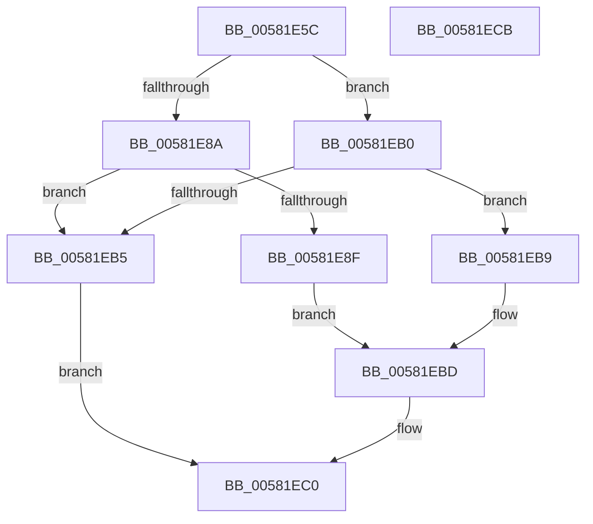

# FsRtlGetMarkHandleInfo

- RVA: `0x00581E5C`–`0x00581ECC` (길이 `112` bytes)
- VA: `0x0000000140581E5C`
- 실행 섹션: `.text`
- PDB 이름 있음: `예`; PDB Function 태그: `아니요`
- unwind 정보 RVA: `0x00065960`
- 디코드: `35`개 명령, `112/112` bytes 표시
- 미해석 바이트: `0` (있으면 어셈블리에 `.byte`로 보존)

> 이 문서는 커널 이미지의 기계어와 PDB 기호를 분석해 생성했습니다. 4번과 5번은 함수 원형과 자료형을 바이너리 사용 방식에서 추정한 C 해석이며 원본 소스 복구 결과는 아닙니다.

## 1. Dependencies

- 직접 호출 지점: **1**; 고유 호출 대상: **1**
- 직접 호출자로 확인된 함수: **1**
- RIP 상대 이미지 참조: **0**

### Outgoing calls
- `0x00581E81` → [IoIs32bitProcess](../40/IoIs32bitProcess_function_0040DFE0.md) (function, `0x0040DFE0`)

### Direct callers
- [FsRtlCheckOplockEx2](../3F/FsRtlCheckOplockEx2_function_003F2BC0.md) at `0x003F33BB`

### Static image references
- 디코드된 RIP-relative 메모리 참조가 없습니다.

## 2. Other-region calls and transfers

- 다른 실행 섹션으로 향하는 call: **0**
- 별도 외부 분기/꼬리 이동을 확인하지 못했습니다.

## 3. Assembly (complete function range)

```asm
00581E5C  48 89 5C 24 08                  mov qword ptr [rsp + 8], rbx
00581E61  57                              push rdi
00581E62  48 83 EC 40                     sub rsp, 0x40
00581E66  33 C0                           xor eax, eax
00581E68  0F 57 C0                        xorps xmm0, xmm0
00581E6B  89 44 24 30                     mov dword ptr [rsp + 0x30], eax
00581E6F  48 8B D9                        mov rbx, rcx
00581E72  48 8B 81 B8 00 00 00            mov rax, qword ptr [rcx + 0xb8]
00581E79  0F 11 44 24 20                  movups xmmword ptr [rsp + 0x20], xmm0
00581E7E  8B 78 10                        mov edi, dword ptr [rax + 0x10]
00581E81  E8 5A C1 E8 FF                  call 0x14040dfe0
00581E86  84 C0                           test al, al
00581E88  74 26                           je 0x140581eb0
00581E8A  83 FF 0C                        cmp edi, 0xc
00581E8D  72 26                           jb 0x140581eb5
00581E8F  48 8B 4B 18                     mov rcx, qword ptr [rbx + 0x18]
00581E93  8B 41 08                        mov eax, dword ptr [rcx + 8]
00581E96  89 44 24 30                     mov dword ptr [rsp + 0x30], eax
00581E9A  8B 01                           mov eax, dword ptr [rcx]
00581E9C  89 44 24 20                     mov dword ptr [rsp + 0x20], eax
00581EA0  48 63 41 04                     movsxd rax, dword ptr [rcx + 4]
00581EA4  48 89 44 24 28                  mov qword ptr [rsp + 0x28], rax
00581EA9  48 8D 44 24 20                  lea rax, [rsp + 0x20]
00581EAE  EB 0D                           jmp 0x140581ebd
00581EB0  83 FF 18                        cmp edi, 0x18
00581EB3  73 04                           jae 0x140581eb9
00581EB5  33 C0                           xor eax, eax
00581EB7  EB 07                           jmp 0x140581ec0
00581EB9  48 8B 43 18                     mov rax, qword ptr [rbx + 0x18]
00581EBD  8B 40 10                        mov eax, dword ptr [rax + 0x10]
00581EC0  48 8B 5C 24 50                  mov rbx, qword ptr [rsp + 0x50]
00581EC5  48 83 C4 40                     add rsp, 0x40
00581EC9  5F                              pop rdi
00581ECA  C3                              ret
00581ECB  CC                              int3
```

## 4. C-style interpretation (structured pseudocode)

```c
__int64 __fastcall FsRtlGetMarkHandleInfo(__int64 a1)
{
    __int64 result;
    __int64 v_rsp;
    unsigned int v_stack_m18;
    unsigned __int64 v_stack_m20;
    unsigned __int64 v_stack_m28;
    unsigned __int64 v_stack_p8;

    v_stack_p8 = v_rbx;
    v_rsp = (v_rsp) - (64);
    result = 0;
    v_stack_m18 = 0;
    v_stack_m28 = v_xmm0;
    result = IoIs32bitProcess(a1, a2, a3, a4);
    if ((unsigned __int8)(result) == 0) goto loc_00581EB0;
    if (((unsigned int)((unsigned int)(*(unsigned int *)(*(unsigned __int64 *)(a1 + 184) + 16)))) < 12) goto loc_00581EB5;
    v_stack_m18 = (unsigned int)((unsigned int)(*(unsigned int *)(*(unsigned __int64 *)(a1 + 24) + 8)));
    v_stack_m28 = (unsigned int)((unsigned int)(*(unsigned int *)(*(unsigned __int64 *)(a1 + 24))));
    v_stack_m20 = (int)(*(unsigned int *)(*(unsigned __int64 *)(a1 + 24) + 4));
    goto loc_00581EBD;
loc_00581EB0:
    if (((unsigned int)((unsigned int)(*(unsigned int *)(*(unsigned __int64 *)(a1 + 184) + 16)))) >= 24) goto loc_00581EB9;
loc_00581EB5:
    result = 0;
    goto loc_00581EC0;
loc_00581EB9:
loc_00581EBD:
loc_00581EC0:
    v_rsp = (v_rsp) + (64);
    return (unsigned int)(*(unsigned int *)(*(unsigned __int64 *)(a1 + 24) + 16));
}
```

## 5. (Beta) C Style

```c
int64_t FsRtlGetMarkHandleInfo(void *Arg1)
{
    uint8_t *arg1 = (uint8_t *)Arg1;

    int64_t result;
    int64_t local_rsp;
    uint32_t v_stack_m18;
    uint64_t v_stack_m20;
    uint64_t v_stack_m28;
    uint64_t v_stack_p8;

    v_stack_p8 = local_rbx;
    local_rsp = (local_rsp) - (64);
    result = 0;
    v_stack_m18 = 0;
    v_stack_m28 = v_xmm0;
    result = IoIs32bitProcess(Arg1, a2, a3, a4);
    if ((uint8_t)(result) == 0) goto loc_00581EB0;
    if (((uint32_t)((uint32_t)(*(uint32_t *)(*(uint64_t *)(arg1 + 0xB8) + 0x10)))) < 12) goto loc_00581EB5;
    v_stack_m18 = (uint32_t)((uint32_t)(*(uint32_t *)(*(uint64_t *)(arg1 + 0x18) + 0x8)));
    v_stack_m28 = (uint32_t)((uint32_t)(*(uint32_t *)(*(uint64_t *)(arg1 + 0x18))));
    v_stack_m20 = (int32_t)(*(uint32_t *)(*(uint64_t *)(arg1 + 0x18) + 0x4));
    goto loc_00581EBD;
loc_00581EB0:
    if (((uint32_t)((uint32_t)(*(uint32_t *)(*(uint64_t *)(arg1 + 0xB8) + 0x10)))) >= 24) goto loc_00581EB9;
loc_00581EB5:
    result = 0;
    goto loc_00581EC0;
loc_00581EB9:
loc_00581EBD:
loc_00581EC0:
    local_rsp = (local_rsp) + (64);
    return (uint32_t)(*(uint32_t *)(*(uint64_t *)(arg1 + 0x18) + 0x10));
}
```

### 관측된 메모리 오프셋

구조체 형식이 확인되지 않은 접근은 인자 기준의 오프셋으로만 기록했습니다.

| 기준 인자 | 오프셋 표현 | 폭 (bit) | 접근 |
|---|---:|---:|---|
| `Arg1` | `+ 0x18` | `64` | `R` |
| `Arg1` | `+ 0xB8` | `64` | `R` |

## 6. Execution-region graph

[열기: 2D/3D 그래프와 함수 탐색 컨트롤 패널](../../../control-panel.html?section=text&rva=0x00581E5C&view=graph)

- 2D 그래프는 위에서 아래로 흐르고, 3D 그래프는 빈 공간을 드래그해 회전합니다. Shift+드래그는 이동, 휠은 확대·축소, 함수 노드 선택은 대상 보고서 이동입니다.

### Static fallback


