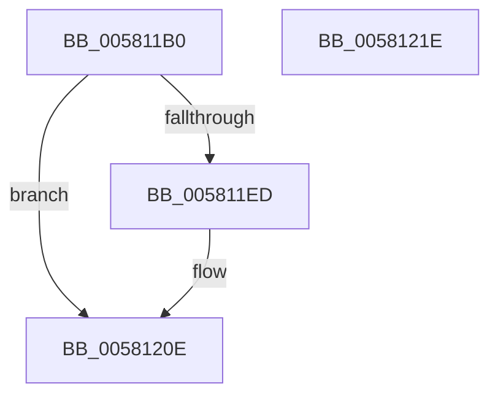

# FsRtlGetNextMcbEntry

- RVA: `0x005811B0`–`0x0058121F` (길이 `111` bytes)
- VA: `0x00000001405811B0`
- 실행 섹션: `.text`
- PDB 이름 있음: `예`; PDB Function 태그: `아니요`
- unwind 정보 RVA: `0x0007F83C`
- 디코드: `33`개 명령, `111/111` bytes 표시
- 미해석 바이트: `0` (있으면 어셈블리에 `.byte`로 보존)

> 이 문서는 커널 이미지의 기계어와 PDB 기호를 분석해 생성했습니다. 4번과 5번은 함수 원형과 자료형을 바이너리 사용 방식에서 추정한 C 해석이며 원본 소스 복구 결과는 아닙니다.

## 1. Dependencies

- 직접 호출 지점: **1**; 고유 호출 대상: **1**
- 직접 호출자로 확인된 함수: **0**
- RIP 상대 이미지 참조: **0**

### Outgoing calls
- `0x005811E4` → [FsRtlGetNextLargeMcbEntry](../40/FsRtlGetNextLargeMcbEntry_function_0040DBB0.md) (function, `0x0040DBB0`)

### Direct callers
- 이 함수 시작 RVA로 연결되는 직접 call은 확인되지 않았습니다. 간접 호출은 완전히 역산할 수 없습니다.

### Static image references
- 디코드된 RIP-relative 메모리 참조가 없습니다.

## 2. Other-region calls and transfers

- 다른 실행 섹션으로 향하는 call: **0**
- 별도 외부 분기/꼬리 이동을 확인하지 못했습니다.

## 3. Assembly (complete function range)

```asm
005811B0  4C 8B DC                        mov r11, rsp
005811B3  49 89 5B 08                     mov qword ptr [r11 + 8], rbx
005811B7  49 89 73 10                     mov qword ptr [r11 + 0x10], rsi
005811BB  57                              push rdi
005811BC  48 83 EC 50                     sub rsp, 0x50
005811C0  33 F6                           xor esi, esi
005811C2  49 8D 43 E8                     lea rax, [r11 - 0x18]
005811C6  49 8B D9                        mov rbx, r9
005811C9  49 89 73 D8                     mov qword ptr [r11 - 0x28], rsi
005811CD  49 8B F8                        mov rdi, r8
005811D0  49 89 73 E0                     mov qword ptr [r11 - 0x20], rsi
005811D4  4D 8D 4B E0                     lea r9, [r11 - 0x20]
005811D8  49 89 73 E8                     mov qword ptr [r11 - 0x18], rsi
005811DC  4D 8D 43 D8                     lea r8, [r11 - 0x28]
005811E0  49 89 43 C8                     mov qword ptr [r11 - 0x38], rax
005811E4  E8 C7 C9 E8 FF                  call 0x14040dbb0
005811E9  84 C0                           test al, al
005811EB  74 21                           je 0x14058120e
005811ED  8B 4C 24 30                     mov ecx, dword ptr [rsp + 0x30]
005811F1  48 8B 94 24 80 00 00 00         mov rdx, qword ptr [rsp + 0x80]
005811F9  89 0F                           mov dword ptr [rdi], ecx
005811FB  48 8B 4C 24 38                  mov rcx, qword ptr [rsp + 0x38]
00581200  83 F9 FF                        cmp ecx, -1
00581203  0F 44 CE                        cmove ecx, esi
00581206  89 0B                           mov dword ptr [rbx], ecx
00581208  8B 4C 24 40                     mov ecx, dword ptr [rsp + 0x40]
0058120C  89 0A                           mov dword ptr [rdx], ecx
0058120E  48 8B 5C 24 60                  mov rbx, qword ptr [rsp + 0x60]
00581213  48 8B 74 24 68                  mov rsi, qword ptr [rsp + 0x68]
00581218  48 83 C4 50                     add rsp, 0x50
0058121C  5F                              pop rdi
0058121D  C3                              ret
0058121E  CC                              int3
```

## 4. C-style interpretation (structured pseudocode)

```c
__int64 __fastcall FsRtlGetNextMcbEntry(__int64 a1, __int64 a2, __int64 a3, __int64 a4, __int64 a5)
{
    __int64 result;
    __int64 v_rsi;
    __int64 v_rsp;
    unsigned int v_stack_m18;
    unsigned __int64 v_stack_m20;
    unsigned int v_stack_m28;
    unsigned __int64 v_stack_p10;
    unsigned __int64 v_stack_p8;

    *(unsigned __int64 *)(v_rsp + 8) = v_rbx;
    *(unsigned __int64 *)(v_rsp + 16) = v_rsi;
    v_rsp = (v_rsp) - (80);
    v_rsi = 0;
    *(unsigned __int64 *)(v_rsp - 40) = 0;
    *(unsigned __int64 *)(v_rsp - 32) = 0;
    *(unsigned __int64 *)(v_rsp - 24) = 0;
    *(unsigned __int64 *)(v_rsp - 56) = v_rsp - 24;
    result = FsRtlGetNextLargeMcbEntry(a1, a2, v_rsp - 40, v_rsp - 32);
    if ((unsigned __int8)(result) != 0) {
        a1 = v_stack_m28;
        a2 = a5;
        *(unsigned int *)(a3) = (unsigned int)(a1);
        a1 = v_stack_m20;
        if (((unsigned int)(a1)) == -1) { a1 = 0; }
        *(unsigned int *)(a4) = (unsigned int)(a1);
        a1 = v_stack_m18;
        *(unsigned int *)(a2) = (unsigned int)(a1);
    }
    v_rsp = (v_rsp) + (80);
    return result;
}
```

## 5. (Beta) C Style

```c
int64_t FsRtlGetNextMcbEntry(int64_t Arg1, int64_t Arg2, void *Arg3, void *Arg4, void *Arg5)
{
    uint8_t *arg3 = (uint8_t *)Arg3;
    uint8_t *arg4 = (uint8_t *)Arg4;
    uint8_t *arg5 = (uint8_t *)Arg5;

    int64_t result;
    int64_t local_rsi;
    int64_t local_rsp;
    uint32_t v_stack_m18;
    uint64_t v_stack_m20;
    uint32_t v_stack_m28;
    uint64_t v_stack_p10;
    uint64_t v_stack_p8;

    *(uint64_t *)(local_rsp + 0x8) = local_rbx;
    *(uint64_t *)(local_rsp + 0x10) = local_rsi;
    local_rsp = (local_rsp) - (80);
    local_rsi = 0;
    *(uint64_t *)(local_rsp - 0x28) = 0;
    *(uint64_t *)(local_rsp - 0x20) = 0;
    *(uint64_t *)(local_rsp - 0x18) = 0;
    *(uint64_t *)(local_rsp - 0x38) = local_rsp - 24;
    result = FsRtlGetNextLargeMcbEntry(Arg1, Arg2, local_rsp - 40, local_rsp - 32);
    if ((uint8_t)(result) != 0) {
        Arg1 = v_stack_m28;
        Arg2 = Arg5;
        *(uint32_t *)(arg3) = (uint32_t)(Arg1);
        Arg1 = v_stack_m20;
        if (((uint32_t)(Arg1)) == -1) { Arg1 = 0; }
        *(uint32_t *)(arg4) = (uint32_t)(Arg1);
        Arg1 = v_stack_m18;
        *(uint32_t *)(Arg2) = (uint32_t)(Arg1);
    }
    local_rsp = (local_rsp) + (80);
    return result;
}
```

### 관측된 메모리 오프셋

구조체 형식이 확인되지 않은 접근은 인자 기준의 오프셋으로만 기록했습니다.

| 기준 인자 | 오프셋 표현 | 폭 (bit) | 접근 |
|---|---:|---:|---|
| `Arg3` | `+ 0x0` | `32` | `W` |
| `Arg4` | `+ 0x0` | `32` | `W` |
| `Arg5` | `+ 0x0` | `32` | `W` |

## 6. Execution-region graph

[열기: 2D/3D 그래프와 함수 탐색 컨트롤 패널](../../../control-panel.html?section=text&rva=0x005811B0&view=graph)

- 2D 그래프는 위에서 아래로 흐르고, 3D 그래프는 빈 공간을 드래그해 회전합니다. Shift+드래그는 이동, 휠은 확대·축소, 함수 노드 선택은 대상 보고서 이동입니다.

### Static fallback


